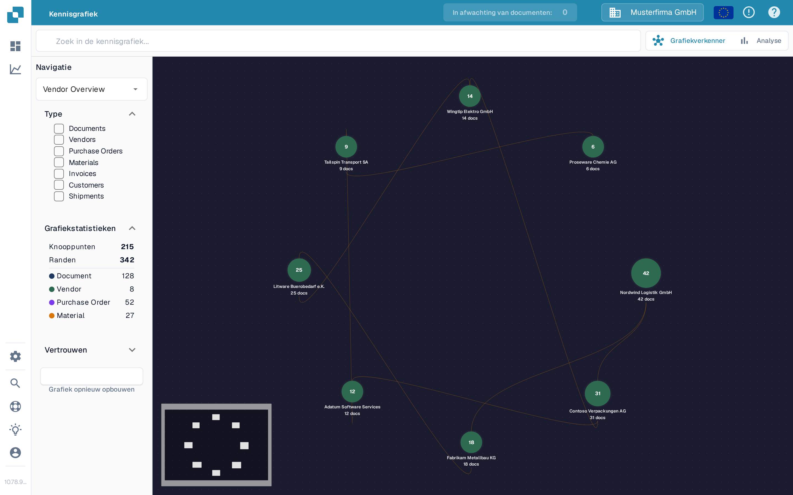

# Kennisgrafiekverkenner

De **Kennisgrafiekverkenner** helpt u verbindingen te zien tussen leveranciers, documenten, inkooporders en andere gegevens. Gebruik hem wanneer u een relatie wilt volgen of wilt controleren hoeveel verbonden items beschikbaar zijn. Het voorbeeld hieronder toont een grafiek in de Nederlandstalige Sandbox-testorganisatie.

<figure><figcaption>
De voorbeeldgrafiek toont verbonden leveranciers. Zoek een item of bouw de grafiek opnieuw op om uw eigen verbindingen te zien.
</figcaption></figure>

## Aan de slag

1. Open **Grafiekverkenner** in DocBits. Controleer of de organisatie die bovenaan wordt getoond, de organisatie is die u wilt inspecteren.
2. Staat in het midden **Search for a node or compute the graph to get started**, kies dan **Grafiek opnieuw opbouwen** en wacht tot het voortgangsbericht is voltooid. Dit bereidt de grafiekgegevens voor; dit kan even duren. Heeft de organisatie nog geen overeenkomende relaties, dan kunnen **Knooppunten** en **Randen** op nul blijven.
3. Voer een naam of een andere zoekterm in in **Search knowledge graph** en druk op Enter of selecteer het zoekpictogram. Verschijnen meerdere resultaten, kies dan het gewenste resultaat. Eén enkel resultaat opent de bijbehorende grafiek direct.
4. Selecteer een knooppunt om de details ervan te zien. Sluit het detailpaneel met **X** wanneer u terug wilt naar de grafiek.

## Kies wat u ziet

| Bedienelement                  | Wat het doet                                                                                                                                                                                                                  |
| ------------------------------ | ----------------------------------------------------------------------------------------------------------------------------------------------------------------------------------------------------------------------------- |
| **Navigatie**                  | Schakelt tussen **Vendor Overview** (verbonden leveranciers), **Vendor Intelligence** (een leverancierstabel), **Document Journey** (stappen en varianten in documentverwerking) en **Anomalies** (ongebruikelijke relaties). |
| **Type**                       | Selecteer de soorten items waarop u zich wilt richten, zoals Documents, Vendors, Purchase Orders of Invoices. Geselecteerde types beperken ook de zoekresultaten.                                                             |
| **Grafiekstatistieken**        | Toont het aantal knooppunten (items) en randen (verbindingen) dat momenteel beschikbaar is. Vouw dit sectie in of uit zoals u wilt.                                                                                           |
| **Vertrouwen**                 | Open deze sectie om de minimale relatiebetrouwbaarheid in te stellen bij het uitvouwen van een knooppunt. Een hogere waarde beperkt de getoonde verbindingen.                                                                 |
| **Grafiek opnieuw opbouwen**   | Start een nieuwe grafiekberekening. Wacht tot de berekening is voltooid voordat u opnieuw zoekt.                                                                                                                              |
| **Grafiekverkenner / Analyse** | Schakelt tussen de interactieve grafiek en overzichtsdiagrammen. **Analyse** toont aantallen en diagrammen wanneer grafiekgegevens bestaan; een lege grafiek laat ook **Analyse** leeg.                                       |

Als u een verschil tussen een factuur en de bijbehorende order wilt oplossen, gaat u verder met het [Scherm voor het vergelijken van inkooporders](../end-user-and-partner-section/end-user-section/purchase-order-matching/). Voor bredere statistieken buiten de grafiek zie het [Analytics Dashboard](../administration-and-setup/analytics-dashboard.md).
