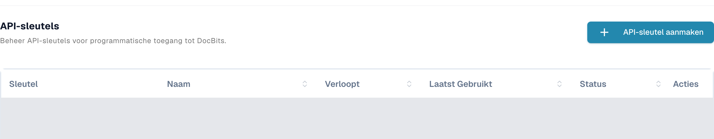
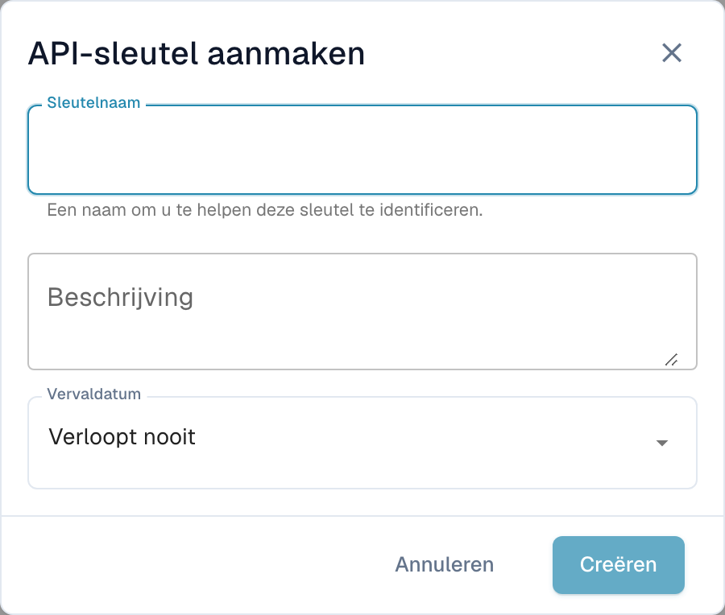

# Postman voor DocBits

Met Postman kunt u HTTP-verzoeken naar de DocBits-API sturen. Begin met een alleen-lezenverzoek in een omgeving waarvoor u toestemming hebt. Gebruik aparte Postman-omgevingen voor testen en productie en bewaar inloggegevens in privévariabelen of een kluis voor geheimen.

## Configuratie

### DocBits-API

Open de API-documentatie van de juiste omgeving, bijvoorbeeld de [Sandbox-API](https://sandbox.api.docbits.com/docs) of de [productie-API](https://api.docbits.com/docs). Gebruik de huidige paden van de bewerkingen en de waarde **Servers** die daar wordt weergegeven. Een relatief serverpad wordt achter de API-oorsprong geplaatst.

In de [hier gecontroleerde Dev-documentatie](https://eu.dev.api.docbits.com/docs) is dit pad `/dev-api`. De volledige basis-URL is dus `https://eu.dev.api.docbits.com/dev-api`. Andere omgevingen kunnen een ander serverpad gebruiken.

De API-specificatie beschrijft verschillende afzonderlijke headerschema’s:

| Header | Doel |
| --- | --- |
| `X-ORG-ID` | Identificeert de doelorganisatie als de bewerking dit vereist. |
| `Authorization` | Bevat de autorisatiewaarde die het betreffende authenticatiemechanisme vereist. |
| `X-API-KEY` | Bevat een API-sleutel voor bewerkingen die dit schema gebruiken. |

Deze headers zijn niet onderling uitwisselbaar. Het algemene dialoogvenster **Authorize** toont de beschikbare schema’s; niet elke bewerking heeft alle headers nodig. Raadpleeg de parameters en autorisatie-informatie van de specifieke bewerking.

Vraag de juiste inloggegevens aan uw beheerder. Bevoegde gebruikers vinden het sleutelbeheer onder **Integratie & SSO → API-sleutels** in de DocBits-instellingen. De lijst toont het sleutelvoorvoegsel, de naam, de vervaldatum, het laatste gebruik en de status. Bestaande rijen zijn op de afbeelding afgedekt.

<figure><figcaption><p>Werkelijke Dev-weergave in het Nederlands: API-sleutels, de knop API-sleutel aanmaken en de kolommen Sleutel, Naam, Verloopt, Laatst Gebruikt, Status en Acties; bestaande rijen zijn afgedekt.</p></figcaption></figure>

**API-sleutel aanmaken**, boven de lijst, opent eerst een leeg formulier met **Sleutelnaam**, **Beschrijving** en **Vervaldatum**. Pas door het formulier te verzenden wordt een sleutel aangemaakt. Het afgebeelde formulier is met **Annuleren** gesloten, zonder het te verzenden. Er is geen sleutel aangemaakt, weergegeven, gekopieerd of ingetrokken. Maak alleen sleutels aan binnen uw bevoegdheden en volgens de regels van uw organisatie.

<figure><figcaption><p>Leeg Nederlandstalig formulier API-sleutel aanmaken met Sleutelnaam, Beschrijving, Vervaldatum, Annuleren en Creëren; Creëren is uitgeschakeld zolang de naam leeg is.</p></figcaption></figure>

### Een nieuwe werkruimte in Postman maken

Open Postman en gebruik een werkruimte met de juiste zichtbaarheid voor uw organisatie. Maak een omgeving met de variabele `base_url`. De waarde is de volledige basis-URL, inclusief het serverpad. Selecteer die omgeving voordat u een verzoek verstuurt. De [Postman-handleiding voor omgevingen](https://learning.postman.com/docs/use/send-requests/variables/managing-environments/) legt uit hoe u variabelen selecteert en gebruikt.

Maak een verzoek of voeg het toe aan uw verzameling. De onderstaande namen van Postman-bedieningselementen zijn de technische labels van de toepassing; de afbeeldingen hierboven tonen het sleutelbeheer van DocBits in het Nederlands.

## Voorbeeld van de methode "GET"

Selecteer **GET** en de URL `{{base_url}}/version`. Kies onder **Authorization** de optie **No Auth** en vervolgens **Send**. Het gecontroleerde alleen-lezenverzoek in Dev was:

```http
GET https://eu.dev.api.docbits.com/dev-api/version
```

Het eindpunt gaf HTTP 200 terug zonder API-sleutel. Het controleert de bereikbaarheid van de API en geeft versie-informatie terug. Het bewijst geen toegang tot documenten of gebruikers van een organisatie. Controleer de antwoordstatus en inhoud; controleer bij fouten eerst de geselecteerde omgeving, de API-oorsprong en het serverpad.

Selecteer voor een bewerking met een API-sleutel **Authorization → API Key** in Postman. Vul bij **Key** `X-API-KEY` in, gebruik een privégeheim voor **Value** en selecteer **Header** onder **Add to**. Voeg `X-ORG-ID` toe onder **Headers** als de bewerking dat vereist. Raadpleeg de officiële handleidingen voor [API-sleutelautorisatie](https://learning.postman.com/docs/use/send-requests/authorization/authorization-types/#api-key) en [Vault-geheimen](https://learning.postman.com/docs/use/postman-vault/use-vault-secrets/).

## Voorbeeld van de methode "POST"

**POST** kan gegevens aanmaken of verwerking starten. Neem de methode, het pad, de verplichte parameters en het schema van de verzoekinhoud over uit de huidige API-specificatie. Voer deze verzoeken alleen uit voor een specifieke, geautoriseerde taak. Een geslaagde versieaanvraag bewijst niet dat een schrijfverzoek zal slagen.

### Document uploaden

Raadpleeg vóór een upload de momenteel gedocumenteerde bewerking. Als deze multipart-formuliergegevens vereist, selecteert u dat inhoudstype en gebruikt u de opgegeven veldnamen en bestandstypen. Leid deze niet af uit een afbeelding van een oudere API-versie. Voor deze handleiding is geen document geüpload.

## Voorbeeld van de methode "DELETE"

**DELETE** kan gegevens definitief verwijderen. Controleer de specifieke bewerking, de doel-ID en de vereiste rechten. Er is hier geen verwijdering uitgevoerd of als geslaagd getest gepresenteerd.

## Voorbeeld van de methode "PUT"

**PUT** kan bestaande gegevens wijzigen. Gebruik uitsluitend de parameters en het schema van de verzoekinhoud van de huidige bewerking en bevestig de omvang van de gevraagde wijziging. Er is hier geen wijziging uitgevoerd.

## E-mailadres van een gebruiker wijzigen

Haal het pad en de verplichte velden uit de huidige API-specificatie en laat de gebruikerswijziging inhoudelijk controleren voordat u die uitvoert. Deze handleiding gebruikt geen echte gebruikers- of organisatiegegevens en bewijst geen geslaagde wijziging van een e-mailadres.

De huidige Dev-API-specificatie, de versieaanvraag zonder authenticatie en de werkelijke Nederlandstalige DocBits-weergaven van het sleutelbeheer en het lege formulier zijn gecontroleerd. Voor de controle van de weergaven zijn het bevoegde testaccount en leesverzoeken voor UI-metagegevens gebruikt. Er zijn geen sleutels of gebruikers aangemaakt, geen uploads uitgevoerd en geen gegevens gewijzigd of verwijderd. Zakelijke API-bewerkingen op documenten of gebruikersrecords zijn niet getest. In de Postman-toepassing zelf is geen verzoek getest.
