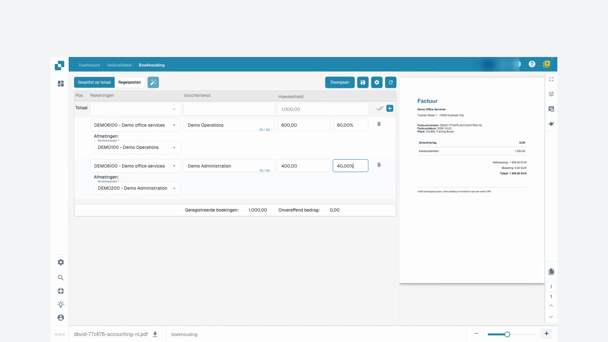
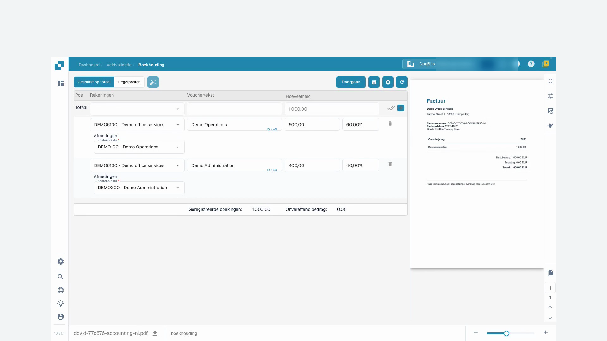

# Boekhouding voor Kostfactuur en Indirecte Verkoop

## Introductie

Welkom bij de module Boekhouding voor Kostfactuur en Indirecte Verkoop! Deze module is ontworpen om u te helpen uw financiële transacties binnen uw ERP-systeem efficiënt te beheren en af te stemmen. Met functies zoals automatische gegevensextractie, documentmatching en gedetailleerde tracking, kunt u ervoor zorgen dat uw financiële gegevens nauwkeurig en up-to-date zijn.

<figure><figcaption></figcaption></figure>

## Aan de Slag

Om de boekhoudmodule te gebruiken, moet u ervoor zorgen dat u de benodigde rechten hebt ingesteld door uw systeembeheerder. U hebt toegang nodig tot zowel de kostprijsboekhouding als de verkoopboekhoudmodules binnen het ERP-systeem.

## Systeemvereisten

* Toegang tot de kostprijsboekhouding en verkoopboekhoudmodules binnen het ERP-systeem.
* Geschikte gebruikersrechten voor het bekijken en verwerken van financiële documenten.

## Belangrijkste Functies

1. **Automatische Gegevensextractie**: Extraheert en interpreteert automatisch gegevens van digitale facturen en andere documenten.
2. **Gegevensvergelijking**: Vergelijkt geëxtraheerde factuurgegevens met bestaande inkoopordergegevens.
3. **Matchverificatie**: Verifieert matches op basis van vooraf gedefinieerde regels en toleranties.
4. **Afwijkingsrapportage**: Identificeert en rapporteert eventuele afwijkingen tussen facturen en inkooporders.
5. **Audit Trail**: Houdt een logboek bij van alle acties voor naleving en controle.
6. **Documenttraining**: Train het systeem om nieuwe documenten te herkennen met minimale inspanning, meestal slechts één keer.
7. **Bedragssplitsing**: Splits bedragen per afdeling voor gedetailleerde financiële tracking.
8. **Grootboekrekeningdefinitie**: Het APS (Accounting and Procurement System) team kan de grootboekrekening definiëren zodra de gegevens zijn geëxtraheerd.

## Gebruikersinterface

De interface van de boekhoudmodule bevat doorgaans de volgende componenten:

* **Dashboard**: Overzicht van factuur- en verkoopstatus en recente activiteiten.
* **Zoek- en Filtertools**: Mogelijkheden om facturen en verkooprecords te zoeken en filteren.
* **Gematchede Records**: Sectie die succesvol gematchte records weergeeft.
* **Afwijkingen**: Sectie die records toont met afwijkingen die moeten worden beoordeeld of aangepakt.
* **Rapporten**: Toegang tot gedetailleerde rapporten en exportopties.

## Stapsgewijze Handleiding voor het Gebruik van de Boekhoudmodule

### 1. Toegang tot de Boekhoudmodule

Navigeer naar de boekhoudmodule vanuit het hoofdmenu van uw ERP-systeem.

### 2. Importeer of Toegang tot Facturen

* **Geautomatiseerde Import**: Als uw systeem is ingesteld voor geautomatiseerde gegevensvastlegging, worden facturen automatisch in het systeem geïmporteerd.
* **Handmatige Upload**: Indien nodig, upload handmatig factuurbestanden in het systeem via de verstrekte interface.

### 3. Automatisch Gematchte Facturen Beoordelen

* Beoordeel facturen die automatisch zijn gematcht met inkooporders.
* Verifieer de details van de match, inclusief artikelnummers, hoeveelheden en prijzen.

### 4. Afwijkingen Behandelen

* Ga naar de sectie Afwijkingen om facturen te beoordelen die niet automatisch konden worden gematcht.
* Pas indien nodig handmatig hoeveelheden of prijzen aan, of markeer de factuur voor verdere beoordeling.

### 5. Handmatige Matching

Voor facturen die niet automatisch zijn gematcht:

* Gebruik de zoek- en filtertools om de bijbehorende inkooporder te vinden.
* Verifieer en match de factuur handmatig met de inkooporder.

### 6. Train het Systeem

* Voor nieuwe documenttypen, train het systeem om ze te herkennen door een voorbeeld te geven.
* Meestal hoeft u het systeem slechts één keer te trainen om vergelijkbare documenten in de toekomst nauwkeurig te herkennen.

### 7. Boekingen Registreren

* Navigeer naar het tabblad "Regelitems" om boekingen voor elke factuur te bekijken en te registreren.
* Wijs de bedragen toe aan de juiste rekeningen, kostenplaatsen en dimensies specifiek voor Infor LN/M3.

**Voorbeeld: Een Kostfactuur Boeken**

1. **Selecteer Regelitem**: Kies het regelitem voor de kostfactuur.
2. **Wijs Rekening Toe**: Wijs de juiste rekening toe, zoals "71200 - Niet-operationele Kosten".
3. **Stel Dimensies In**: Stel aanvullende dimensies in zoals kostenplaats, productgroep en project.
4. **Bedrag Splitsen**: Splits indien nodig het bedrag per afdeling voor gedetailleerdere tracking.
5. **Voer Bedrag In**: Voer het bedrag voor het regelitem in.

### 8. Grootboekrekeningen Definiëren

* Zodra de gegevens zijn geëxtraheerd, kan het APS-team de grootboekrekeningen definiëren.
* Dit zorgt ervoor dat elke transactie onder de juiste rekening wordt geregistreerd voor nauwkeurige financiële rapportage.

### 9. Rapporten Genereren

* Ga naar de sectie "Rapporten" om gedetailleerde rapporten over financiële transacties te genereren.
* Gebruik exportopties om rapporten op te slaan voor verdere analyse of archivering.

### Voorbeeld Gebruik

1. **Documenten Uploaden**: Gebruikers kunnen verschillende documenten (facturen, afleverbonnen, etc.) naar het systeem uploaden.
2. **Automatische Matching**: Het systeem matcht automatisch de geüploade documenten met bestaande inkooporders.
3. **Matches Beoordelen**: Gebruikers kunnen de matches beoordelen, details verifiëren en statusindicatoren bekijken.
4. **Afwijkingen Oplossen**: Eventuele mismatches of afwijkingen worden gemarkeerd voor de gebruiker om handmatig te beoordelen en te corrigeren.
5. **Gegevens Exporteren**: Gematchte gegevens kunnen worden geëxporteerd voor verdere verwerking of archivering.

## Videohandleiding: Een onkostenfactuur verdelen

De persoon en stem zijn synthetisch. De opname toont de echte DocBits-testinterface met synthetische trainingsfacturen.


Een onkostenfactuur verdelen


[Bekijken met ondertiteling en hoofdstukken](https://docbits-videos.fra1.cdn.digitaloceanspaces.com/settings-assistant/cost-invoice-accounting-customer/v2/nl.html)

Sommige oorspronkelijke productlabels kunnen in een andere taal staan. Technische veld-ID’s blijven behouden.

In de opgenomen interface toont de kolom « Hoeveelheid » hier het geldbedrag van de verdeling. « Geregistreerde boekingen » is het toegewezen totaal en « Onvereffend bedrag » het nog toe te wijzen restant. « Vouchertekst » bevat de omschrijving van de boekingsverdeling. De namen van de demonstratierekeningen en kostenplaatsen zijn ingestelde waarden. Deze verdeling bevestigt geen betaling of boeking in het ERP.

Eerst controleer ik onze originele trainingsfactuur. De leverancier, het factuurnummer en het bedrag moeten overeenkomen met het document. In dit voorbeeld is het duizend euro zonder btw. De factuur bevat geen inkooporder.

Ik open de boeking en werk met de verdeling op basis van het totaalbedrag. De beschikbare grootboekrekeningen en kostenplaatsen zijn vooraf door onze beheerder ingesteld. Ik kies alleen waarden die zakelijk gezien logisch zijn voor deze factuur.

Met de verdeelfunctie maak ik twee subregels aan. DocBits begint hier met een gelijkmatige verdeling. Maar voor ons voorbeeld heb ik zestig en veertig procent nodig. Het oorspronkelijke factuurbedrag blijft duizend euro.

Voor beide subregels selecteer ik de voorbereide grootboekrekening voor kantoordiensten. De eerste regel hoort bij de operationele kostenplaats, de tweede bij de administratie. De kostenplaats is in dit voorbeeld een verplicht veld. Ik voeg ook een duidelijke boekingstekst toe.

In de eerste regel vul ik zestig procent in en bevestig met Enter. Ik wacht tot het bedrag zeshonderd euro aangeeft. Daarna bevestig ik veertig procent in de tweede regel en wacht op vierhonderd euro. Zo controleer ik elke herberekening voordat ik verderga.

Nu controleer ik de twee bedragen, grootboekrekeningen en kostenplaatsen samen. Zeshonderd plus vierhonderd is duizend euro. Het geregistreerde totaal moet ook duizend euro aangeven, en het resterende saldo moet nul zijn. Ik los eventuele verschillen in de totalen op voordat ik opsla.

<figure><figcaption>
Kostenplaatsen met een gecontroleerd totaal van 1.000 euro
</figcaption></figure>

Ik sla de verdeling op en wacht op de bevestiging. Daarna laad ik de factuur opnieuw. Beide kostenplaatsen, de percentages en de bedragen zijn er nog steeds. Ik controleer ook het totaal en het resterende saldo na het herladen.

<figure><figcaption>
Boekingsverdeling opgeslagen en na heropenen gecontroleerd
</figcaption></figure>
