# AI Tabel

De **AI-geëxtraheerde tabel** is de regelitemtabel die DocBits met AI uitleest wanneer een leverancier geen getrainde tabelregels heeft. Ze verschijnt op het validatiescherm onder de koptekstvelden. Deze pagina beschrijft elk bedieningselement rond de tabel: hoe u een verkeerde kolom herstelt, hoe u de AI instructies geeft, hoe u een wijziging test voordat u die bewaart, hoe u ziet wat de AI heeft gedaan, wat de Assistent wel en niet voor u kan doen en wie wat mag opslaan.

## Wanneer u de AI-tabel krijgt

* Een beheerder heeft **AI-tabel extractie** ingeschakeld (Instellingen → Documentverwerking → Classificatie en extractie, zie [Instellingen voor beheerders](./#instellingen-voor-beheerders)). Als deze uitstaat, toont het tabelgebied _AI-tabel wordt hier weergegeven. Inschakelen in …_.
* De leverancier heeft **geen opgeslagen regels**. Zodra iemand de tabel van de leverancier traint en de regels opslaat, vervangen de opgeslagen regels de AI-tabel voor die leverancier. De rijen verschijnen dan in het tabblad **Geëxtraheerde tabel** en het tabblad **AI-geëxtraheerde tabel** is grijs met de tooltip _Tabel AI gedeactiveerd: Er is een op maat getrainde tabel in gebruik._
* Uitzondering: kolommen met de markering **AI gebruiken** in de tabelkolominstellingen worden door de AI gevuld, ook voor leveranciers met opgeslagen regels, zie [AI gebruiken per kolom](./#ai-gebruiken-per-kolom).

Welke AI-tier de tabel leest (Fast, Full, Nexus) wordt per organisatie ingesteld en kan per leverancier worden overschreven, zie Leverancierspecifiek AI-model voor Veld- en Tabelextractie.

## De AI-tabel in één oogopslag

<figure>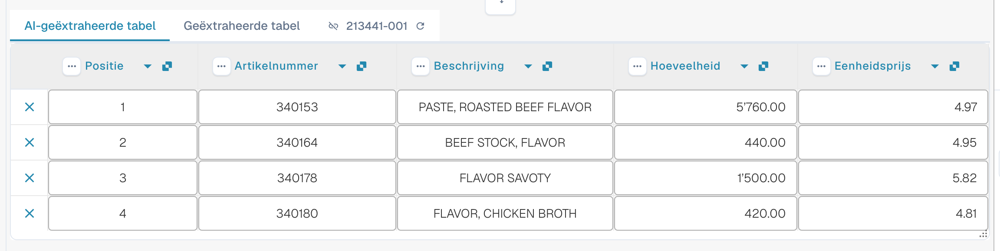<figcaption>
De twee tabbladen, de AI-geëxtraheerde tabel en de bijbehorende kolomkoppen.
</figcaption></figure>

* **Tabbladen.** _AI-geëxtraheerde tabel_ is wat de AI heeft gelezen. _Geëxtraheerde tabel_ is de klassieke tabel uit getrainde regels. Het AI-tabblad wordt standaard geopend wanneer het document een AI-tabel heeft.
* **Kolomkop.** Elke kolom toont zijn naam, een klein **oorsprongssymbool** (houd de muisaanwijzer erop: _AI · kaartweergave_, _AI · synoniem_ en dergelijke vertellen u hoe de AI de kolom heeft gekoppeld), een **menu met drie puntjes** en, bij een gekoppelde kolom, een **naamknop** waarmee u kunt wijzigen om welke kolom het gaat.
* **Rijknoppen.** Het **x** aan het begin van een rij verwijdert die rij. Klik met de rechtermuisknop op een rij voor _Selecteer als extra kosten_ / _Verwijderen als extra kosten_.
* **Werkbalk onderaan.** De pictogrammen onderaan het scherm voegen kolommen en rijen toe of verbergen ze, zie [Werkbalk onderaan](./#werkbalk-onderaan).
* **Kaart Instructies voor de AI** onder de tabel: prompt, extra kolommen, **Test wijziging**, **Toepassen**, **Opslaan als training**, **Verwijderen**, **Exporteren**, zie [Geef de AI instructies](./#geef-de-ai-instructies).


De kolomfuncties werken alleen wanneer u het document kunt bewerken. Als ze grijs zijn, is het document alleen-lezen of in een andere sessie vergrendeld. Als de rode banner meldt dat het document door uw eigen gebruiker in een andere sessie is vergrendeld, neemt **Ontgrendelen** de vergrendeling over.


## Een kolom wijzigen

### De juiste kolom kiezen (herkoppelen)

Gebruik dit wanneer een waarde in de verkeerde kolom staat, bijvoorbeeld wanneer het nettobedrag in _Totaalbedrag_ staat of _Hoeveelheid_ leeg is, terwijl de factuur de waarde wel heeft.

1. Klik op de **kolomnaam** in de kop.
2. Kies de geconfigureerde tabelkolom waartoe de waarden werkelijk behoren.

<figure>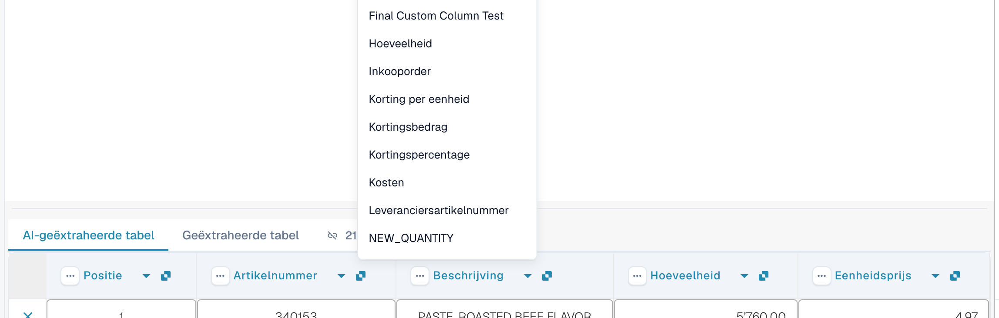<figcaption>
Klik op de kolomnaam en kies de kolom die het moet zijn. De lijst toont elke geconfigureerde tabelkolom.
</figcaption></figure>

DocBits maakt de tabel direct opnieuw op, alleen voor dit document. Als de gekozen kolom al door een andere kolom wordt gebruikt, waarschuwt een dialoogvenster _"…" opnieuw toewijzen?_ dat de andere kolom niet meer gekoppeld zal zijn. Bevestig om door te gaan; de andere kolom toont dan het foutpictogram _Select a column to map from dropdown_, zodat u ook daarvoor een kolom kunt kiezen.

### Het menu met drie puntjes

<figure>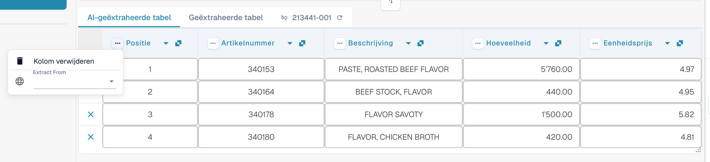<figcaption>
Het menu met drie puntjes van een kolom.
</figcaption></figure>

| Optie                  | Wat het doet                                                                                                                                                                                                                                  |
| ---------------------- | --------------------------------------------------------------------------------------------------------------------------------------------------------------------------------------------------------------------------------------------- |
| **Kolom verwijderen**  | Verbergt de kolom. Een bevestiging meldt _Modifications will be discarded_; kies **Klaar**. De tabel wordt zonder de kolom opnieuw opgebouwd. Gebruik **Tabelkolom herstellen** in de werkbalk onderaan om verborgen kolommen terug te halen. |
| **Kolom uitschakelen** | Voor een kolom die u zelf hebt toegevoegd: verbergt deze zonder de AI opnieuw uit te voeren.                                                                                                                                                  |
| **Bedrag opmaak**      | Alleen voor bedragkolommen. Kies hoe getallen worden gelezen (decimaal- en duizendtalscheidingsteken). **Auto** laat DocBits beslissen.                                                                                                       |
| **Extract From**       | Vertelt de AI de waarde te nemen uit de regel **Above** (boven) of **Below** (onder) het kolomlabel. Laat het leeg als de waarde op de normale plek staat.                                                                                    |

### Werkbalk onderaan

<figure><figcaption>
De tabelpictogrammen onderaan het validatiescherm, van links naar rechts.
</figcaption></figure>

| Pictogram (tooltip)                                                             | Wat het doet                                                                                                                                                                                                                               |
| ------------------------------------------------------------------------------- | ------------------------------------------------------------------------------------------------------------------------------------------------------------------------------------------------------------------------------------------ |
| **Ga naar tabel-extractieweergave**                                             | Opent de klassieke tabeltraining. Als het document een AI-tabel heeft, waarschuwt DocBits: _De tabel is al door AI geëxtraheerd. Wilt u handmatig trainen? In de toekomst wordt de AI-tabel voor deze leverancier niet meer geëxtraheerd._ |
| **Lege toegewezen kolommen toevoegen**                                          | Opent **Kolommeninstellingen** om geconfigureerde kolommen toe te voegen die de AI niet heeft gevuld, zodat u de waarden met de hand kunt invoeren.                                                                                        |
| **Niet-toegewezen kolommen weergeven** / **Niet-toegewezen kolommen verbergen** | Toont of verbergt de kolommen die de AI heeft teruggegeven en die niet aan een geconfigureerde kolom zijn gekoppeld. Standaard zijn ze verborgen. Dit wijzigt alleen de weergave van dit document.                                         |
| **Bloktabelextractie voor deze leverancier**                                    | Schakelt de tabelextractie voor de leverancier uit.                                                                                                                                                                                        |
| **Tabel verwijderen**                                                           | Wist de tabel in de editor.                                                                                                                                                                                                                |
| **Nieuwe tabelkolom toevoegen**                                                 | Voegt een eigen kolom toe. Alleen voor beheerders.                                                                                                                                                                                         |
| **Nieuwe tabelrij toevoegen**                                                   | Voegt een lege rij toe.                                                                                                                                                                                                                    |
| **Negeer tabelvalidatie**                                                       | Negeert de tabelvalidatie voor dit document.                                                                                                                                                                                               |
| **Tabelkolom herstellen**                                                       | Haalt elke kolom terug die u hebt verwijderd.                                                                                                                                                                                              |

<figure>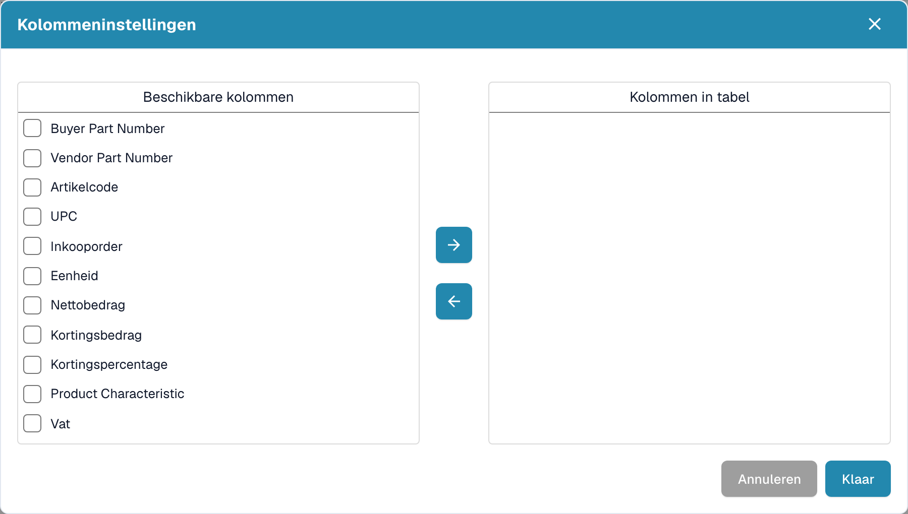<figcaption>
Kolommeninstellingen: verplaats kolommen met de pijlknoppen van <em>Beschikbare kolommen</em> naar <em>Kolommen in tabel</em> en kies daarna <strong>Klaar</strong>.
</figcaption></figure>

## Geef de AI instructies

Onder de tabel vertelt de kaart **Instructies voor de AI** de AI wat die anders moet doen. De kaart heeft twee invoervelden en vier knoppen die u voortdurend gebruikt.

<figure>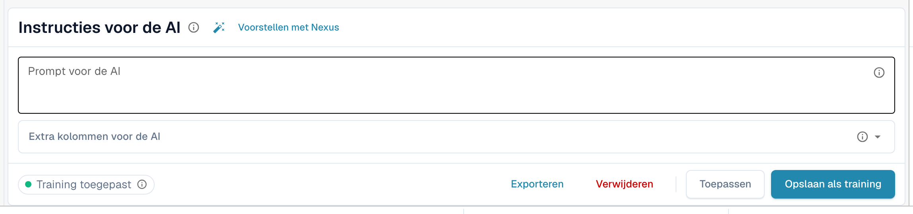<figcaption>
De kaart Instructies voor de AI.
</figcaption></figure>

* **Prompt voor de AI.** Schrijf één instructie per regel, in gewone taal. Typ **@** om een kolomnaam in te voegen, zodat de AI precies weet welke kolom u bedoelt.
* **Extra kolommen voor de AI.** Kies kolommen die de AI naast de gebruikelijke moet teruggeven.
* **Trainingsstatus.** De chip toont **Training toegepast** wanneer bij de laatste run een opgeslagen training is gebruikt, of **Geen training toegepast**.

<figure>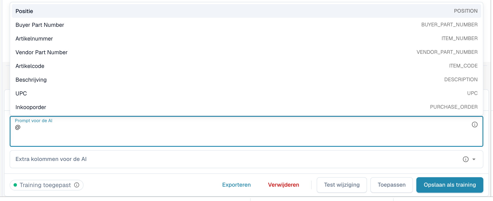<figcaption>
Typ <strong>@</strong> in de prompt om een kolom te kiezen. Zodra er iets is gewijzigd, verschijnt <strong>Test wijziging</strong> naast <strong>Toepassen</strong>.
</figcaption></figure>


Een gewijzigde prompt laat de AI de tabel opnieuw lezen en kan elke kolom veranderen, niet alleen de kolom die u in gedachten had. Controleer daarna de hele tabel.


### Voorstellen met Nexus

Weet u niet wat u moet schrijven? Klik op **Voorstellen met Nexus**. DocBits bekijkt de extractie van dit document en stelt instructies of extra kolommen voor. Er wordt niets toegepast totdat u op **Invoegen** klikt (voegt de regel toe aan uw prompt) of op **Add column** (kolom toevoegen).

<figure>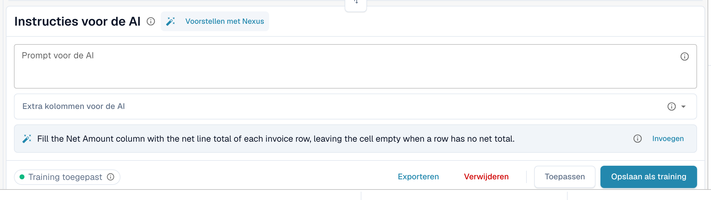<figcaption>
Een voorstel van Nexus. <strong>Invoegen</strong> kopieert het naar de prompt.
</figcaption></figure>

Als uw organisatie de AI-adviseur heeft uitgeschakeld, meldt DocBits dat in plaats van een voorstel te doen.

### Testen, toepassen, opslaan: wat elke knop doet

| Knop                                                | Wat er gebeurt                                                                                                                                                                                                                      | Opgeslagen voor volgende documenten? |
| --------------------------------------------------- | ----------------------------------------------------------------------------------------------------------------------------------------------------------------------------------------------------------------------------------- | ------------------------------------ |
| **Test wijziging**                                  | Voert uw wijziging uit en toont een vergelijking. **Er wordt niets geschreven**, niet naar het document en niet als regel.                                                                                                          | Nee                                  |
| **Toepassen**                                       | Leest de tabel opnieuw met uw wijzigingen en zet het resultaat in dit document in de editor. Het wordt pas permanent wanneer u het document opslaat.                                                                                | Nee                                  |
| **Opslaan als training** (tooltip _Regels opslaan_) | Slaat de prompt, extra kolommen, kolomkoppeling, verborgen kolommen, bedragnotaties en **Extract From**-instellingen op voor deze leveranciersindeling. De volgende documenten met deze indeling worden op dezelfde manier gelezen. | Ja                                   |
| **Verwijderen** (tooltip _Regels verwijderen_)      | Verwijdert de opgeslagen tabelregels van deze leveranciersindeling, zonder extra bevestiging, en voert de AI opnieuw uit zonder die regels. Ook klassieke tabeltraining die voor dezelfde indeling is opgeslagen, wordt verwijderd. | Verwijdert ze                        |
| **Exporteren**                                      | Downloadt de tabel als CSV-bestand.                                                                                                                                                                                                 | Nee                                  |


Koptekst-herkoppelingen, **Kolom verwijderen**, **Bedrag opmaak**, **Extract From** en **Tabelkolom herstellen** gedragen zich als **Toepassen**: ze bouwen de tabel direct opnieuw op voor dit document en worden met het document opgeslagen, niet als regel. Alleen **Opslaan als training** leert DocBits iets voor de volgende documenten.


Als het document al regels heeft die aan een inkooporder zijn gekoppeld, waarschuwen Toepassen en Opslaan dat **u PO-verbindingen kunt verliezen**. Kies **Klaar** om door te gaan en koppel daarna opnieuw.

<figure>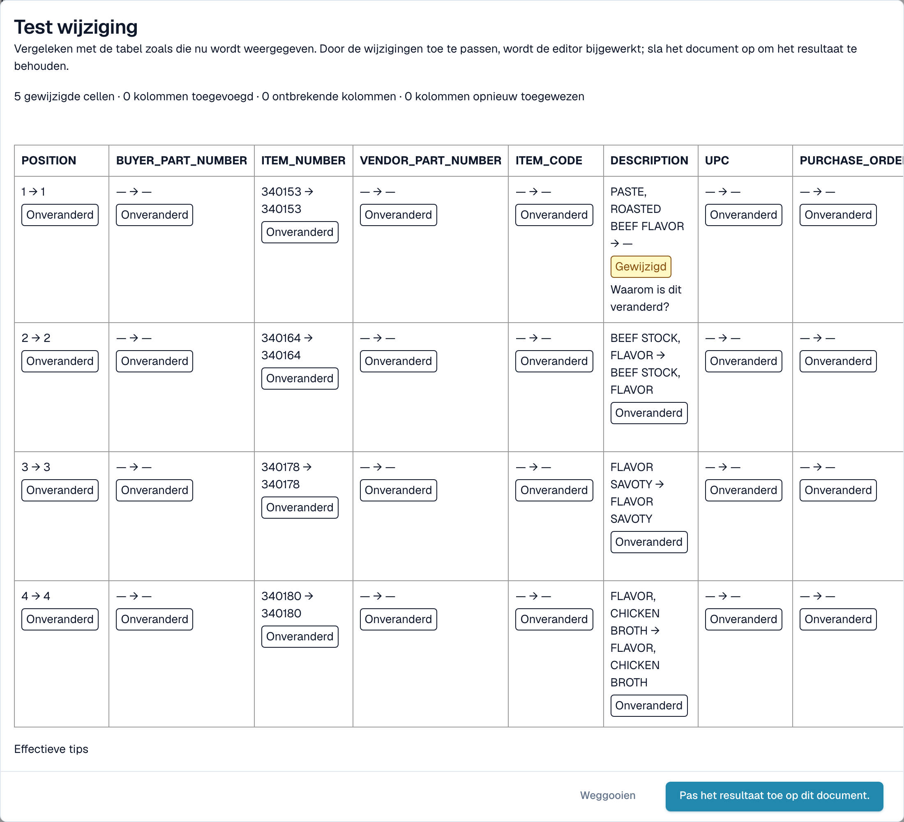<figcaption>
Het dialoogvenster <strong>Test wijziging</strong> vergelijkt het nieuwe resultaat met de tabel die u nu ziet.
</figcaption></figure>

Het dialoogvenster **Test wijziging** telt wat er zou veranderen: gewijzigde cellen, toegevoegde kolommen, ontbrekende kolommen en opnieuw toegewezen kolommen. Elke cel is gemarkeerd als **Toegevoegd**, **Gewijzigd**, **Vermist**, **Herplaatst** of **Onveranderd**. Onderaan toont het dialoogvenster het bewijs voor de run: _Effectieve tips_, _Geselecteerde training_, _Kolombeleid_ en _Verzoekoverrides gebruikt_. Kies **Pas het resultaat toe op dit document.** om het over te nemen (sla daarna het document op) of **Weggooien** om het te verwerpen. Als u de prompt na het testen wijzigt, wordt het resultaat als verouderd gemarkeerd en moet u opnieuw testen.

Na **Opslaan als training** meldt DocBits dat de training bij de volgende verwerking wordt gebruikt; de huidige run heeft die nog niet gebruikt. Controleer bij het volgende document van de leverancier of de chip **Training toegepast** toont.

## Zien wat de AI heeft gedaan

Vier knoppen onder de tabel verklaren de extractie.

<figure>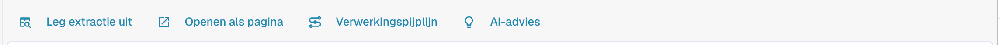<figcaption>
De uitlegknoppen.
</figcaption></figure>

* **Leg extractie uit** opent _Hoe de AI-tabel tot zijn waarden is gekomen_: het document, de AI-extractie (tier, aantal onbewerkte kolommen en rijen), de afbeelding op uw structuur en het resultaat per kolom met de oorsprong van elke kolom.
* **Openen als pagina** toont dezelfde uitleg in een eigen venster.
* **Verwerkingspijplijn** toont de verwerkingsstappen van het document en waar het is gestopt.
* **AI-advies** vraagt Nexus hoe de extractie beter kan en toont concrete aanbevelingen, bijvoorbeeld _Enable structured output_ of _Add an instruction tag → Net Amount_. Het is alleen advies; u beslist.

<figure>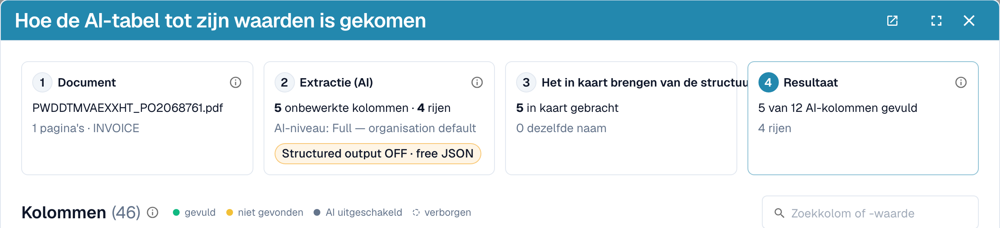<figcaption>
Leg extractie uit: vier stappen van document tot resultaat.
</figcaption></figure>

<figure>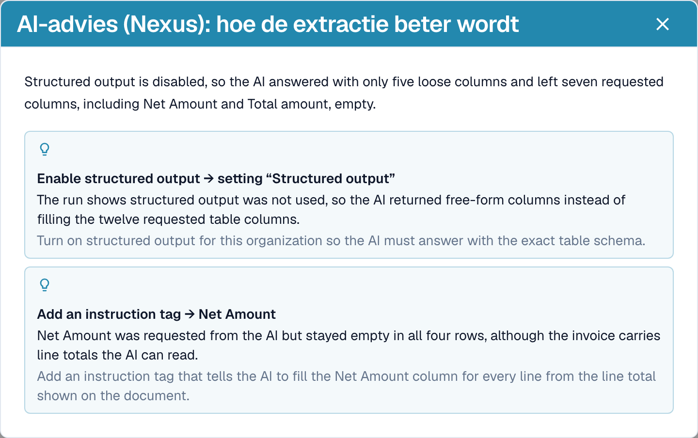<figcaption>
AI-advies stelt de volgende stappen voor.
</figcaption></figure>

<figure>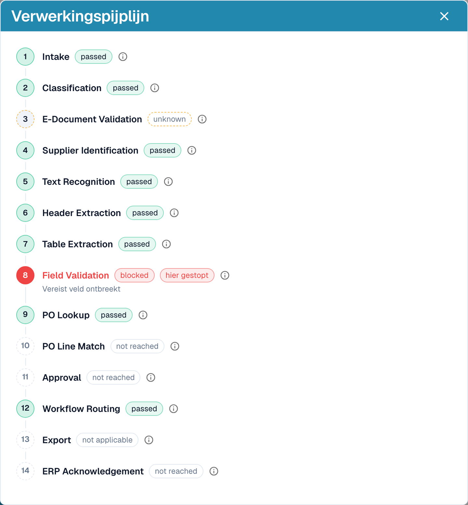<figcaption>
De verwerkingspijplijn toont waar een document is gestopt, hier bij de veldvalidatie.
</figcaption></figure>

Deze uitleg hoort bij de module **Analytics Dashboard**. Zonder modulelicentie, of wanneer uw rol geen toegang heeft tot het tabblad Analytics, vertelt DocBits wat u aan uw beheerder moet vragen (activeer de module onder Instellingen → Modules, of geef uw rol toegang tot het tabblad onder Instellingen → Rollen).

## Praktische voorbeelden

| Situatie                                                                                    | Wat te doen                                                                                                                                                                                                                                                                  |
| ------------------------------------------------------------------------------------------- | ---------------------------------------------------------------------------------------------------------------------------------------------------------------------------------------------------------------------------------------------------------------------------- |
| Een waarde staat in de verkeerde kolom, bijvoorbeeld _Eenheidsprijs_ staat in _Nettobedrag_ | Klik op de kolomnaam en koppel de kolom aan de juiste kolom. Kies daarna **Opslaan als training** als de leverancier het altijd zo afdrukt.                                                                                                                                  |
| Een kolom blijft in elke rij leeg, bijvoorbeeld _Kortingsbedrag_                            | Voeg de kolom toe onder **Extra kolommen voor de AI**, of schrijf een instructie met de bewoordingen van de factuur, zoals _Vul de kolom Kortingsbedrag met de waarden uit de kolom "Rabatt" op de factuur._ Controleer met **Test wijziging** en kies daarna **Toepassen**. |
| De AI weet niet wat te doen (niets in de prompt)                                            | Klik op **Voorstellen met Nexus** en voeg in wat past.                                                                                                                                                                                                                       |
| Een prijs moet worden gedeeld of afgerond                                                   | Schrijf de regel in de prompt, bijvoorbeeld _De eenheidsprijs is het nettobedrag gedeeld door de hoeveelheid_.                                                                                                                                                               |
| Bedragen worden met de verkeerde scheidingstekens gelezen (1.234,50 versus 1,234.50)        | Open het menu met drie puntjes van de kolom, kies **Bedrag opmaak** en selecteer de juiste notatie.                                                                                                                                                                          |
| Het label staat onder de waarde                                                             | Menu met drie puntjes → **Extract From** → **Below**.                                                                                                                                                                                                                        |
| Een kolom is niet nodig voor deze leverancier                                               | Menu met drie puntjes → **Kolom verwijderen**. **Opslaan als training** houdt de kolom voor de leverancier verborgen.                                                                                                                                                        |
| Een rij is fout of ontbreekt                                                                | Verwijder de rij met het **x**, of voeg er een toe met **Nieuwe tabelrij toevoegen** en typ de waarden.                                                                                                                                                                      |
| Dezelfde correcties zijn steeds opnieuw nodig                                               | Gebruik **Opslaan als training**, zodat de volgende documenten van deze leverancier goed uitkomen. Voor complexe indelingen [traint u in plaats daarvan de tabel](../../../administration-and-setup/setup/document-training/training-line-fields-table-training/).           |


Niet elke omgebroken omschrijvingsregel kan met een instructie worden hersteld. Als regels van één artikel over meerdere rijen zijn verdeeld, bewerk dan de rijen of gebruik de klassieke tabeltraining.


## De Assistent en de AI-tabel

Klik op de **Assistent** (lampje naast Opslaan op het validatiescherm) om vragen over het document te stellen.

<figure>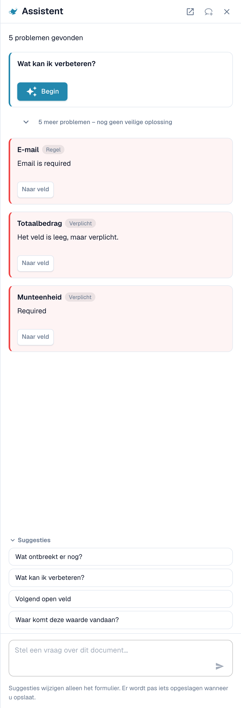<figcaption>
De Assistent toont de openstaande problemen en biedt vragen aan.
</figcaption></figure>

**Wat de Assistent voor tabellen doet.** Hij kan u naar een tabelcel brengen en, als u het document mag bewerken, een tabelcelwaarde instellen of een tabelrij toevoegen. Dit werkt zowel in de AI-geëxtraheerde tabel als in de Geëxtraheerde tabel. Hij beantwoordt ook vragen als _Wat ontbreekt er nog?_ en _Wat kan ik verbeteren?_.

<figure>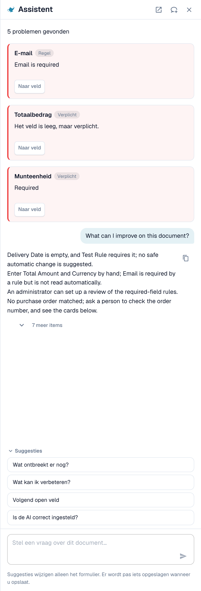<figcaption>
Vraag <em>Wat kan ik verbeteren?</em> voor een korte lijst met wat u hierna kunt herstellen.
</figcaption></figure>

**Wat hij niet doet.** De Assistent wijzigt **geen** AI-instructies, extra kolommen, kolomkoppeling of training. Gebruik daarvoor de kaart **Instructies voor de AI** (**Voorstellen met Nexus**, **Test wijziging**, **Toepassen**, **Opslaan als training**). Beheerders kunnen _Is de AI correct ingesteld?_ vragen om advies over instellingen te zien, bijvoorbeeld over het combineren van AI-tabellezing met opgeslagen tabelregels.

### Een regel voorstellen aan uw beheerder

Veel problemen komen van een **veld**, niet van de tabel: een e-mailadres dat altijd verplicht is maar leeg blijft, een datum in het verkeerde formaat, een leveranciers-ID dat een lookup nodig heeft. Daarvoor kan iedereen die het document kan openen via de Assistent een voorstel indienen:

1. Vraag _Wat kan ik verbeteren?_ of open een bevindingenkaart in de Assistent.
2. Als u beheerder bent, biedt de kaart **Toepassen**. Zo niet, dan staat er _Een beheerder kan dit voorstel beoordelen._ met de knop **Verbetering voorstellen**. Klik erop.
3. DocBits toont _Uw suggestie is naar de beheerders verzonden._ Als iemand eerder dezelfde suggestie heeft gedaan, wordt uw verzoek daarbij geteld in plaats van een tweede aan te maken.
4. De kaart toont daarna **Aangevraagd**, later **Geïmplementeerd** of **Afgewezen** (met de reden, als de beheerder die heeft opgegeven).

Het voorstel kan een **transformatieregel**, een **validatieregel** of een **lookup** zijn. U verstuurt het vanuit het document en de server bouwt het regelconcept zelf op uit het probleem dat is gevonden, dus u hoeft niets te schrijven. Het aantal suggesties is beperkt tot 20 per gebruiker en uur.


**AI-tabelinstructies, kolomkoppeling of training** kunt u op deze manier niet voorstellen. Als een tabel moet worden hersteld, corrigeer het dan in het document en breng een beheerder op de hoogte, of vraag uw beheerder om **Opslaan als training** uit te voeren op een document van die leverancier. Beheerders kunnen regels opslaan; zie [Wie kan wat doen](./#wie-kan-wat-doen).


**Wat de beheerder ziet.** Beheerders worden met een taak en een e-mail op de hoogte gebracht. Ze openen **Touchless Intelligence** en vinden het voorstel onder **Openstaande verbeteringen** (tabblad _Open_, geschiedenis onder _Geschiedenis_). Een klik opent de zijbalk _Verbetersuggestie_ met voorbeelddocumenten en een voorbeeldweergave. De beheerder kan **Goedkeuren** of **Afwijzen**. Bij goedkeuren bepaalt **Direct inschakelen** of de nieuwe regel meteen actief is; zonder deze optie wordt de regel inactief aangemaakt en schakelt de beheerder deze in de regellijst in. Bij afwijzen wordt om een reden en een optionele notitie voor de aanvragers gevraagd. Zie [Touchless Intelligence](../../../administration-and-setup/analytics-dashboard/touchless-intelligence/).

<figure>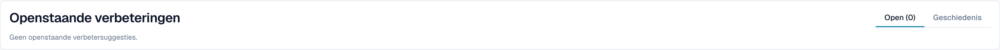<figcaption>
Beheerders vinden voorstellen onder <strong>Openstaande verbeteringen</strong>.
</figcaption></figure>

## Wie kan wat doen

| Actie                                                                                                                                | Wie                                                                                                                                                                                                            |
| ------------------------------------------------------------------------------------------------------------------------------------ | -------------------------------------------------------------------------------------------------------------------------------------------------------------------------------------------------------------- |
| Een kolom herkoppelen, **Kolom verwijderen**, **Bedrag opmaak**, **Extract From**, **Test wijziging**, **Toepassen**, rijen bewerken | Iedereen die het document kan bewerken                                                                                                                                                                         |
| **Opslaan als training**                                                                                                             | Iedereen die kan bewerken, tenzij de organisatie-instelling **Extractieregels opslaan (alleen beheerders)** aanstaat. Dan kunnen alleen organisatiebeheerders regels opslaan; anderen krijgen een foutmelding. |
| **Nieuwe tabelkolom toevoegen**                                                                                                      | Beheerders                                                                                                                                                                                                     |
| Een regel voorstellen via de Assistent                                                                                               | Iedereen die het document kan openen                                                                                                                                                                           |
| Een suggestie goedkeuren of afwijzen                                                                                                 | Beheerders                                                                                                                                                                                                     |
| **Leg extractie uit**, **AI-advies**                                                                                                 | Gebruikers van wie de rol toegang heeft tot de module Analytics Dashboard                                                                                                                                      |

## Instellingen voor beheerders

Open **Instellingen → Documentverwerking → Documenttypen → Classificatie en extractie**, tabblad **Algemeen**, sectie **Extractie**.

<figure>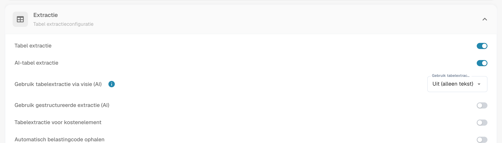<figcaption>
De schakelaars die bepalen of de AI-tabel bestaat.
</figcaption></figure>

* **Tabel extractie** schakelt de klassieke tabel in.
* **AI-tabel extractie** schakelt de AI-tabel voor de organisatie in of uit.
* **Gebruik gestructureerde extractie (AI)**: de AI geeft de tabel terug in een vaste structuur die direct op uw geconfigureerde kolommen wordt afgebeeld, in plaats van de kolomkoppen van de leverancier over te nemen. Kolomnamen komen dan altijd overeen met uw configuratie; een kolom die de leverancier afdrukt maar die u niet hebt geconfigureerd, wordt niet geëxtraheerd.
* **Extractieregels opslaan (alleen beheerders)**: indien ingeschakeld kunnen alleen organisatiebeheerders extractieregels opslaan en exporteren.

<figure>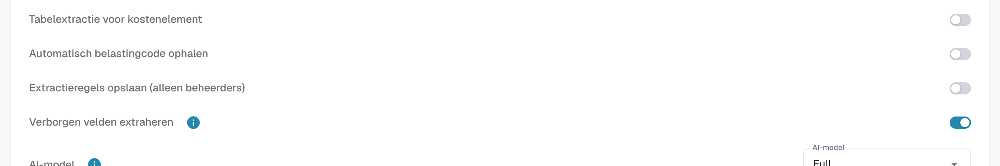<figcaption>
<strong>Extractieregels opslaan (alleen beheerders)</strong> bepaalt wie <strong>Opslaan als training</strong> kan gebruiken.
</figcaption></figure>

### AI gebruiken per kolom

Elke tabelkolom heeft een vlag **AI gebruiken** (Instellingen → Globale instellingen → Documenttypen → [Tabelkolommen](../../../administration-and-setup/settings/global-settings/document-types/table-columns/)). Met de vlag ingeschakeld vult de AI die kolom, ook wanneer de leverancier opgeslagen regels heeft; de andere kolommen blijven uit de regels komen. Typisch gebruik: een vrije-tekstomschrijvingskolom die getrainde regels slecht vastleggen.

De AI leidt die kolom dan af uit de hele rij. Als de AI er consequent de verkeerde waarde in zet, bijvoorbeeld het regeltotaal in _Kosten_, schakel dan **AI gebruiken** voor die kolom uit of voeg een instructie toe die de AI vertelt wat de kolom is.

## Gerelateerde pagina's

* [AI Tabel Tags](ai-table-tags.md)
* [Training Line Fields/Tabel Training](../../../administration-and-setup/setup/document-training/training-line-fields-table-training/)
* [Touchless Intelligence](../../../administration-and-setup/analytics-dashboard/touchless-intelligence/)
