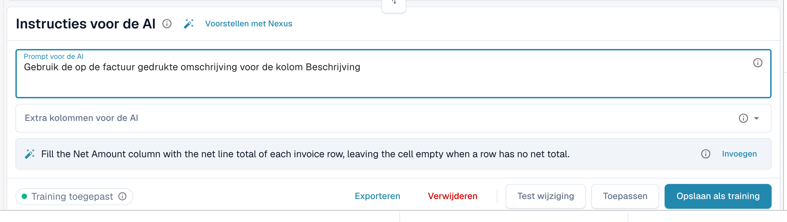

# AI-tabel tags en instructies

Met tags vertelt u de AI wat die met een tabel moet doen. In de kaart **Instructies voor de AI** onder de AI-tabel (zie [AI-tabel](README.md)) geeft u twee soorten tags:

| Soort | Waar u het invoert | Wat de AI ermee doet |
| --- | --- | --- |
| **Instructie** | **Prompt voor de AI**, één instructie per regel | Volgt de instructie bij het lezen van de tabel, bijvoorbeeld hoe te berekenen of welke bewoordingen te gebruiken. |
| **Kolom** | **Extra kolommen voor de AI** | Moet die kolom naast de gebruikelijke teruggeven, ook als het document deze niet duidelijk benoemt. |

Beide worden samen als AI-tags van de leverancier opgeslagen wanneer u **Opslaan als training** kiest.

<figure><figcaption>
Eén instructie per regel in <strong>Prompt voor de AI</strong>.
</figcaption></figure>

## Tags stap voor stap toevoegen

1. Open het document op het validatiescherm en blijf op het tabblad **AI-geëxtraheerde tabel**.
2. Schrijf in **Prompt voor de AI** wat de AI moet doen, één instructie per regel. Typ **@** om een kolom uit uw configuratie in te voegen.
3. Of open **Extra kolommen voor de AI** en kies de kolommen die de AI moet teruggeven.
4. Weet u niet wat u moet schrijven? Klik op **Voorstellen met Nexus** en gebruik **Invoegen** of **Add column** bij een voorstel.
5. Klik op **Test wijziging** om het resultaat met de huidige tabel te vergelijken. Er wordt nog niets geschreven.
6. Tevreden? Klik op **Toepassen** (of op **Pas het resultaat toe op dit document.** in het testvenster) om het resultaat in dit document te zetten.
7. Als elk document van deze leverancier het nodig heeft, klik dan op **Opslaan als training**. **Verwijderen** verwijdert de opgeslagen tags en regels van de leveranciersindeling.


Elke regel in **Prompt voor de AI** is een instructie, zelfs een enkel woord (DocBits voegt een punt toe, zodat de AI het niet voor een kolomnaam aanziet). Kolommen horen in **Extra kolommen voor de AI**.


## Goede instructies schrijven

* **Noem de kolom en de bewoordingen van het document.** *Vul de kolom Kortingsbedrag met de waarden uit de kolom "Rabatt".* werkt beter dan *zoek de korting*.
* **Eén ding per regel.** Korte regels zijn gemakkelijker te testen en te verwijderen.
* **Beschrijf berekeningen eenvoudig.** *De eenheidsprijs is het nettobedrag gedeeld door de hoeveelheid.*
* **Zeg wat met rust moet blijven.** *Negeer de verzendregels onderaan de tabel.*
* **Controleer de hele tabel.** Een gewijzigde prompt voert de AI opnieuw uit en kan elke kolom veranderen.
* **Herhaal niet wat al bekend is.** Een kolomtag die een andere tag dupliceert of gelijk is aan een koptekstveld, wordt genegeerd.

## Voorbeelden

| Probleem | Tag |
| --- | --- |
| De kolom Kortingsbedrag blijft leeg | Extra kolom **Kortingsbedrag** en de instructie *Vul de kolom Kortingsbedrag met de waarden uit de kolom "Rabatt".* |
| Hoeveelheid en eenheid staan in één cel | *Zet het getal in Hoeveelheid en de maateenheid in Eenheid.* |
| De eenheidsprijs is niet afgedrukt | *De eenheidsprijs is het nettobedrag gedeeld door de hoeveelheid.* |
| Datums moeten ISO zijn | *Schrijf alle datums als JJJJ-MM-DD.* |
| Bedragen in een vreemde valuta | *Rond alle bedragen af op twee decimalen.* |

De kolommen die u kunt kiezen zijn de tabelkolommen die voor het documenttype zijn geconfigureerd, zie [Tabelkolommen](../../../administration-and-setup/settings/global-settings/document-types/table-columns/README.md).

## Voordat u opslaat

* **Test wijziging** eerst. Het schrijft nooit iets.
* **Opslaan als training** geldt voor de indeling van de leverancier, zodat de volgende documenten met uw tags worden gelezen. Controleer bij het volgende document of de chip **Training toegepast** toont.
* Als **Extractieregels opslaan (alleen beheerders)** aanstaat, vraag dan een organisatiebeheerder om op te slaan.
* Tags veranderen hoe de AI de tabel leest. Voor stabiele kolomposities van een terugkerende indeling [traint u in plaats daarvan de tabel](../../../administration-and-setup/setup/document-training/training-line-fields-table-training/README.md).
