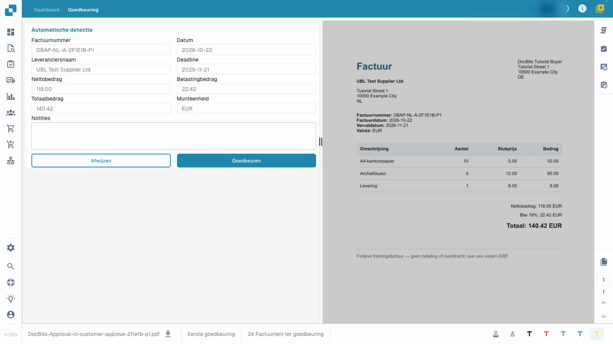
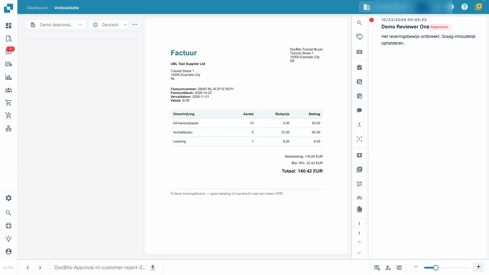

# Een factuur goedkeuren of afwijzen

Deze video toont het goedkeuringsproces vanuit het perspectief van een beoordelaar.


Een factuur goedkeuren of afwijzen


[Bekijk video met ondertiteling](https://docbits-videos.fra1.cdn.digitaloceanspaces.com/settings-assistant/invoice-approval-customer/v1/nl.html)

De echte applicatie wordt getoond. De namen van opties kunnen per gebruikte versie verschillen.

Gebruik goedkeuring om uw inhoudelijke beslissing vast te leggen over een factuur die al is gevalideerd. U heeft toegang tot het document nodig en toestemming voor de huidige goedkeuringsfase. De video gebruikt een gewoon beoordelaarsaccount.

## Beoordelen en beslissen

1. Open de aan u toegewezen factuur en controleer de huidige goedkeuringsfase.
2. Vergelijk het factuurnummer, de leverancier, de datums en het totaal met het origineel. Controleer ook de factuurregels en de belasting. Technische validatie vervangt uw inhoudelijke controle niet.
3. Leg een duidelijke beoordelingsnotitie vast. Keur een correcte factuur goed, of wijs deze af met een specifieke reden wanneer verduidelijking nodig is. Wacht tot de bewerking is voltooid.
4. Heropen het document en inspecteer de goedkeuringsgeschiedenis. Controleer of de beoordelaar, het tijdstip, de beslissing en de volledige notitie correct zijn opgeslagen.

<figure><figcaption>
Ingevuld factuurformulier vergeleken met het origineel.
</figcaption></figure>

<figure><figcaption>
Bewaarde afwijzing met reden.
</figcaption></figure>

## Controleer de volgende fase

Wanneer een tweede goedkeuring is geconfigureerd, laat uw eerste goedkeuring de factuur wachten op een andere geautoriseerde beoordelaar. De factuur is nog niet volledig goedgekeurd. Een afwijzing vereist inhoudelijke opheldering; correctie en herindiening volgen uw geconfigureerde proces.

Een vermelding in de goedkeuringsgeschiedenis bewijst niet dat gegevens een ERP-systeem hebben bereikt. In dit geïsoleerde voorbeeld heeft het ophaalkanaal geen extern ERP-doel. De technische status `pending_data_fetch`, wanneer weergegeven, betekent dat het document wacht op het ophalen van gegevens.

## Gerelateerde pagina's

- [Validatiescherm](validation-screen/README.md)
- [Documenttaken](tasks.md)
