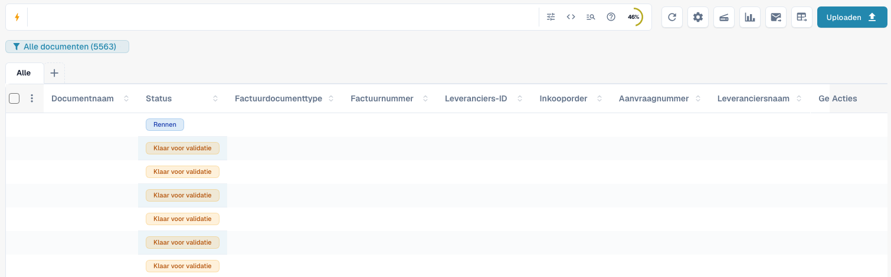
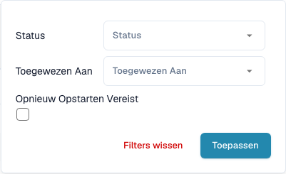
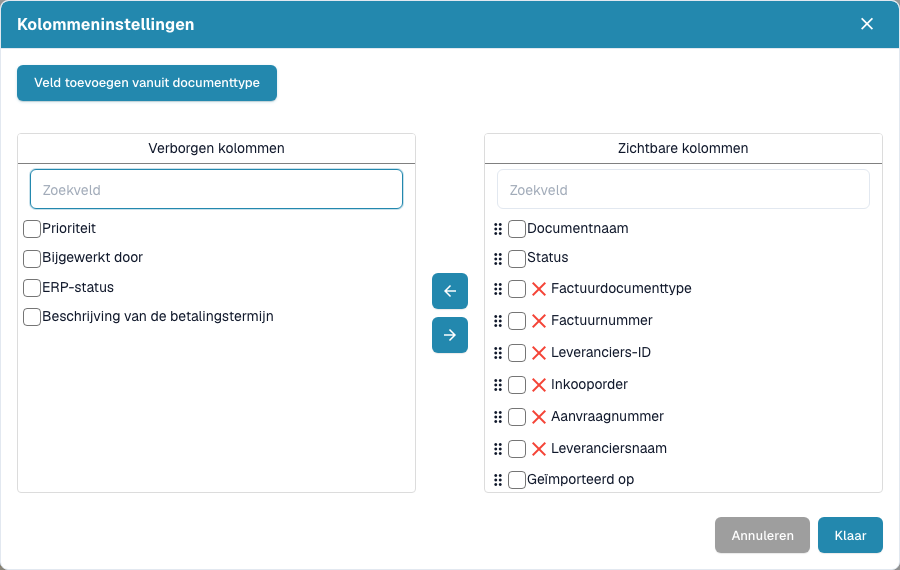
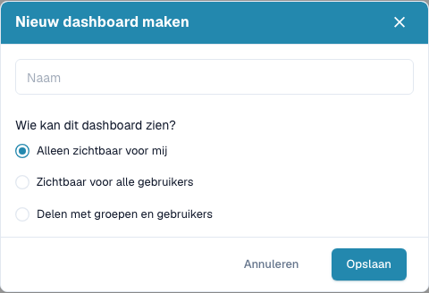
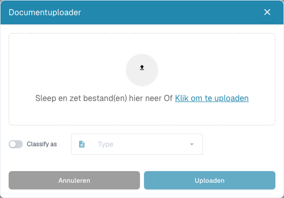

# Dashboard

Het dashboard is uw dagelijkse werklijst in DocBits. Vind geïmporteerde documenten, controleer hun status, open ze voor validatie en verdeel het werk binnen uw team.


De beschikbare functies hangen af van uw rechten, de documentstatus en de ingeschakelde modules van uw organisatie. Sommige beschreven knoppen kunnen ontbreken. In smallere desktopvensters staan extra acties onder **Meer**.


<figure><figcaption>
Het huidige dashboard met zoeken, hulpmiddelen, opgeslagen weergaven, documenttypen en de tabel. Documentwaarden zijn verborgen om gegevens te beschermen.
</figcaption></figure>

## Volledige rondleiding door het dashboard

De klant in Amsterdam laat gecombineerd zoeken met AND, statusfilters, zoekhulp, kolominstellingen, statistieken en vernieuwen zien.



[Open de speler met ondertiteling](https://docbits-videos.fra1.cdn.digitaloceanspaces.com/settings-assistant/dashboard-tour-customer/v4/nl.html) · [Nederlandse ondertiteling (VTT)](https://docbits-videos.fra1.cdn.digitaloceanspaces.com/settings-assistant/dashboard-tour-customer/v4/nl.vtt) · [Transcript](https://docbits-videos.fra1.cdn.digitaloceanspaces.com/settings-assistant/dashboard-tour-customer/v4/nl.txt)

## Uw dagelijkse werk beginnen

1. Controleer de actieve organisatie en, indien beschikbaar, de suborganisatie.
2. Kies een documenttype of laat **Alle** geselecteerd.
3. Zoek en filter de benodigde documenten.
4. Controleer **Status** en **Toegewezen aan** en open de documentrij om het document te behandelen.
5. Vernieuw de lijst na het verwerken of importeren van documenten.

## Documenten zoeken en filteren

Voer een documentnaam, factuurnummer of andere bedrijfswaarde in en druk op **Enter**. Gebruik het pictogram **Filters** (drie schuifbalken) aan het rechteruiteinde van de zoekbalk voor **Status**, **Toegewezen aan** en **Opnieuw opstarten vereist**; kies **Toepassen**. Verwijder afzonderlijke filters of wis de filters als een document ontbreekt. Ook documenttypetabbladen en opgeslagen weergaven beperken de lijst.

Het pictogram **bliksem** aan het begin van het zoekvak opent de veldkeuze. Deze toont eerst de **Slimme filters** — kant-en-klare zoekopdrachten zoals **Verlopen**, **Binnenkort beschikbaar**, **Aan mij toegewezen**, **De inbox van vandaag**, **In afwachting van validatie** of **Elektronische documenten** — en daarna alle doorzoekbare velden. Bij een keuze wordt de bijbehorende voorwaarde in het zoekvak geplaatst.

De zoekbalk biedt gestructureerde zoekfilters, een directe queryweergave en hulp bij velden en syntaxis. Neem veldnamen en voorbeelden uit die hulp over. Technische veldnamen blijven bij een taalwijziging gelijk. Geavanceerde functies hangen af van de ingeschakelde zoekmogelijkheden.

Bij ingeschakeld zoeken in volledige tekst bepaalt het inhoudsmenu hoe gewone tekst wordt gezocht: automatisch zoekt eerst in bedrijfsvelden en daarna in documentinhoud als velden geen treffers geven; inhoud meenemen voegt inhoudstreffers toe; alleen velden beperkt de zoekopdracht tot velden. Een aanduiding laat zien wanneer resultaten uit documentinhoud komen. Een `+` achter het aantal resultaten betekent dat het resultaatvenster begrensd is. Verfijn dan de zoekopdracht.

Als de aparte datumkeuze zichtbaar is, kiest u een vooraf ingestelde of eigen importperiode. Bij zoeken in volledige tekst is deze verborgen; gebruik dan de beschikbare datumvelden in de zoekbalk.

<figure><figcaption>
Filter op status, toegewezen persoon en de noodzaak van een herstart.
</figcaption></figure>

## De documenttabel lezen en indelen

Elke rij is een document. Afhankelijk van de kolommen ziet u naam, status, type, factuurgegevens, leverancier, toegewezen persoon, datums en bedragen. Klik op een sorteerbare kolomkop om de volgorde te wijzigen. Schuif horizontaal voor meer kolommen en gebruik de paginering en het aantal documenten per pagina om resultaten te bekijken.

Als groeperen beschikbaar is, kiest u boven de tabel een groepeerveld. Kies bij datumvelden dag, week of maand. Open een groep om de documenten te bekijken of verwijder de groepering om terug te keren naar de gewone lijst.

Met **+** naast de documenttypetabbladen toont u andere typen. Versleep de tabbladen om ze te ordenen. Een tabblad verwijderen wijzigt alleen de weergave en verwijdert geen documenten.

Open het tandwiel **Geavanceerde instellingen** rechts van de zoekbalk en daarin de knop **Kolommeninstellingen**. Verplaats kolommen tussen de verborgen en zichtbare lijst en versleep zichtbare kolommen om ze te ordenen. U kunt ook velden van een documenttype toevoegen. Zie [Documentkolommen wijzigen](change-document-columns.md).

<figure><figcaption>
Kies en orden de tabelinformatie in de kolominstellingen.
</figcaption></figure>

## Statussen en documentacties begrijpen

Verwerkingsstatussen tonen stappen zoals OCR, classificatie of export. **Klaar voor validatie** betekent dat het document kan worden gecontroleerd. Goedkeuringsstatussen geven aan dat goedkeuring nog nodig is. **Geëxporteerd** geeft aan dat de documentexport klaar is. Klik op de status **Fout** voor beschikbare foutdetails.

Als verwerkingstijden beschikbaar zijn, houdt u de aanwijzer boven een status om de fasen en hun duur te zien. Documenten met mogelijke duplicaten tonen een duplicaatpictogram; open dit om de gerelateerde documenten te vergelijken.

Open een rij om in het validatiescherm te werken. Het actiemenu biedt toegestane bewerkingen, zoals toewijzen, downloaden, geschiedenis bekijken of de verwerking opnieuw starten. Downloadvarianten hangen van het document af en kunnen aantekeningen of elektronische factuurformaten bevatten.

Selecteer meerdere documenten met de selectievakjes en open het menu in de tabelkop voor toegestane bulkacties, zoals toewijzen, samenvoegen, herstarten, export herstarten of verwijderen. Controleer de selectie en iedere bevestiging. Deze acties kunnen documenten wijzigen; een weergave opslaan wijzigt alleen de presentatie van de werklijst.

## Een persoonlijk dashboard opslaan

Open de weergaveknop onder het zoekvak en kies **Nieuw dashboard maken**. Geef het een naam en kies **Alleen zichtbaar voor mij**, **Zichtbaar voor alle gebruikers** of **Delen met groepen en gebruikers**. Bewaar filters, sortering en kolommen voor terugkerend werk.

Selecteer opgeslagen weergaven via hetzelfde menu. Sla latere wijzigingen op als de weergave van u is en is gewijzigd. U kunt een met u gedeelde weergave niet overschrijven: maak een eigen weergave. Delen geeft geen extra documentrechten. Zie [Persoonlijke dashboards](personal-dashboards.md).

<figure><figcaption>
Maak een dashboard met een naam en kies wie het kan zien.
</figcaption></figure>

## Documenten uploaden en hulpmiddelen gebruiken

Kies **Uploaden**, sleep bestanden naar het venster of selecteer ze op uw computer en start de upload. Kies indien beschikbaar via de classificatieoptie expliciet een documenttype. Anders classificeert DocBits de bestanden automatisch.

De andere hulpmiddelen vernieuwen de lijst, openen geavanceerde instellingen, starten een scanner, tonen statusstatistieken, starten de ingestelde e-mailimport of vragen een CSV-/Excel-export aan. Scannen en exporteren vereisen de juiste configuratie. Een tabelexport is een andere handeling dan een document naar uw ERP exporteren. Sla kolomwijzigingen in uw persoonlijke dashboard vóór de export op: de export gebruikt de opgeslagen configuratie. Zie [Dashboard-hulpmiddelen](dashboard-tools.md).

<figure><figcaption>
Upload bestanden en kies zo nodig vóór de import een documenttype.
</figcaption></figure>

## Als een document of knop ontbreekt

Controleer eerst organisatie, actieve weergave, documenttype, zoektekst en filters. Vernieuw de lijst en bekijk andere resultaatpagina’s. Vraag uw beheerder om rechten en modules te controleren als een functie blijft ontbreken.

**Ctrl/Cmd + K** opent de globale snelzoekfunctie; **Ctrl/Cmd + Q** vernieuwt het dashboard; **Ctrl/Cmd + H** opent de hulp. Het menu **Geavanceerde instellingen** bevat de sneltoetsen. De eventuele teller voor openstaande documenten van de hele organisatie is een beheerdersindicator en geen persoonlijke taakenteller.

Gebruik Ctrl op Windows/Linux en Cmd op macOS. Sneltoetsen van browser of besturingssysteem kunnen voorrang hebben.
