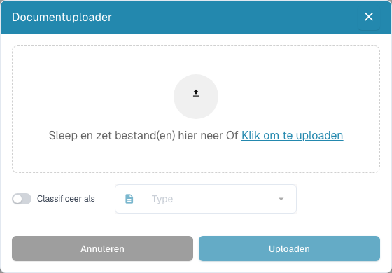

# Dashboard-hulpmiddelen

De hulpmiddelen staan naast het zoekvak. Beweeg de aanwijzer over een pictogram voor het label. Open in smallere desktopvensters **Meer**.

| Hulpmiddel | Gebruik |
| --- | --- |
| Vernieuwen | Laad de lijst en statussen opnieuw. Een wijzigingsindicator betekent dat nieuwere gegevens beschikbaar zijn. |
| Geavanceerde instellingen (tandwiel) | Open **Meer instellingen**, de lijst **Sneltoetsen**, het **Importlogboek** en het venster **Kolommeninstellingen**. Instellingen voor de hele organisatie vereisen beheerdersrechten. |
| Document scannen | Open het scanvenster wanneer scannen is ingeschakeld en een geschikte scanner beschikbaar is. Kies apparaat en instellingen voordat u begint. |
| Analyse | Toon statusstatistieken en kies een categorie om de lijst te filteren. |
| E-mailimport starten | Start een import met de bestaande postvakconfiguratie. Deze actie stelt geen postvak in. |
| Tabel exporteren | Vraag CSV of Excel aan als dit is ingeschakeld. Sla kolomwijzigingen van uw persoonlijke weergave eerst op: de export leest de opgeslagen configuratie. |
| Uploaden | Kies of sleep bestanden, stel eventueel een documenttype in en start de upload. |

<figure><figcaption>
Er zijn nog geen bestanden geselecteerd. ‘Classificeer als’ is uitgeschakeld en het veld ‘Type’ is niet actief; ‘Annuleren’ sluit het venster.
</figcaption></figure>

Controleer e-mailimports in het importlogboek. Filter op onderwerp of afzender en bekijk de beschikbare informatie. Een geslaagde aanvraag voor een tabelexport bevestigt dat de opdracht is verstuurd; dit betekent niet dat een document naar uw ERP is geëxporteerd.

De [dashboardhandleiding](README.md) beschrijft zoeken, documentacties en opgeslagen weergaven.
