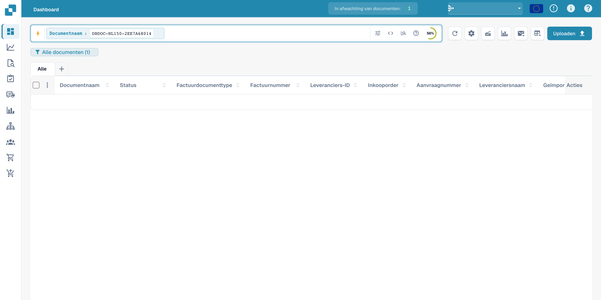
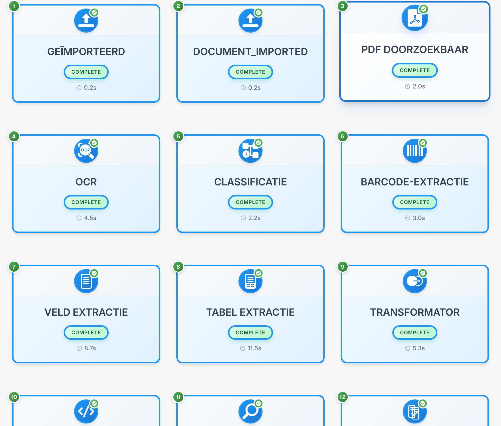

# Documentstroom

De documentstroom toont volgorde, status en duur van de verwerkingsfasen. Het voorbeeld gebruikt een fictieve factuur.

## De documentstroom openen

Zoek het document in het dashboard. Documentwaarden zijn afgeschermd.

<figure><figcaption>
Het fictieve document zoeken in het dashboard; waarden zijn afgeschermd.
</figcaption></figure>

Open de veldvalidatie en het optiemenu in de rechterwerkbalk om de documentstroom te bekijken.

<figure><figcaption>
Validatiemenu om de documentstroom te openen.
</figcaption></figure>

## De fasen lezen

Elke kaart vertegenwoordigt een fase, zoals import, OCR, classificatie of veldextractie. Volg de nummering.

<figure><figcaption>
Verwerkingsfasen van een fictieve factuur; technische codes blijven ongewijzigd.
</figcaption></figure>

Technische codes zoals DOCUMENT_IMPORTED en COMPLETE blijven ongewijzigd. COMPLETE betekent dat een fase is voltooid.

## Details bekijken

Selecteer een kaart om de beschikbare details en logboeken te bekijken.

| Detail | Betekenis |
| --- | --- |
| Module | Verwerkingscomponent van de fase |
| Status | Huidige status van de fase |
| Duur | Vastgelegde verwerkingstijd |
| Logboeken | Beschikbare technische meldingen |

Onderzoek meldingen van een wachtende of mislukte fase voordat u de verwerking opnieuw start. Sommige diagnostische titels kunnen in het product Engelstalig blijven.

De details van een fase tonen de verwerkingscomponent, status, duur en beschikbare technische logboeken.
