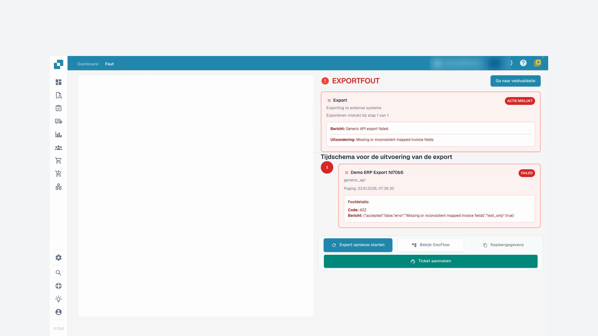
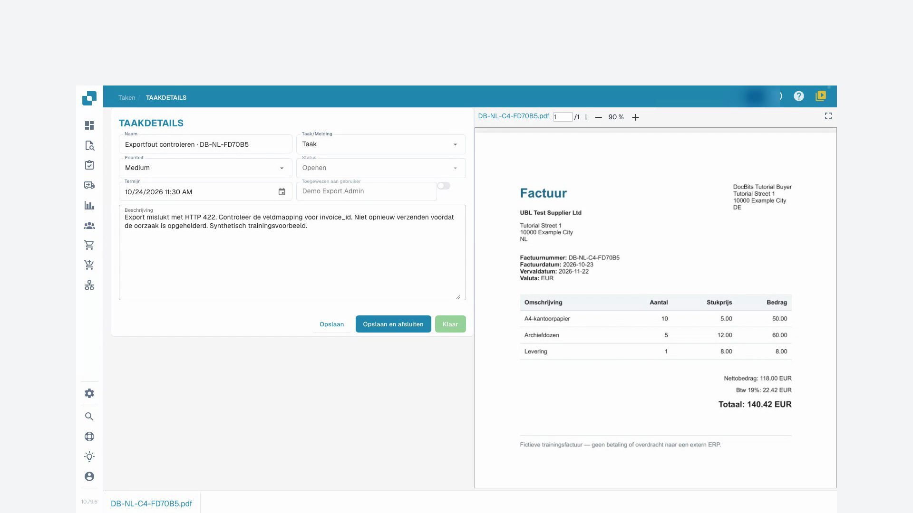

# Documentstatus

Verwerkingsstatussen tonen stappen zoals OCR, classificatie of export. **Klaar voor validatie** betekent dat het document kan worden gecontroleerd. Goedkeuringsstatussen geven aan dat goedkeuring nog nodig is. **Geëxporteerd** geeft aan dat de documentexport klaar is. Klik op de status **Fout** voor beschikbare foutdetails.

Als verwerkingstijden beschikbaar zijn, houdt u de aanwijzer boven een status om de fasen en hun duur te zien. Documenten met mogelijke duplicaten tonen een duplicaatpictogram; open dit om de gerelateerde documenten te vergelijken.

Open een rij om in het validatiescherm te werken. Het actiemenu biedt toegestane bewerkingen, zoals toewijzen, downloaden, geschiedenis bekijken of de verwerking opnieuw starten. Downloadvarianten hangen van het document af en kunnen aantekeningen of elektronische factuurformaten bevatten.

Selecteer meerdere documenten met de selectievakjes en open het menu in de tabelkop voor toegestane bulkacties, zoals toewijzen, samenvoegen, herstarten, export herstarten of verwijderen. Controleer de selectie en iedere bevestiging. Deze acties kunnen documenten wijzigen; een weergave opslaan wijzigt alleen de presentatie van de werklijst.

De [dashboardhandleiding](README.md) beschrijft zoeken, documentacties en opgeslagen weergaven.

## Videohandleiding: Geblokkeerde facturen verder verwerken

De persoon en stem zijn synthetisch. De opname toont de echte DocBits-testinterface met synthetische trainingsfacturen.


Geblokkeerde facturen verder verwerken


[Bekijken met ondertiteling en hoofdstukken](https://docbits-videos.fra1.cdn.digitaloceanspaces.com/settings-assistant/blocked-invoices-customer/v1/nl.html)

Sommige oorspronkelijke productlabels kunnen in een andere taal staan. Technische veld-ID’s blijven behouden.

Ik open de factuur in de veldvalidatie. In dit voorbeeld ontbreekt het factuurnummer. De overige waarden zijn al ingevuld. Ik vergelijk ze met het origineel voordat ik iets verander.

Nu vul ik het factuurnummer in en verlaat ik het veld. Daarna sla ik de factuur op. Ik wacht op de reactie en laad het document opnieuw. Zo zie ik of de correctie echt behouden blijft.

Het nummer staat er nog steeds na het opnieuw openen. De fout van het verplichte veld is opgelost. Opslaan betekent echter nog niet dat de factuur is goedgekeurd of naar het ERP is geëxporteerd.

Bij een tweede factuur toont de lijst een exportfout. Ik open de status en lees de details. De testontvanger heeft de verzonden gegevens afgewezen met foutcode vierhonderdtweeëntwintig. Hier moet de technische mapping worden gecontroleerd. Ik start de export niet zomaar meerdere keren opnieuw.

<figure><figcaption>
Exportfout en antwoord van de ontvanger
</figcaption></figure>

Bij de taken op het document maak ik een duidelijke taak voor onze testbeheerder. Ik noem de foutcode en vraag om het factuurnummer in de mapping te controleren. Voor deze training blijft het verzenden van e-mails uitgeschakeld.

Na het opnieuw laden controleer ik of de taak is opgeslagen en aan de juiste persoon is toegewezen. De taak blijft open totdat de oorzaak is opgehelderd. Een aangemaakte taak is nog geen succesvolle export.

<figure><figcaption>
Opgeslagen overdrachtstaak toegewezen aan de beheerder
</figcaption></figure>
