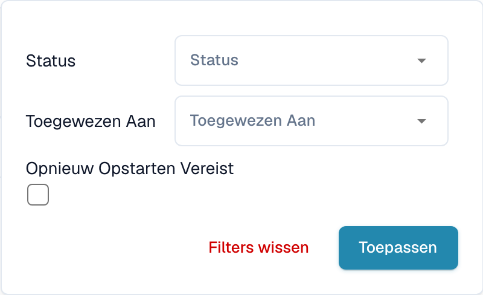

# Documenten filteren

Open in het dashboard de filters naast de zoekbalk. U kunt de lijst beperken op status, toewijzing of een vereiste herstart.

<figure><figcaption>
Dashboardfilters voor toewijzing en vereiste herstart.
</figcaption></figure>

Kies de bedoelde status of verantwoordelijke en pas de filters toe. Wis de filters om de beperkingen op te heffen. Datumopties hangen af van configuratie en weergave. Controleer de actieve filters voordat u het aantal documenten interpreteert.
