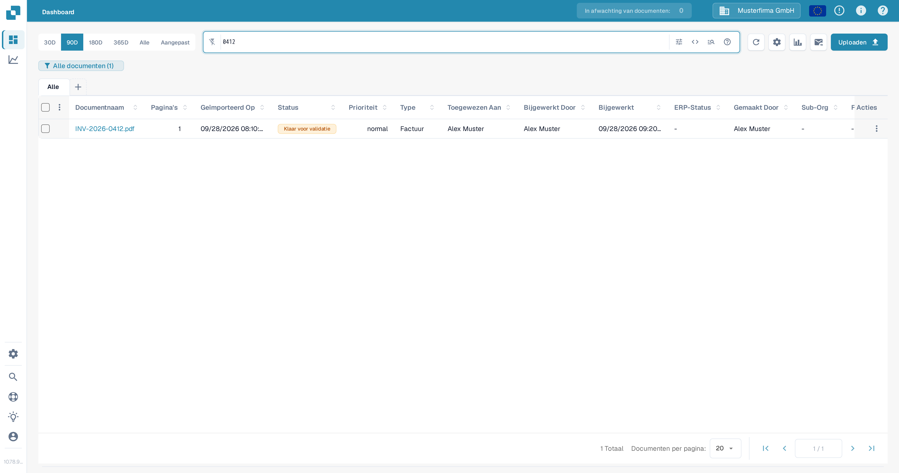
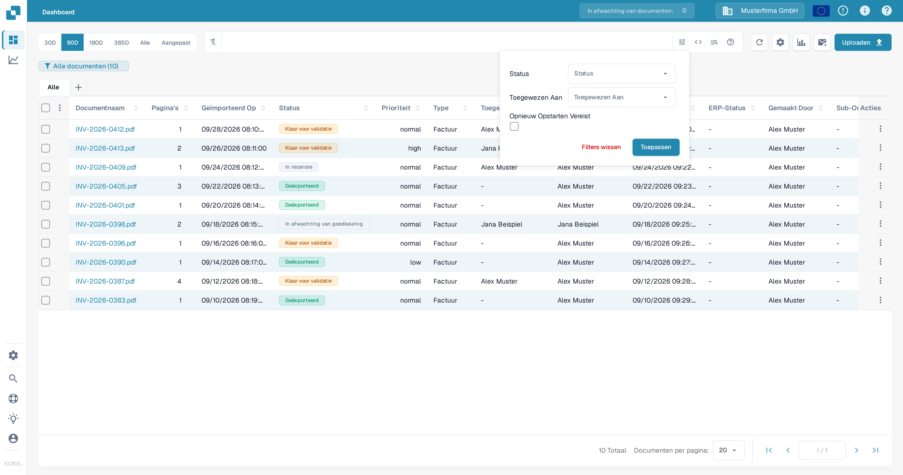
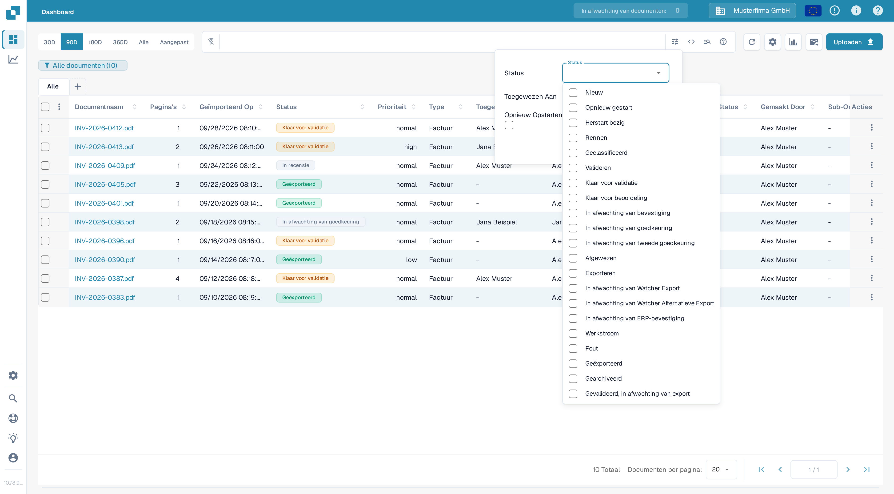
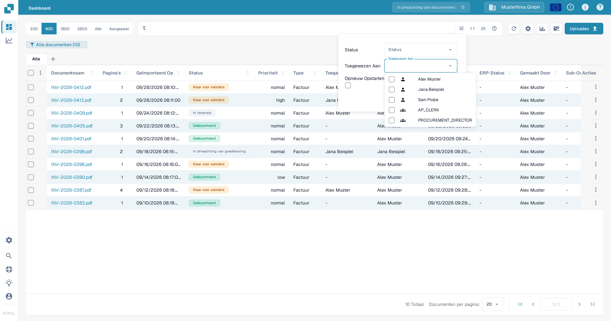
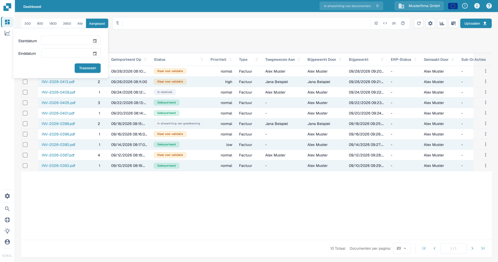
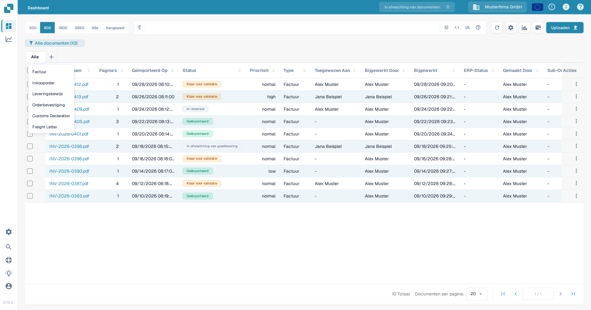
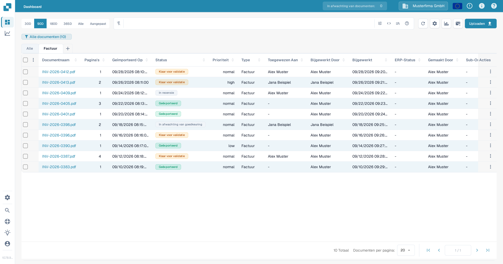

# Documenten filteren

Gebruik de zoekbalk van het Dashboard, het filterpaneel, het datumbereik en de tabbladen voor documenttypen om de documentlijst te beperken. De bedieningselementen werken samen: een document moet overeenkomen met de actieve zoekopdracht en filters om in de tabel te blijven.

## Zoek een document op naam

1. Open het **Dashboard**.
2. Typ een deel van een documentnaam in de zoekbalk boven de tabel en druk op **Enter**. Het aantal in de dashboardbadge en de tabel worden bijgewerkt met de overeenkomende documenten.
3. Vervang de zoekterm wanneer je een ander document zoekt. Voor zoekopdrachten op veld en de zoeksyntaxis, zie [Snel zoeken](quick-search.md).

<figure><figcaption>
Een zoekopdracht op documentnaam beperkt de documentlijst.
</figcaption></figure>

## Filter op status, toewijzing of herstart

1. Selecteer het pictogram **Filters** (schuifregelaars) rechtsbovenaan de zoekbalk.
2. Kies een of meer **Status**-waarden. Je kunt meerdere statussen tegelijk selecteren.
3. In **Toegewezen Aan** selecteer je de gebruikers waarvan je documenten wilt zien. Als je organisatie groepsrechten heeft ingeschakeld, kunnen groepen in dezelfde lijst verschijnen. In dit paneel bestaat geen apart veld **Toegewezen aan groep**.
4. Selecteer **Opnieuw Opstarten Vereist** om documenten te tonen die een herstart nodig hebben.
5. Selecteer **Toepassen**. Selecteer **Filters wissen** in dit paneel om deze selecties te verwijderen; de zoektekst en het datumbereik zijn afzonderlijke bedieningselementen.

<figure><figcaption>
Het huidige filterpaneel heeft drie criteria en twee acties.
</figcaption></figure>

<figure><figcaption>
Selecteer de verwerkingsstatussen die je nodig hebt.
</figcaption></figure>

<figure><figcaption>
Selecteer een gebruiker in Toegewezen Aan.
</figcaption></figure>

Voor een uitleg van elke verwerkingsstatus, zie [Documentstatus](document-status.md).

## Kies een importdatumbereik

Boven de zoekbalk selecteer je **30D**, **90D**, **180D**, **365D** of **Alle** om het datumbereik van de import te wijzigen. Selecteer **Aangepast**, kies **Startdatum** en **Einddatum** en selecteer daarna **Toepassen** voor een specifiek bereik. De huidige keuze is gemarkeerd.

<figure><figcaption>
Gebruik Aangepast als de vooraf ingestelde perioden niet passen.
</figcaption></figure>

## Gebruik de tabbladen voor documenttypen

1. Selecteer **+** naast **Alle**. Het menu toont de documenttypen die voor je organisatie beschikbaar zijn.
2. Selecteer een type, bijvoorbeeld **Factuur**, om het tabblad toe te voegen. Selecteer daarna het nieuwe tabblad om de tabel tot dat type te beperken. **Alle** verwijdert de typebeperking zonder het tabblad te verwijderen.
3. Om een typetabblad te verwijderen, selecteer je de **×**. Het tabblad **Alle** kan niet worden verwijderd.

<figure><figcaption>
Voeg een typetabblad toe via het menu met het plusteken.
</figcaption></figure>

<figure><figcaption>
Kies het tabblad om het typefilter toe te passen; gebruik × om het tabblad te verwijderen.
</figcaption></figure>

Als het menu **+** geen typen toont, vraag dan een beheerder om te controleren welke documenttypen actief zijn voor je organisatie. Zie [Documenttypen](../../../administration-and-setup/settings/global-settings/document-types/README.md). Om een combinatie van filters te bewaren voor later, zie [Persoonlijke Dashboards](personal-dashboards.md).
