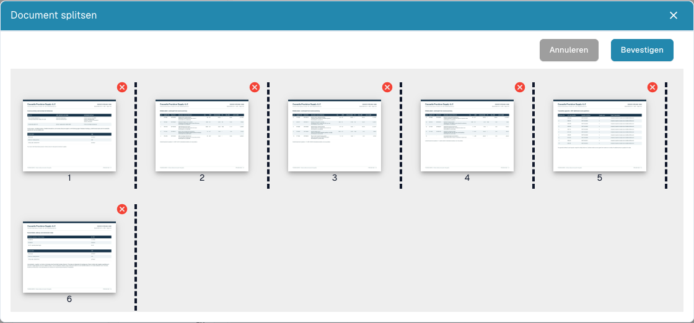

# Een PDF splitsen en pagina's ordenen

<figure><figcaption>
Miniaturen, scheidingen en verwijderknoppen voordat een splitsing wordt ingediend.
</figcaption></figure>

Splits handmatig wanneer één PDF meerdere zelfstandige documenten bevat. Bijvoorbeeld: factuur A op pagina 1–3, factuur B op 4–7 en een pakbon op 8–10. Verwerk elk document afzonderlijk.

## Voorbereiding

U hebt bewerkingsrechten en een document met meerdere pagina's nodig. Bewaar het origineel. Stem een documentvergrendeling af met de verantwoordelijke collega voordat u wijzigingen aanbrengt.

## Stappen

1. Open het document vanuit het dashboard en controleer alle oorspronkelijke pagina's.
2. Open de aanvullende opties in de documentviewer en kies het splitsen van het document.
3. Controleer de genummerde miniaturen. Plaats scheidingen na de laatste pagina van elk bedoeld document: **3** en **7** in het voorbeeld.
4. Sleep miniaturen naar de juiste volgorde. Controleer daarna volgorde en scheidingen opnieuw.
5. Verwijder een pagina met het **rode kruis** uitsluitend wanneer deze moet worden uitgesloten. Een lege scheidingspagina kan overbodig zijn; een btw-specificatie of bijlage kan noodzakelijk zijn.
6. Kies **Bevestigen**, lees de bevestiging en ga verder wanneer de groepen juist zijn. **Annuleren** sluit zonder de splitsing in te dienen.
7. Open elk ontstaan document in het dashboard. Controleer eerste/laatste pagina, aantal pagina's, documenttype en geëxtraheerde waarden.

## Controleren en onderzoeken

Elke oorspronkelijke pagina moet bij een bedoeld document horen of bewust zijn uitgesloten. Splitsen bewijst geen geslaagde extractie, goedkeuring of ERP-export.

Ontbreekt de optie, controleer dan pagina's, rechten, vergrendeling en status. Zonder scheidingen, herordening of verwijderingen kan het venster melden dat niets is gewijzigd. Controleer na een fout eerst het dashboard voordat u een handeling met onzekere uitkomst herhaalt.

Zie [Documenten samenvoegen](document-merging.md) en [Classificatie en extractie](../../../administration-and-setup/settings/document-processing/classification-and-extraction/README.md) voor automatisch splitsen met barcodes.
