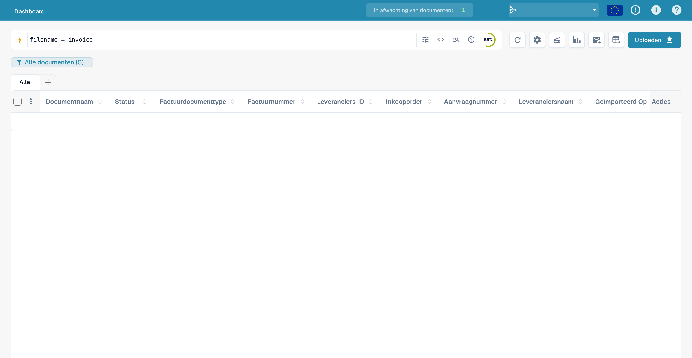
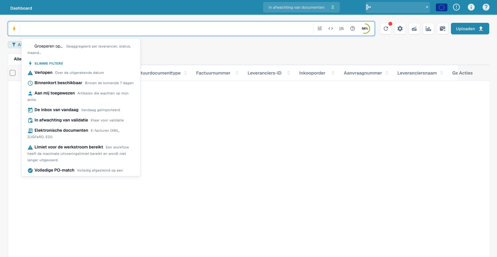
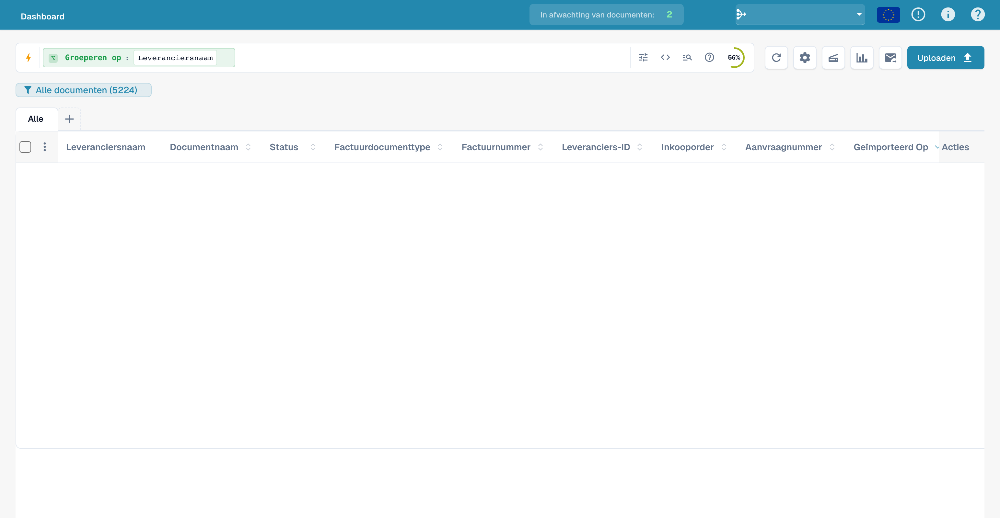
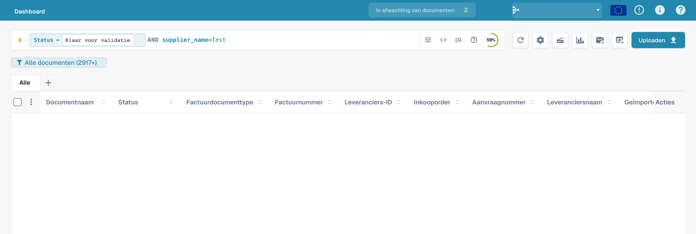
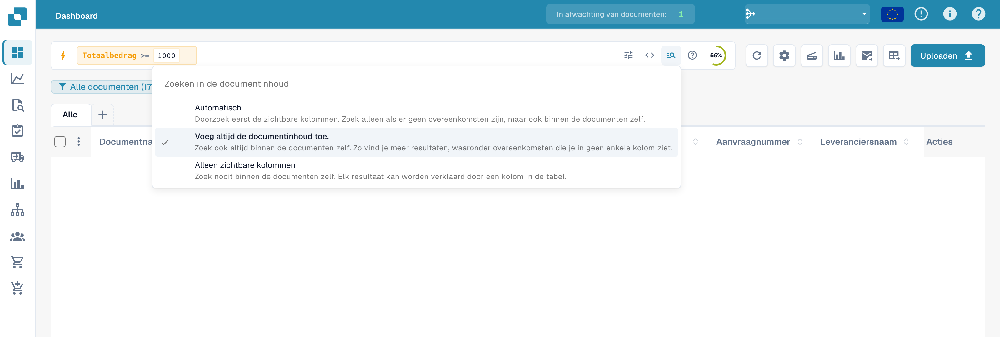
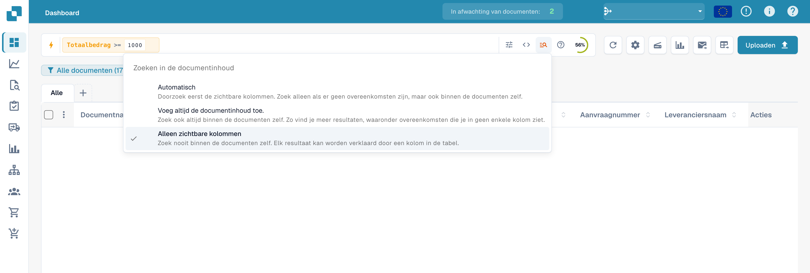

# Snel zoeken

**Snel zoeken** (Quick Search) is de snelste manier om documenten op het dashboard te vinden. U typt wat u zoekt — een naam, een status, een bedrag, een datum — en de
documentlijst filtert direct.

Deze handleiding is opgebouwd zoals het zoeken zelf:

1. **Standaardvelden** — de kolommen die elk document heeft (documentnaam,
   status, datums). Altijd beschikbaar.
2. **Fulltext-velden** — geëxtraheerde inhoud (leverancier, inkooporder, factuurnummer,
   bedragen, regels). Beschikbaar wanneer fulltext-zoeken is ingeschakeld.
3. **Operatoren, sneltoetsen en recepten** — de volledige referentie voor als u
   eenmaal vertrouwd bent met het zoeken.

> U hoeft niets te onthouden: klik in de zoekbalk en kies een veld en een
> waarde uit de lijst — Snel zoeken stelt de query voor u samen. De onderstaande voorbeelden
> tonen ook de getypte vorm, zodat u ze direct kunt kopiëren.

<figure><figcaption><p>Snelzoeken in het Nederlandstalige dashboard.</p></figcaption></figure>

---

## Hoe de zoekbalk werkt — chips, werkbalk en ruwe weergave

Voordat we naar de velden zelf gaan, is het handig te weten hoe de balk is opgebouwd.

### Voorwaarden worden chips

Zodra u een voorwaarde voltooit (een veld, een operator en een waarde) zet Snel zoeken
deze om in een **chip** — een gekleurd pilletje in de balk — en begint een nieuwe. Een
chip toont het **veld**, de **operator** en de **waarde**, met een **×** om hem
te verwijderen. Chips zijn gekleurd naar de plaats waar de gegevens staan:

| Chipkleur | Veldtype |
|-----------|----------|
| **Blauw** | Standaardkolom (documentnaam, status, datums) |
| **Oranje** | Fulltext-/geëxtraheerd veld (leverancier, bedrag, factuurnummer) |
| **Paars** | Vector- (semantisch) zoeken |
| **Groen** | Zoeken in OCR-tekst |

Klik op een chip om hem te bewerken (hij klapt weer uit tot tekst); klik op **×** om hem te verwijderen.
Meerdere chips samen worden standaard gelezen als **AND**.

### De werkbalk

Aan het rechteruiteinde van de balk:

- **ⓘ Help** — opent de ingebouwde referentie **Zoeken in het dashboard — Velden en syntaxis**
  met alle velden, operatoren en sneltoetsen die in uw werkruimte beschikbaar zijn.
- **Filters** (drie schuifbalken) — een snel paneel voor de gangbare filters **Status**,
  **Toegewezen aan** en **Opnieuw opstarten vereist**, met **Filters wissen** en **Toepassen**.
- **Indexring** — een kleine voortgangsring die toont hoeveel van uw fulltext-index
  is opgebouwd (alleen zichtbaar wanneer fulltext-zoeken is ingeschakeld).

### Standaard- versus ruwe weergave

De balk toont uw query normaal gesproken als chips (**standaardweergave**). Schakel over naar de **ruwe
weergave** om de query als platte tekst te zien en te bewerken (bijv.
`status=ready_for_validation AND supplier_name=Test`) — handig om te kopiëren,
te delen of een lange query direct te typen. Uw query blijft behouden bij het wisselen en wordt
onthouden wanneer u het dashboard opnieuw laadt.

---

## Deel 1 — Standaardvelden

Standaardvelden zijn de eigen kolommen van het document. Ze zijn **altijd beschikbaar**,
ongeacht of fulltext-zoeken is ingeschakeld.

### Documenten op naam vinden

De documentnaam is de meest gebruikte zoekopdracht. Er zijn drie manieren om te matchen —
allemaal **hoofdletterongevoelig**:

#### `=` → begint met

```
filename=invoice
```

Vindt documenten waarvan de naam **begint met** "invoice". Hoofdletters worden genegeerd, dus
al deze komen overeen met `filename=invoice`:

```
Invoice.pdf   iNVoice.pdf   iNvoiCE.pdf   INVOICE.pdf
Invoice.xml   iNVoice.xml   iNvoiCE.edi   …
```

Het komt **niet** overeen met `XYZ_Invoice.pdf` (daar staat "invoice" in het midden — gebruik
daarvoor `:`).

<figure><figcaption><p>Een query op bestandsnaam invoeren.</p></figcaption></figure>

#### `:` → bevat (overal)

```
filename:invoice
```

Gebruik `:` om het woord **overal** in de naam te matchen — `2026_Invoice.pdf`,
`vietnam_einvoice_sample.xml`, `scan_invoice_copy.pdf`.

<figure><figcaption><p>Een deel van de bestandsnaam zoeken: filename:invoice.</p></figcaption></figure>

#### `="…"` → begint *of* eindigt met

```
filename="invoice"
```

Met aanhalingstekens matcht `=` namen die met de waarde **beginnen of eindigen** — handig
voor een voorloopcode of een bestandsextensie.

> **De drie in één regel:** `=` → begint met · `:` → bevat · `="…"` →
> begint of eindigt met. Alle negeren hoofd- en kleine letters. U kunt dit op elk moment
> samengevat zien via het **hulppictogram** in de zoekbalk (volgende gedeelte).

### Documenten op status vinden

```
status=ready_for_validation
```

Status is een vaste lijst, dus `=` is een **exacte** match en de balk biedt een
waardekiezer zodra u `status=` typt.

<figure><figcaption><p>Een filter op de technische status ready_for_validation invoeren.</p></figcaption></figure>

### Documenten op datum vinden

```
created_on>2026-05-25
```

Gebruik `>`, `<`, `>=`, `<=` voor datumbereiken. U kunt ook **relatieve** datums gebruiken:
`today()`, `today()-7` (laatste 7 dagen), `today()+30` (komende 30 dagen).

<figure><figcaption><p>Een zoekopdracht voor documenten na 25 mei 2026 invoeren.</p></figcaption></figure>

### Documenten op factuursubtype vinden

```
invoice_sub_type="Cost Invoice"
```

Het factuursubtype is een vaste lijst (bijvoorbeeld **Kostenfactuur** of **Purchase
Invoice**), dus `=` is een **exacte** match en de balk biedt een waardekiezer zodra
u `invoice_sub_type=` typt. Gebruik `invoice_sub_type!="Cost Invoice"` voor
alles behalve dat subtype.

---

## Deel 2 — Fulltext-velden

Fulltext-velden doorzoeken de **geëxtraheerde inhoud** van uw documenten — leverancier,
inkooporder, factuurnummer, bedragen, regels. Ze verschijnen in het **oranje**
en zijn beschikbaar wanneer **fulltext-zoeken is ingeschakeld** voor uw organisatie. De
matchregels zijn precies dezelfde als voor standaardtekstvelden
(`=` begint met, `:` bevat, `="…"` begint of eindigt met).

### Documenten van een leverancier vinden

```
supplier_name=Test
```

Begint met, op de geëxtraheerde leveranciersnaam. Gebruik `supplier_name:Example` om overal te matchen,
of `supplier_name:"Example"` om een waarde met spaties tussen aanhalingstekens te zetten.

<figure><figcaption><p>Voorbeeld van een leveranciersquery: supplier_name=Test.</p></figcaption></figure>

### Documenten op inkooporder vinden

```
purchase_order=PO
```

Begint met, op het geëxtraheerde inkoopordernummer — ideaal voor een PO-prefix.

<figure><figcaption><p>Voorbeeld van een inkooporderquery: purchase_order=PO.</p></figcaption></figure>

### Documenten op bedrag vinden

```
total_amount>5000
```

Gebruik `>`, `<`, `>=`, `<=` of `between 100 and 500` voor een bereik.

<figure><figcaption><p>Een filter op totaalbedragen boven 5000 invoeren.</p></figcaption></figure>

Voor een venster gebruikt u `between`:

```
total_amount between 1000 and 5000
```

Dit is een verkorte schrijfwijze van `total_amount>=1000 AND total_amount<=5000`.

<figure><figcaption><p>Een query op bedragen tussen 1000 en 5000 invoeren.</p></figcaption></figure>

### Vinden wat ontbreekt

```
supplier_name=""
```

`=""` betekent "dit veld is **niet ingevuld**"; `supplier_name!=""` betekent "heeft
een leverancier".

<figure><figcaption><p>Een filter op een lege leveranciersnaam invoeren.</p></figcaption></figure>

Dezelfde controle werkt op elk veld — bijvoorbeeld documenten waarbij nog
een AP-toewijzingscode ontbreekt:

```
ap_assignment_code=""
```

<figure><figcaption><p>Zoeken naar documenten zonder AP-toewijzing.</p></figcaption></figure>

---

## Slimme filters — één klik

Het pictogram **bliksem** aan het begin van het zoekvak opent de veldkeuze. Bovenaan die
veldkeuze staan de **Slimme filters**: kant-en-klare zoekopdrachten die u met één klik
toepast. Elk filter is een sneltoets voor een query die u ook zelf kunt typen:

| Slim filter | Vindt | Gelijk aan typen van |
|-------------|-------|----------------------|
| ⚠️ **Verlopen** | Vervaldatum verstreken | `invoice_due_date<today()` |
| 🕐 **Binnenkort beschikbaar** | Binnen de komende 7 dagen | `invoice_due_date<=today()+7` |
| 👤 **Aan mij toegewezen** | Items die op uw actie wachten | `assigned_to=<u>` |
| 📅 **De inbox van vandaag** | Vandaag geïmporteerd | `imported_on>=today()` |
| 📋 **In afwachting van validatie** | Klaar om te valideren | `status=ready_for_validation` |
| 🧾 **Elektronische documenten** | E-facturen (XML, ZUGFeRD, EDI) | `is_edoc=true` |
| ✅ **Volledige PO-match** | Volledig afgestemd op een inkooporder | `po_match_status=full_matched` |
| ➗ **Gedeeltelijke PO-match** | Gedeeltelijk afgestemd op een inkooporder | `po_match_status=partial_matched` |
| 📉 **Onder PO-match** | Hoeveelheid of eenheidsprijs onder de inkooporder | `po_match_status=under_matched` |

De drie **PO-match**-filters en de fulltext-velden vereisen dat fulltext-zoeken
is ingeschakeld voor uw organisatie.

<figure><figcaption><p>Hulp bij query&#x27;s en filters voor snelzoeken.</p></figcaption></figure>

---

## Resultaten groeperen

In plaats van een platte lijst kunt u de resultaten **groeperen** op elk veld — leverancier,
status, documenttype, suborganisatie of een datumvak. Voeg een groepering toe vanuit
de zoekbalk:

```
group by supplier_name
```

De lijst toont dan inklapbare **groepskoppen**, elk met de naam van de groep en
een **aantal** (bijv. *Example (12)*). Klik op een kop om die groep uit of in te klappen.
Voor datumvelden kunt u groeperen op **dag, week of maand**.

<figure><figcaption><p>Een query met groepering op leverancier invoeren.</p></figcaption></figure>

Groeperen combineert met elk filter — `status=ready_for_validation group by
supplier_name` groepeert alleen de overeenkomende documenten. Als u in een groep klikt, **zoomt** u in:
de waarde van die groep wordt als filter toegepast en u keert terug naar de
platte lijst voor die selectie.

---

## Deel 3 — Operatoren, verbindingen, sneltoetsen

### De ingebouwde hulp

Het **hulppictogram** in de zoekbalk opent een volledige referentie van alle velden,
operatoren en sneltoetsen die in uw werkruimte beschikbaar zijn — inclusief welke velden
standaard- en welke fulltext-velden zijn.

<figure><figcaption><p>De ingebouwde hulp <strong>Dashboard Search — Fields &#38; Syntax</strong> met alle operatoren en hoe waarden worden gematcht.</p></figcaption></figure>

### Hoe `=` matcht, per veldtype

Alle tekstmatching negeert hoofd- en kleine letters.

| Veldtype | Voorbeeld | `=` betekent |
|----------|-----------|--------------|
| Tekst (naam, leverancier, inkooporder) | `filename=invoice` | **begint met** |
| Tekst, overal | `filename:invoice` | **bevat** |
| Tekst, begin *of* einde | `filename="invoice"` | **begint of eindigt met** |
| Status / type / PO match (vaste lijsten) | `status=finished` | **exact** |
| Identificatoren (factuurnummer, leverancier-ID) | `invoice_number=INV-100` | **exact** |
| Getal | `total_amount>5000` | bereik (`> < >= <= between`) |
| Datum | `created_on>2026-01-01` | bereik + `today()±N` |

### Operatoren

| Operator | Betekenis |
|----------|-----------|
| `=` | begint met (tekst) / exact (lijst, getal, datum) |
| `:` | bevat (tekst, overal) |
| `="…"` | begint met of eindigt met (tekst) |
| `!=` | het tegenovergestelde van `=` |
| `>` `<` `>=` `<=` | groter / kleiner dan |
| `between … and …` | inclusief bereik |
| `field=""` / `field!=""` | is leeg / is ingevuld |
| `today()`, `today()-7`, `today()+30` | relatieve datums |

### Verbindingen

Combineer voorwaarden met **AND** (beide waar), **OR** (een van beide), **NOT** en
haakjes `( … )` om te groeperen:

```
status=ready_for_validation AND supplier_name=Test
(status=error OR status=failed) AND created_on>today()-1
```

<figure><figcaption><p>Status- en leveranciersvoorwaarden met AND verbinden.</p></figcaption></figure>

### Queryvoorbeelden

De afbeeldingen tonen ingevoerde query's in de Nederlandstalige interface. Documentgegevens zijn afgeschermd. Een afbeelding van de filterbalk bewijst geen exact aantal resultaten.

#### Vergelijkingsoperator in tekstvorm

```
created_on gt 2026-05-25
```

<figure><figcaption><p>De vergelijkingsoperator gt in een datumquery.</p></figcaption></figure>

#### Vóór vandaag

```
created_on < today()
```

<figure><figcaption><p>created_on met today() vergelijken.</p></figcaption></figure>

#### Vanaf een aanmaakdatum

```
created_on >= 2026-06-01
```

<figure><figcaption><p>Een aanmaakdatum vanaf 1 juni 2026 invoeren.</p></figcaption></figure>

#### Zonder toegewezen verantwoordelijke

```
assigned_to is empty
```

<figure><figcaption><p>Zoeken naar documenten zonder toegewezen verantwoordelijke.</p></figcaption></figure>

#### Statusfilter

```
status=ready_for_validation
```

<figure><figcaption><p>Voorbeeld van een statusfilter bij snelzoeken.</p></figcaption></figure>

#### Buiten een periode

```
created_on not between 2026-06-01 and 2026-06-15
```

<figure><figcaption><p>Een zoekopdracht buiten een datumbereik invoeren.</p></figcaption></figure>

#### Alternatieve statussen

```
status=ready_for_validation OR status=exported
```

<figure><figcaption><p>Twee technische statussen met OR verbinden.</p></figcaption></figure>

#### Een leveranciersvoorwaarde uitsluiten

```
NOT supplier_name=Test
```

<figure><figcaption><p>Een leveranciersvoorwaarde met NOT uitsluiten.</p></figcaption></figure>

#### Deel van de bestandsnaam

```
filename:invoice
```

<figure><figcaption><p>Een term in bestandsnamen zoeken.</p></figcaption></figure>

#### Query op factuurnummer

```
invoice_number=INV
```

<figure><figcaption><p>Voorbeeld van een query met invoice_number.</p></figcaption></figure>

#### Lege toewijzing

```
assigned_to=""
```

<figure><figcaption><p>Een lege toewijzing invoeren: assigned_to=&quot;&quot;.</p></figcaption></figure>

#### Valutaquery

```
currency=EUR
```

<figure><figcaption><p>Een valutafilter invoeren: currency=EUR.</p></figcaption></figure>

#### Vervaldatum vóór vandaag

```
invoice_due_date<today()
```

<figure><figcaption><p>Een vervaldatum vóór today() invoeren.</p></figcaption></figure>

#### Bedragdrempel

```
total_amount>=1000
```

<figure><figcaption><p>Een totaalbedrag van minstens 1000 invoeren.</p></figcaption></figure>

## Documentinhoud meenemen

Het menu voor zoeken in inhoud bepaalt of de zoekopdracht ook documenttekst omvat. Dit staat los van technische voorvoegsels zoals vector:, ocr: en ai:.

### Automatisch

Zoekt eerst in de zichtbare kolommen. Zonder overeenkomsten wordt ook inhoud gebruikt als de organisatie over de vereiste functies beschikt.

<figure><figcaption><p>Documentinhoud automatisch meenemen bij snelzoeken.</p></figcaption></figure>

### Inhoud altijd meenemen

Neemt documentinhoud expliciet mee. De bijbehorende zoekfuncties moeten beschikbaar zijn.

<figure><figcaption><p>Documentinhoud altijd meenemen bij snelzoeken.</p></figcaption></figure>

### Alleen zichtbare kolommen

Beperkt de zoekopdracht tot de zichtbare dashboardkolommen.

<figure><figcaption><p>Zoeken beperken tot zichtbare kolommen.</p></figcaption></figure>

### Recepten

| U wilt… | Typ dit |
|---------|---------|
| Klaar om te valideren, volledig afgestemd | `status=ready_for_validation AND po_match_status=full_matched` |
| Deze leverancier, deze week | `supplier_name=Test AND created_on>today()-7` |
| Achterstallige facturen met hoge waarde | `total_amount>5000 AND invoice_due_date<today()` |
| Twee leveranciers tegelijk | `supplier_name=ExampleA OR supplier_name=ExampleB` |
| Documenten met fouten van vandaag | `(status=error OR status=failed) AND created_on>today()-1` |
| Elektronische creditnota's | `is_edoc=true AND sub_doc_type=CREDIT_NOTE` |
| Op prefix van het inkoopordernummer | `purchase_order=PO-2026` |

> Oranje (fulltext-)velden vereisen dat **fulltext-zoeken** is ingeschakeld voor uw
> organisatie. Een letterlijke `%` of `_` in een waarde wordt als gewoon teken behandeld.
