# Snel zoeken

**Snel zoeken** (Quick Search) is de snelste manier om documenten op het dashboard te vinden. U typt wat u zoekt — een naam, een status, een bedrag, een datum — en de
documentlijst filtert direct.

Deze handleiding is opgebouwd zoals het zoeken zelf:

1. **Standaardvelden** — de kolommen die elk document heeft (documentnaam,
   status, datums). Altijd beschikbaar.
2. **Fulltext-velden** — geëxtraheerde inhoud (leverancier, inkooporder, factuurnummer,
   bedragen, regels). Beschikbaar wanneer fulltext-zoeken is ingeschakeld.
3. **Operatoren, sneltoetsen en recepten** — de volledige referentie voor als u
   eenmaal vertrouwd bent met het zoeken.

> U hoeft niets te onthouden: klik in de zoekbalk en kies een veld en een
> waarde uit de lijst — Snel zoeken stelt de query voor u samen. De onderstaande voorbeelden
> tonen ook de getypte vorm, zodat u ze direct kunt kopiëren.

<figure>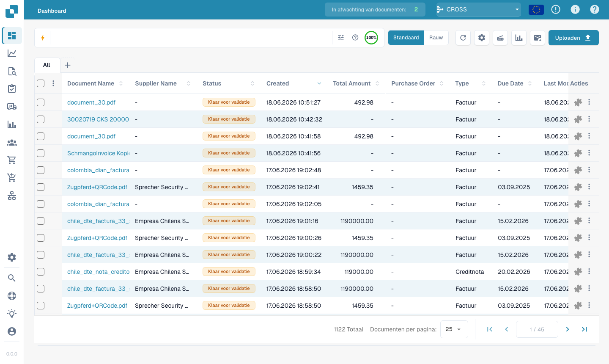<figcaption><p>De zoekbalk Snel zoeken bovenaan het dashboard.</p></figcaption></figure>

---

## Hoe de zoekbalk werkt — chips, werkbalk en ruwe weergave

Voordat we naar de velden zelf gaan, is het handig te weten hoe de balk is opgebouwd.

### Voorwaarden worden chips

Zodra u een voorwaarde voltooit (een veld, een operator en een waarde) zet Snel zoeken
deze om in een **chip** — een gekleurd pilletje in de balk — en begint een nieuwe. Een
chip toont het **veld**, de **operator** en de **waarde**, met een **×** om hem
te verwijderen. Chips zijn gekleurd naar de plaats waar de gegevens staan:

| Chipkleur | Veldtype |
|-----------|----------|
| **Blauw** | Standaardkolom (documentnaam, status, datums) |
| **Oranje** | Fulltext-/geëxtraheerd veld (leverancier, bedrag, factuurnummer) |
| **Paars** | Vector- (semantisch) zoeken |
| **Groen** | Zoeken in OCR-tekst |

Klik op een chip om hem te bewerken (hij klapt weer uit tot tekst); klik op **×** om hem te verwijderen.
Meerdere chips samen worden standaard gelezen als **AND**.

### De werkbalk

Aan het rechteruiteinde van de balk:

- **ⓘ Help** — opent de ingebouwde referentie **Dashboard Search — Fields & Syntax**
  met alle velden, operatoren en sneltoetsen die in uw werkruimte beschikbaar zijn.
- **Filters (tune)** — een snel paneel voor de gangbare filters Status / User / Restart,
  met **Clear filters** en **Apply**.
- **Indexring** — een kleine voortgangsring die toont hoeveel van uw fulltext-index
  is opgebouwd (alleen zichtbaar wanneer fulltext-zoeken is ingeschakeld).

### Standaard- versus ruwe weergave

De balk toont uw query normaal gesproken als chips (**standaardweergave**). Schakel over naar de **ruwe
weergave** om de query als platte tekst te zien en te bewerken (bijv.
`status=ready_for_validation AND supplier_name=Test`) — handig om te kopiëren,
te delen of een lange query direct te typen. Uw query blijft behouden bij het wisselen en wordt
onthouden wanneer u het dashboard opnieuw laadt.

---

## Deel 1 — Standaardvelden

Standaardvelden zijn de eigen kolommen van het document. Ze zijn **altijd beschikbaar**,
ongeacht of fulltext-zoeken is ingeschakeld.

### Documenten op naam vinden

De documentnaam is de meest gebruikte zoekopdracht. Er zijn drie manieren om te matchen —
allemaal **hoofdletterongevoelig**:

#### `=` → begint met

```
filename=invoice
```

Vindt documenten waarvan de naam **begint met** "invoice". Hoofdletters worden genegeerd, dus
al deze komen overeen met `filename=invoice`:

```
Invoice.pdf   iNVoice.pdf   iNvoiCE.pdf   INVOICE.pdf
Invoice.xml   iNVoice.xml   iNvoiCE.edi   …
```

Het komt **niet** overeen met `XYZ_Invoice.pdf` (daar staat "invoice" in het midden — gebruik
daarvoor `:`).

<figure>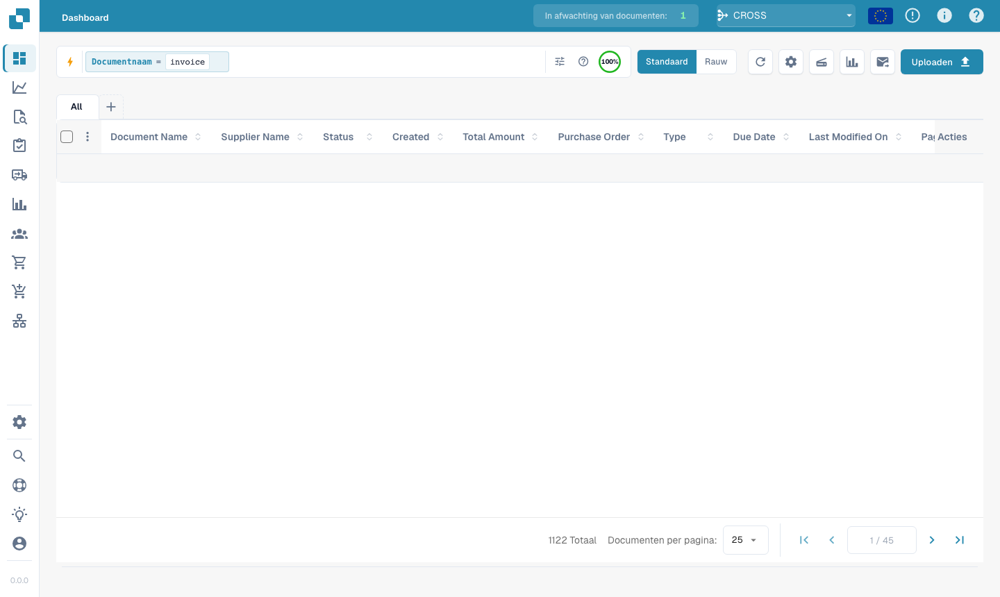<figcaption><p><code>filename=invoice</code> — alleen namen die <strong>beginnen met</strong> "invoice", in elke schrijfwijze met hoofdletters (<code>Invoice.pdf</code>, <code>iNVoice.pdf</code>, <code>INVOICE_2026.pdf</code> … komen allemaal overeen). Vergelijk met <code>:</code> hieronder.</p></figcaption></figure>

#### `:` → bevat (overal)

```
filename:invoice
```

Gebruik `:` om het woord **overal** in de naam te matchen — `2026_Invoice.pdf`,
`vietnam_einvoice_sample.xml`, `scan_invoice_copy.pdf`.

<figure>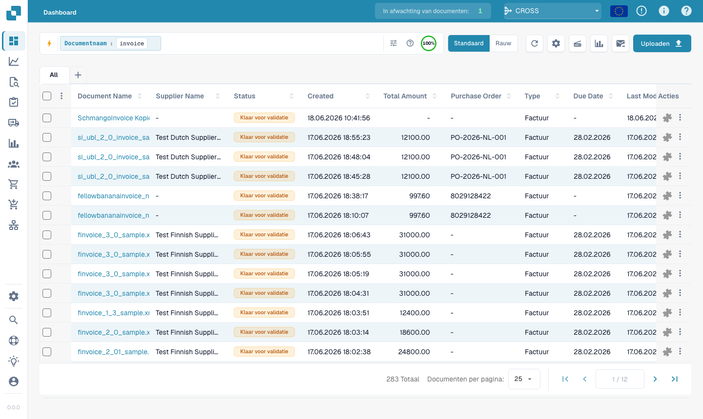<figcaption><p><code>filename:invoice</code> — komt overeen met het woord op elke plaats in de documentnaam.</p></figcaption></figure>

#### `="…"` → begint *of* eindigt met

```
filename="invoice"
```

Met aanhalingstekens matcht `=` namen die met de waarde **beginnen of eindigen** — handig
voor een voorloopcode of een bestandsextensie.

> **De drie in één regel:** `=` → begint met · `:` → bevat · `="…"` →
> begint of eindigt met. Alle negeren hoofd- en kleine letters. U kunt dit op elk moment
> samengevat zien via het **hulppictogram** in de zoekbalk (volgende gedeelte).

### Documenten op status vinden

```
status=ready_for_validation
```

Status is een vaste lijst, dus `=` is een **exacte** match en de balk biedt een
waardekiezer zodra u `status=` typt.

<figure>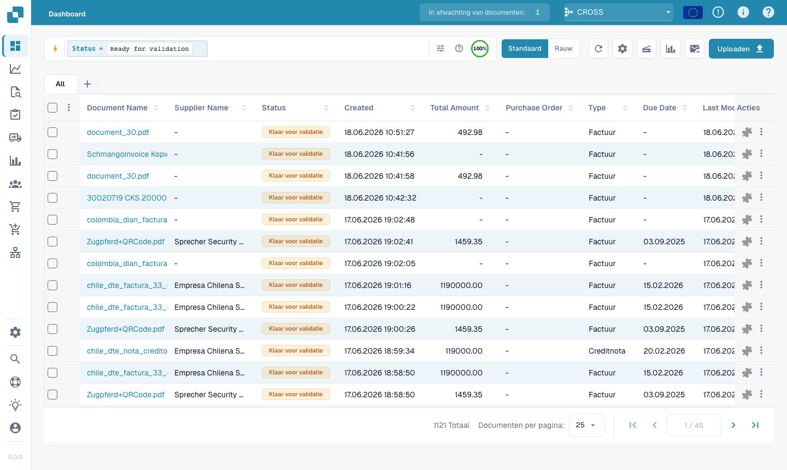<figcaption><p><code>status=ready_for_validation</code> — exacte match op een veld met een vaste lijst.</p></figcaption></figure>

### Documenten op datum vinden

```
created_on>2026-05-25
```

Gebruik `>`, `<`, `>=`, `<=` voor datumbereiken. U kunt ook **relatieve** datums gebruiken:
`today()`, `today()-7` (laatste 7 dagen), `today()+30` (komende 30 dagen).

<figure>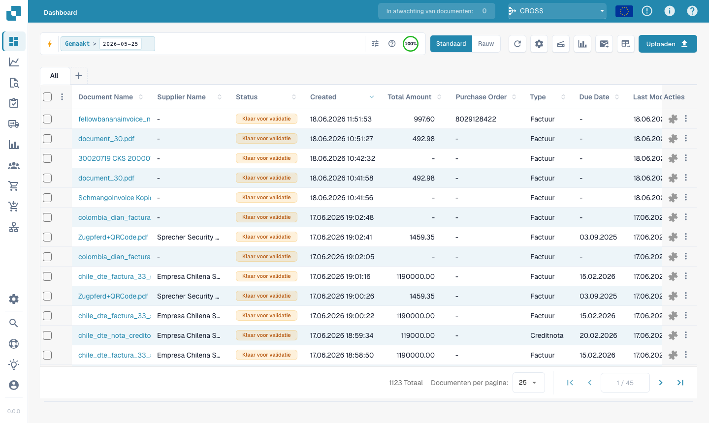<figcaption><p><code>created_on&#62;2026-05-25</code> — documenten die na een datum zijn aangemaakt.</p></figcaption></figure>

### Documenten op factuursubtype vinden

```
invoice_sub_type="Cost Invoice"
```

Het factuursubtype is een vaste lijst (bijvoorbeeld **Cost Invoice** of **Purchase
Invoice**), dus `=` is een **exacte** match en de balk biedt een waardekiezer zodra
u `invoice_sub_type=` typt. Gebruik `invoice_sub_type!="Cost Invoice"` voor
alles behalve dat subtype.

---

## Deel 2 — Fulltext-velden

Fulltext-velden doorzoeken de **geëxtraheerde inhoud** van uw documenten — leverancier,
inkooporder, factuurnummer, bedragen, regels. Ze verschijnen in het **oranje**
en zijn beschikbaar wanneer **fulltext-zoeken is ingeschakeld** voor uw organisatie. De
matchregels zijn precies dezelfde als voor standaardtekstvelden
(`=` begint met, `:` bevat, `="…"` begint of eindigt met).

### Documenten van een leverancier vinden

```
supplier_name=Test
```

Begint met, op de geëxtraheerde leveranciersnaam. Gebruik `supplier_name:fuji` om overal te matchen,
of `supplier_name:"Ruiz Foods"` om een waarde met spaties tussen aanhalingstekens te zetten.

<figure>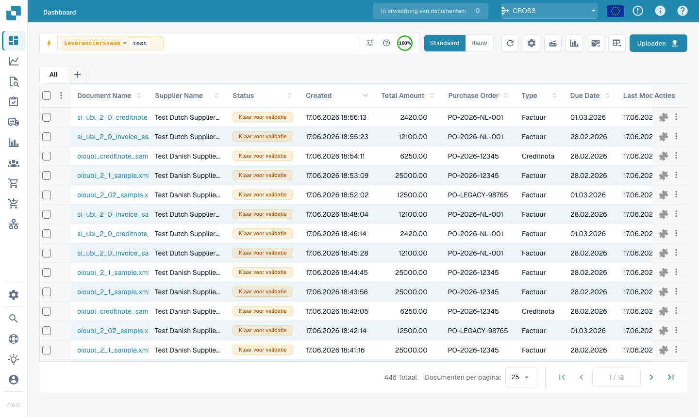<figcaption><p><code>supplier_name=Test</code> — de leverancier van elk resultaat begint met "Test".</p></figcaption></figure>

### Documenten op inkooporder vinden

```
purchase_order=PO
```

Begint met, op het geëxtraheerde inkoopordernummer — ideaal voor een PO-prefix.

<figure><figcaption><p><code>purchase_order=PO</code> — documenten waarvan het PO-nummer begint met "PO".</p></figcaption></figure>

### Documenten op bedrag vinden

```
total_amount>5000
```

Gebruik `>`, `<`, `>=`, `<=` of `between 100 and 500` voor een bereik.

<figure>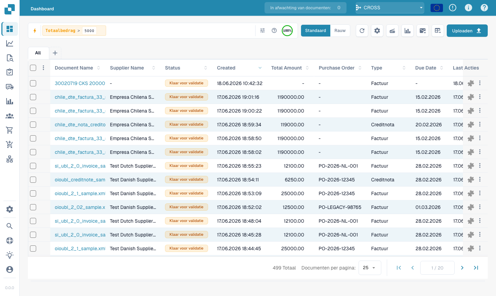<figcaption><p><code>total_amount&#62;5000</code> — facturen boven 5.000.</p></figcaption></figure>

Voor een venster gebruikt u `between`:

```
total_amount between 1000 and 5000
```

Dit is een verkorte schrijfwijze van `total_amount>=1000 AND total_amount<=5000`.

<figure>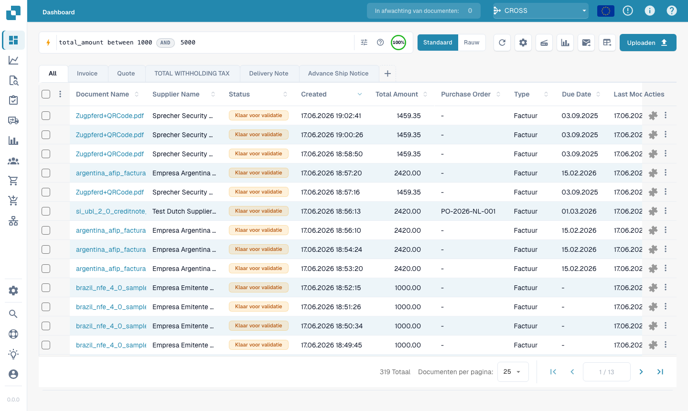<figcaption><p><code>total_amount between 1000 and 5000</code> — elk resultaat valt binnen het venster.</p></figcaption></figure>

### Vinden wat ontbreekt

```
supplier_name=""
```

`=""` betekent "dit veld is **niet ingevuld**"; `supplier_name!=""` betekent "heeft
een leverancier".

<figure>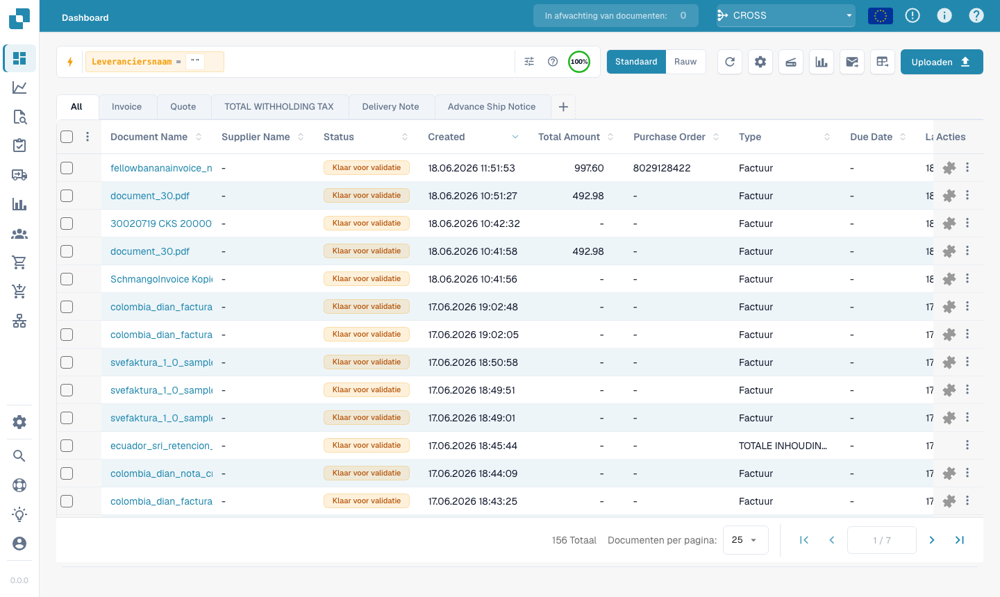<figcaption><p><code>supplier_name=""</code> — documenten die nog geen leverancier hebben.</p></figcaption></figure>

Dezelfde controle werkt op elk veld — bijvoorbeeld documenten waarbij nog
een AP-toewijzingscode ontbreekt:

```
ap_assignment_code=""
```

<figure>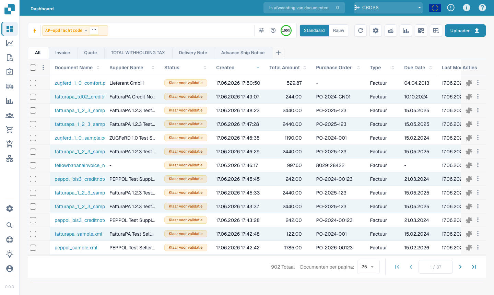<figcaption><p><code>ap_assignment_code=""</code> — documenten die geen AP-toewijzingscode hebben. Gebruik <code>ap_assignment_code!=""</code> voor documenten die er wel een hebben.</p></figcaption></figure>

---

## Slimme filters — één klik

Bovenaan het dropdownmenu van Snel zoeken (klik in de zoekbalk) vindt u de
**Slimme filters** (Smart Filters): kant-en-klare zoekopdrachten die u met één klik toepast. Elk filter
is een sneltoets voor een query die u ook zelf kunt typen:

| Slim filter | Vindt | Gelijk aan typen van |
|-------------|-------|----------------------|
| ⚠️ **Overdue** | Vervaldatum verstreken | `invoice_due_date<today()` |
| 🕐 **Due soon** | Binnen de komende 7 dagen | `invoice_due_date<=today()+7` |
| 👤 **Assigned to me** | Items die op uw actie wachten | `assigned_to=<u>` |
| 📅 **Today's inbox** | Vandaag geïmporteerd | `imported_on>=today()` |
| 📋 **Pending validation** | Klaar om te valideren | `status=ready_for_validation` |
| 🧾 **Electronic documents** | E-facturen (XML, ZUGFeRD, EDI) | `is_edoc=true` |
| ✅ **Full PO match** | Volledig afgestemd op een inkooporder | `po_match_status=full_matched` |
| ➗ **Partial PO match** | Gedeeltelijk afgestemd op een inkooporder | `po_match_status=partial_matched` |
| 📉 **Under PO match** | Hoeveelheid of eenheidsprijs onder de inkooporder | `po_match_status=under_matched` |

De drie **PO match**-filters en de fulltext-velden vereisen dat fulltext-zoeken
is ingeschakeld voor uw organisatie.

<figure><figcaption><p>De Slimme filters bovenaan het dropdownmenu van Snel zoeken — met één klik past u het filter toe (Overdue, Due soon, Assigned to me, Today's inbox, Pending validation, Electronic documents, Full / Partial / Under PO match).</p></figcaption></figure>

---

## Resultaten groeperen

In plaats van een platte lijst kunt u de resultaten **groeperen** op elk veld — leverancier,
status, documenttype, suborganisatie of een datumvak. Voeg een groepering toe vanuit
de zoekbalk:

```
group by supplier_name
```

De lijst toont dan inklapbare **groepskoppen**, elk met de naam van de groep en
een **aantal** (bijv. *Ruiz Foods (12)*). Klik op een kop om die groep uit of in te klappen.
Voor datumvelden kunt u groeperen op **dag, week of maand**.

<figure>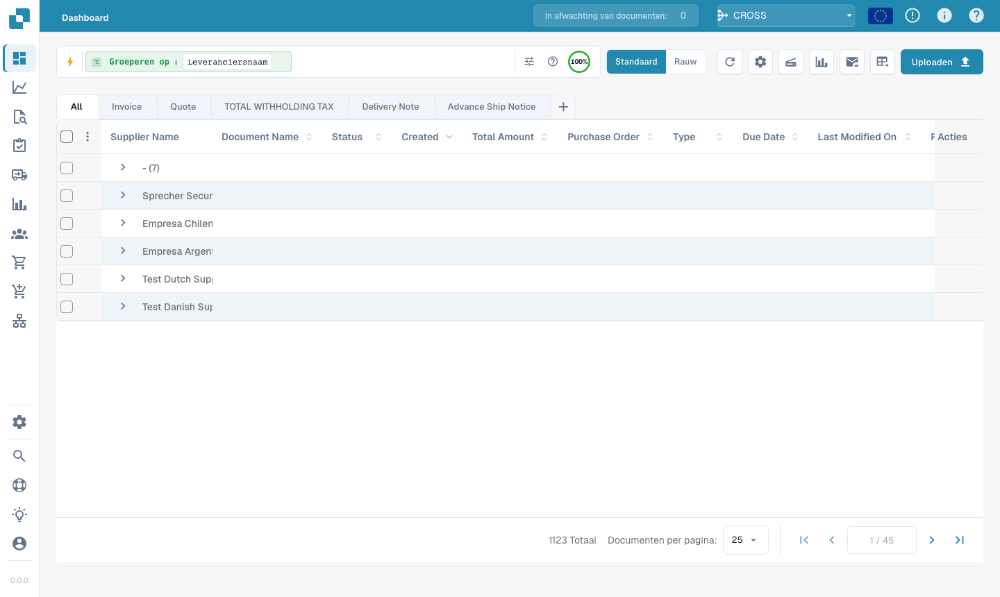<figcaption><p><code>group by supplier_name</code> — resultaten klappen samen tot één uitklapbare kop per leverancier.</p></figcaption></figure>

Groeperen combineert met elk filter — `status=ready_for_validation group by
supplier_name` groepeert alleen de overeenkomende documenten. Als u in een groep klikt, **zoomt** u in:
de waarde van die groep wordt als filter toegepast en u keert terug naar de
platte lijst voor die selectie.

---

## Deel 3 — Operatoren, verbindingen, sneltoetsen

### De ingebouwde hulp

Het **hulppictogram** in de zoekbalk opent een volledige referentie van alle velden,
operatoren en sneltoetsen die in uw werkruimte beschikbaar zijn — inclusief welke velden
standaard- en welke fulltext-velden zijn.

<figure><figcaption><p>De ingebouwde hulp <strong>Dashboard Search — Fields &#38; Syntax</strong> met alle operatoren en hoe waarden worden gematcht.</p></figcaption></figure>

### Hoe `=` matcht, per veldtype

Alle tekstmatching negeert hoofd- en kleine letters.

| Veldtype | Voorbeeld | `=` betekent |
|----------|-----------|--------------|
| Tekst (naam, leverancier, inkooporder) | `filename=invoice` | **begint met** |
| Tekst, overal | `filename:invoice` | **bevat** |
| Tekst, begin *of* einde | `filename="invoice"` | **begint of eindigt met** |
| Status / type / PO match (vaste lijsten) | `status=finished` | **exact** |
| Identificatoren (factuurnummer, leverancier-ID) | `invoice_number=INV-100` | **exact** |
| Getal | `total_amount>5000` | bereik (`> < >= <= between`) |
| Datum | `created_on>2026-01-01` | bereik + `today()±N` |

### Operatoren

| Operator | Betekenis |
|----------|-----------|
| `=` | begint met (tekst) / exact (lijst, getal, datum) |
| `:` | bevat (tekst, overal) |
| `="…"` | begint met of eindigt met (tekst) |
| `!=` | het tegenovergestelde van `=` |
| `>` `<` `>=` `<=` | groter / kleiner dan |
| `between … and …` | inclusief bereik |
| `field=""` / `field!=""` | is leeg / is ingevuld |
| `today()`, `today()-7`, `today()+30` | relatieve datums |

### Verbindingen

Combineer voorwaarden met **AND** (beide waar), **OR** (een van beide), **NOT** en
haakjes `( … )` om te groeperen:

```
status=ready_for_validation AND supplier_name=Test
(status=error OR status=failed) AND created_on>today()-1
```

<figure>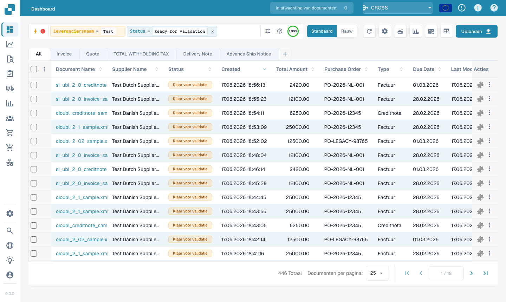<figcaption><p><code>status=ready_for_validation AND supplier_name=Test</code> — twee voorwaarden gecombineerd.</p></figcaption></figure>

### Sneltoetsen

Kortere schrijfwijzen voor dezelfde queries — gebruik wat u het prettigst leest:

| Sneltoets | Gelijk aan | Beschrijving |
|-----------|------------|--------------|
| `total_amount gt 5000` | `total_amount>5000` | Woordaliassen voor vergelijkingsoperatoren (`gt`/`gte`/`lt`/`lte`/`eq`/`ne`) |
| `due_date > today` | `due_date>today()` | Kale `today` / `yesterday` / `tomorrow` |
| `imported_on this_week` | `imported_on>=today()-7 AND imported_on<=today()` | Relatieve perioden (`this_week`, `last_week`, `this_month`, …) |
| `ap_assignment_code is empty` | `ap_assignment_code=""` | Of een veld een waarde heeft |
| `status:open` | `status=ready_for_validation` | Leesbaar statuslabel (`open`/`closed`/`failed`/`done`) |
| `total_amount not between 100, 200` | `total_amount<100 OR total_amount>200` | Waarde buiten een venster |
| `status in (finished, error)` | `status=finished OR status=error` | Elke waarde uit een lijst matchen |
| `not status=finished` | `status!=finished` | Elk predicaat negeren |
| `filename contains rechnung` | `filename:rechnung` | Tekstmatch (`contains`/`starts_with`/`ends_with`) |
| `total_amount > 5k` | `total_amount>5000` | Bedragsuffix `k` (×1 000), `M` (×1 000 000) |
| `overdue` | `invoice_due_date<today() AND status!=finished` | Onbetaalde facturen na de vervaldatum |
| `#INV-1234` | `invoice_id:INV-1234` | Twitter-achtig prefix voor factuur-ID |
| `@User` | `assigned_to:User` | Twitter-achtig prefix voor de toegewezen gebruiker |
| `$5000+` | `total_amount>=5000` | `$`-prefix voor bedragdrempels |

### Galerij met sneltoetsquery's en resultaten

Deze voorbeelden tonen elk sneltoetspatroon met de query die u typt en het resultaat dat het dashboard toont. De eerste groep gebruikt standaardvelden en werkt ook wanneer fulltext-zoeken niet is ingeschakeld. De tweede groep gebruikt velden die alleen met fulltext beschikbaar zijn, zoals bedrag of vervaldatum van de factuur.

#### Werkt zonder fulltext

##### Operatoraliassen

- Query: `created_on gt 2026-05-25`
- Gelijk aan: `created_on>2026-05-25`
- Resultaat: Filtert op Created na 25 mei 2026.

<figure><figcaption><p><code>created_on gt 2026-05-25</code> - Filtert op Created na 25 mei 2026.</p></figcaption></figure>

##### Kale datumwoorden

- Query: `created_on < today`
- Gelijk aan: `created_on<today()`
- Resultaat: Breidt het kale woord today uit tot today().

<figure>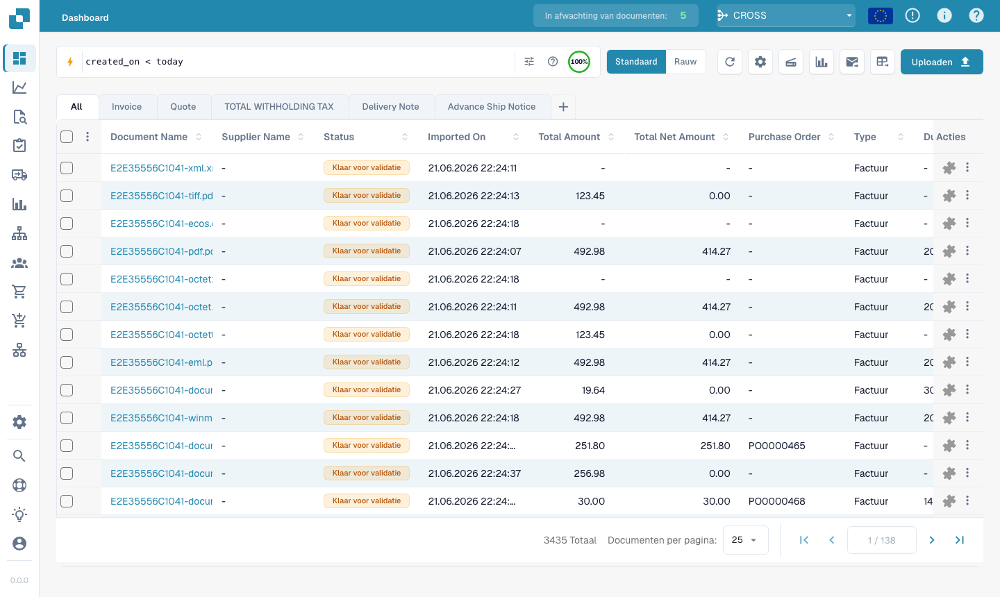<figcaption><p><code>created_on &lt; today</code> - Breidt het kale woord today uit tot today().</p></figcaption></figure>

##### Relatieve periode

- Query: `created_on this_month`
- Gelijk aan: `created_on>=first day of this month AND created_on<=last day of this month`
- Resultaat: Breidt this_month uit tot een datumvenster.

<figure><figcaption><p><code>created_on this_month</code> - Breidt this_month uit tot een datumvenster.</p></figcaption></figure>

##### Woorden voor leeg of ingevuld

- Query: `assigned_to is empty`
- Gelijk aan: `assigned_to=""`
- Resultaat: Vindt documenten zonder toegewezen gebruiker.

<figure><figcaption><p><code>assigned_to is empty</code> - Vindt documenten zonder toegewezen gebruiker.</p></figcaption></figure>

##### Leesbare status

- Query: `status:open`
- Gelijk aan: `status=ready_for_validation`
- Resultaat: Koppelt open aan de validatiestatus.

<figure><figcaption><p><code>status:open</code> - Koppelt open aan de validatiestatus.</p></figcaption></figure>

##### Not between

- Query: `created_on not between 2026-06-01, 2026-06-15`
- Gelijk aan: `(created_on<2026-06-01 OR created_on>2026-06-15)`
- Resultaat: Vindt waarden buiten een datumvenster.

<figure><figcaption><p><code>created_on not between 2026-06-01, 2026-06-15</code> - Vindt waarden buiten een datumvenster.</p></figcaption></figure>

##### In-lijst

- Query: `status in (ready_for_validation, exported)`
- Gelijk aan: `status=ready_for_validation OR status=exported`
- Resultaat: Matcht elke vermelde status.

<figure><figcaption><p><code>status in (ready_for_validation, exported)</code> - Matcht elke vermelde status.</p></figcaption></figure>

##### Negatieprefix

- Query: `not status=finished`
- Gelijk aan: `status!=finished`
- Resultaat: Keert het predicaat voor de status finished om.

<figure>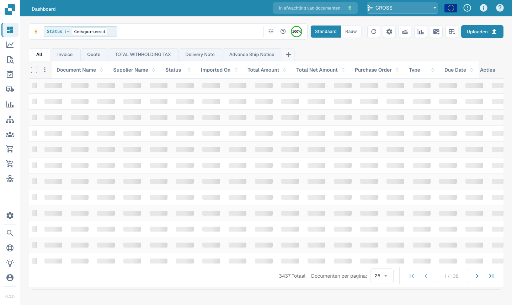<figcaption><p><code>not status=finished</code> - Keert het predicaat voor de status finished om.</p></figcaption></figure>

##### Tekst bevat

- Query: `filename contains E2E`
- Gelijk aan: `filename:E2E`
- Resultaat: Gebruikt contains als zoekopdracht op een deel van de bestandsnaam.

<figure><figcaption><p><code>filename contains E2E</code> - Gebruikt contains als zoekopdracht op een deel van de bestandsnaam.</p></figcaption></figure>

##### Factuurprefix

- Query: `#INV-1234`
- Gelijk aan: `invoice_id:INV-1234`
- Resultaat: Koppelt #... aan een zoekopdracht op factuur-ID.

<figure><figcaption><p><code>#INV-1234</code> - Koppelt #... aan een zoekopdracht op factuur-ID.</p></figcaption></figure>

##### Prefix voor toegewezen gebruiker

- Query: `@Daniel`
- Gelijk aan: `assigned_to:"Daniel"`
- Resultaat: Koppelt @... aan een zoekopdracht op de naam van de toegewezen gebruiker.

<figure><figcaption><p><code>@Daniel</code> - Koppelt @... aan een zoekopdracht op de naam van de toegewezen gebruiker.</p></figcaption></figure>

#### Vereist fulltext-zoeken

Als u dezelfde sneltoets met een veld gebruikt dat alleen via fulltext beschikbaar is, vereist de query nog steeds fulltext. `ap_assignment_code is empty` gebruikt bijvoorbeeld dezelfde sneltoets voor leeg/ingevuld als `assigned_to is empty`, maar het veld voor de AP-toewijzing is alleen via fulltext beschikbaar.

##### Bedragsuffix

- Query: `total_amount > 5k`
- Gelijk aan: `total_amount>5000`
- Resultaat: Breidt k uit tot duizendtallen op een bedragveld.

<figure><figcaption><p><code>total_amount &gt; 5k</code> - Breidt k uit tot duizendtallen op een bedragveld.</p></figcaption></figure>

##### Sneltoets overdue

- Query: `overdue`
- Gelijk aan: `invoice_due_date<today() AND status!=finished`
- Resultaat: Vindt niet-afgeronde facturen waarvan de vervaldatum is verstreken.

<figure><figcaption><p><code>overdue</code> - Vindt niet-afgeronde facturen waarvan de vervaldatum is verstreken.</p></figcaption></figure>

##### Bedragprefix

- Query: `$5000+`
- Gelijk aan: `total_amount>=5000`
- Resultaat: Koppelt $...+ aan een bedragdrempel.

<figure><figcaption><p><code>$5000+</code> - Koppelt $...+ aan een bedragdrempel.</p></figcaption></figure>

---

## Deel 4 — Geavanceerde zoekmodi

Naast zoeken op velden doorzoeken drie prefixmodi de inhoud van het document zelf.

### Vector- (semantisch) zoeken — `vector:`

Matcht op **betekenis**, niet op exacte tekst — handig voor "vind documenten over XYZ".
Vereist de Vector-module; werkt op de documentinhoud.

```
vector: invoices about office supplies
vector: shipping delays with Hamburg port
```

<figure>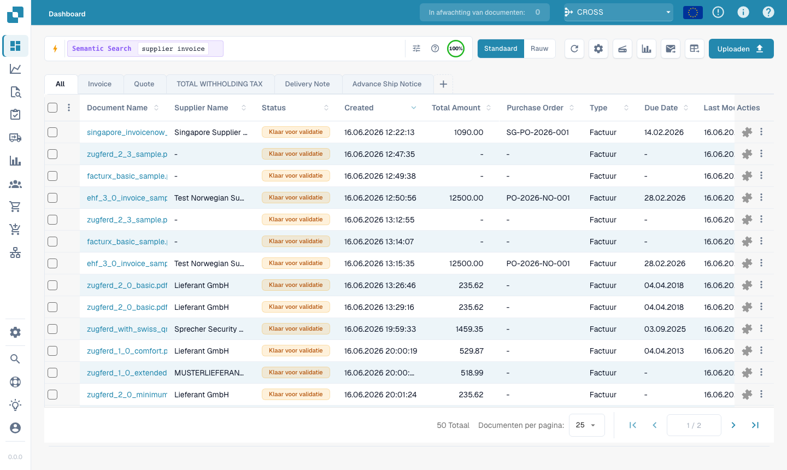<figcaption><p><code>vector: supplier invoice</code> — semantisch verwante documenten, ook zonder precies deze woorden.</p></figcaption></figure>

### Zoeken in OCR-tekst — `ocr:`

Doorzoekt de **paginatekst** die de OCR-engine heeft geëxtraheerd — niet alleen de
gestructureerde kolommen. Handig wanneer de waarde die u zich herinnert in de hoofdtekst van het document staat.

```
ocr: Versandkosten
ocr: "purchase order PO-12345"
ocr: Hamburg AND doc_type=INVOICE
ocr: IBAN
```

<figure>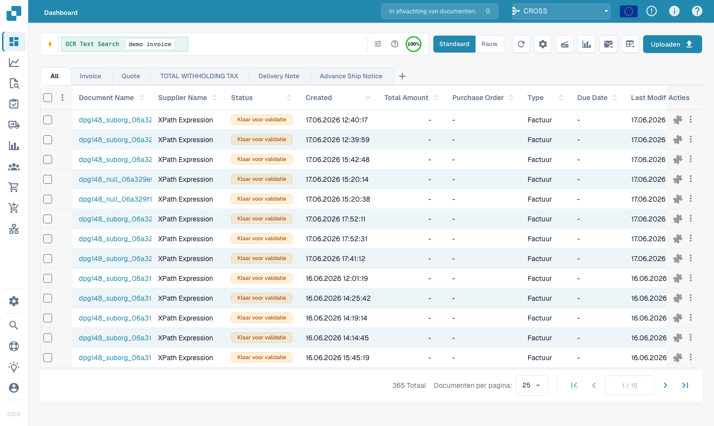<figcaption><p><code>ocr: demo invoice</code> — komt overeen met tekst die ergens op de documentpagina's staat.</p></figcaption></figure>

### Zoeken in natuurlijke taal (AI) — `ai:`

Beschrijf in gewone taal wat u zoekt; de AI leest uw zin en haalt er filters uit
(leverancier, datums, bedragen) die in een gestructureerde query worden gezet. In tegenstelling tot Vector
**bouwt** dit een query **op** in plaats van vergelijkbare documenten te zoeken.

```
ai: invoices from Ruiz over 1000 last quarter
ai: overdue invoices waiting on approval
ai: shipping documents from Hamburg last month
```

<figure>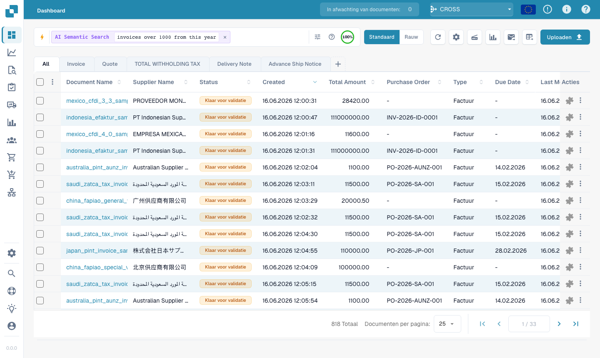<figcaption><p><code>ai: invoices over 1000 from this year</code> — de AI zet de zin automatisch om in filters.</p></figcaption></figure>

---

### Recepten

| U wilt… | Typ dit |
|---------|---------|
| Klaar om te valideren, volledig afgestemd | `status=ready_for_validation AND po_match_status=full_matched` |
| Deze leverancier, deze week | `supplier_name=Test AND created_on>today()-7` |
| Achterstallige facturen met hoge waarde | `total_amount>5000 AND invoice_due_date<today()` |
| Twee leveranciers tegelijk | `supplier_name=fuji OR supplier_name=acme` |
| Documenten met fouten van vandaag | `(status=error OR status=failed) AND created_on>today()-1` |
| Elektronische creditnota's | `is_edoc=true AND sub_doc_type=CREDIT_NOTE` |
| Op prefix van het inkoopordernummer | `purchase_order=PO-2026` |

> Oranje (fulltext-)velden vereisen dat **fulltext-zoeken** is ingeschakeld voor uw
> organisatie. Een letterlijke `%` of `_` in een waarde wordt als gewoon teken behandeld.
