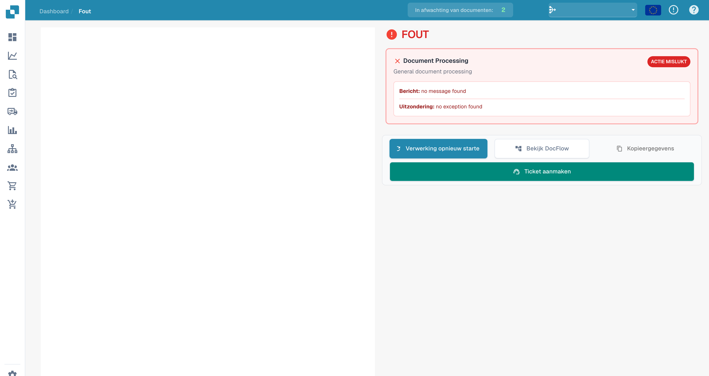
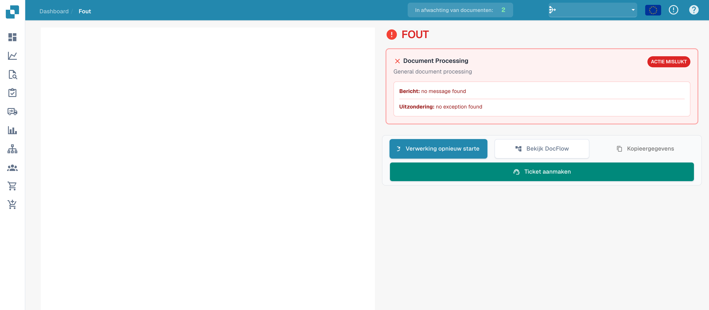

# Foutweergave

Als de verwerking mislukt, kunt u in de foutweergave de betrokken fase, de melding en de beschikbare uitzondering onderzoeken.

## Details onderzoeken

<figure><figcaption>
Melding en uitzondering in de foutweergave zonder geregistreerde melding. De diagnostische teksten Document Processing, no message found en no exception found blijven Engelstalig.
</figcaption></figure>

Dit voorbeeld toont de interface zonder geregistreerde fout. De teksten no message found en no exception found zijn geen diagnose van een incident. Onderzoek bij een echte fout de beschikbare meldingen en de documentstroom.

## Beschikbare acties

<figure><figcaption>
Acties in de foutweergave; het voorbeeld bevat geen geregistreerde foutdetails. De diagnostische teksten Document Processing, no message found en no exception found blijven Engelstalig.
</figcaption></figure>

| Actie | Gebruik |
| --- | --- |
| Verwerking opnieuw starten | Opnieuw proberen nadat u de oorzaak hebt onderzocht of verholpen. |
| DocFlow openen | De fasen en hun statussen onderzoeken. |
| Details kopiëren | Beschikbare technische informatie verzamelen. |
| Ticket maken | Een ondersteuningsverzoek voorbereiden. |

De document- en voorbeeldacties hangen af van het laden van het document. De oude PDF-werkbalk maakt niet betrouwbaar deel uit van deze weergave.

Geef bij een terugkerende fout het document-ID, de exacte melding, het tijdstip en de uitgevoerde controles door aan ondersteuning. Controleer vertrouwelijke informatie voordat u details deelt.
