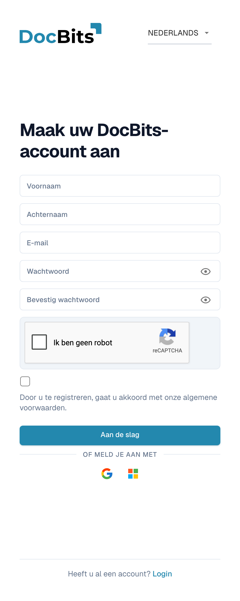
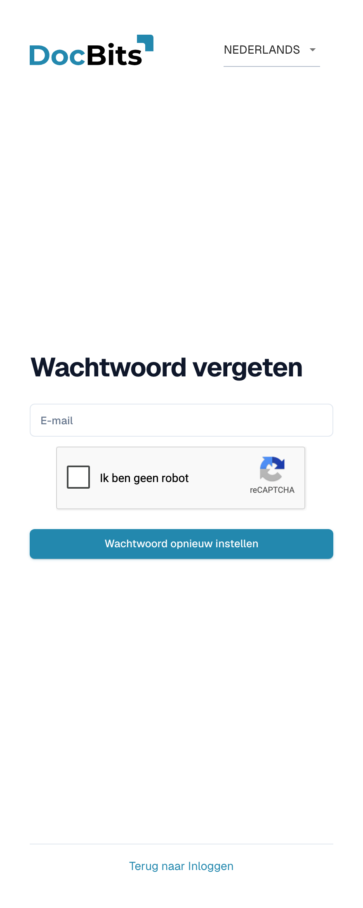
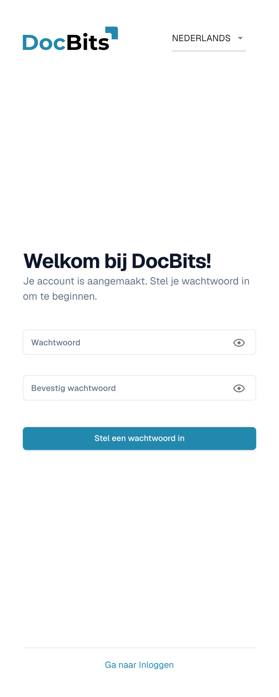

# Toegang verkrijgen en inloggen

Deze pagina legt uit hoe u een DocBits-account krijgt en hoe u inlogt wanneer u uw wachtwoord niet meer weet:

* [Registratie](#registratie) — maak zelf een DocBits-account aan.
* [Wachtwoord vergeten](#wachtwoord-vergeten) — stel uw wachtwoord opnieuw in met een herstellink.
* [Eerste wachtwoord voor door de beheerder aangemaakte accounts](#eerste-wachtwoord-voor-door-de-beheerder-aangemaakte-accounts) — stel het eerste wachtwoord in voor een account dat uw beheerder voor u heeft aangemaakt.

Inloggen met een bestaand account en Tweefactorauthenticatie worden behandeld in [Tweefactorauthenticatie (2FA)](../../security/two-factor-authentication.md). Gebruik het taalmenu rechtsboven op deze formulieren als u een andere weergavetaal nodig heeft.

## Registratie

U kunt zelf een DocBits-account aanmaken op de registratiepagina. Open deze via de koppeling **Registreren** op het inlogscherm, of ga naar `https://app.docbits.com/register` (gebruik het webadres dat uw organisatie heeft gekregen).

<figure><figcaption>
Registratie: vul Voornaam, Achternaam, E-mail, Wachtwoord en Bevestig wachtwoord in. Voltooi reCAPTCHA als deze verschijnt, accepteer de algemene voorwaarden en kies Aan de slag. Login brengt u terug naar de inlogpagina.
</figcaption></figure>

Vul het formulier in:

1. **Voornaam** en **Achternaam** — uw naam zoals deze in DocBits moet verschijnen.
2. **E-mail** — uw zakelijke e-mailadres. Dit is uw inlognaam.
3. **Wachtwoord** en **Bevestig wachtwoord** — zie de wachtwoordregels hieronder. Een checklist onder het wachtwoordveld toont aan welke regels uw wachtwoord al voldoet.
4. Als de pagina een **reCAPTCHA**-widget toont, voltooi deze dan. De widget verschijnt alleen wanneer uw DocBits-implementatie botbeveiliging heeft ingeschakeld.
5. Vink het selectievakje aan om te bevestigen dat u akkoord gaat met de **algemene voorwaarden**.
6. Klik op **Aan de slag**. Als u al een account heeft, klik dan onderaan op **Login** om terug te keren naar de inlogpagina. **Bezoek website** opent de DocBits-website voor productinformatie.

Gebruik het oogpictogram naast een wachtwoordveld om de ingevoerde tekens te tonen of te verbergen.

### Wachtwoordregels

Uw wachtwoord moet:

* tussen **8 en 20 tekens** lang zijn,
* minstens één **hoofdletter** en één **kleine letter** bevatten,
* minstens één **cijfer** bevatten,
* minstens één **speciaal teken** bevatten (`!@#$%^&*()_+=\[{]\};:,.<>?/\|~-`).

Alleen letters, cijfers en deze speciale tekens zijn toegestaan.

### Aanmelden met Google of Microsoft

In plaats van een wachtwoord kunt u op de knop **Google** of **Microsoft** klikken onder **OF MELD JE AAN MET**. DocBits maakt uw account aan via uw identiteitsprovider en u logt later op dezelfde manier in.

### Bevestig uw e-mailadres

Nadat u het formulier heeft verzonden, toont DocBits een bevestigingspagina en stuurt een **verificatie-e-mail** naar het door u ingevoerde adres. Open de e-mail en klik op de koppeling erin — deze brengt u naar een bevestigingspagina die uw adres verifieert. Als de e-mail niet aankomt, biedt de bevestigingspagina een optie om **opnieuw te verzenden**. Zodra het adres is geverifieerd, klikt u op **Inloggen** en logt u in met uw e-mailadres en wachtwoord.

## Wachtwoord vergeten

DocBits slaat inlogwachtwoorden op als eenrichtingshashes met salt. Een bestaand wachtwoord kan niet uit de hash worden teruggehaald, dus met deze procedure stelt u een nieuw wachtwoord in. Zie [Veilige opslag van inloggegevens](../../security/secure-storage-of-credentials.md).

Als u uw wachtwoord bent vergeten:

1. Klik op het inlogscherm op **Wachtwoord vergeten**.
2. Voer op de pagina **Wachtwoord vergeten** uw **e-mailadres** in en klik op **Wachtwoord opnieuw instellen**. Als er een reCAPTCHA-widget wordt getoond, voltooi deze dan eerst.

   <figure><figcaption>
Vul uw E-mail in en kies Wachtwoord opnieuw instellen om een herstellink aan te vragen, of gebruik Terug naar Inloggen. Voltooi reCAPTCHA wanneer deze verschijnt.
</figcaption></figure>

   Als u uw wachtwoord niet opnieuw wilt instellen, klik dan op **Terug naar Inloggen** om terug te keren naar de inlogpagina.

3. DocBits e-mailt u een **koppeling om uw wachtwoord opnieuw in te stellen**. Open de e-mail en klik op de koppeling — deze opent de pagina voor het opnieuw instellen.
4. Voer uw **nieuwe wachtwoord twee keer** in. Dezelfde wachtwoordregels als bij de [registratie](#wachtwoordregels) gelden, en een checklist toont welke regels worden voldaan.
5. Klik op **Wachtwoord opnieuw instellen**. DocBits bevestigt de wijziging en brengt u terug naar het inlogscherm, waar u kunt inloggen met het nieuwe wachtwoord.


Herstellinks verlopen na korte tijd. Als de koppeling niet meer werkt, herhaal dan de bovenstaande stappen om een nieuwe aan te vragen.


## Eerste wachtwoord voor door de beheerder aangemaakte accounts

Wanneer uw beheerder u als gebruiker toevoegt (zie [Gebruikers](../../administration-and-setup/settings/global-settings/groups-users-and-permissions/users/README.md)), ontvangt u een e-mail met uw inloggegevens en een koppeling om uw **eerste wachtwoord** in te stellen. De koppeling opent de pagina **Stel een wachtwoord in**:

<figure><figcaption>
Eerste wachtwoord voor een door de beheerder aangemaakt account: vul Wachtwoord en Bevestig wachtwoord in en kies Stel een wachtwoord in. Ga naar Inloggen brengt u terug naar de inlogpagina.
</figcaption></figure>

1. Klik op de koppeling in de uitnodigings-e-mail. De pagina begroet u met "Welkom bij DocBits! Je account is aangemaakt. Stel je wachtwoord in om te beginnen."
2. Voer uw wachtwoord twee keer in — dezelfde [wachtwoordregels](#wachtwoordregels) gelden.
3. Klik op **Stel een wachtwoord in**. Daarna kunt u inloggen met uw e-mailadres en dit wachtwoord.

De oogpictogrammen tonen of verbergen wat u heeft ingevoerd. Als u stopt voordat u een wachtwoord instelt, brengt **Ga naar Inloggen** u terug naar de inlogpagina.

De koppeling is gekoppeld aan uw account en werkt slechts één keer. Als deze verloopt voordat u deze gebruikt, vraag uw beheerder dan de uitnodiging opnieuw te versturen of gebruik **Wachtwoord vergeten** met uw e-mailadres.
