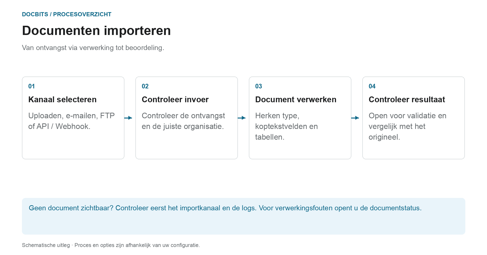

# Hoe Documenten te Importeren

## Van ontvangst tot een document dat klaar is voor beoordeling

<figure><figcaption>
Van ontvangst via verwerking tot beoordeling. Het diagram is schematisch; de actieve instellingen van uw organisatie bepalen het daadwerkelijke gedrag.
</figcaption></figure>

Selecteer eerst de importroute. Het succesvol versturen van een e-mail of het indienen van een API-verzoek bewijst niet dat het document volledig is verwerkt. Controleer de ontvangst in DocBits en vervolgens de documentstatus.

1. **Selecteer importkanaal:** Gebruik handmatige upload voor individuele bestanden of een automatisch ingesteld kanaal voor reguliere invoer.
2. **Controleer ontvangst:** Zoek het document in de juiste organisatie. Controleer voor inkomende e-mails indien nodig de importlogboeken; ondersteunen de formaat- en afzenderregels de bijlage?
3. **Wacht op verwerking:** DocBits verwerkt het document op basis van het documenttype en de actieve instellingen. Voor PDFs kan OCR of bestaande PDF-tekst worden gebruikt; elektronische documenten kunnen gestructureerde gegevens opleveren. Niet elke import verloopt via hetzelfde extractiepad.
4. **Open het resultaat:** Zodra het document gereed is voor validatie, vergelijkt u de herkende waarden met het origineel. Het importeren van een document keurt het niet goed of exporteert het niet naar de ERP.

### Vind de juiste importroute

| Invoer | Instructies |
| --- | --- |
| Upload individuele documenten | [Handmatig importeren](manual-import.md) |
| Verbind uw mailbox of stuur e-mails door | [E-mail importeren](email/README.md) |
| Haal bestanden op via een ingesteld FTP-kanaal | [FTP](ftp.md) |
| Documenten overbrengen vanuit een applicatie | [Webhook / API](webhook.md) |

**Als er iets ontbreekt:** Controleer eerst het ingangskanaal. Als het document al bestaat in DocBits, helpen [Documentstatus](../dashboard/document-status.md) en [Documentstroom](../dashboard/document-flow.md) bij het vinden van de betreffende verwerkingsstap.


DocBits Tutorial importeren: documenten uploaden, slepen en neerzetten + handmatig versus automatische classificatie


Een gids voor het uploaden van documenten naar DocBits.
