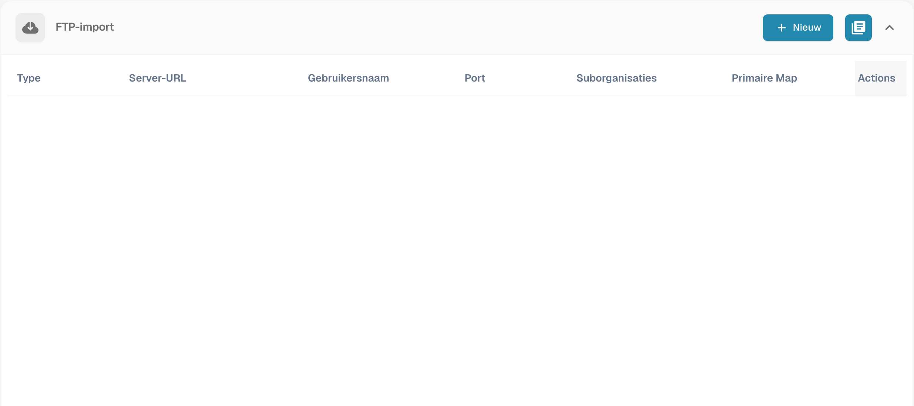
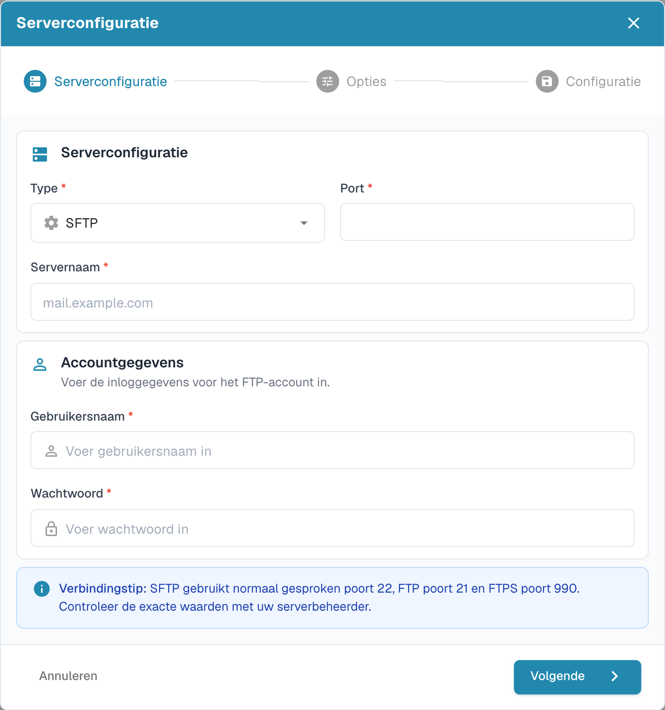

# Import via FTP en SFTP

Automatische import vereist goedgekeurde verbindingsgegevens en een map die toegankelijk is voor het serveraccount.

## Een verbinding maken

Open de importinstellingen en maak een nieuwe verbinding in het FTP-gedeelte.

<figure><figcaption>
Overzicht van FTP-verbindingen met afgeschermde verbindingsgegevens.
</figcaption></figure>

De wizard begint met de serverconfiguratie. Kies het bedoelde protocol, de server, de poort en de aanmeldgegevens. Gebruik de waarden van de serverbeheerder.

<figure><figcaption>
Eerste stap van de FTP-importwizard: serverconfiguratie.
</figcaption></figure>

Ga verder met de opties en configuratie. Controleer de hele verbinding voordat u opslaat.

## Bestanden archiveren

Als de verbinding archivering ondersteunt, stelt u dit in bij de importopties. Controleer of het account naar de archiefmap kan schrijven en test het gedrag met een voorbeeldbestand. Het oude afzonderlijke archiveringsformulier is vervangen door de huidige wizard.
