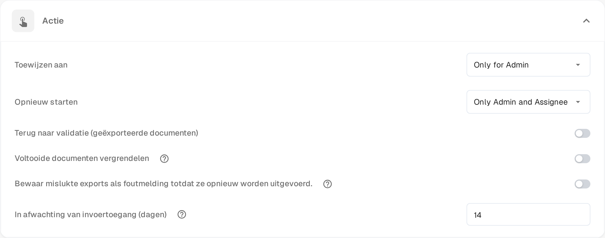

# Pending Input

**Pending Input** pauzeert een document terwijl u op het antwoord van een collega wacht. U stelt de vraag in het activiteitenlogboek van het document en markeert de mensen die moeten antwoorden. Het document verlaat de actieve wachtrij tot zij antwoorden, en de gemarkeerde mensen kunnen het alleen-lezen openen via een link in hun e-mail.

De status verschijnt in het [dashboard](dashboard/README.md) als **Pending Input**, en u kunt de werklijst daarop filteren.

## Om invoer vragen

1. Open het document in een scherm dat het activiteitenlogboek aanbiedt — de goedkeurings- en beoordelingsschermen doen dat — en kies het spraakballonpictogram in de werkbalk.
2. Schrijf uw vraag en typ **@** gevolgd door de naam van de persoon die u wilt vragen. Kies de persoon uit de lijst die verschijnt. De markering geeft de toegang: alleen gemarkeerde mensen ontvangen de link naar het document.
3. Zodra iemand is gemarkeerd, verschijnt onder het invoerveld een vak met twee mogelijkheden:

* **Comment only** (alleen opmerking) – de vraag wordt in het activiteitenlogboek geplaatst en de status blijft ongewijzigd. Gebruik dit als u alleen een antwoord nodig hebt en het document niet wilt vasthouden.
* **Send & set to Pending Input** (verzenden en op Pending Input zetten) – de vraag wordt geplaatst en het document gaat in de wacht. Het verlaat de actieve wachtrij en blijft gepauzeerd tot de gemarkeerde persoon antwoordt.

De gemarkeerde mensen ontvangen een e-mail met een link naar het document. **Enter** of het verzendpictogram plaatsen nog steeds een gewone opmerking zonder toegang te geven; **Shift+Enter** begint een nieuwe regel. Bij een document dat al gepauzeerd is, of bij een document dat nog niet gepauzeerd kan worden, biedt het vak de vraag zonder de pauze-optie aan.

## Een verzoek beantwoorden

U wordt om invoer gevraagd wanneer een collega u in het activiteitenlogboek markeert.

* Open de link uit de e-mail. De pagina **Pending Input** toont links de pagina's van het document en rechts het activiteitenlogboek, met de badge **Pending Input**.
* Uw toegang is alleen-lezen: u kunt het document lezen en in het activiteitenlogboek antwoorden, maar u kunt geen velden wijzigen en niet exporteren.
* Schrijf uw antwoord in het activiteitenlogboek en verzend het. De vraagsteller wordt op de hoogte gebracht en het gesprek blijft in de geschiedenis van het document staan.
* De kop van de pagina laat zien hoe lang uw toegang geldt, bijvoorbeeld **Read-only access until 09.11.2026**. De toegang eindigt ook zodra het document verdergaat.

Opent u de link nadat het verzoek is beantwoord of nadat uw toegang is verlopen, dan meldt de pagina dat het verzoek is afgehandeld of verlopen en dat er niets hoeft te gebeuren.

## Het verzoek afronden

Het document blijft gepauzeerd tot de toegewezen persoon het antwoord oppakt.

1. Open het document vanuit het dashboard. Een gepauzeerd document opent direct op zijn pagina **Pending Input**.
2. Lees het antwoord in het activiteitenlogboek.
3. Kies **Resolve & Proceed** (afronden en doorgaan). Het document gaat verder in de volgende status van zijn workflow, zodat u direct op het scherm komt waar u verder werkt.

Alleen de toegewezen persoon of een lid van de groep waaraan het document is toegewezen, kan het verzoek afronden. Beheerders en goedkeurders kunnen een gepauzeerd document alleen-lezen openen om te zien waarom het wacht.

## De toegangsduur instellen

De functie is in elke organisatie beschikbaar. Wat u kunt instellen, is hoe lang iemand die om invoer is gevraagd toegang tot het document houdt:

1. Open **Instellingen → Dashboard**.
2. Klap **Actie** open.
3. Vul bij **In afwachting van invoertoegang (dagen)** een heel aantal dagen in. De standaardwaarde is **14** en minimaal één dag is vereist.
4. Sla uw wijzigingen op.

De termijn begint bij het verzenden van het verzoek. Hij eindigt eerder wanneer het document wordt afgerond of naar een andere status gaat.

<figure><figcaption>
In afwachting van invoertoegang (dagen) in de sectie Actie van de dashboardinstellingen. De machtigingswaarden erboven worden door het product nog in het Engels getoond.
</figcaption></figure>
