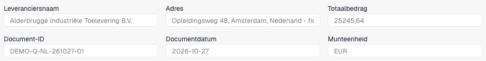
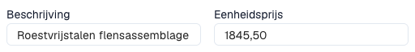

# Offerteregels en prijzen controleren

De offerteweergave geldt voor documenten die daarvoor zijn geconfigureerd. Type, indeling, rechten en workflow bepalen velden en acties. Deze weergave staat los van inkoopordermatching.

<figure><figcaption>
Kop van een fictieve Nederlandse offerte van drie pagina’s in DocBits: leverancier, referentie, datum, valuta en totaal. De uitsnede toont de eerste zes velden.
</figcaption></figure>

Download de fictieve offerte van drie pagina’s (PDF)



## Regels beoordelen en corrigeren

<figure><figcaption>
Omschrijving en eenheidsprijs van de geselecteerde eerste regel. Er zijn geen waarden gewijzigd of opgeslagen.
</figcaption></figure>

1. Open de juiste offerte. Vergelijk leverancier, referentie, datum en valuta met het origineel.
2. Controleer artikelen, omschrijvingen, aantallen, eenheden, prijzen en bedragen. Een gelijk artikelnummer bewijst geen gelijke prijs of eenheid.
3. Selecteer een regel om de details onder de tabel te tonen.
4. Gebruik de geconfigureerde stamgegevenslookup waar beschikbaar. Controleer selectie en ingevulde waarden; onderzoek waarschuwingen.
5. Corrigeer de regel en kies **Opslaan** of **Opslaan en volgende**. **Annuleren** sluit de regeleditor zonder die wijzigingen in te dienen.
6. Kopieer standaardwaarden alleen naar de volgende regel als ze daarbij passen. Controleer de gekopieerde waarden.
7. Open document en regel opnieuw om opgeslagen waarden te controleren. Lees bij een afgewezen regel de beschikbare notitie en los de zakelijke reden op.

## Bijzondere gevallen

Een regel toevoegen maakt een handmatige positie wanneer bewerken is toegestaan. Vergelijk deze met het origineel en vul verplichte velden in. Verwijderen is een aparte handeling; verwijder geen echte positie om totalen gelijk te krijgen.

Controleer bij alleen-lezen documenten rechten, vergrendeling en verwerkingsfase. Onderzoek bij ontbrekende regels origineel, extractie en indeling.

Automatische controles tegen beheerde, laatste of contractprijzen gebruiken [Offertevergelijkingskaarten](../../administration-and-setup/workflow/cards-overview/quote-comparison-guide.md). Opslaan bewijst niet dat deze controles zijn uitgevoerd, goedkeuring is verleend of ERP-export is voltooid.
