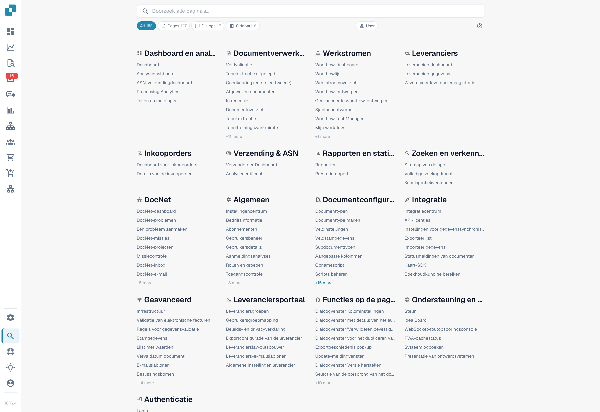
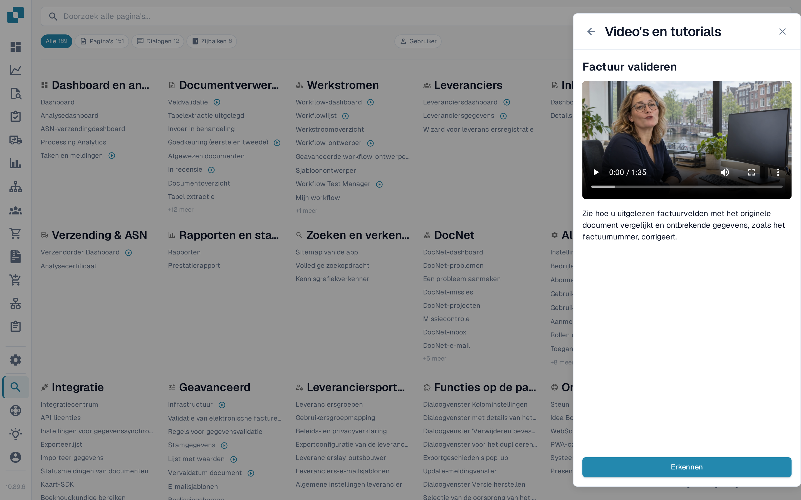

# Sitemap

De Sitemap is de complete, doorzoekbare index van alles wat DocBits biedt — elke pagina, dialoog, zijbalkvermelding, actie en functie binnen pagina's, gegroepeerd per categorie. Het is de uitgebreide tegenhanger van [Globale Snelzoek](global-quick-search.md).

## Hoe te openen

Open de Sitemap vanuit de zijbalk (vermelding nabij de onderkant) of druk op <kbd>Cmd</kbd>/<kbd>Ctrl</kbd> + <kbd>K</kbd> en kies **Alle resultaten bekijken**. De directe URL is `/sitemap`.

<figure><figcaption>
Paginacatalogus in de geselecteerde interfacetaal. Enkele vaste filters en aanduidingen kunnen in de afgebeelde versie nog Engels zijn.
</figcaption></figure>

## Door de catalogus bladeren

De Sitemap is gegroepeerd in categorieën die de structuur van de toepassing weerspiegelen — Instellingen, Documentverwerking, Workflow, Validatie enzovoort. Elke categorie toont eerst de pagina's en daarna de functies binnen pagina's gegroepeerd per subcategorie.

Vermeldingen zijn gekleurd op type:

* **Pagina** — een volledige navigeerbare route.
* **Dialoogvenster** — een modaal venster geopend vanuit een ander deel van de toepassing.
* **Zijbalk / Paneel / Menu** — een navigatie- of context-oppervlak.
* **Actie** — een knop of sneltoets die iets uitvoert zonder te navigeren.

Klik op een willekeurige vermelding om er direct heen te springen. Vermeldingen die een parameter nodig hebben (zoals een documenttype of document-ID) bevatten een inline-selector — kies de waarde voordat u klikt.

## Trainingsvideo's in de lijst

Items van pagina's met een trainingsvideo tonen een video-pictogram achter de naam — niet alleen in Instellingen, maar overal in de catalogus, bijvoorbeeld op het Dashboard, bij Veldvalidatie of op de workflowpagina's. Kies het pictogram om de video van die pagina in het paneel **Video's en tutorials** af te spelen zonder de sitemap te verlaten.

<figure><figcaption>
Items met een trainingsvideo hebben een video-pictogram; een klik opent de video in het paneel.
</figcaption></figure>

Het paneel blijft elke video per onderwerp tonen, dus u kunt de hele bibliotheek ook via het pictogram in de bovenbalk doorbladeren en doorzoeken. Zie [Video's en tutorials](videos-and-tutorials.md).

## Zoeken en filteren

De vaste kop bovenaan bevat het zoekveld en de filterpillen. Typ een paar tekens om de lijst live te filteren op naam en beschrijving. Gebruik de typepillen om te beperken tot één type vermelding — bijvoorbeeld alleen **Dialoogvenster**.

De huidige zoekopdracht en filter worden aan de URL toegevoegd, zodat een gefilterde weergave kan worden opgeslagen als bladwijzer of gedeeld.

<mark>De Sitemap respecteert dezelfde rechtencontrole als de rest van DocBits. Pagina's die u niet kunt openen verschijnen niet.</mark>

## Ontwikkelaarsmodus

Een **Gebruiker / Dev** schakelaar in de kop activeert extra detail voor partnerontwikkelaars:

* Het interne routepad van elke vermelding.
* Parameterlabels (`:docType`, `:docId`, deep-link-sleutels).

De ontwikkelaarsmodus wordt onthouden in uw browser. Schakel terug naar Gebruikersmodus voor de reguliere leesweergave.

## Terug naar boven

De Sitemap is lang. Zodra u voorbij het eerste scherm scrolt, verschijnt rechtsonder een Terug-naar-boven-knop.
