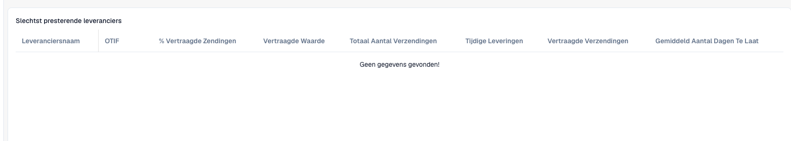

# Leveranciersstatistieken voor leveringen begrijpen

Gebruik deze statistieken om leverprestaties te onderzoeken. De beheerder moet de module inschakelen en relevante verzendgegevens moeten beschikbaar zijn. De cijfers hangen af van de gegevens van uw organisatie.

<figure><figcaption>
Kolommen van de leveranciersstatistieken in een organisatie zonder verzendgegevens. Een lege tabel bewijst geen goede leveringsprestaties.
</figcaption></figure>

## Een leverancier beoordelen

1. Open **Leveranciersstatistieken**. Laat bij een ontbrekende optie module en toegang controleren.
2. Zoek de leverancier in de tabel met slechtst presterende leveranciers.
3. Vergelijk totaal, op tijd en vertraagd geleverde zendingen voordat u percentages beoordeelt. Twee en tweeduizend zendingen zijn verschillende steekproeven.
4. Bekijk **OTIF**, vertragingspercentage, vertraagde waarde en gemiddelde vertragingsdagen samen. OTIF betekent *On Time In Full*: op tijd is niet hetzelfde als volledig geleverd.
5. Vergelijk de grafieken voor OTIF en vertraagde zendingen. Gebruik leveranciers per pagina en paginering voor meer regels.
6. Onderzoek de werkelijke zendingen: beloofde/werkelijke datums, aantallen, leveranciersidentificaties en valuta voordat u contact opneemt met de leverancier.

## Interpreteren en onderzoeken

Aantallen verklaren de steekproef, gemiddelde dagen de duur en vertraagde waarde de betrokken waarde. Leid OTIF niet alleen af uit tijdige leveringen. Tel verschillende valuta niet op zonder afgesproken omrekening.

Een lege tabel of nuldiagram bewijst geen perfecte leverprestatie. Controleer beschikbare gegevens en synchronisatie. De samenvatting verklaart geen afzonderlijke zending.

Bewaar bij afwijkingen leverancier-ID, relevante zendingen, datums en verwachte berekening. Laat bronwaarden en de basis van de indicator controleren.

Zie [Modules](../../administration-and-setup/settings/document-processing/module/README.md) en [Gegevenssynchronisatie](../../administration-and-setup/settings/log-settings/data-synchronization.md).
