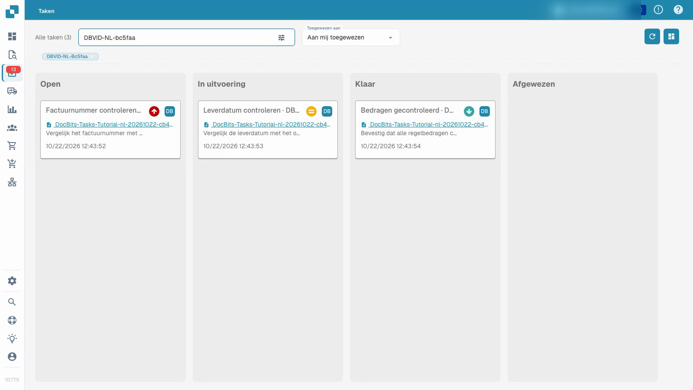
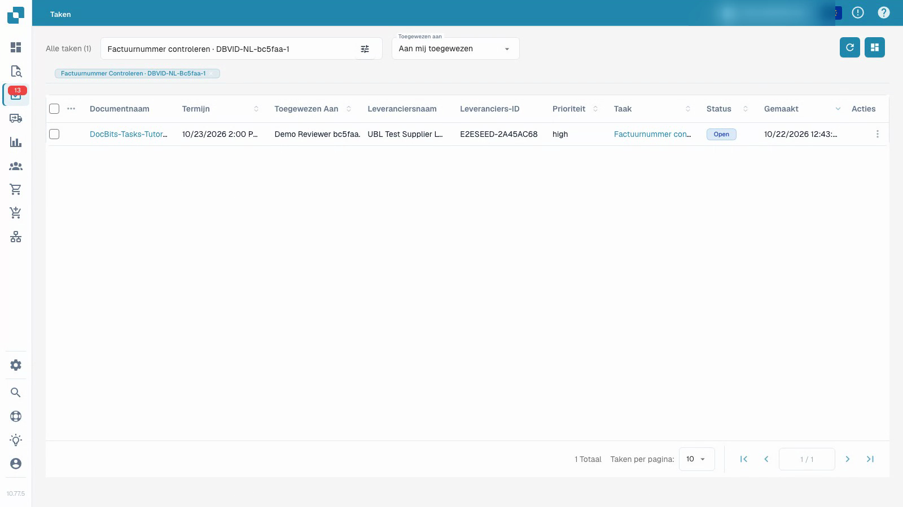

# Taken

De video toont een gewone testgebruiker die aan een taak werkt met synthetische documenten.


Taken


[Bekijk met ondertiteling](https://docbits-videos.fra1.cdn.digitaloceanspaces.com/settings-assistant/document-tasks-customer/v1/nl.html)

Opmerking: Sommige native productlabels zijn mogelijk niet vertaald. De opname behoudt de daadwerkelijke gebruikersinterface.

Gebruik het takenoverzicht om toegewezen werk te vinden en de voortgang ervan te volgen. Het bord groepeert taken op status; de lijst biedt meer details. Filter op toewijzing en gebruik de zoekfunctie om een bepaalde taak te vinden. Prioriteit en deadline helpen bij het plannen van de werkvolgorde.

## Werken aan een toegewezen documenttaak

1. Open een taak en lees de beschrijving en toewijzing.
2. Inspecteer het gekoppelde originele document. Een taaktitel alleen bewijst niet dat het document correct is.
3. Zet de taak op in uitvoering en sla op tijdens het uitvoeren van het werk.
4. Leg het resultaat vast in de taakbeschrijving.
5. Voltooi de taak, sla deze op en herlaad om de opgeslagen status en feedback te bevestigen. Controleer de positie in het takenoverzicht.

De video gebruikt een gewone testgebruiker en synthetische documenten. Het voltooien van een taak staat los van het goedkeuren of exporteren van de bijbehorende factuur. Beschikbare acties zijn afhankelijk van de machtigingen van het account.

## Als u een taak niet als voltooid kunt markeren

Uw organisatie kan beperken wie taken mag afsluiten, dat wil zeggen op **Klaar** of **Afgewezen** zetten. In dat geval worden de knop **Klaar**, de statussen **Klaar** en **Afgewezen** en **Markeer als voltooid** niet aangeboden voor taken die u niet mag afsluiten, en kunt u zo'n taak op het takenbord niet in de kolom **Klaar** of **Afgewezen** neerzetten. Taken die aan u zijn toegewezen, kunt u nog steeds bewerken, opslaan en tussen **Open** en **In uitvoering** verplaatsen.

Een beheerder van uw organisatie bepaalt wie taken mag afsluiten en verwijderen. Zie [Taken en meldingen](../../administration-and-setup/settings/document-processing/module/tasks-and-notifications.md).

<figure><figcaption>
Takenoverzicht met synthetische gegevens.
</figcaption></figure>

<figure><figcaption>
Takenlijst met synthetische demonstratiegegevens.
</figcaption></figure>

## Extra opname


Taken

