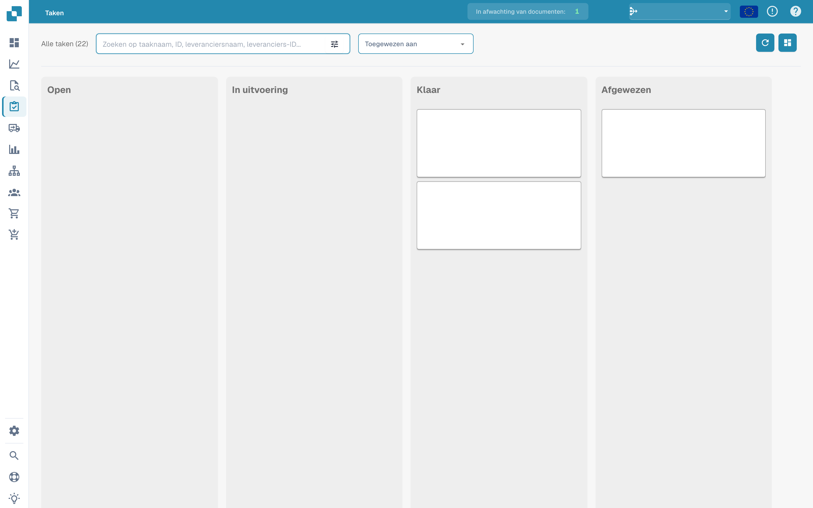
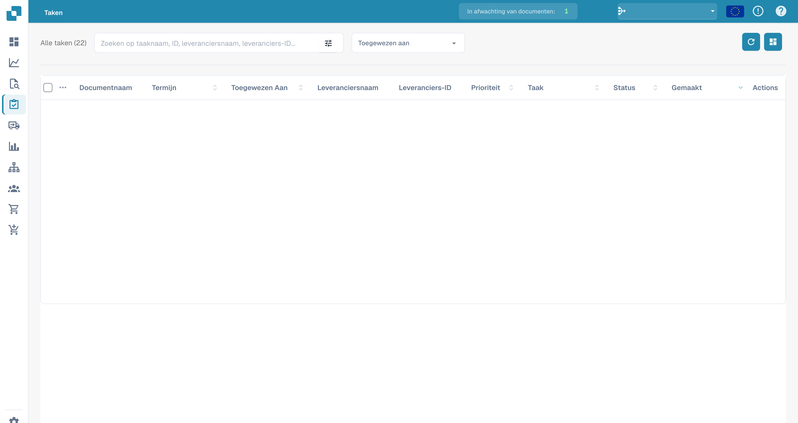

# Taken


DocBits Tutorial voor taken en meldingen: werk toewijzen, status volgen en workflowtaken afhandelen


Dit is waar je een oogje in het zeil kunt houden op je taken. Je kunt kiezen tussen twee verschillende indelingen – de ene is iets gedetailleerder dan de andere. Je kunt ook taken filteren op verschillende criteria, zoals of ze aan jou zijn toegewezen of de status van de taak.

<figure><figcaption>
Takenbord per status; de inhoud van de taken is afgeschermd.
</figcaption></figure>

<figure><figcaption>
Takenlijst met afgeschermde documentgegevens.
</figcaption></figure>
