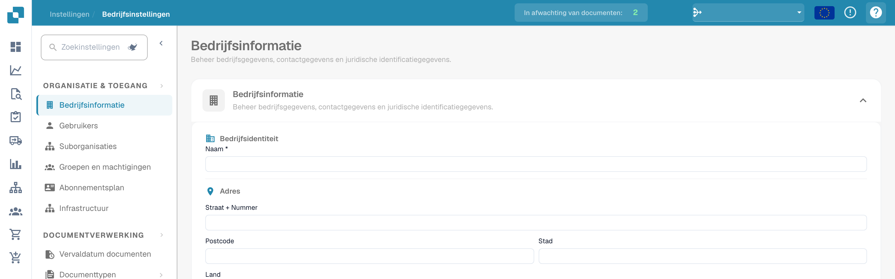

# Help-pictogrammen

Help-pictogrammen zijn overal in DocBits geplaatst om je te helpen bij het leren en begrijpen wat een functie echt doet en hoe het je kan helpen bij je documentverwerking.

Deze help-pictogrammen zien er als volgt uit

<figure><figcaption>
Helppictogram rechtsboven in de instellingen.
</figcaption></figure>
