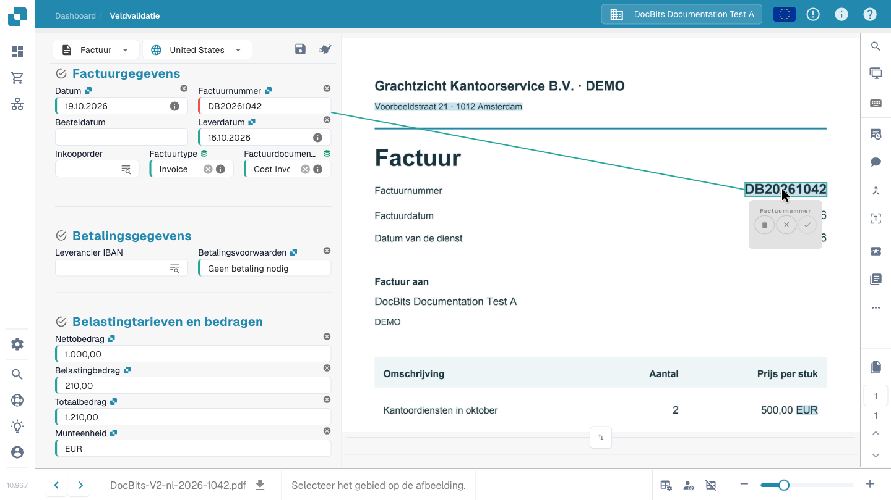

# Validatiescherm

## Een factuur controleren en de verificatie afronden

Volg een factuur van het dashboard tot de overdracht: vergelijk leverancier, datums, factuurnummer, bedragen en valuta met het origineel en lees een melding over een verplicht veld. Selecteer het nummer rechtstreeks op het document, bevestig de koppeling en bewaar de extractieregel met Regels opslaan. In dit voorbeeld wordt de gecontroleerde factuur daarna ter goedkeuring doorgestuurd. De beschikbare acties hangen af van je rechten en het proces van je bedrijf.



## Het validatiescherm openen en gebruiken

Open een document vanuit het dashboard. In **veldvalidatie** vergelijk je de bewerkbare velden met het origineel ernaast. Het documenttype en de ingestelde lay-out bepalen welke velden, tabellen en actieknoppen verschijnen. Versleep de scheidingslijn om de velden of het document meer ruimte te geven.

Gebruik de paginabediening bij documenten met meerdere pagina’s en de zoom om kleine tekst te lezen. De pijlen onderaan wisselen tussen documenten en staan los van de paginabediening.

### Documentoorsprong

Controleer de **documentoorsprong** voordat je datums en bedragen bekijkt. Deze bepaalt hoe DocBits datum- en getalnotaties interpreteert; de instelling vertaalt het document niet en wijzigt de interfacetaal niet. Kies de oorsprong die bij het document hoort en vergelijk de waarden met het origineel.

## Een veld corrigeren en DocBits de bronlocatie leren

Als het factuurnummer verkeerd is uitgelezen:

1. Selecteer het veld **Factuurnummer**.
2. Dubbelklik op het volledige nummer in het origineel of selecteer het gebied waarin het staat.
3. Controleer het voorgestelde veld en bevestig de koppeling met het vinkje wanneer daarom wordt gevraagd.
4. Controleer de veldwaarde en het gemarkeerde brongebied. Selecteer opnieuw als het nummer onvolledig is of aan het verkeerde veld is gekoppeld.
5. Sla het document op. Gebruik daarnaast **Regels opslaan / Save Rules** en bevestig het venster om de extractietraining te bewaren.

<figure><figcaption>
Het nummer geselecteerd op het origineel en gekoppeld aan het veld. Bevestig de koppeling voordat je de regel opslaat.
</figcaption></figure>


Een vervangende waarde intypen corrigeert dit document, maar maakt niet de koppeling met het brongebied die voor deze extractietraining nodig is. Selecteer de waarde op het origineel, bevestig de koppeling en sla de regel op voor hergebruik bij passende documenten van deze leverancier. Training op basis van de afbeelding is niet beschikbaar voor documenten die rechtstreeks als elektronische factuurgegevens zijn gelezen.


## Opslaan, regels bewaren en verder verwerken

| Actie | Resultaat |
| --- | --- |
| **Opslaan** — diskette boven de velden | Bewaart wijzigingen aan het huidige document. Deze actie keurt het document op zichzelf niet goed en exporteert het niet. |
| **Regels opslaan / Save Rules** | Bewaart extractieregels op basis van het document en de koppelingen met brongebieden. Dit staat los van het opslaan van veldwaarden. |
| **Export**, goedkeuring of een andere ingestelde actie | Stuurt het document na de bijbehorende controles naar de volgende ingestelde stap. Actie en nieuwe status hangen af van het proces en je rechten. |

In de video wordt de gecontroleerde factuur ter goedkeuring doorgestuurd. Een knop **Export** garandeert niet dat de factuur al in het doelsysteem voor ERP is aangekomen. Controleer de nieuwe status op het dashboard en eventuele verwerkingsfouten.

## Verplichte velden en validatiemeldingen

Een rode rand of waarschuwingspictogram vraagt aandacht voor een veld. Lees de informatie: er kan een verplichte waarde ontbreken, de extractie kan controle vereisen of een ingestelde controle kan zijn mislukt. Een zichtbare waarde bewijst op zichzelf niet dat het veld geldig is.

Vergelijk leverancier, nummer, datums, bedragen en valuta met het origineel. Controleer bij totalen de betreffende kopvelden en eventuele regels. Verhelp de aangegeven oorzaak voordat je verdergaat. De controles hangen af van het documenttype en de organisatie-instellingen; zie [Automatische controles](automatic-checks-on-the-validation-screen.md).

## De assistent gebruiken

De knop **Assistent** boven de velden toont openstaande validatieproblemen. Open deze en kies **Ga naar veld** om het betreffende veld te controleren. AI-vragen en suggesties hangen af van activering voor je organisatie en je rechten. Lees de melding in het paneel als ze niet beschikbaar zijn. Suggesties wijzigen het formulier: controleer ze en sla het document op om de wijzigingen te bewaren.

## Stamgegevens selecteren

Velden met een ingestelde zoekfunctie kunnen leveranciers, inkooporders of andere stamgegevens doorzoeken. Open de zoekfunctie bij het veld, beperk de resultaten en selecteer de juiste record. Hierdoor kunnen meerdere gekoppelde velden worden ingevuld: controleer die ook. Deze waarden komen uit stamgegevens en kunnen afwijken van de gedrukte tekst. Zie [Fuzzy Data](fuzzy-data.md).

## Factuurregels controleren

Als de lay-out tabellen bevat, vergelijk je regels, omschrijvingen, aantallen, prijzen en bedragen met het document. **Geëxtraheerde tabel** en **Door AI geëxtraheerde tabel** zijn verschillende extractieweergaven. Hun beschikbaarheid hangt af van de ingeschakelde methoden en de lay-out. Een leeg of ontbrekend tabblad verklaart op zichzelf geen extractieprobleem.

Corrigeer cellen en ontbrekende of dubbele regels met de beschikbare bediening. Deze wijzigingen betreffen het huidige document. Herbruikbare tabeltraining, AI-tags en de training van kopvelden zijn afzonderlijke handelingen. Zie [AI-tabeltags](../ai-table/ai-table-tags.md) en [Tabeltraining](../../../administration-and-setup/setup/document-training/training-line-fields-table-training/README.md).

Lees meldingen over verplichte kolommen, regelberekeningen en totalen. Lees de bevestiging voordat je een nieuwe AI-extractie toepast of een tabel opnieuw laat uitlezen: bestaande koppelingen met inkooporders moeten mogelijk worden verwijderd en opnieuw gemaakt.

## Documentweergave en samenwerking

Beweeg de aanwijzer over een pictogram om de naam te lezen. Sommige hulpmiddelen vereisen bepaalde modules, documenttypen of rechten.

| Hulpmiddel | Gebruik |
| --- | --- |
| **Vergrootglas** en zoom | Kleine details in het origineel bekijken. |
| **Afbeelding in een nieuw venster openen** | Dezelfde afbeelding in een apart venster tonen, bijvoorbeeld op een tweede monitor. De interface vermeldt dat dit een Chrome-functie is. |
| **Sneltoetsen** | De hulp openen; zie [Sneltoetsen](keyboard-shortcuts.md). |
| **Taken** | Intern werk voor een persoon of groep aanmaken en volgen. |
| **Activiteitenstroom** | Vastgelegde activiteiten van het document bekijken. |
| **Goedkeuringsgeschiedenis** | Goedkeuringen en afwijzingen bekijken wanneer de functie is ingeschakeld. |
| **Annotatiemodus** | Notities op het document plaatsen als annotaties zijn ingeschakeld. |
| **Samenvoegen / pagina’s toevoegen** | Documenten combineren of ontbrekende pagina’s toevoegen via het beschikbare venster. Controleer de gekozen pagina’s voordat je bevestigt. |
| **OCR-weergave** | Reeds herkende tekst bekijken. Het openen start geen nieuwe OCR-extractie. De functie is niet beschikbaar voor bepaalde elektronische documenten. |
| **Ticket aanmaken** | Een ondersteuningsverzoek met documentcontext en probleembeschrijving voorbereiden. Interne taken worden apart behandeld. |
| **Scriptlogboeken** | Meldingen van documentscripts bekijken als de module is ingeschakeld. Dit is een logboekweergave, geen scripteditor. |

## Meer opties en beheerinstellingen

Bij facturen opent **Meer opties → Documentstroom** het verwerkingsverloop. Afhankelijk van toegang en inrichting kan het menu ook documentsplitsing, een koppeling naar de lay-outsjabloon en extractievoorkeuren voor de leverancier bevatten.

**E-Text gebruiken indien beschikbaar**, **Gestructureerde extractie (AI) gebruiken** en **AI-model** zijn extractie-instellingen voor de leverancier, geen gewone veldcorrecties. Alleen bevoegde beheerders kunnen ze wijzigen. Volg de herstartbevestiging als nieuwe verwerking nodig is. Een lay-outsjabloon stelt het validatieformulier in en wijzigt niet de gedrukte vormgeving van de factuur. Zie [AI-model per leverancier](supplier-specific-ai-model-for-field-and-table-extraction.md).

## Als je niet kunt bewerken of doorgaan

Lees de weergegeven reden: het document kan vergrendeld, alleen-lezen, in een andere status of beperkt voor je rol zijn. Los validatiemeldingen op en overleg met de verantwoordelijke collega of beheerder over toegang en instellingen. Blijft de fout bestaan, raadpleeg dan [Problemen oplossen](troubleshooting/README.md) of bereid een ticket voor met het document en de exacte melding.
