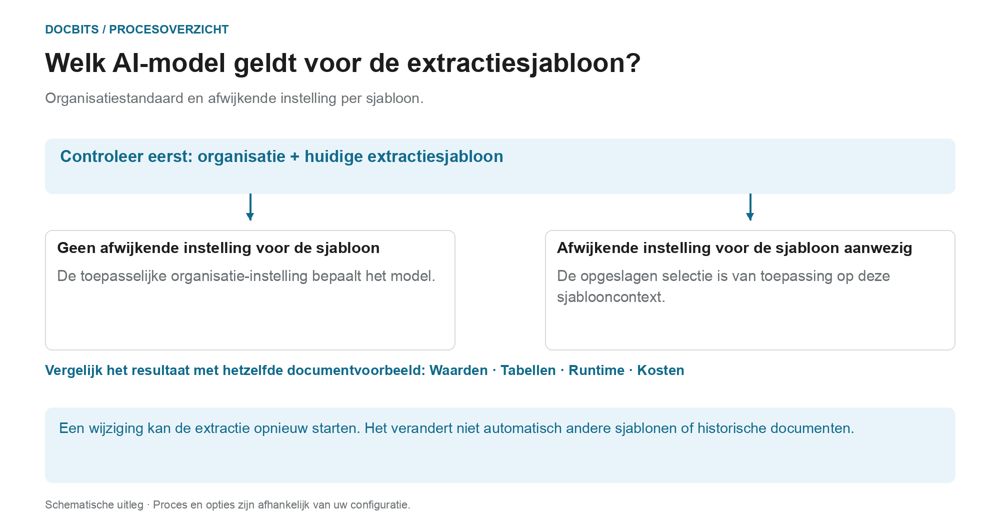

# Leverancierspecifiek AI-model voor Veld- en Tabelextractie

## Van organisatiestandaard naar effectief model

<figure><figcaption>
Organisatiestandaard en afwijkende instelling per sjabloon. Het diagram is schematisch; de actieve instellingen van uw organisatie bepalen het daadwerkelijke gedrag.
</figcaption></figure>

De invoer in het validatiescherm heet het leveranciersspecifieke AI-model. De **huidige extractiesjablooncontext** is echter cruciaal: de afwijkende instelling wordt per organisatie en sjabloon opgeslagen. Een leverancier kan meerdere sjablonen hebben met verschillende instellingen.

1. **Context bepalen:** Controleer de organisatie, het document en de huidige extractiesjabloon voordat u een model wijzigt.
2. **Controleer overschrijven:** Als een model voor deze sjabloon is opgeslagen, wordt deze selectie binnen het bereik ervan van kracht. Als er een afwijkende instelling ontbreekt, is de toepasselijke organisatie-instelling van toepassing.
3. **Bevestig de wijziging bewust:** Selecteer alleen een optie die beschikbaar is in uw omgeving. Voor een wijziging is mogelijk bevestiging nodig en wordt de extractie opnieuw geactiveerd. Alleen het openen van het menu verandert de selectie niet.
4. **Resultaten vergelijken:** Controleer de veldwaarden, tabellen, looptijd en kosten met een vast monster. Een ander modelniveau garandeert geen betere extractie, succesvolle validatie of PO-matching.

**Voorbeeld:** Leverancier A gebruikt de sjablonen “Binnenlandse factuur” en “Buitenlandse factuur”. Een afwijkende instelling voor “Binnenlandse factuur” verandert niet alle facturen van die leverancier. Controleer voor een ander document opnieuw het sjabloon en de effectieve instelling ervan.

De afbeelding toont de selectiehiërarchie, geen aanbeveling voor een specifiek modelniveau. Informatie over de [Organisatorische standaard en afwijkende instellingen](../../../administration-and-setup/settings/document-processing/classification-and-extraction/ai-model.md) en de [Welk extractiepad werd gebruikt?](../../../overview-and-basics/faq/document-processing/which-extraction-path-was-used.md)-diagnose helpen om het daadwerkelijke resultaat te classificeren.

In de gereedschapssectie van het **Validatiescherm** kunt u het AI-model kiezen dat wordt gebruikt voor **Veldextractie** en **Tabelextractie**.\
Het geselecteerde **AI-model** wordt alleen toegepast op alle documenten van de huidige leverancier.

Om het model te wijzigen, opent u het optiemenu door op de knop **Meer opties** (de drie puntjes) aan de rechterkant van het scherm te klikken en kiest u vervolgens een van de beschikbare modellen: 

* **Full** – Hoogste nauwkeurigheid; kost 2 tokens per document
* **Fast** – Standaardtier; kost 1 token per document
* **Nexus** – Kost 1 token per document
* **Nexus Flash** – Snellere tier van de Nexus-familie; kost 1 token per document
* **Auto** – DocBits beslist per document of Fast volstaat of Full nodig is; kost 1 token per document
* **Auto Nexus** – Zoals Auto, maar beperkt tot de Nexus-modelfamilie; kost 1 token per document

<figure><figcaption>
Open het optiemenu en kies het AI-model voor deze leverancier.
</figcaption></figure>

<figure><figcaption>
De keuzelijst AI-model met de zes beschikbare opties.
</figcaption></figure>

Als de resultaten van de **veldextractie** of **tabelextractie** niet bevredigend zijn, probeer dan over te schakelen naar een ander model om de nauwkeurigheid te verbeteren.

Om het AI-model **globaal te configureren voor leveranciers zonder aangepast model** of om te **beheren welk model actief is voor elke leverancier**, raadpleegt u de bijbehorende documentatie [**hier**](../../../administration-and-setup/settings/document-processing/classification-and-extraction/ai-model.md).
