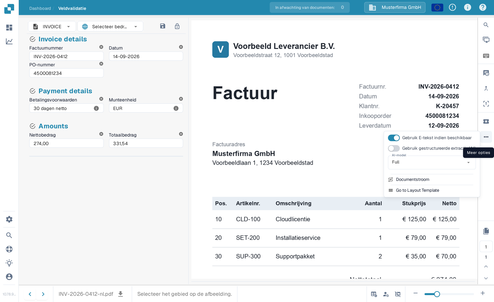
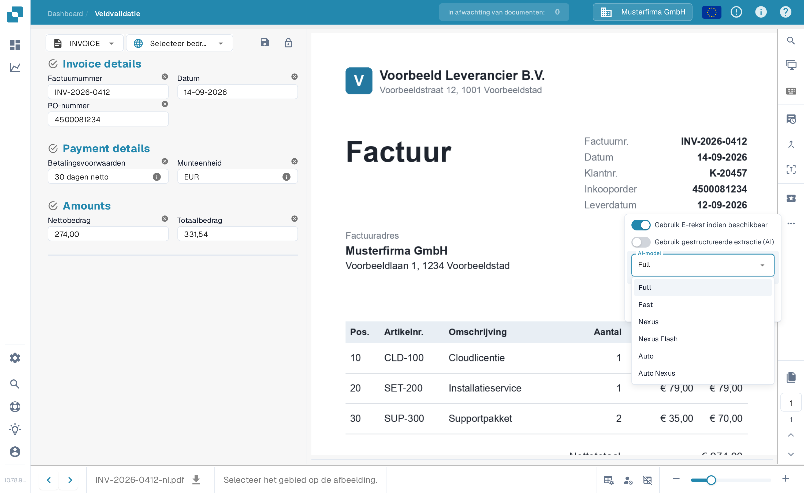

# Leverancierspecifiek AI-model voor Veld- en Tabelextractie

In de gereedschapssectie van het **Validatiescherm** kunt u het AI-model kiezen dat wordt gebruikt voor **Veldextractie** en **Tabelextractie**.\
Het geselecteerde **AI-model** wordt alleen toegepast op alle documenten van de huidige leverancier.

Om het model te wijzigen, opent u het optiemenu door op de knop **Meer opties** (de drie puntjes) aan de rechterkant van het scherm te klikken en kiest u vervolgens een van de beschikbare modellen: 

* **Full** – Hoogste nauwkeurigheid; kost 2 tokens per document
* **Fast** – Standaardtier; kost 1 token per document
* **Nexus** – Kost 1 token per document
* **Nexus Flash** – Snellere tier van de Nexus-familie; kost 1 token per document
* **Auto** – DocBits beslist per document of Fast volstaat of Full nodig is; kost 1 token per document
* **Auto Nexus** – Zoals Auto, maar beperkt tot de Nexus-modelfamilie; kost 1 token per document

<figure><figcaption>
Open het optiemenu en kies het AI-model voor deze leverancier.
</figcaption></figure>

<figure><figcaption>
De keuzelijst AI-model met de zes beschikbare opties.
</figcaption></figure>

Als de resultaten van de **veldextractie** of **tabelextractie** niet bevredigend zijn, probeer dan over te schakelen naar een ander model om de nauwkeurigheid te verbeteren.

Om het AI-model **globaal te configureren voor leveranciers zonder aangepast model** of om te **beheren welk model actief is voor elke leverancier**, raadpleegt u de bijbehorende documentatie [**hier**](../../../administration-and-setup/settings/document-processing/classification-and-extraction/ai-model.md).
