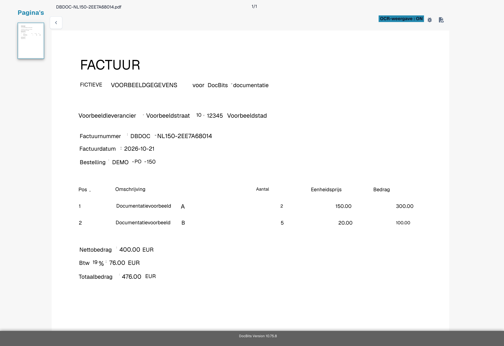
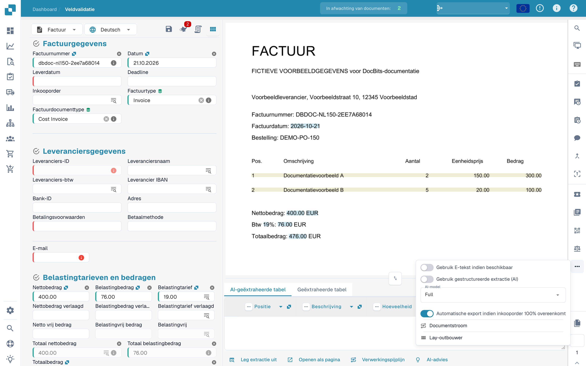
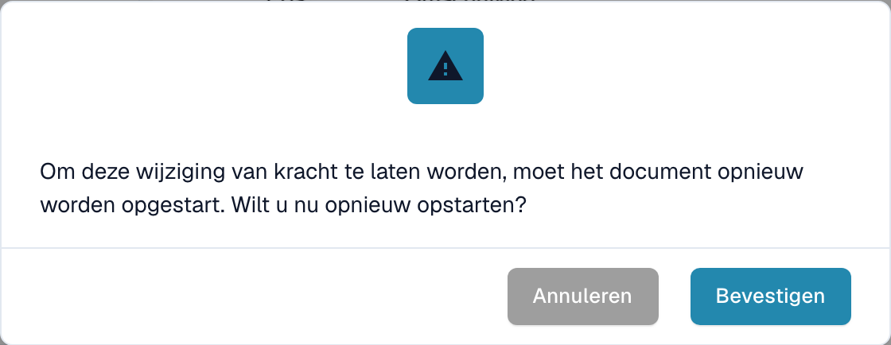
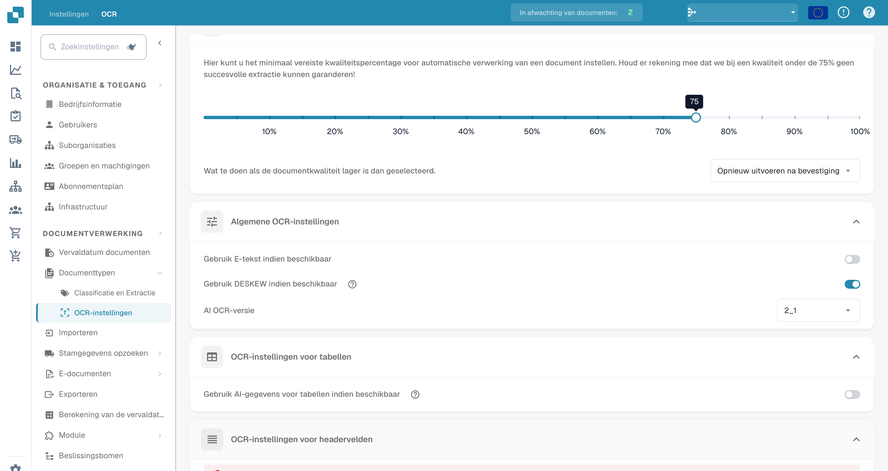
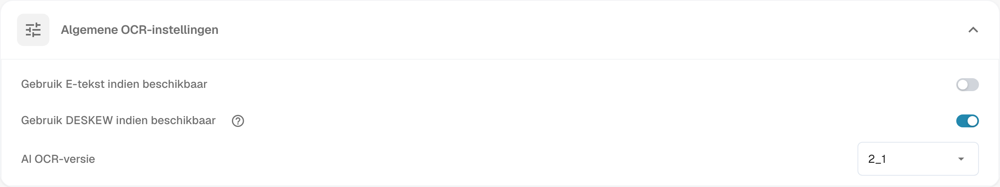

# Ontbrekend Tekst in OCR Extractie

## **Probleem**

In sommige gevallen kan het lijken alsof tekst ontbreekt in de **OCR-weergave**, wat voorkomt dat deze kan worden geëxtraheerd met behulp van de extractiefunctie.

<figure><figcaption>
Velden van een fictieve factuur controleren.
</figcaption></figure>

Om dit te verifiëren, klik op de knop **OCR-weergave** in de werkbalk aan de rechterkant. Als de tekst daar niet verschijnt, betekent dit dat deze niet beschikbaar is voor extractie.

<figure><figcaption>
OCR-weergave van herkende tekst op de fictieve factuur.
</figcaption></figure>

## **Oorzaak**

De meest waarschijnlijke oorzaak is dat de tekst die je probeert te extraheren deel uitmaakt van een afbeelding (bijv. een logo of gescande sectie) binnen het document.\
Wanneer de E-tekst functie is ingeschakeld, wordt tekst die op afbeeldingen of logo's verschijnt niet opgenomen in de geëxtraheerde tekstlaag. Als gevolg hiervan kan deze tekst niet worden benaderd of geëxtraheerd via de standaard extractielogica.

## **Oplossing**

Om dit probleem op te lossen, schakel je de functie E-tekst uit—ofwel voor de [specifieke leverancier](missing-text-in-ocr-extraction.md#e-tekst-uitschakelen-voor-een-specifieke-leverancier) of voor de [hele organisatie](missing-text-in-ocr-extraction.md#e-tekst-uitschakelen-voor-de-hele-organisatie). Zodra E-tekst is gedeactiveerd, zal DocBits uitsluitend op OCR vertrouwen, dat in staat is om tekst uit afbeeldingen en logo's binnen het document te extraheren.

### **E-tekst Uitschakelen voor een Specifieke Leverancier**

1. Open een document van de specifieke leverancier in de **Veldvalidatie**.
2.  Klik op het menu met drie stippen in de werkbalk aan de rechterkant.

<figure><figcaption>
Menu met extra opties bij veldvalidatie.
</figcaption></figure>

3.  Vink **Gebruik E-tekst indien beschikbaar** uit.

<figure><figcaption>
Optie voor elektronische tekst in het documentmenu.
</figcaption></figure>

4.  Klik op **Toevoegen** om de verwerking voor het document opnieuw te starten.

<figure><figcaption>
Bevestiging vóór wijziging van het gebruik van elektronische tekst.
</figcaption></figure>

### E-tekst Uitschakelen voor de Hele Organisatie

1.  Ga naar **Instellingen → Documentverwerking → OCR-instellingen**.

<figure><figcaption>
OCR-instellingen in de Nederlandstalige interface.
</figcaption></figure>

2.  Onder **Algemene OCR-instellingen**, vink de optie **Gebruik E-tekst indien beschikbaar** uit.

<figure><figcaption>
Algemene OCR-instellingen met de optie voor elektronische tekst.
</figcaption></figure>

De afbeeldingen gebruiken een fictieve factuur met beschikbare OCR-tekst. Ze tonen interfacecontroles, geen gereproduceerd incident met ontbrekende tekst.
