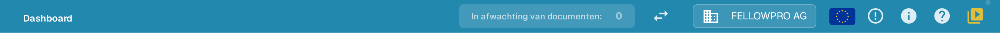
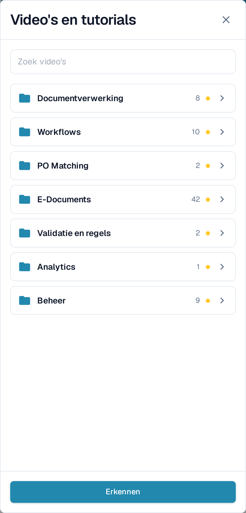
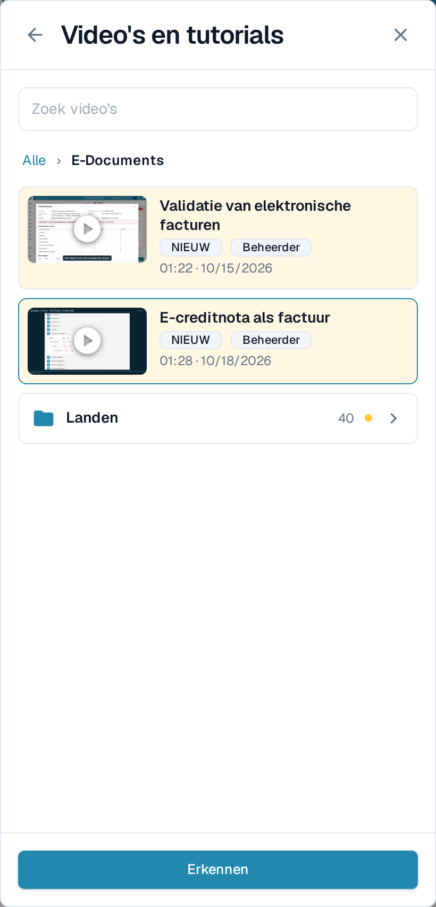
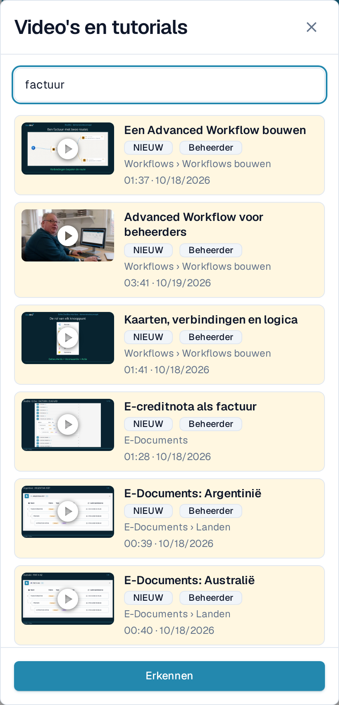
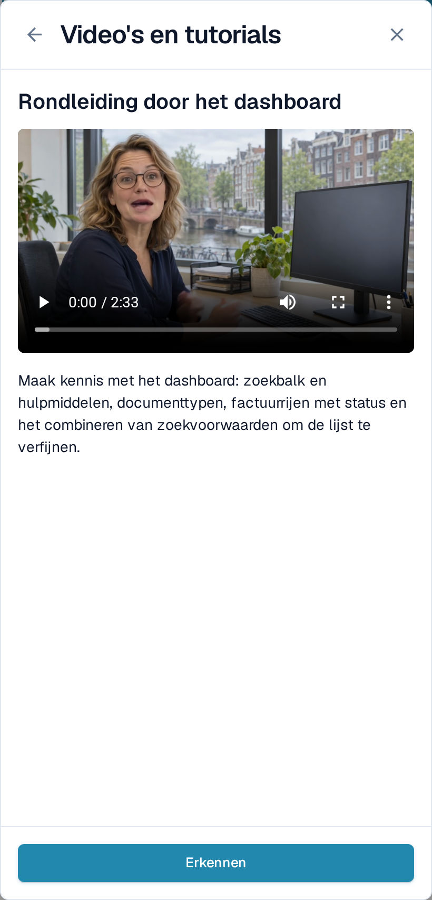

# Video's en tutorials

**Video's en tutorials** speelt korte DocBits-video's af zonder dat u de pagina verlaat waarop u werkt. De video's zijn gegroepeerd per onderwerp, zodat u snel de video vindt die bij uw taak hoort.

## Het paneel openen

Het videopictogram staat helemaal rechts in de bovenbalk, na het hulppictogram.

<figure><figcaption>
Het videopictogram is het laatste pictogram in de bovenbalk.
</figcaption></figure>

* Het pictogram is **geel met een klein stipje** zolang minstens één video nog niet is erkend.
* Het krijgt dezelfde kleur als de overige pictogrammen zodra u elke video hebt erkend.

Selecteer het pictogram om **Video's en tutorials** als paneel aan de rechterkant te openen.

<figure><figcaption>
Het paneel opent op de lijst met onderwerpen. Elk onderwerp is een map met het aantal video's erin.
</figcaption></figure>

## Een onderwerp doorbladeren

Het paneel opent op de **onderwerpmappen**, bijvoorbeeld **Documentverwerking**, **Workflows**, **E-Documents** of **Beheer**. Een map laat zien hoeveel video's hij bevat en toont de markering **NIEUW** zolang hij een video bevat die u nog niet hebt erkend.

Selecteer een map om hem te openen. Daarin vindt u de video's van dat onderwerp en, bij een omvangrijk onderwerp, extra mappen die ze groeperen, zoals **Landen** onder **E-Documents**. Het kruimelpad bovenaan en de terugpijl brengen u een niveau omhoog. Een video die u vanuit een map hebt geopend, keert bij het sluiten terug naar die map.

<figure><figcaption>
Open een onderwerp om de video's en submappen ervan te zien.
</figcaption></figure>

## Naar een video zoeken

Typ in **Zoek video's** om alle onderwerpen tegelijk te doorzoeken. Elk resultaat noemt de map waartoe het behoort, bijvoorbeeld **Workflows › Workflows bouwen**, zodat u weet waar de video staat. De zoekfunctie vindt ook namen van onderwerpen en mappen en let niet op hoofdletters of accenten.

<figure><figcaption>
De zoekfunctie omvat alle onderwerpen en toont bij elk resultaat de map.
</figcaption></figure>

Maak het zoekveld leeg om terug te keren naar de onderwerpmappen.

## Een video bekijken en erkennen

Selecteer een video om hem in het paneel af te spelen. De titel en een korte beschrijving vertellen waarover de video gaat.

<figure><figcaption>
Speel de video af in het paneel en erken hem daarna.
</figcaption></figure>

Selecteer **Erkennen** wanneer u de video hebt bekeken. Daarmee geldt hij alleen voor uw gebruiker als gezien: de markering **NIEUW** verdwijnt voor u bij de video en bij de map, en het pictogram in de bovenbalk wordt grijs zodra er niets meer openstaat. Andere gebruikers zien nog steeds hun eigen niet-erkende video's.

## Video's voor beheerders en voor gebruikers

* Video's met de markering **Beheerder** zijn bedoeld voor beheerders. Beheerders zien in het paneel zowel de beheerders- als de eindgebruikersvideo's; eindgebruikers zien alleen de eindgebruikersvideo's.
* Is een video niet beschikbaar in uw interfacetaal, dan wordt de Engelse versie getoond met een taalcode zoals **EN**.


De schermafbeeldingen tonen de DocBits-testorganisatie met de applicatie ingesteld op Nederlands.

