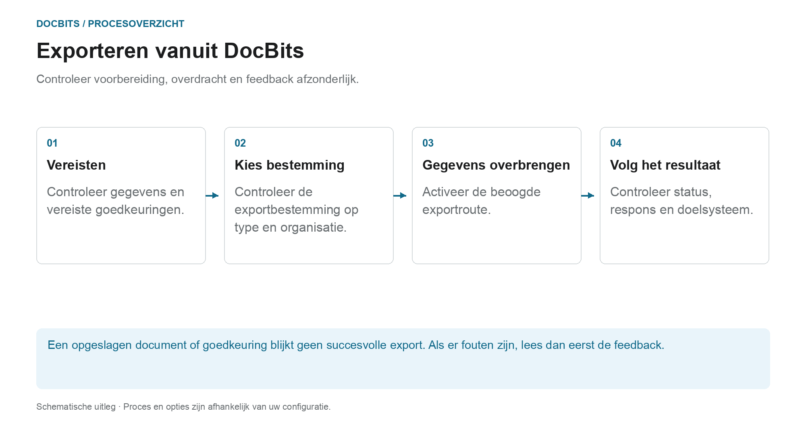

# Exporteren in DocBits

## Van het gecontroleerde document naar het doelsysteem

<figure><figcaption>
Controleer voorbereiding, overdracht en feedback afzonderlijk. Het diagram is schematisch; de actieve instellingen van uw organisatie bepalen het daadwerkelijke gedrag.
</figcaption></figure>

Bij het exporteren draagt de DocBits documenten en gegevens over naar een bestaande verbinding. Of een export automatisch wordt aangeboden of geactiveerd, hangt af van het documenttype, de status, de workflow en de exportconfiguratie.

1. **Controleer de vereisten:** Bekijk de documentgegevens, openstaande taken en goedkeuringen die vereist zijn voor uw proces. Succesvolle PO-matching vervangt deze stappen niet.
2. **Exportbestemming verduidelijken:** Controleer welke configuratie van toepassing is op het documenttype en de organisatie of suborganisatie. Het exportbeheer ondersteunt onder meer Infor, Infor & IDM, Webhook en SFTP. De daadwerkelijke leveringsomvang is afhankelijk van de opgebouwde verbinding.
3. **Overdracht activeren:** Gebruik de beoogde documentactie of geconfigureerde workflow. Een alternatieve export wordt apart ingericht; de beschikbaarheidsstatus is niet de status die moet worden ingesteld na het exporteren.
4. **Feedback controleren:** Controleer de documentstatus en beschikbare reacties van ontvangers. Voor een end-to-end controle controleer je ook het bijbehorende proces in het doelsysteem. Voor Infor kunnen verdere verwerkingsstappen volgen in ION en ERP.

### Als het exporteren mislukt

Open de foutdetails voordat u opnieuw exporteert. Herhaaldelijke verzending zal een onjuiste toewijzing of een afwijzing door de ontvanger niet oplossen. Gebruik het antwoord om documentwaarden, mapping en doelconfiguratie te controleren, en controleer of er al een transactie is aangemaakt in het doelsysteem.

### Verdere instructies

- [Exportmodule](export-module.md): Aan de slag met beheer.
- [Configuratie exporteren](../../administration-and-setup/settings/document-processing/export.md): Aansluitingen en scopes.
- [Alternatieve export](alternate-export.md): apart exportpad per documenttype en status.
- [Exporteren naar Infor](../exporting-to-infor/README.md): stroomafwaartse Infor-verwerking.

Een handleiding voor het exporteren van documenten in DocBits.
