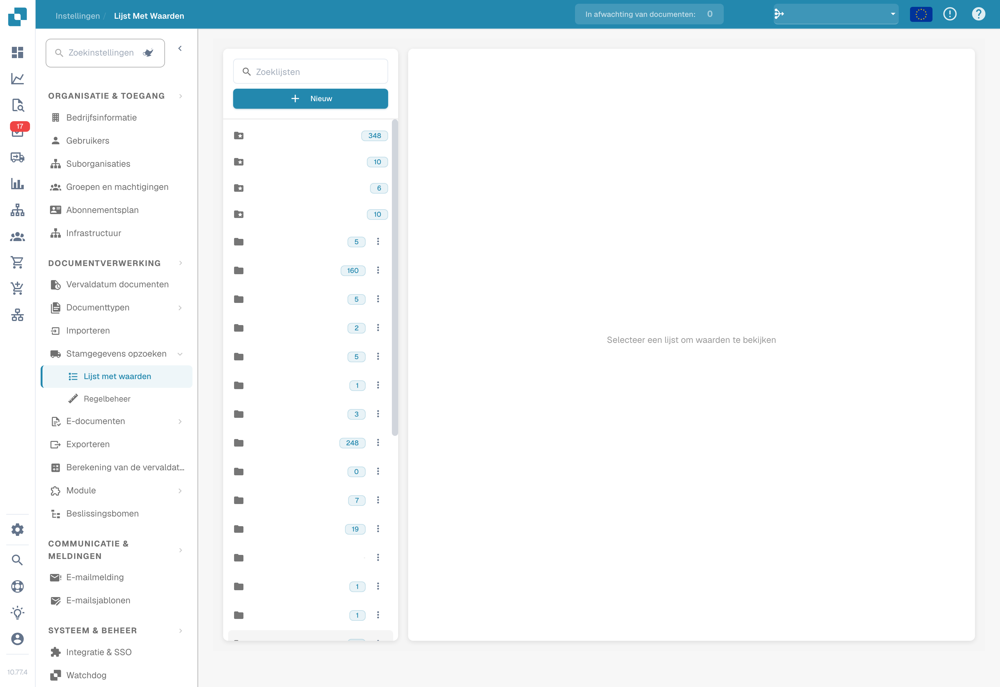
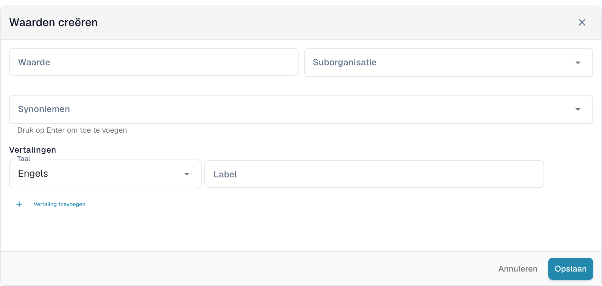
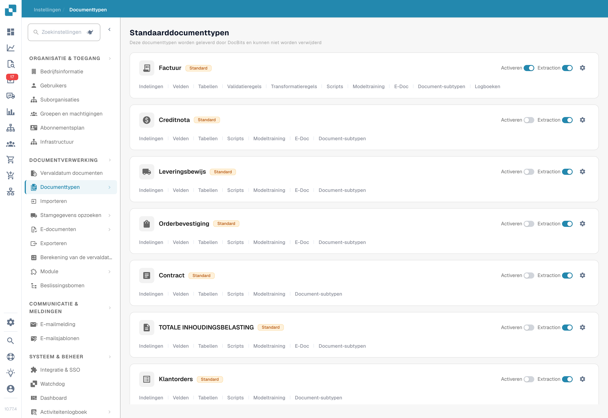
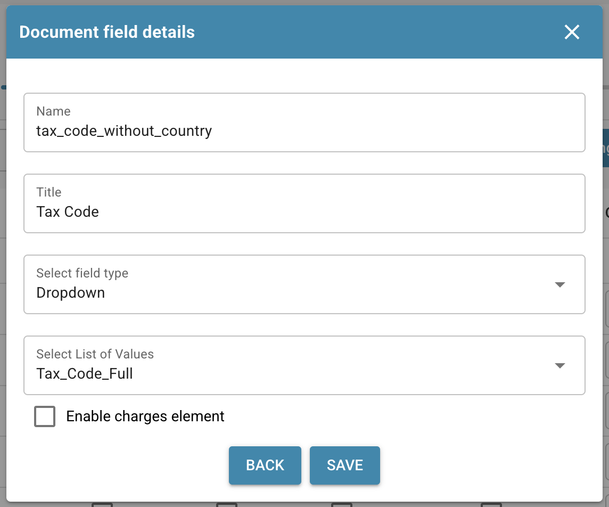
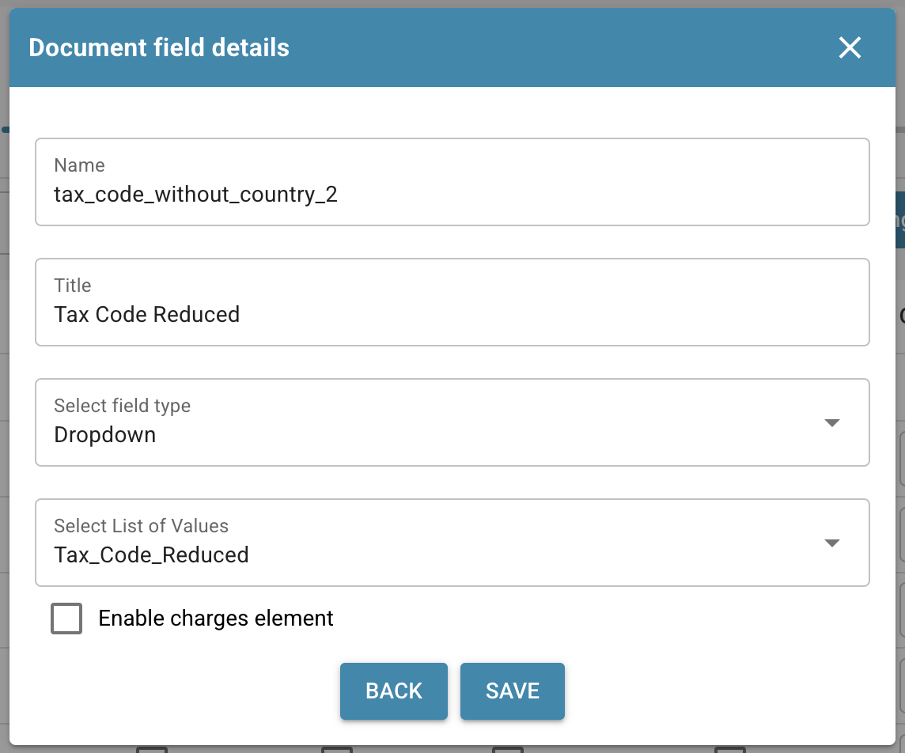
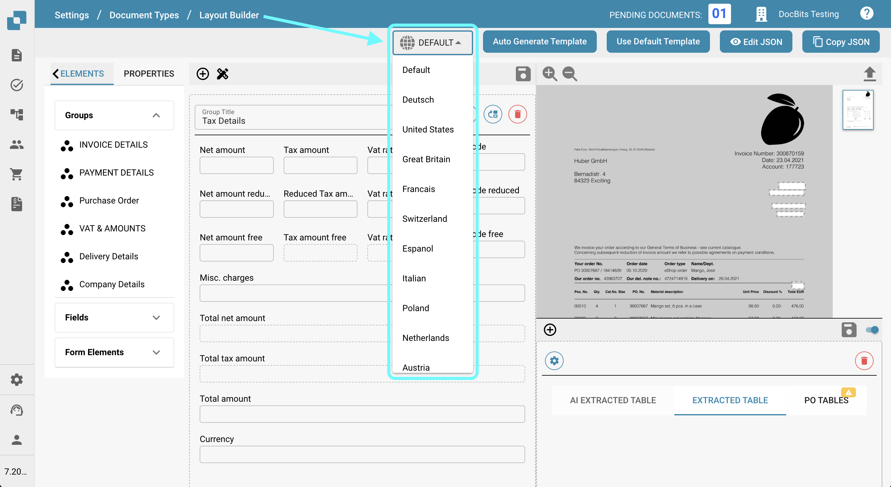
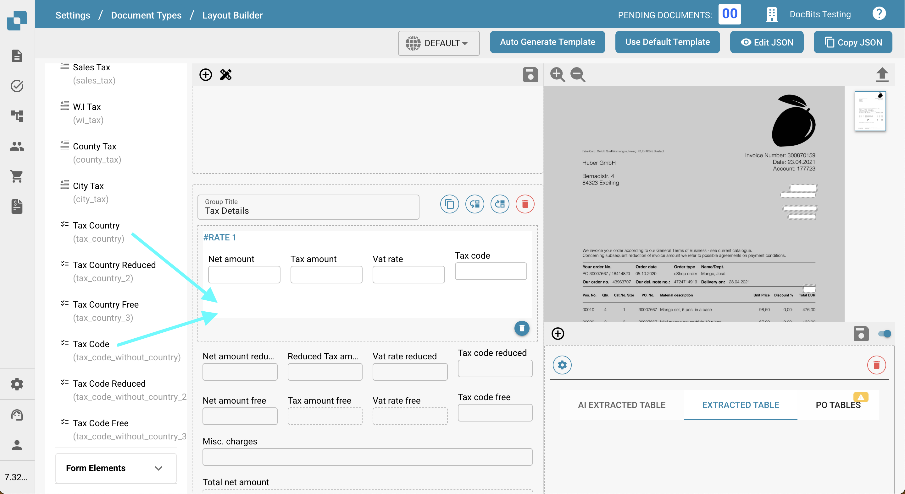
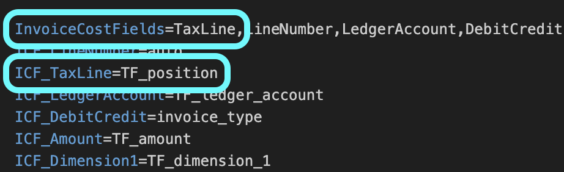

# Belastingcodes exporteren naar LN

## **Overzicht:**

\
Deze handleiding leidt u door het installatieproces om ervoor te zorgen dat belastingcodes correct vanuit DocBits naar LN worden geëxporteerd.

## **Enkele belastingcodes**

### **Stap 1: Lijst met waarden instellen**

1.  Ga naar **Instellingen** -> **Documentverwerking** -> **Lijst met waarden**.

    <figure><figcaption>
Waardenlijsten in DocBits; de namen van organisatiespecifieke lijsten zijn afgeschermd.
</figcaption></figure>
2.  Klik op **New**.

    <figure><figcaption></figcaption></figure>
3.  Maak een lijst met de naam `Tax_Country` en klik op **Save**.

    <figure><figcaption></figcaption></figure>
4.  Maak de volgende drie extra lijsten aan:

    * `Tax_Code_Full`
    * `Tax_Code_Reduced`
    * `Tax_Code_Free`

    
<figure><figcaption></figcaption></figure> <figure><figcaption></figcaption></figure> <figure><figcaption></figcaption></figure>

5.  Klik op een van de nieuw aangemaakte lijsten om deze te openen. Klik vervolgens op de knop **Add Row** om een nieuwe rij toe te voegen.

    <figure><figcaption></figcaption></figure>
6.  Voer de gewenste bijbehorende waarden uit **LN** in en klik op **Save** om de wijzigingen op te slaan.

    * Als u meerdere waarden hebt, kunt u op **Add More Values** klikken om ze toe te voegen.

    
<figure><figcaption></figcaption></figure> <figure><figcaption>
Formulier voor een nieuwe waarde met suborganisatie, synoniemen en vertalingen. Er is geen waarde ingevoerd of opgeslagen; de taalselectie betreft de vertaling van de waarde.
</figcaption></figure>

    * **OPMERKING:** U vindt de belastingcodes in LN onder: **Common** → **Taxation** → **Master Data** → **Tax Codes** → **Tax Codes by Country**

    <figure><figcaption></figcaption></figure>

### **Stap 2: Velden toevoegen in DocBits**

1.  Ga naar **Settings** -> **Global Settings** -> **Document Types**.

    <figure><figcaption>
Documenttypen: kies Velden bij het betreffende type. De ingestelde schakelaars zijn niet gewijzigd.
</figcaption></figure>
2.  Kies het menu **Fields** van het documenttype waaraan u de velden wilt toevoegen.

    <figure><figcaption></figcaption></figure>
3.  Maak onder **VAT & Amounts** zes nieuwe velden aan, als volgt:

    <figure><figcaption></figcaption></figure>

<table data-header-hidden><thead><tr><th width="306"></th><th width="139"></th><th width="119"></th><th></th></tr></thead><tbody><tr><td><strong>Naam</strong></td><td><strong>Titel</strong></td><td><strong>Veldtype</strong></td><td><strong>Lijst met waarden</strong></td></tr><tr><td><code>tax_country</code></td><td>Belasting land</td><td>Dropdown</td><td>Tax_Country</td></tr><tr><td><code>tax_country_2</code></td><td>Belastingland verlaagd</td><td>Dropdown</td><td>Tax_Country</td></tr><tr><td><code>tax_country_3</code></td><td>Belastingland Gratis</td><td>Dropdown</td><td>Tax_Country</td></tr><tr><td><code>tax_code_without_country</code></td><td>Belastingcode</td><td>Dropdown</td><td>Tax_Code_Full</td></tr><tr><td><code>tax_code_without_country_2</code></td><td>Belastingwet verlaagd</td><td>Dropdown</td><td>Tax_Code_Reduced</td></tr><tr><td><code>tax_code_without_country_3</code></td><td>Belastingcode gratis</td><td>Dropdown</td><td>Tax_Code_Free</td></tr></tbody></table>

<figure><figcaption></figcaption></figure> <figure><figcaption></figcaption></figure> <figure><figcaption></figcaption></figure>

<figure><figcaption></figcaption></figure> <figure><figcaption></figcaption></figure> <figure><figcaption></figcaption></figure>

4.  Klik na het opslaan van elk veld op **Save Settings** om de wijzigingen toe te passen.

    <figure><figcaption></figcaption></figure>

### **Stap 3: Lay-out bewerken**

1.  Ga naar **Settings** -> **Global Settings** -> **Document Types**.

    <figure><figcaption>
Documenttypen: kies Velden bij het betreffende type. De ingestelde schakelaars zijn niet gewijzigd.
</figcaption></figure>
2.  Open het menu **Edit Layout** voor het documenttype dat u wilt bewerken.

    <figure><figcaption></figcaption></figure>
3.  Selecteer de juiste **Document Origin** waarvoor u de belastingcodes wilt toepassen.

    <figure><figcaption></figcaption></figure>
4.  Scroll omlaag naar de sectie **Tax Details**.

    <figure><figcaption></figcaption></figure>
5. Klap het keuzemenu **Form Elements** open.
6.  Gebruik in de sectie **Tax Details** de **Horizontal Separator Tool**. Sleep deze tussen de subsecties binnen de belastingsectie om ze duidelijk van elkaar te scheiden en verwarring te beperken.

    <figure><figcaption></figcaption></figure>
7. Klap het keuzemenu **Form Fields** open.
8.  Zoek naar **Tax Country** en sleep het veld naar het bijbehorende gebied.

    <figure><figcaption></figcaption></figure>
9.  Zoek naar **Tax Code** en sleep het veld naar het bijbehorende gebied.

    <figure><figcaption></figcaption></figure>
10. Sla het sjabloon op.

    <figure><figcaption></figcaption></figure>

### Stap 4: Controleren of alles werkt

Nadat u een nieuw document in DocBits hebt geüpload met de juiste documentinstellingen, kunt u nu de belastingcodes selecteren die u in stap 1 aan de lijsten hebt toegevoegd.

<figure><figcaption></figcaption></figure>

## Meerdere belastingcodes

### **Stap 1: Lijst met waarden instellen**

1.  Ga naar **Instellingen** -> **Documentverwerking** -> **Lijst met waarden**.

    <figure><figcaption>
Waardenlijsten in DocBits; de namen van organisatiespecifieke lijsten zijn afgeschermd.
</figcaption></figure>
2.  Klik op **New**.

    <figure><figcaption></figcaption></figure>
3.  Maak een lijst met de naam `Tax_Country` en klik op **Save**.

    <figure><figcaption></figcaption></figure>
4.  Maak de volgende drie extra lijsten aan:

    * `Tax_Code_Full`
    * `Tax_Code_Reduced`
    * `Tax_Code_Free`

    
<figure><figcaption></figcaption></figure> <figure><figcaption></figcaption></figure> <figure><figcaption></figcaption></figure>

5.  Klik op een van de nieuw aangemaakte lijsten om deze te openen. Klik vervolgens op de knop **Add Row** om een nieuwe rij toe te voegen.

    <figure><figcaption></figcaption></figure>
6.  Voer de gewenste bijbehorende waarden uit **LN** in en klik op **Save** om de wijzigingen op te slaan.

    * Als u meerdere waarden hebt, kunt u op **Add More Values** klikken om ze toe te voegen.

    
<figure><figcaption></figcaption></figure> <figure><figcaption>
Formulier voor een nieuwe waarde met suborganisatie, synoniemen en vertalingen. Er is geen waarde ingevoerd of opgeslagen; de taalselectie betreft de vertaling van de waarde.
</figcaption></figure>

    * **OPMERKING:** U vindt de belastingcodes in LN onder: **Common** → **Taxation** → **Master Data** → **Tax Codes** → **Tax Codes by Country**

    <figure><figcaption></figcaption></figure>

### **Stap 2: Velden toevoegen in DocBits**

1.  Ga naar **Settings** -> **Global Settings** -> **Document Types**.

    <figure><figcaption>
Documenttypen: kies Velden bij het betreffende type. De ingestelde schakelaars zijn niet gewijzigd.
</figcaption></figure>
2.  Kies het menu **Fields** van het documenttype waaraan u de velden wilt toevoegen.

    <figure><figcaption></figcaption></figure>
3.  Maak onder **VAT & Amounts** zes nieuwe velden aan, als volgt:

    <figure><figcaption></figcaption></figure>

<table data-header-hidden><thead><tr><th width="306"></th><th width="139"></th><th width="119"></th><th></th></tr></thead><tbody><tr><td><strong>Naam</strong></td><td><strong>Titel</strong></td><td><strong>Veldtype</strong></td><td><strong>Waarde</strong></td></tr><tr><td><code>tax_country</code></td><td>Belasting land</td><td>Dropdown</td><td>Tax_Country</td></tr><tr><td><code>tax_country_2</code></td><td>Belastingland verlaagd</td><td>Dropdown</td><td>Tax_Country</td></tr><tr><td><code>tax_country_3</code></td><td>Belastingland Gratis</td><td>Dropdown</td><td>Tax_Country</td></tr><tr><td><code>tax_code_without_country</code></td><td>Belastingcode</td><td>Dropdown</td><td>Tax_Code_Full</td></tr><tr><td><code>tax_code_without_country_2</code></td><td>Belastingwet verlaagd</td><td>Dropdown</td><td>Tax_Code_Reduced</td></tr><tr><td><code>tax_code_without_country_3</code></td><td>Belastingcode gratis</td><td>Dropdown</td><td>Tax_Code_Free</td></tr></tbody></table>

<figure><figcaption></figcaption></figure> <figure><figcaption></figcaption></figure> <figure><figcaption></figcaption></figure>

<figure><figcaption></figcaption></figure> <figure><figcaption></figcaption></figure> <figure><figcaption></figcaption></figure>

4.  Klik na het opslaan van elk veld op **Save Settings** om de wijzigingen toe te passen.

    <figure><figcaption></figcaption></figure>

### **Stap 3: Lay-out bewerken**

1.  Ga naar **Settings** -> **Global Settings** -> **Document Types**.

    <figure><figcaption>
Documenttypen: kies Velden bij het betreffende type. De ingestelde schakelaars zijn niet gewijzigd.
</figcaption></figure>
2.  Open het menu **Edit Layout** voor het documenttype dat u wilt bewerken.

    <figure><figcaption></figcaption></figure>
3.  Selecteer de juiste **Document Origin** waarvoor u de belastingcodes wilt toepassen.

    <figure><figcaption></figcaption></figure>
4.  Scroll omlaag naar de sectie **Tax Details**.

    <figure><figcaption></figcaption></figure>
5. Klap het keuzemenu **Form Elements** open.
6.  Gebruik in de sectie Tax Details de tool **Sub Group**. Sleep deze naast een bestaand veld.

    <figure><figcaption></figcaption></figure>
7.  Om uw subgroep een naam te geven, klikt u op de subgroep en voert u de gewenste naam in het veld **Label** in.

    
<figure><figcaption></figcaption></figure> <figure><figcaption></figcaption></figure>

8.  Sleep de velden die bij deze groep horen naar het veld **Sub Group**.

    <figure><figcaption></figcaption></figure>
9. Klap het keuzemenu **Fields** open.
10. Zoek naar **Tax** en sleep de betreffende velden, zoals **Tax Country** en **Tax Code**, naar de bijbehorende subgroep.

    <figure><figcaption></figcaption></figure>
11. Herhaal stap 5 tot en met 10 twee keer om de volgende situatie te bereiken:

    <figure><figcaption></figcaption></figure>
12. Sla het sjabloon op.

    <figure><figcaption></figcaption></figure>

### Stap 4: Controleren of alles werkt en de resulterende wijzigingen

Nadat u een nieuw document in DocBits hebt geüpload met de juiste documentinstellingen, kunt u de in stap 1 toegevoegde belastingcodes selecteren en meerdere belastingcodes toevoegen die in stap 3 zijn geconfigureerd.

* Het document begint met drie afzonderlijke secties: één voor bedragen met volledig tarief (Tax Full), één voor bedragen met verlaagd tarief (Tax Reduced) en één voor belastingvrije bedragen (Tax Free).
* Als u in een sectie op de plusknop klikt, wordt een duplicaat gemaakt, zodat u meerdere regels tegen het geselecteerde belastingtarief kunt invoeren.

<figure><figcaption></figcaption></figure>

* Secties kunt u verwijderen door op de verwijderknop te klikken.

<figure><figcaption></figcaption></figure>

* De totaalbedragen worden berekend als de som van alle secties.
* De validatie van het totaalbedrag wordt aangepast op basis van alle belastingsecties.
* Scripts voor nieuwe secties kunnen pas worden toegepast nadat de velden aan de weergave zijn toegevoegd.

### Opmerking voor LN:

In **LN** wordt USt Position ingevuld op basis van het positienummer uit het keuzemenu Tax Code/Tax Country. Alleen het positienummer wordt naar de export gestuurd.

<figure><figcaption></figcaption></figure>

<figure><figcaption></figcaption></figure>

#### **Export Mapping**

Om de Tax Line aan de Cost Line te koppelen:

1. Voeg `TaxLine` toe aan de lijst **InvoiceCostFields**.
2. Voeg het volgende item toe, volgens onderstaand voorbeeld:\
   `ICF_TaxLine = TF_position`

<figure><figcaption></figcaption></figure>
