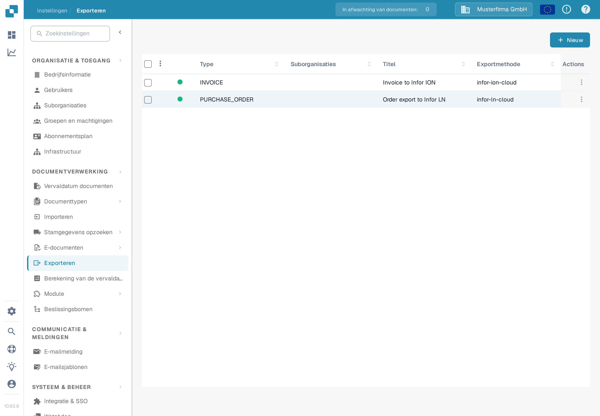
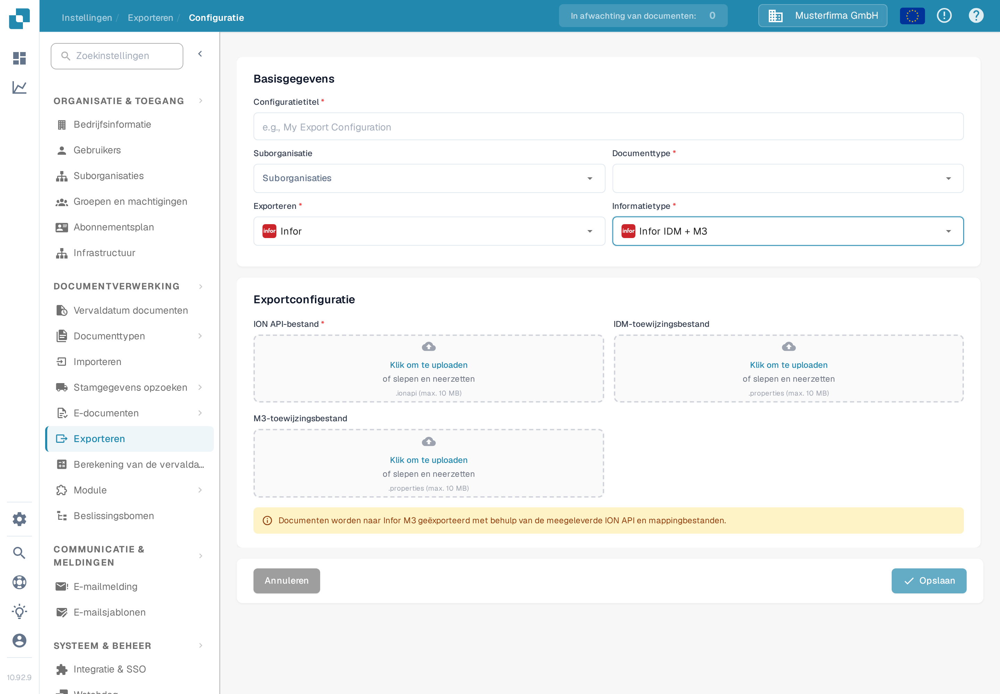

# Een Infor M3-export configureren

Op deze pagina worden de controles uitgelegd die een exportconfiguratie van DocBits verbinden met een documentflow van Infor ION voor M3. De vorige pagina bevatte 38 schermafbeeldingen van een oudere Infor-tenant, inclusief omgevingspecifieke API- en mappinginstellingen. Zij kunnen de configuratie in uw tenant niet vaststellen, daarom verwijst de huidige gids naar de instructies van Infor en toont het geverifieerde Nederlandse DocBits-formulier. Voor deze update zijn geen Infor-verbinding of factuurexport getest.

## De Infor-tenant voorbereiden

Vraag de Infor-beheerder om het goedgekeurde **ION API-eindpunt**, een tenant-specifiek `.ionapi`-bestand, de `.properties`-bestanden van de **IDM-mapping** en **M3-mapping**, en de namen van de BOD-mappings die door het factuurproces van dit bedrijf worden gebruikt. Het `.ionapi`-bestand bevat inloggegevens; houd het buiten schermafbeeldingen, Jira-bijlagen en Git. De `ci`-waarde ervan is de client-ID, zoals beschreven in [de Infor-referentie voor gegevensvelden](https://docs.infor.com/crm/9.4.x/en-us/webclient/upi1639111995644.html).

De beheerder zou in ION Desk het volgende moeten doen:

1. De mappingversies importeren en goedkeuren die de huidige tenant vereist. Controleer de invoer- en uitvoer-BOD-namen van de mappings in plaats van namen uit een oude schermafbeelding opnieuw te gebruiken.
2. De verbindingspunten van DocBits en M3 controleren, met hun omgevingspecifieke logische ID's, documentabonnementen en machtigingen.
3. De documentflow opbouwen met de goedgekeurde mappings en de eventueel vereiste filters. Infor legt [verbindingspunten, mappings en documentflows](https://docs.infor.com/inforos/2024.x/en-us/useradminlib_cloud/iondeskceug_cloud_osm/lnj1556623308383.html) uit.
4. De documentflow pas opslaan, beoordelen en [activeren](https://docs.infor.com/depm/2024.x/en-us/depmolh/configuring_ion/jex1510174562552.html) nadat de routes zijn gecontroleerd. Activeren is iets anders dan een geslaagde documentexport.

Voor een historisch ION-voorbeeld uitgewerkt van begin tot eind, zie [Exporteren naar Infor M3](README.md). Vergelijk elk Infor-scherm daar met uw tenant voordat u het volgt.

## Export configureren in DocBits

Open in de beoogde DocBits-organisatie **Instellingen → Exporteren** en selecteer **Nieuw**. De Nederlandse Sandbox-testorganisatie die hier wordt getoond, heeft geen opgeslagen exportconfiguratie.

<figure><figcaption>
De lijst Exporteren in de DocBits-instellingen in het Nederlands: geen opgeslagen configuratie, rechtsboven de knop “Nieuw”.
</figcaption></figure>

Voer een **Configuratietitel** in, kies het **Documenttype** (Factuur voor dit proces) en selecteer een **Suborganisatie** alleen indien vereist. Kies **Infor** bij **Exporteren** en **Infor IDM + M3** bij **Informatietype**. Het actuele formulier vraagt om een **ION API-bestand** (`.ionapi`, verplicht), een **IDM-toewijzingsbestand** (`.properties`) en een **M3-toewijzingsbestand** (`.properties`). Verkrijg alleen bestanden voor deze tenant en beoordeel ze vóór het opslaan. De schermafbeelding laat alle uploadvelden bewust leeg.

<figure><figcaption>
Het exportformulier “Infor IDM + M3” in de Nederlandse Sandbox-interface; de velden ION API-bestand, IDM-toewijzingsbestand en M3-toewijzingsbestand zijn leeg gelaten.
</figcaption></figure>

Nadat de Infor-flow actief is, test dan met één niet-productiefactuur. Controleer het resultaat in DocBits, ION en M3. Een opgeslagen configuratie of een geactiveerde flow alleen toont niet dat de factuur is aangekomen.
