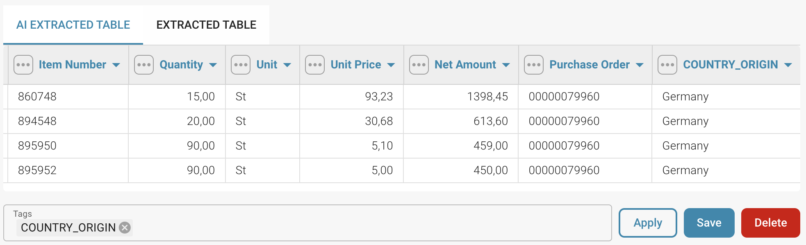
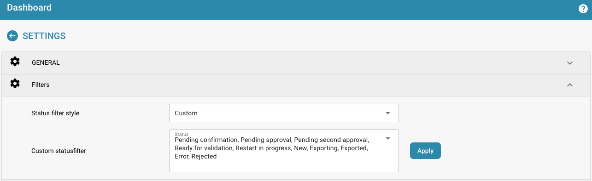

# Gegevensstroom voor cloudklanten

#### Streaminstellingen inschakelen in DocBits 

Ga naar _Instellingen → Module → BOD Verbindingsstream_

<figure><figcaption></figcaption></figure>

Als u dit inschakelt, wordt automatisch een Stream Name gegenereerd. Ga vervolgens in Infor naar _→ OS  → ION  → Data Flows._ Stel hier een nieuwe gegevensstroom in. Deze moet er ongeveer als volgt uitzien:

<figure><figcaption></figcaption></figure>
