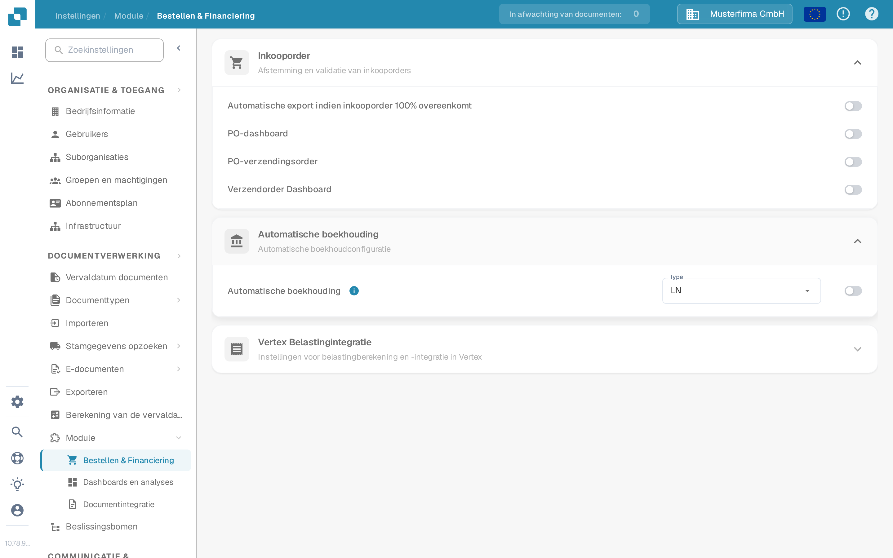
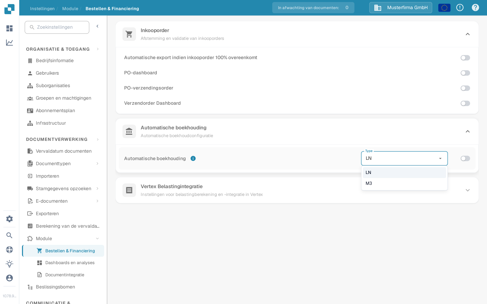

# Auto Accounting

Gebruik deze handleiding wanneer een Infor-LN-beheerder wil dat DocBits geïmporteerde financiële stamgegevens gebruikt voor automatische boekhouding (Auto Accounting). De oude pagina toonde 48 schermen uit één specifieke Infor-tenant. Verbindingspunt-namen, mappings, inloggegevens en eindpuntadressen van die tenant zijn geen herbruikbare configuratie.

## De instelling in DocBits vinden

Open **Instellingen → Module → Bestellen & Financiering → Automatische boekhouding** met een beheerdersaccount. Het menu **Type** biedt **LN** en **M3** aan. Controleer bij een LN-integratie of het geselecteerde type **LN** is. Schakel de schakelaar pas in nadat de beoogde LN-maatschappij, de BOD-stroom en de geïmporteerde stamgegevens zijn gecontroleerd. Het wijzigen van het type of de schakelaar kan het boekhoudgedrag beïnvloeden; volg daarom het wijzigingsproces van uw organisatie.

De volgende Nederlandse screenshots komen uit de synthetische Sandbox **DocBits Documentation Test A**. In deze organisatie was **LN** geselecteerd en stond Automatische boekhouding **uit**. Het menu werd geopend zonder een andere waarde te selecteren; er is geen instelling opgeslagen.

<figure><figcaption>
Zoek Automatische boekhouding en controleer het geselecteerde type voordat u het inschakelt.
</figcaption></figure>

<figure><figcaption>
LN en M3 zijn de beschikbare typen in deze Sandbox; er is geen keuze gewijzigd.
</figcaption></figure>

## LN en ION voorbereiden

1. Bevestig de LN-maatschappij, de boekhoudingseenheid, de DocBits-organisatie en de doelomgeving. Stem met uw DocBits-beheerder af welke actuele API-bewerking en welk veldmapping rekeningen en dimensies ontvangen. Bewaar API-inloggegevens in de goedgekeurde secrets-opslag, nooit in een screenshot of Jira-bijlage.
2. Configureer BOD-publicatie in LN en valideer de publicatiegegevens-instelling. Infor documenteert **BOD Parameters (tcbod0100m000)** en **Validate Publishing Data Setup (tcbod0300m000)** in zijn [LN BOD-publicatiegids](https://docs.infor.com/ln/10.7.in/en-us/lnolh/help/tc/onlinemanual/000520.html).
3. Controleer welke nouns uw LN-release en de DocBits-ontvangende bewerking nodig hebben. Het eerdere voorbeeld gebruikte `Sync.ChartOfAccounts` en `Sync.CodeDefinition` voor rekeningschema- en dimensiegegevens. Infor's [Publish Financial Master Data (tfbia0200m000)](https://docs.infor.com/ln/2025.x/en-us/lnolh/tfolh/help/tf/bia/tfbia0200m000.html) toont de opties Chart of Accounts en CodeDefinition. Sommige CodeDefinition-tabbladen verschijnen pas nadat de dimensiemapping is opgegeven en goedgekeurd. Bevestig de exacte documentversies en velden in uw tenant voordat u ze routeert.
4. Verbind in **ION Desk → Connect → Connection Points** de LN-bron met de goedgekeurde DocBits-API-bestemming. Routeer in **Data Flows** de geselecteerde documenten, controleer filters en mapping en sla vervolgens op en activeer. Infor onderscheidt [het opslaan van het activeren van een flow](https://docs.infor.com/inforos/latest/en-us/useradminlib_cloud/iondeskceug/lsm1436532178755.html).
5. Gebruik in LN een niet-gevoelige testidentificatie. Gebruik in **Publish Financial Master Data** eerst **Count** of **Simulate** om de selectie te inspecteren, en publiceer (**Publish**) alleen binnen de door de beheerder goedgekeurde wijziging. De publicatieactie is niet doelspecifiek: Infor levert aan alle abonnees. Volg die identificatie en eventuele fouten in [ION OneView](https://docs.infor.com/inforos/latest/en-us/useradminlib_cloud/iondeskceug/lsm1436532196155.html).

## Het DocBits-resultaat bevestigen

Vraag de DocBits-beheerder om het ontvangen record, de organisatie en de boekhoudingsvelden te controleren in de actuele import- of API-logs. Waar de betreffende opzoektabel toegankelijk is, zoekt u dezelfde identificatie onder **Instellingen → Documentverwerking → Stamgegevens opzoeken**. Een succesvol geactiveerde ION-flow bewijst op zichzelf niet dat DocBits een record heeft geaccepteerd. Ontbreekt een waarde, vergelijk dan de bron-BOD, de ION-mapping, het API-antwoord en de doelorganisatie voordat u automatische boekhouding inschakelt.

Voor een end-to-end test was geen LN-tenant en geen echte financiële BOD-overdracht beschikbaar. De nieuwe Sandbox-afbeeldingen bevestigen alleen de huidige DocBits-besturingselementen. De tenantbeheerder moet de uiteindelijke mapping en het boekhoudresultaat valideren.
