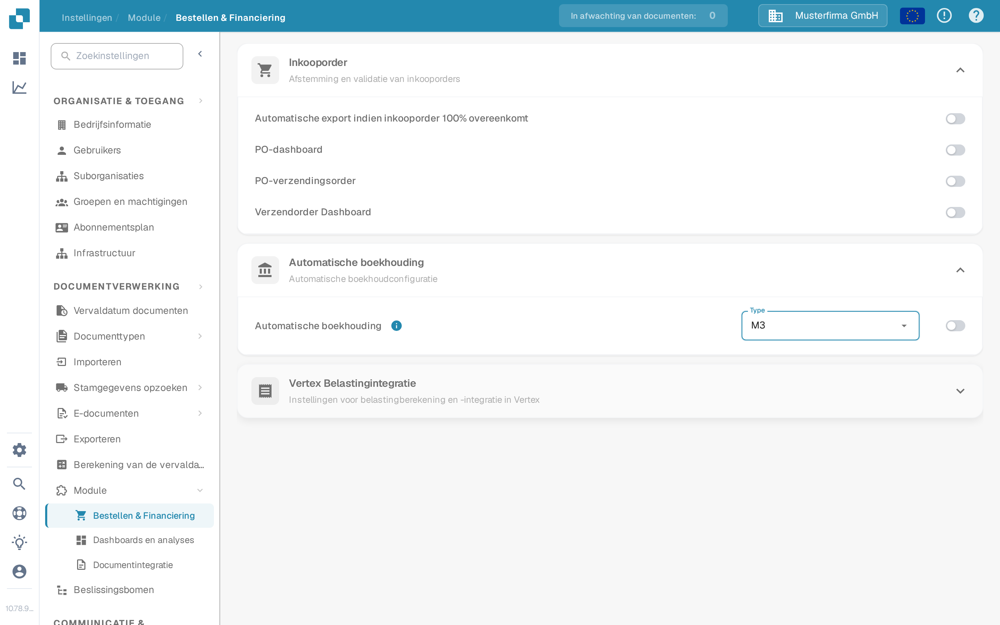

# Auto accounting met Infor M3

Gebruik deze handleiding om de stamgegevens te plannen die nodig zijn voor auto accounting in DocBits met M3. Een actieve instelling alleen importeert geen rekeningen of kostenposten. Uw Infor-beheerder moet de BOD-mapping, de DocBits-API-bewerking en het resultaat in uw eigen organisatie bevestigen.

## De DocBits-instelling controleren

Een beheerder kan **Instellingen → Module → Bestellen & Financiering → Automatische boekhouding** openen. Het menu **Type** biedt **LN** en **M3**. Kies **M3** alleen voor een M3-integratie, en schakel de schakelaar in nadat de gegevensstroom en de vereiste stamgegevens zijn geverifieerd. De screenshots tonen de Engelse sandbox **DocBits Documentation Test A**. De schakelaar stond daar **uit**, het huidige Type was **LN**, en het openen van het menu heeft geen instelling opgeslagen of gewijzigd.

<figure><figcaption>
Zoek Automatische boekhouding in Bestellen &amp; Financiering; dit sandboxvoorbeeld is uitgeschakeld.
</figcaption></figure>

<figure><figcaption>
Het menu Type biedt LN en M3. In dit voorbeeld is geen optie geselecteerd.
</figcaption></figure>

## De M3-gegevensstroom voorbereiden

1. Spreek af welke M3-company en welke DocBits-organisatie gegevens uitwisselen. Vraag uw DocBits-beheerder welke huidige API-bewerking de boekhoudkundige stamgegevens accepteert. Kopieer geen endpoint of aanmeldgegevens uit een oudere tenant-screenshot.
2. Bevestig in M3 dat de vereiste BOD's zijn ingeschakeld voor de relevante boekhoudentiteit. Het eerdere tenant-voorbeeld gebruikte `Sync.ChartOfAccounts` en `Sync.CodeDefinition` voor boekhoudkundige dimensies. Bevestig het exacte noun, de versie en de velden aan de hand van uw M3-configuratie en de ontvangende API-overeenkomst. Infor beschrijft [het inschakelen van BOD-publicatie](https://docs.infor.com/m3core/2025.x/en-us/useradminlib_cloud/m3cecoreag_cloud/wbr1509377469290.html).
3. Configureer in **ION Desk → Connect → Connection Points** de M3-bron en een API-bestemming met de goedgekeurde DocBits-bewerking en serviceaccount. Routeer in **Data Flows** alleen de goedgekeurde documenten, controleer de filters en veldmapping, en sla de stroom op en activeer deze. Zie de [Infor-lijst met connection points](https://docs.infor.com/inforos/latest/en-us/useradminlib_cloud/iondeskceug/documentflowdesk_connectionpointmasterlist.html) en de [instructies voor het activeren van dataflows](https://docs.infor.com/inforos/latest/en-us/useradminlib_cloud/iondeskceug/lsm1436532178755.html).
4. Publiceer één niet-gevoelige testidentifier vanuit M3. Een initiële load kan M3 **EVS006** gebruiken; de actie- en tabelnamen hangen af van de geïnstalleerde M3-versie. Volg de [instructies voor de initiële load van Infor](https://docs.infor.com/m3core/2025.x/en-us/useradminlib_cloud/m3cecoreag_cloud/pbi1544012609638.html). Traceer in **ION OneView** de identifier door de stroom en inspecteer het API-resultaat met [Infor OneView](https://docs.infor.com/inforos/latest/en-us/useradminlib_cloud/iondeskceug/lsm1436532196155.html).
5. Controleer dezelfde identifier in DocBits bij **Instellingen → Documentverwerking → Stamgegevens opzoeken**. De [handleiding M3-naar-DocBits-API](import-from-infor-m3-to-docbits-via-api.md) legt de importcontroles uit. Schakel M3 auto accounting alleen in als de vereiste records aanwezig zijn en uw beheerder de mapping heeft gevalideerd.

## Kostenposten

Het oudere tenant-voorbeeld exporteerde kostenposten vanuit M3 **PPS280** naar Excel, verminderde kolommen en uploadde een CSV via een oud HTTP-API-scherm. Die screenshotreeks is geen veilige algemene importprocedure: kolomnamen, scheidingsteken, endpoint en authenticatie moeten voor de huidige omgeving worden bevestigd. Gebruik de huidige [handleiding kostenposttabellen](table-extraction-for-costing-element.md) om het bestand voor te bereiden en de beschikbare DocBits-CSV-besturingselementen te inspecteren. Upload geen bestand voordat de beheerder de kolommen heeft gecontroleerd aan de hand van de doeltabel.

Als een BOD ION bereikt maar er verschijnt geen rij in DocBits, inspecteer dan de ION-route, het API-antwoord, de organisatie, de identifier en de mapping vóór het inschakelen van de functie. Leid succes niet af van een geactiveerde stroom of van bestaande demogegevens.

Deze pagina vervangt 43 screenshots van één oudere Infor-tenant door huidige DocBits-besturingselementen en aan bronnen gekoppelde stappen. Er was geen Infor-tenant of live BOD-overdracht beschikbaar voor een end-to-end test; uw tenant-beheerder moet de uiteindelijke mapping, import en het boekhoudkundige resultaat valideren.
