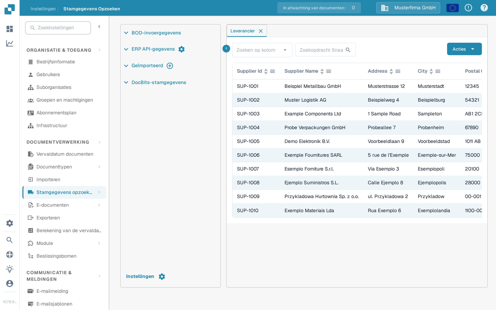
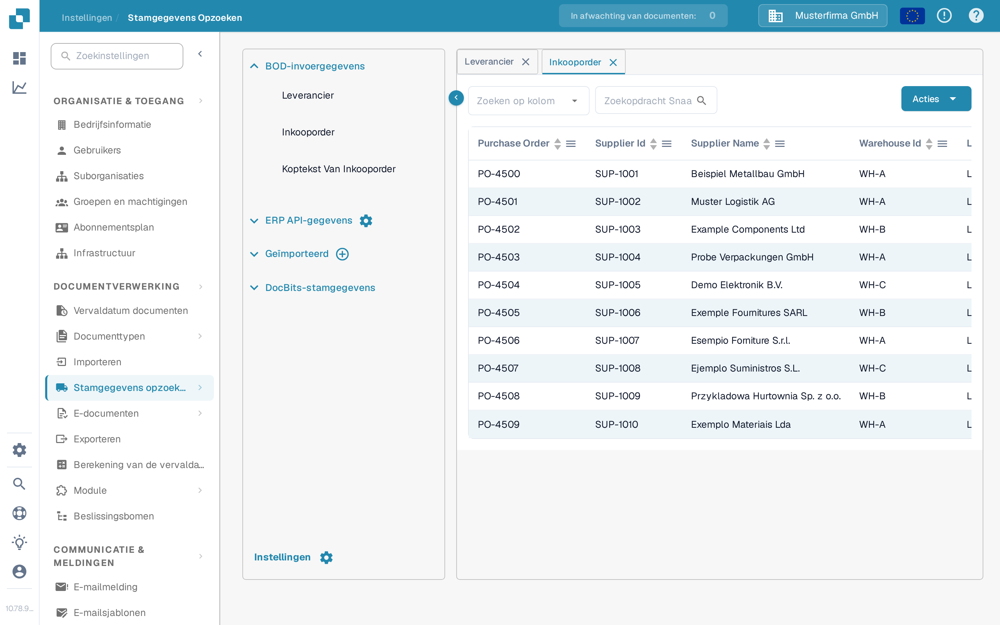

# Import van Infor M3 naar DocBits via API

Gebruik deze gids wanneer een Infor M3-beheerder geselecteerde BOD's aan DocBits moet leveren via Infor ION en API Gateway. De vorige versie van deze pagina bevatte 42 screenshots van één oudere Infor-tenant en vaste Sandbox-API-adressen. Die schermen en adressen zijn geen veilig configuratievoorbeeld voor een andere tenant.

Het te controleren pad is **M3 publiceert een BOD → ION routeert het → API Gateway roept de DocBits API aan → DocBits toont de geïmporteerde record**. Elke stap heeft zijn eigen status. Een record in DocBits zien is de eindcontrole; een actieve ION-dataflow bewijst op zichzelf geen import.

## Voordat u de flow configureert

1. Bevestig de M3-bedrijf, de ION-tenant, de DocBits-organisatie en de omgeving die u wilt koppelen. Vraag een DocBits-beheerder naar de huidige API-basis-URL en de vereiste API-bewerking uit de OpenAPI-beschrijving van die omgeving. Regionale hosts kunnen verschillen; kopieer geen host of API Gateway-proxy-pad uit een oude screenshot.
2. Spreek af welke documenttypen de organisatie nodig heeft. Leveranciers- en inkooporderstamgegevens kunnen in DocBits worden gecontroleerd. Voeg leverings- en boekhoudingsdocumenten alleen toe wanneer hun gebruiksdoel en de ontvangende bewerking bevestigd zijn.
3. Bereid een Infor-serviceaccount voor met toestemming voor de geselecteerde API-bewerking en een DocBits API-referentie met het minimaal vereiste toegangsniveau. Voer referenties alleen in het geautoriseerde configuratiescherm in. Plak geen volledig `.ionapi`-bestand of een API-sleutel in een documentatiepagina, een Jira-issue of een screenshot.
4. Bewaar één niet-gevoelige testidentifier voor elke gekozen BOD, zodat u dezelfde record in M3, ION OneView en DocBits kunt volgen.

## Kies het document en de ontvangende bewerking

Het voorbeeld van de oude tenant gebruikte deze BOD's. Gebruik de huidige API-metadata en uw integratieontwerp om elke koppeling te bevestigen voordat u een connection point aanmaakt:

| BOD in het oude voorbeeld                                                                   | Beoogde DocBits-gegevens                               | Waar u het ontvangende formaat controleert                                                              |
| ------------------------------------------------------------------------------------------- | ------------------------------------------------------ | ------------------------------------------------------------------------------------------------------- |
| `Sync.SupplierPartyMaster`, `Sync.RemitToPartyMaster`                                       | Stamgegevens van leveranciers                          | [Leveranciers-BOD-import](../importing-via-the-api/supplier-bod.md)                                     |
| `Sync.PurchaseOrder`                                                                        | Inkooporders                                           | [Inkooporder-BOD-import](../importing-via-the-api/purchase-order-bod.md)                                |
| `Sync.ReceiveDelivery`                                                                      | Leveringsgegevens                                      | [Receive Delivery-BOD-import](../importing-via-the-api/receive-delivery-bod.md)                         |
| `Sync.AdvanceShipNotice`, `Sync.ChartOfAccounts`, `Sync.CodeDefinition-AccountingDimension` | Aanvullende stamgegevens voor geconfigureerde functies | [Stamgegevens-XML-import](../importing-via-the-api/master-data-xml.md) en de API-metadata van uw tenant |

`Acknowledge.SupplierInvoice` hoort bij een factuurbevestigingsflow en moet apart van een M3-naar-DocBits-stamgegevensimport worden geconfigureerd. De oude pagina vermengde deze richtingen en bevatte een tenantspecifieke request body; kopieer die body niet in een nieuwe flow zonder het endpoint-contract en de toegangscontroles te controleren.

## Configureer Infor OS en ION

1. Bereid in Infor OS het API Gateway-doel voor op de **bevestigde** DocBits API-bewerking. Controleer de doel-URL, de aanvraagmethode, het aanvraagformaat en de authenticatie met de DocBits-beheerder. Gebruik de huidige [Infor API Gateway-gids](https://docs.infor.com/inforos/2025.x/en-us/useradminlib_cloud/apigatewayag_cloud/ionapi_2025.x_apigatewayag_cloud_en-us.pdf) voor de Gateway-bedieningselementen.
2. Maak of selecteer in **ION → Connect → Connection Points** het connection point voor de DocBits API. Voeg in **Documents** alleen de gekozen BOD's toe, selecteer de bijbehorende Gateway-bewerking en configureer de request-payload die de bewerking verwacht. Infor's [instructies voor het API-element](https://docs.infor.com/inforos/latest/en-us/useradminlib_cloud/iondeskceug/hqg1491985489422.html) leggen het serviceaccount en de aanvraaginstellingen uit.
3. Verbind in **ION → Connect → Data Flows** de M3-bron en de API-bestemming. Controleer de documentenlijst, de filters en de koppelingen; sla daarna op en activeer de flow. Infor onderscheidt het [opslaan van het activeren van een dataflow](https://docs.infor.com/inforos/latest/en-us/useradminlib_cloud/iondeskceug/lsm1436532178755.html).
4. Publiceer één goedgekeurde test-BOD vanuit M3. Zoek in **ION OneView** die identifier en bevestig welk connection point, welke koppeling en welke API-aanroep het heeft verwerkt. Zie [Infor OneView](https://docs.infor.com/inforos/latest/en-us/useradminlib_cloud/iondeskceug/lsm1436532196155.html). Als er geen route wordt getoond of een fout verschijnt, herstel dan eerst de ION-flow voordat u DocBits controleert.

## Controleer het resultaat in DocBits

Open **Instellingen → Documentverwerking → Stamgegevens opzoeken**. Vouw **BOD-invoergegevens** uit, kies het relevante type en zoek naar de testidentifier. De tabbladen **Leverancier** en **Inkooporder** hieronder zijn actuele Nederlandse weergaven van de synthetische organisatie van de mock-runner. Hun bestaande demorijen zijn **geen bewijs van een M3-import**.

<figure><figcaption>
Kies Leverancier, selecteer een zoekkolom en voer de testidentifier van de leverancier in.
</figcaption></figure>

<figure><figcaption>
Kies Inkooporder en zoek naar de testorder; de getoonde rijen zijn synthetische demogegevens.
</figcaption></figure>

In beide tabbladen kiest **Zoeken op kolom** het veld, accepteert het zoekveld de identifier en start het vergrootglas de zoekopdracht. De tabelkoppen sorteren de zichtbare rijen; de pijlen onderaan bladeren door de pagina's. **Acties** opent tabelbewerkingen en is niet nodig voor deze alleen-lezen controle. De **×** op een tabblad sluit het. De plus-knop bij **Geïmporteerd** is voor CSV-uploads, niet voor het ontvangen van een ION-BOD.

Als de BOD in OneView verschijnt maar de record ontbreekt in DocBits, controleer dan de API-bewerking en het antwoord, de organisatie/omgeving, het documenttype, het payload-formaat en de gebruikte identifier bij de zoekopdracht. Vraag de DocBits-beheerder om het bijbehorende importlogboek. Leid succes niet af uit een HTTP-aanroep of een screenshot van een niet-gerelateerde demorij.

Deze pagina is bijgewerkt met de huidige DocBits Sandbox-bedieningselementen en Infor-documentatie. Er was geen Infor-tenant of echte M3-naar-DocBits-BOD-overdracht beschikbaar voor een end-to-end test; een tenantbeheerder moet de uiteindelijke koppeling en het resultaat valideren.
