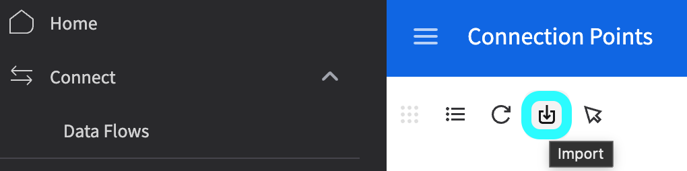

# M3\_OLD

## Een API-verbindingssjabloon importeren in Infor M3

Deze handleiding legt uit hoe u een API-verbindingssjabloon importeert om snel belangrijke instellingen te configureren voor de integratie met Infor M3. Met een sjabloon zet u een vooraf gedefinieerde verbindingsconfiguratie op, wat het proces vereenvoudigt en voor consistentie zorgt.

<mark style="color:red;">**Opmerking**</mark>: Voor de gedetailleerde configuratie van specifieke onderdelen zoals Auto Accounting, leveranciersintegratie, inkooporders of Table Extraction voor kostenelementen verwijzen wij naar de bijbehorende documentatie:

* [Auto Accounting](m3/auto-accounting.md)
* [Leveranciers en inkooporder](m3/suppliers-and-purchase-orders.md)
* [Hoe alle leveranciers importeren](m3/how-to-import-all-suppliers.md)
* [Tabelextractie voor kostenelement](m3/table-extraction-for-costing-element.md)

### **Het sjabloon downloaden**

Download vóór het importeren het benodigde verbindingssjabloon via het onderstaande bestand:



### Sjabloon importeren

#### Stappen om een verbindingssjabloon te importeren

1. **Infor ION Desk openen:**
   *   Ga naar **InforOS** → **ION Desk** → **Connect** → **Verbindingspunten**.

       
2. **Het sjabloon importeren:**
   *   Klik op de knop **Import**.

       <figure><figcaption></figcaption></figure>
   * Selecteer het juiste **sjabloonbestand** op uw lokale systeem.
   *   Klik op **OK** om het importproces te starten.

       <figure><figcaption></figcaption></figure>
3. **Bevestiging:**
   *   Als de import is geslaagd, verschijnt een bevestigingsmelding.

       <figure><figcaption></figcaption></figure>
4. **Configuratie na de import:**
   * Na het importeren van het sjabloon kunt u specifieke verbindingsinstellingen naar wens aanpassen.
   * Vergeet niet uw **Service Account** voor authenticatie en toegangsbeheer te importeren of te configureren.

<figure><figcaption></figcaption></figure>
