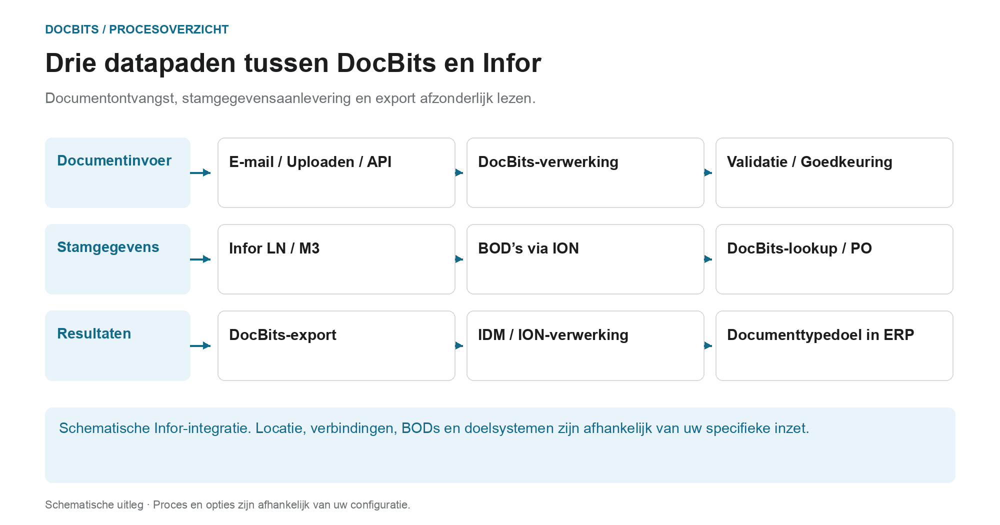

# Architectuur

## De architectuur als drie afzonderlijke datapaden

<figure><figcaption>
Documentontvangst, stamgegevensaanlevering en export afzonderlijk lezen. Het diagram is schematisch; de actieve instellingen van uw organisatie bepalen het daadwerkelijke gedrag.
</figcaption></figure>

De architectuur bevat meerdere datastromen met verschillende doeleinden. Documenten worden geïmporteerd voor verwerking; stamgegevens zijn afkomstig van de ERP-integratie; herkende en beoordeelde resultaten worden geretourneerd via het geconfigureerde exportpad. Deze paden zijn afzonderlijke verbindingen en moeten tijdens de diagnose afzonderlijk worden getraceerd.

| Gegevenspad | Richting en doel | Controlepunt |
| --- | --- | --- |
| **Documentontvangst** | E-mailen, uploaden of interface → DocBits. Documenten worden naar het beoogde verwerkingsproces gestuurd. | Is het juiste document bij de juiste organisatie terechtgekomen? |
| **Stamdatavoorziening** | LN/M3 → BODs en ION gegevensstroom → DocBits. Leveranciers en bestellingen worden beschikbaar gesteld voor identificatie en afstemming. | Is de benodigde dataset overgedragen en geaccepteerd door DocBits? |
| **Resultaatexport** | DocBits → geconfigureerde Infor-verbinding → IDM of ION en ERP. Document- en bedrijfsgegevens kunnen verschillende stroomafwaartse paden volgen. | Zijn de overdracht en de respectieve verwerking op de bestemming bewezen? |

In de hier beschreven Infor-export worden de PDF en zijn attributen naar IDM verzonden, en wordt `Sync.CaptureDocument` naar ION Desk verzonden. ION transformeert het in de vereiste doel-BODs, afhankelijk van het documenttype. Acceptatie door LN of M3 moet worden geverifieerd in het betreffende doelsysteem; een DocBits-stap alleen bewijst niet elke stroomafwaartse verwerkingsstap.

**Gebruik het overzicht om fouten te onderzoeken:** Ontbreekt een document, begin dan met importeren. Als leveranciers of inkooporderregels ontbreken, volgt u het stamgegevenspad. Als de retouroverdracht mislukt, controleer dan de exportconfiguratie, het antwoord van de ontvanger en de ION/ERP-verwerking. De onderstaande architectuurdiagrammen voegen implementatie- en componentdetails toe aan dit procesoverzicht.

Verder: [Documenten importeren](../../end-user-and-partner-section/end-user-section/how-to-import-documents/README.md), [Importeer stamgegevens van klanten](../../infor-integration-and-configuration/importing-customer-master-data/README.md) en [Exporteren vanuit DocBits](../../infor-integration-and-configuration/exporting-in-docbits/README.md).

## **DocBits Cloud-klant**

<figure><figcaption></figcaption></figure>

## DocBits op locatie

<figure><figcaption></figcaption></figure>

Doc**Bits** integreert naadloos met Infor LN/M3 via de ION API, ION Desk en Infor Standaard BODs. Onze API-integratie stelt ons in staat om gegevens naar Infor te exporteren en masterdata-validatie in Doc**Bits** uit te voeren.

## **DocBits Operator-architectuur**

Alle verbindingen tussen componenten zijn beveiligd met versleutelingsprotocollen volgens de industriestandaard. SSH, HTTPS en andere beveiligde kanalen waarborgen de integriteit en vertrouwelijkheid van gegevens in het hele systeem.

**On premise:**&#x20;

<figure><figcaption></figcaption></figure>


[prefect-local-setup-requirements.md](prefect-local-setup-requirements.md)


**Cloud**:

<figure><figcaption></figcaption></figure>

## Gegevens exporteren naar Infor

We gebruiken de ION API om de PDF met attributen naar IDM te sturen en de BOD Sync.CaptureDocument naar ION Desk. In ION Desk transformeren we de [Sync.CaptureDocument](../../infor-integration-and-configuration/exporting-in-docbits/) naar de gewenste doel-BODs, afhankelijk van het documenttype dat wordt verwerkt. Deze getransformeerde Infor BODs worden vervolgens automatisch geïmporteerd in LN of M3.


Exporteren naar [Infor](../../infor-integration-and-configuration/exporting-to-infor/)


## Masterdata-validatie in DocBits

Om de leverancier te identificeren of inkooporderregels te vergelijken/te matchen, activeren we in LN/M3 een trigger die de BODs Sync.RemitToPartyMaster, Sync.SupplierPartyMaster en Sync.PurchaseOrder naar Doc**Bits** stuurt. We configureren dit proces in ION Desk door de gegevensstroom naar een specifiek aansluitpunt (connection point) naar Doc**Bits** te definiëren.

<figure><figcaption></figcaption></figure>


[Masterdata-validatie](../../infor-integration-and-configuration/importing-customer-master-data/)


## E-mailimport OAuth Office365

<figure><figcaption></figcaption></figure>
