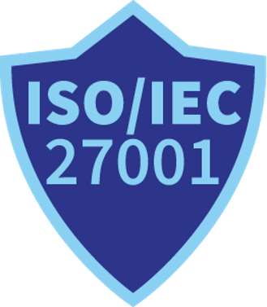
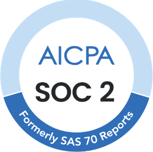
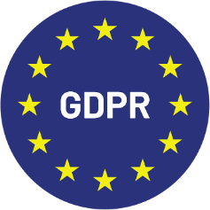

# Certificeringen

## 1. ISO/IEC 27001

<figure><figcaption></figcaption></figure>

Deze internationale norm definieert de vereisten voor het opzetten, implementeren, onderhouden en voortdurend verbeteren van een Informatiebeveiligingsbeheersysteem (ISMS). Het helpt organisaties om gegevens op een systematische en kosteneffectieve manier te beschermen, inclusief processen voor risicobeheer en informatiebeveiligingscontroles.

Impact voor Klanten: Zorgt ervoor dat DocBits voldoet aan de hoogste normen voor informatiebeveiliging, wat vertrouwen biedt dat gevoelige gegevens goed beschermd zijn.

## 2. SOC 1 (Service Organization Control 1)

<figure><figcaption></figcaption></figure>

SOC 1-rapporten zijn ontworpen voor organisaties die de effectiviteit van interne controles over financiële rapportage moeten aantonen. Het is bijzonder relevant voor dienstverleners die invloed hebben op de financiële rapportage van hun klanten.

Relevantie voor DocBits: Toont onze toewijding aan het handhaven van strenge interne controles over financiële gegevens, wat zekerheid biedt aan klanten over de betrouwbaarheid van onze processen.

## 3. SOC 2 (Service Organization Control 2)

<figure><figcaption></figcaption></figure>

SOC 2 richt zich op de controles van een dienstverlenende organisatie die relevant zijn voor beveiliging, beschikbaarheid, verwerkingsintegriteit, vertrouwelijkheid en privacy van gegevens. Het is cruciaal voor technologie- en cloudcomputingbedrijven die gevoelige informatie verwerken.

Waarde voor Klanten: Biedt een onafhankelijke validatie dat DocBits effectieve controles heeft geïmplementeerd om klantgegevens te beschermen, wat de betrouwbaarheid van onze software en diensten waarborgt.

## 4. GDPR (General Data Protection Regulation) Compliance

<figure><figcaption></figcaption></figure>

De GDPR is een verordening in de EU-wetgeving over gegevensbescherming en privacy in de Europese Unie en de Europese Economische Ruimte. Het behandelt ook de overdracht van persoonlijke gegevens buiten de EU en EER-gebieden.

Klantgarantie: Naleving van de GDPR zorgt ervoor dat DocBits persoonlijke gegevens verwerkt in overeenstemming met de EU-regelgeving, de privacy van gebruikers beschermt en zich houdt aan strikte richtlijnen voor gegevensverwerking.
