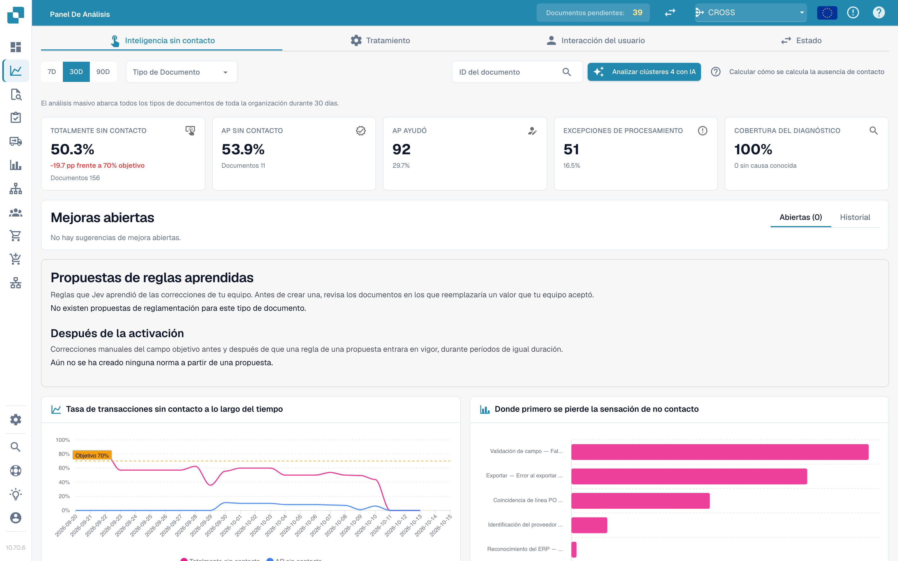
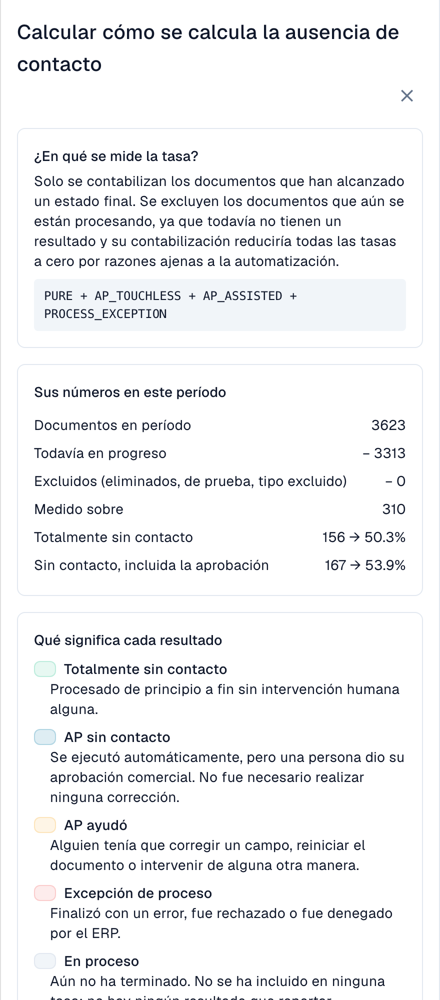
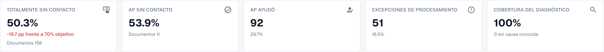
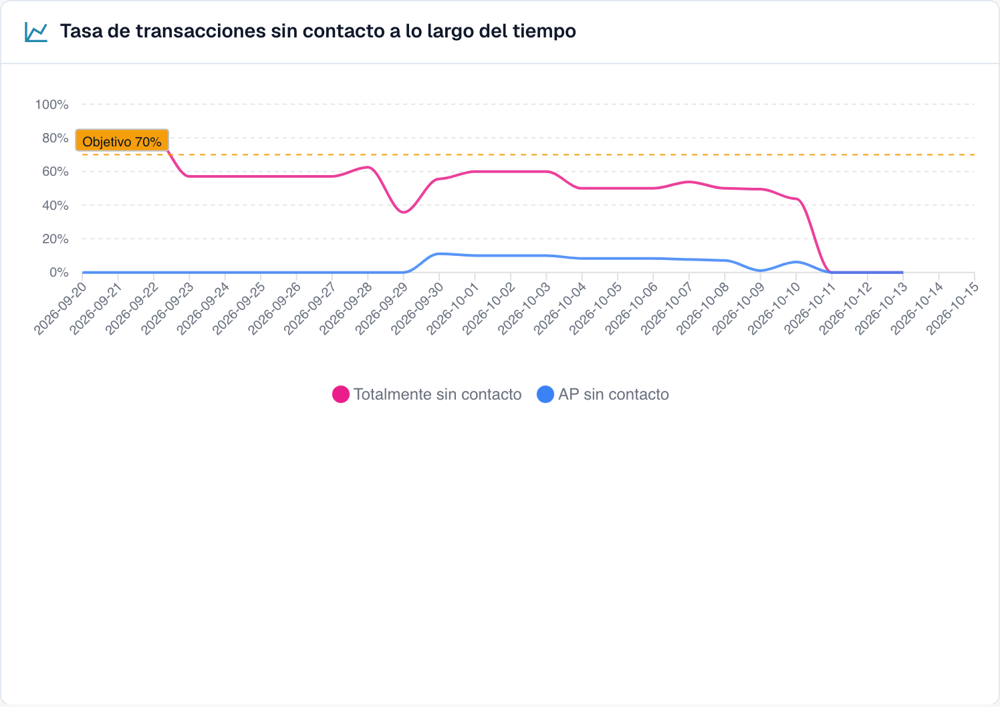
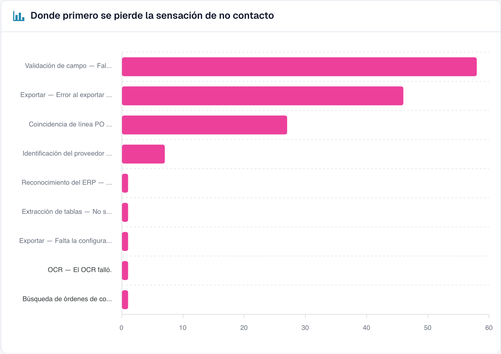
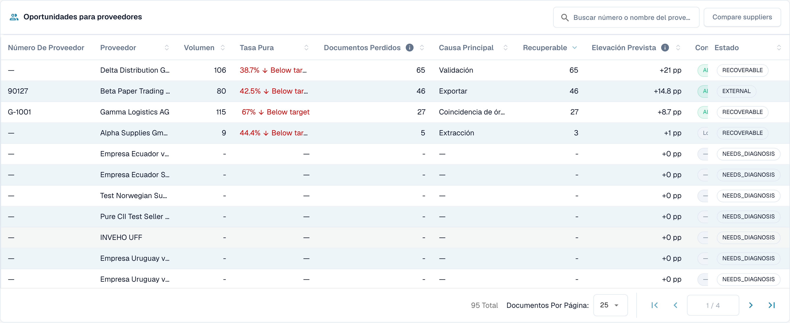
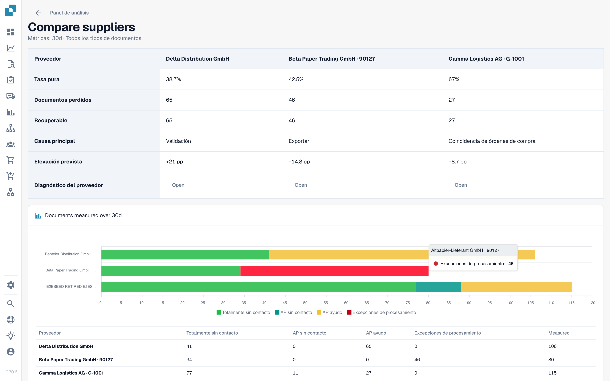

# Touchless Intelligence



## Descripción general

**Touchless Intelligence** responde a dos preguntas sobre el procesamiento de sus documentos:

1. **¿Cuántos documentos pasan por DocBits sin que nadie los toque?** Esta es su _tasa touchless_.
2. **¿Por qué se detienen los demás y qué debemos cambiar para que se detengan menos?** Este es el _diagnóstico_.

Es una pestaña del [Panel de Análisis](../). No añade trabajo para su equipo: DocBits registra lo que ocurre con cada documento en el pipeline de procesamiento y evalúa el resultado cada 15 minutos.

<figure><figcaption><p>La pestaña Touchless Intelligence: cifras clave, mejoras, la tasa a lo largo del tiempo y el gráfico de dónde se pierde primero el touchless. Organización de ejemplo con datos de demostración; los nombres de proveedores son ficticios.</p></figcaption></figure>

### Qué puede hacer con ella

| Usted quiere…                          | Utilice                                         | Ejemplo                                                                                     |
| -------------------------------------- | ----------------------------------------------- | ------------------------------------------------------------------------------------------- |
| Ver cuán automatizado está             | Las cinco **cifras clave** de la parte superior | "El 63.2 % de nuestros documentos se procesó sin intervención de una persona el mes pasado" |
| Ver la tendencia                       | **Touchless rate over time**                    | "La tasa subió del 55 % al 68 % desde que corregimos los datos maestros de proveedores"     |
| Saber dónde se atascan los documentos  | **Where touchless is lost first**               | "La mayoría de los documentos se detiene en Field Validation"                               |
| Decidir qué proveedor corregir primero | **Supplier opportunities**                      | "El proveedor A nos daría +4.0 puntos porcentuales"                                         |
| Entender a un proveedor                | Página **Supplier Diagnosis**                   | "Sus facturas no tienen número de OC, por eso falla la coincidencia con la OC"              |
| Entender un documento                  | **Document Trace**                              | "Esta factura se detuvo en la etapa 8, Field Validation"                                    |
| Comparar proveedores                   | **Compare suppliers**                           | "Los proveedores A y B usan la misma plantilla, pero solo B falla"                          |
| Cambiar un ajuste que ayuda            | **Change proposals**                            | "Active la coincidencia automática con la OC: previsualizar, aplicar, medir, deshacer"      |

## Quién puede verla

* La pestaña forma parte del Panel de Análisis. Su administrador la habilita para la organización. Si falta la pestaña, consulte a su administrador.
* Los **administradores de la organización** siempre la ven.
* Los demás usuarios la ven cuando un administrador ha concedido a su rol la pestaña **Analytics dashboard** (**Settings → Roles**). Sin esa concesión, solo los administradores tienen acceso.
* Algunas acciones son solo para administradores: **AI analysis**, **aplicar y deshacer un cambio**, **learned rule proposals** y el **Consulting report**.

Si no tiene permiso, la página muestra _Action not allowed, please contact the administrator_ (acción no permitida, póngase en contacto con el administrador).

## Qué significa "touchless"

Cada documento termina con exactamente **un** resultado:

| Resultado             | Significado                                                                                                         | Cuenta en la tasa                                                                                |
| --------------------- | ------------------------------------------------------------------------------------------------------------------- | ------------------------------------------------------------------------------------------------ |
| **Pure touchless**    | Procesado desde la importación hasta la exportación **sin ninguna intervención humana**                             | Sí, como éxito                                                                                   |
| **AP touchless**      | Se ejecutó automáticamente y una persona solo dio la **aprobación de negocio**. No fue necesaria ninguna corrección | Sí, como éxito                                                                                   |
| **AP assisted**       | Una persona tuvo que **corregir un campo, reiniciar el documento** o intervenir de otro modo                        | Sí, como fallo. No es un error, solo una automatización que no llevó el documento hasta el final |
| **Process exception** | Terminó con un **error**, fue **rechazado**, fue **rechazado por el ERP** o se **estancó** en el pipeline           | Sí, como fallo                                                                                   |
| **In progress**       | Todavía no ha terminado                                                                                             | **No**. Aún no tiene resultado                                                                   |
| **Not eligible**      | Eliminado, archivado, un documento de prueba o un tipo de documento excluido                                        | **No**                                                                                           |

La **tasa touchless** es:

```
rate = (Pure touchless + AP touchless)
       ÷ (Pure touchless + AP touchless + AP assisted + Process exception)
```

Los documentos que siguen **in progress** o que son **not eligible** nunca entran en el cálculo. Esto protege la tasa: un documento que llegó hace cinco minutos no puede bajarla.


**Un toque cuenta para siempre.** Cuando una persona ha tocado un documento, este sigue contando como tocado, aunque una ejecución automática posterior no hubiera necesitado a nadie. **Reiniciar un documento no lo vuelve touchless.** La tasa refleja el trabajo que se realizó.


### Ejemplo de cálculo (cifras ilustrativas)

En 30 días llegaron 200 documentos:

| Resultado                           | Documentos |
| ----------------------------------- | ---------- |
| Pure touchless                      | 120        |
| AP touchless                        | 30         |
| AP assisted                         | 30         |
| Process exception                   | 10         |
| In progress                         | 8          |
| Not eligible (documentos de prueba) | 2          |

* Denominador: 120 + 30 + 30 + 10 = **190**. Los 8 documentos in progress y los 2 not eligible se dejan fuera.
* **Pure touchless**: 120 ÷ 190 = **63.2 %**
* **AP touchless**: 30 ÷ 190 = **15.8 %**
* **Tasa touchless**: (120 + 30) ÷ 190 = **78.9 %**

La pestaña muestra un **objetivo** (70 % salvo que su organización utilice otro). En este ejemplo, la tasa está por encima del objetivo.

Haga clic en **How touchless is calculated**, arriba a la derecha, para abrir esta explicación dentro de DocBits, con las cifras de su propio período (documentos en el período, aún in progress, excluidos, medidos).

<figure><figcaption><p>El panel <strong>How touchless is calculated</strong>: la fórmula, <strong>Your numbers in this period</strong> (aquí 2,425 documentos, 2,115 aún in progress, 310 medidos) y qué significa cada resultado. Organización de ejemplo con datos de demostración; los nombres de proveedores son ficticios.</p></figcaption></figure>

### Cuán actuales son las cifras

Los resultados se **recalculan cada 15 minutos**. El resultado de un documento aún puede cambiar después de aparecer por primera vez: el ERP puede confirmar una exportación horas más tarde. La línea **Data as of …** de la parte inferior de la pestaña muestra cuándo se calcularon las cifras por última vez.

## La pestaña de resumen

### Filtros

| Filtro                            | Qué hace                                                                                                                                                                                                                                |
| --------------------------------- | --------------------------------------------------------------------------------------------------------------------------------------------------------------------------------------------------------------------------------------- |
| **7D / 30D / 90D**                | El período para las cifras clave y la cola. El valor predeterminado es 30 días                                                                                                                                                          |
| **Document Type**                 | Limita todas las cifras a un tipo, por ejemplo INVOICE                                                                                                                                                                                  |
| **Segment field / Segment value** | Solo si su organización ejecuta varios procesos con un mismo tipo de documento (por ejemplo, pedidos directos, indirectos y EAM en el campo `order_type`). Elija un campo para ver el desglose y un valor para limitar todo a ese valor |
| **Document ID**                   | Abre el **Document Trace** de un documento                                                                                                                                                                                              |

La **suborganización** que seleccionó en la parte superior de DocBits limita las cifras clave y la cola de proveedores. Los clústeres de problemas y el análisis con IA siempre abarcan toda la organización.

### Las cinco cifras clave

<figure><figcaption><p>Las cinco cifras clave. Aquí la tasa pura es del 50.3 % (156 documentos), es decir, 19.7 puntos por debajo del objetivo del 70 %, y la cobertura del diagnóstico es del 100 %. Organización de ejemplo con datos de demostración; los nombres de proveedores son ficticios.</p></figcaption></figure>

| Tarjeta                | Muestra                                                     | Ejemplo (ilustrativo)                                                                   |
| ---------------------- | ----------------------------------------------------------- | --------------------------------------------------------------------------------------- |
| **Pure touchless**     | El porcentaje y la diferencia con el objetivo               | **63.2 %** · "120 documents" · "−6.8 pp vs 70 % target" (rojo, por debajo del objetivo) |
| **AP touchless**       | El porcentaje                                               | **15.8 %** · "30 documents"                                                             |
| **AP assisted**        | El número de documentos y su proporción                     | **30** · 15.8 %                                                                         |
| **Process exceptions** | El número de documentos y su proporción                     | **10** · 5.3 %                                                                          |
| **Diagnosis coverage** | Cuántos documentos bloqueados tienen una causa **conocida** | **80 %** · "10 without a known cause"                                                   |

* Una tarjeta muestra un guion (—) en lugar de **0 %** cuando no hay nada que medir. Un guion significa "sin datos", no "cero".
* **Diagnosis coverage** = documentos con un motivo de bloqueo conocido ÷ todos los documentos bloqueados. Ejemplo: 50 documentos bloqueados, 10 con una causa desconocida → 40 ÷ 50 = **80 %**. Un valor bajo significa "todavía no entendemos por qué se detienen los documentos". Mejórelo antes de intentar corregir causas individuales.
* **Haga clic en una tarjeta** para abrir en una pestaña nueva la lista de documentos que hay detrás de la cifra ("View the documents behind this number"). Las tarjetas con 0 documentos no se pueden pulsar.

### Touchless rate over time

<figure><figcaption><p>La tasa por día con la línea del objetivo. Aquí la tasa se mantiene entre el 40 y el 60 % y cae bruscamente a partir del 10 de octubre. Organización de ejemplo con datos de demostración; los nombres de proveedores son ficticios.</p></figcaption></figure>

Un gráfico con una línea para **Pure touchless**, una para **AP touchless** y la **línea del objetivo**. Los períodos cortos muestran puntos diarios; los períodos largos, puntos semanales.

**Ejemplo.** Después de activar la coincidencia automática con la OC el 1 de octubre, la tasa pura sube del 55 % al 68 % en dos semanas. El gráfico muestra el día en que la curva cambia, de modo que puede relacionarlo con su cambio.

### Where touchless is lost first

<figure><figcaption><p>Documentos bloqueados según la etapa y el motivo en los que se detuvieron primero. Aquí <strong>Field validation: Required field missing</strong> cuesta más documentos (58), seguido de <strong>Export mapping failed</strong> (46) y <strong>PO item mismatch</strong> (27). Organización de ejemplo con datos de demostración; los nombres de proveedores son ficticios.</p></figcaption></figure>

Un gráfico de barras de **Blocked documents** por etapa del pipeline: la **primera** etapa que detuvo un documento.

**Ejemplo.** Barras: Supplier Identification 12, Field Validation 41, PO Line Match 7. La barra más grande le indica que debe revisar primero **Field Validation**, normalmente porque no se extrae un campo obligatorio.

### Supplier opportunities

<figure><figcaption><p>La cola de proveedores (abreviada a las cuatro primeras filas). El primer proveedor tiene 106 documentos, una tasa pura del 38.7 % y 65 documentos recuperables, de modo que corregirlo vale <strong>+21 pp</strong>. Organización de ejemplo con datos de demostración; los nombres de proveedores son ficticios.</p></figcaption></figure>

La cola responde a **"¿Qué proveedor deberíamos corregir primero?"**. Está ordenada por documentos **Recoverable**, de mayor a menor, con 25 filas por página.

| Columna                        | Significado                                                                                                                                                                            |
| ------------------------------ | -------------------------------------------------------------------------------------------------------------------------------------------------------------------------------------- |
| **Supplier Number / Supplier** | El proveedor. Los documentos sin un proveedor reconocido aparecen como **No supplier identified (n documents)**                                                                        |
| **Volume**                     | Documentos elegibles del proveedor en el período                                                                                                                                       |
| **Pure Rate**                  | Proporción de documentos pure touchless. Verde si está en el objetivo o por encima, rojo si está por debajo                                                                            |
| **Lost Documents**             | Documentos que terminaron como AP assisted o como process exception. No siempre interviene una persona: un rechazo del ERP o un documento estancado durante siete días también cuentan |
| **Root Cause**                 | Quién es responsable de la corrección: Configuration, ERP integration, Export, Extraction, Master data, Measurement, PO matching, User process, Validation o Unknown                   |
| **Recoverable**                | Documentos perdidos cuya causa DocBits puede corregir: configuración, datos maestros o plantilla del proveedor                                                                         |
| **Expected Lift**              | Cuántos **puntos porcentuales** ganaría la tasa de su organización si cada documento recuperable de este proveedor se procesara touchless (**+x pp**)                                  |
| **Confidence**                 | **High**, **Medium** o **Low**: cuán seguro es el diagnóstico                                                                                                                          |
| **Status**                     | New, Open, Investigating, In progress, Confirmed, Resolved, Dismissed. Un proveedor con muy pocos documentos muestra **NEEDS\_DIAGNOSIS**                                              |

**Ejemplo.** Su organización tiene 1,000 documentos elegibles en el período. El proveedor A tiene 40 documentos recuperables; el proveedor B tiene 90 documentos perdidos, pero solo 10 recuperables (su problema está de su lado).

* Proveedor A: 40 ÷ 1,000 = **+4.0 pp de mejora esperada**
* Proveedor B: 10 ÷ 1,000 = **+1.0 pp**, aunque B tiene más documentos perdidos

La cola clasifica a A por encima de B porque la **mejora esperada** se mide con respecto a toda su organización, no con respecto al proveedor. Un proveedor con cuatro documentos malos no puede superar a uno con cuatrocientos.

Utilice el cuadro de búsqueda ("Search supplier number or name") para encontrar un proveedor. Haga clic en una fila para abrir el **Supplier Diagnosis**.

### Compare suppliers

<figure><figcaption><p>Tres proveedores lado a lado: tasa pura, documentos perdidos y recuperables, causa raíz, mejora esperada y un gráfico de barras de los resultados. Cada <strong>Open</strong> lleva al Supplier Diagnosis. Organización de ejemplo con datos de demostración; los nombres de proveedores son ficticios.</p></figcaption></figure>

Haga clic en **Compare suppliers**, marque **de dos a cinco** proveedores (cada uno aparece con su número de documentos bloqueados) y haga clic en **Compare**.

La comparación muestra los proveedores lado a lado: **Pure rate**, **Lost documents**, **Recoverable**, **Root cause**, **Expected lift**, un gráfico de barras de los resultados y un enlace al **Supplier Diagnosis** de cada uno.

**Ejemplo.** Los proveedores A y B envían el mismo diseño de factura. B tiene una tasa pura del 80 %, A solo del 35 %. Ambos tienen la causa raíz "Master data". La comparación muestra que el diseño es correcto y que el registro del proveedor A está incompleto. Corrija los datos maestros de A en lugar de cambiar la plantilla.

### Analyse with AI

El botón **Analyse n clusters with AI** analiza los clústeres de problemas con mayor potencial touchless (como mínimo un número mínimo de documentos cada uno). Tarda unos 13 segundos por clúster y abarca **toda la organización**. Solo los administradores pueden iniciarlo.

Mientras se ejecuta, verá **Queued**, **Running**, **Done**, **Already analysed** o **Error** para cada clúster, con un enlace **Open cluster**. Si la IA está desactivada o no está configurada en el entorno, el botón aparece desactivado con el motivo, y **todo lo demás en la página sigue funcionando**.

## Profundizar

| Página                                                                                 | Qué cubre                                                                                                                                                                                                        |
| -------------------------------------------------------------------------------------- | ---------------------------------------------------------------------------------------------------------------------------------------------------------------------------------------------------------------- |
| [Diagnóstico de proveedores y clústeres de problemas](touchless-supplier-diagnosis.md) | Un proveedor en detalle: bloques de resultados, tendencia, clústeres de problemas, de dónde viene una recomendación                                                                                              |
| [Diagnóstico de la coincidencia con la OC](touchless-po-matching-diagnosis.md)         | Por qué los documentos se detienen en la búsqueda de la OC o en la coincidencia de líneas de la OC, y el flujo de decisión que muestra cómo DocBits hace coincidir las líneas de factura con las líneas de la OC |
| [Seguimiento del documento](touchless-document-trace.md)                               | Qué ocurrió con un documento, etapa por etapa                                                                                                                                                                    |
| [Propuestas de cambio e informes](touchless-change-proposals.md)                       | Previsualizar, aplicar, medir y deshacer un cambio; propuestas de reglas aprendidas; el Consulting report                                                                                                        |

## Trabajar con Touchless Intelligence: una rutina

1. **Cada semana**: abra la pestaña y compare la **tasa** y la **tendencia** con el objetivo.
2. Revise **Diagnosis coverage**. Si está por debajo de aproximadamente el 80 %, averigüe primero por qué se detienen los documentos.
3. Lea **Where touchless is lost first** y elija la etapa más grande.
4. Abra **Supplier opportunities**. Ordene por **Expected lift** y tome el primer proveedor con el estado **RECOVERABLE**.
5. Lea los **issue clusters**, revise **Missing evidence** y siga después **What to change**.
6. Aplique un cambio cada vez con una **vista previa**, para que el **Change history** pueda medirlo.
7. Transcurridas dos semanas, revise el resultado de **antes/después**.

## Pregunte en lenguaje natural: DocBits MCP

Todo esto también está disponible para su asistente de IA a través del [DocBits MCP](../../../advanced-functions-and-tools/docbits-mcp/). Ejemplos de preguntas:

* "¿Cuál es nuestra tasa touchless de los últimos 30 días?"
* "¿Qué tres proveedores nos cuestan más documentos touchless?"
* "¿Por qué los documentos de este proveedor se detienen para una persona?"
* "¿Por qué falló la coincidencia con la OC en este documento?"

## Preguntas frecuentes

**Las tasas muestran un guion (—).** Ningún documento ha alcanzado un resultado final en el período, o se midieron menos documentos que el mínimo. Los documentos que siguen in progress no se cuentan.

**Falta la pestaña.** Pida a su administrador que habilite el módulo y que conceda a su rol la pestaña **Analytics dashboard**.

**Un documento cuenta como tocado, pero esta vez se procesó sin nadie.** Fue tocado en una ejecución anterior (una corrección o un reinicio). La tasa cuenta el trabajo que se realizó.

**¿Por qué cambia la cifra después de unas horas?** El ERP puede confirmar una exportación horas después de enviarla. El resultado se recalcula cada 15 minutos.

**¿Cambia la IA algo por sí sola?** No. La IA solo escribe explicaciones. Un ajuste solo cambia después de que un administrador lo previsualice y lo aplique.

## Páginas relacionadas

* [Diagnóstico de proveedores y clústeres de problemas](touchless-supplier-diagnosis.md)
* [Diagnóstico de la coincidencia con la OC](touchless-po-matching-diagnosis.md)
* [Seguimiento del documento](touchless-document-trace.md)
* [Propuestas de cambio e informes](touchless-change-proposals.md)
* [Panel de Análisis](../)
* [Settings Assistant](../../settings/global-settings/company-information/settings-assistant/)
* [DocBits MCP](../../../advanced-functions-and-tools/docbits-mcp/)
