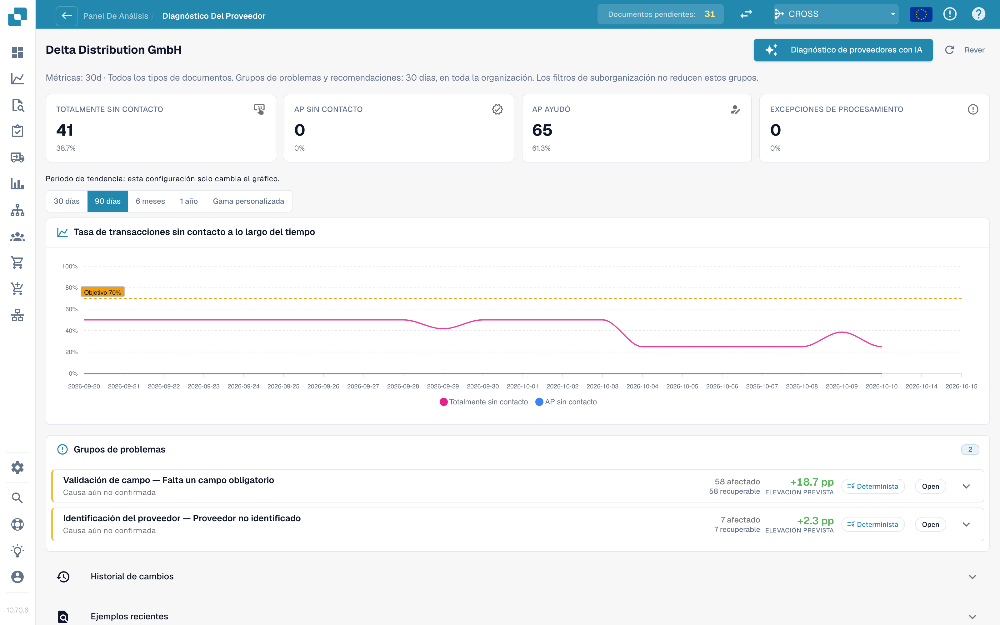
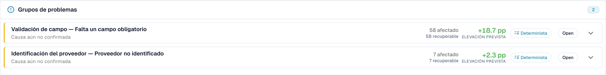

# Diagnóstico de proveedores y clústeres de problemas

Haga clic en un proveedor de la cola para abrir su página de diagnóstico.

<figure><figcaption>
La página Supplier Diagnosis: bloques de resultados, tendencia con selector de período y dos clústeres de problemas ordenados por mejora esperada. Organización de ejemplo con datos de demostración; los nombres de proveedores son ficticios.
</figcaption></figure>

La página muestra:

* **Seis bloques de resultados** (Pure touchless, AP touchless, AP assisted, Process exception, In progress, Not eligible), cada uno enlazado con los documentos.
* **La tendencia** con su propio selector de período: 30 días, 90 días, 6 meses, 1 año o un intervalo personalizado (hasta dos años). Esto solo cambia el gráfico.
* **Issue clusters** (clústeres de problemas, véase más abajo).
* **Change history**: los cambios que aplicó para este proveedor y lo que lograron.
* **Recent examples**: documentos de muestra, en dos pestañas: **Needed attention** y **Went touchless**.
* **Diagnose supplier with AI**: analiza todos los clústeres del proveedor (administradores).

Una breve nota explica una página vacía, por ejemplo: _5 documents from this supplier are still being processed and have no analysis result yet._ (5 documentos de este proveedor aún se están procesando y todavía no tienen resultado de análisis) o _All 40 completed documents from this supplier ran touchless: there is nothing to diagnose._ (los 40 documentos completados de este proveedor se procesaron touchless: no hay nada que diagnosticar).

### Issue clusters

Un **clúster** agrupa los documentos de un proveedor que se detuvieron por el **mismo primer motivo**. En lugar de 40 problemas individuales, ve "3 problemas".

<figure><figcaption>
Una tarjeta de clúster abierta: el primer bloqueo, <strong>What to change</strong> y una <strong>Change proposal</strong> con riesgo, alcance y preguntas abiertas. Aquí el clúster abarca 58 documentos y vale +18.7 pp. Organización de ejemplo con datos de demostración; los nombres de proveedores son ficticios.
</figcaption></figure>

**Clúster de ejemplo (ilustrativo).**

* **Headline**: _Required field missing_ en la etapa _Field Validation_
* **Affected**: 28 documentos. **Recoverable**: 28 documentos. **Expected lift**: +2.8 pp
* **Suspected cause**: el proveedor imprime el número de OC debajo de la tabla, donde la extracción no busca
* **What to change**: _Master data change_: añadir el diseño de este proveedor. **Open** le lleva a la página de ajustes correcta
* **Owner**: Consultant. **Confidence**: Medium. **Source**: Hypothesis

Qué muestra una tarjeta de clúster:

| Parte                                      | Significado                                                                                                                                                                                                                                               |
| ------------------------------------------ | --------------------------------------------------------------------------------------------------------------------------------------------------------------------------------------------------------------------------------------------------------- |
| **First blocker** y **stage**              | El motivo y la etapa del pipeline en la que se detienen los documentos. Hay más de 30 motivos, por ejemplo _Supplier not identified_, _Purchase order not found_, _Unit price outside PO tolerance_, _Rejected by the ERP_, _E-invoice validation failed_ |
| **Affected / Recoverable / Expected lift** | Cuántos documentos, cuántos se pueden recuperar y cuántos puntos porcentuales supondría                                                                                                                                                                   |
| **Suspected cause / Confirmed cause**      | Lo que DocBits cree que es el motivo (o lo que una persona confirmó)                                                                                                                                                                                      |
| **Evidence** y **Missing evidence**        | En qué se basa el hallazgo y lo que DocBits **no** pudo establecer. Lea **Missing evidence** antes de fiarse del resto                                                                                                                                    |
| **What to change**                         | Pasos concretos con enlaces **Open** a los ajustes. Una etiqueta indica el tipo: _Configuration change_, _Master data change_, _Supplier template change_, _Process change_, _Supplier action needed_, _Not fixable_                                      |
| **Owner**                                  | DocBits, Customer, Consultant, Supplier o Unassigned                                                                                                                                                                                                      |
| **Sample documents**                       | Documentos reales del clúster para revisar                                                                                                                                                                                                                |

**Fixable in DocBits** y **Supplier action only** se muestran en dos grupos. En _Supplier action only_, nada en DocBits cambia el resultado: el proveedor tiene que corregir el documento y volver a enviarlo.

### De dónde viene una recomendación

Cada causa muestra su **fuente**, de modo que pueda distinguir un hallazgo derivado de una suposición:

| Fuente                             | Significado                                                                                                                 |
| ---------------------------------- | --------------------------------------------------------------------------------------------------------------------------- |
| **Deterministic** / **Rule-based** | Una regla lo derivó de la evidencia registrada del pipeline. No intervino ningún modelo de lenguaje                         |
| **Hypothesis**                     | Un modelo de lenguaje lo propuso a partir de la evidencia del clúster. Trátelo como una pista y compruébelo antes de actuar |
| **Confirmed**                      | Una persona revisó la evidencia y confirmó la causa                                                                         |

Los textos de IA se escriben en el idioma de su organización. Si un clúster se analizó en otro idioma, utilice **Analyse in this language**.

## Clústeres de coincidencia con la OC

Si el primer bloqueo de un clúster es un motivo de coincidencia con la OC (por ejemplo, _PO item mismatch_ o _Purchase order not found_), la tarjeta del clúster muestra cómo intenta DocBits hacer coincidir la factura con la orden de compra. Véase [Diagnóstico de la coincidencia con la OC](touchless-po-matching-diagnosis.md).

## Páginas relacionadas

* [Touchless Intelligence](./)
* [Diagnóstico de la coincidencia con la OC](touchless-po-matching-diagnosis.md)
* [Seguimiento del documento](touchless-document-trace.md)
* [Propuestas de cambio e informes](touchless-change-proposals.md)
