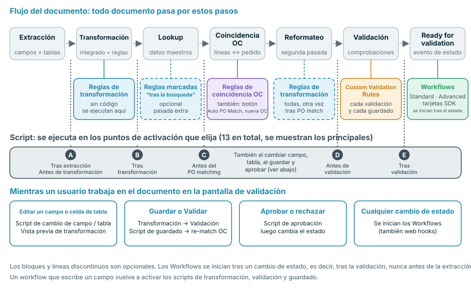
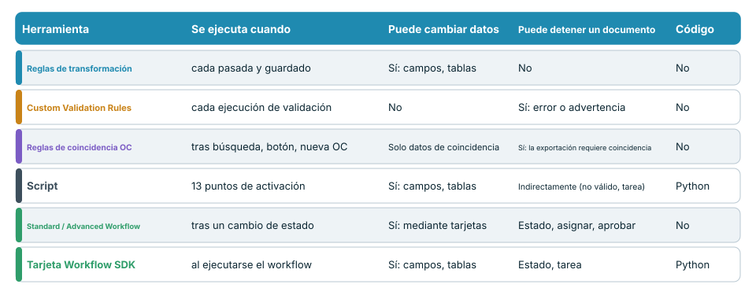
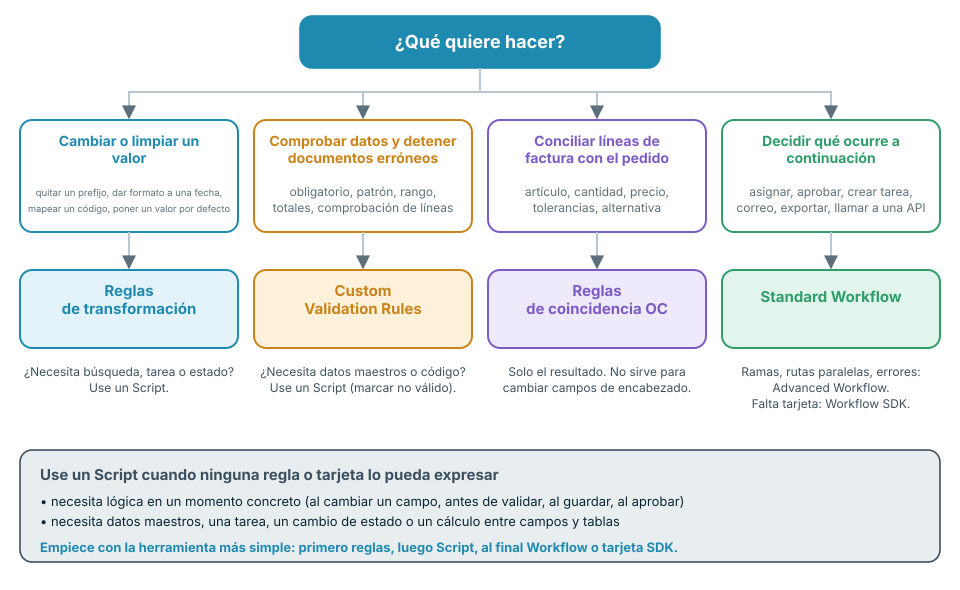

# Elegir la automatización adecuada



El vídeo (casi seis minutos) recorre los mismos temas en cuatro partes: **0:00** dónde se ejecuta cada herramienta en el flujo del documento, **1:43** código, workflows y la comparación, **2:56** qué puede y qué no puede hacer cada herramienta, **4:08** buenas prácticas y errores comunes.

DocBits ofrece varias formas de modificar, comprobar y enrutar documentos: **Transformation Rules** (reglas de transformación), **Custom Validation Rules**, **reglas de coincidencia de órdenes de compra**, **Scripts**, **Standard Workflows**, **Advanced Workflows** y **tarjetas del Workflow SDK**. Se solapan a propósito. Esta página le indica cuál elegir, **cuándo se ejecuta cada una en el flujo del documento** y qué puede y qué no puede hacer.

## La respuesta corta

| Quiero … | Usar | Por qué |
| --- | --- | --- |
| Limpiar o reescribir un valor (recortar, prefijo, formato de fecha, mapeo de unidades, valor por defecto) | [Reglas de transformación](settings/global-settings/document-types/transformation-rules.md) | Sin código, vista previa en directo, se ejecutan en cada pasada y al guardar |
| Asegurarme de que los datos estén completos y sean plausibles, y detener los documentos que no lo sean | [Custom Validation Rules](settings/global-settings/document-types/custom-validation-rules.md) | Comprobaciones declarativas, error o advertencia, bloquean la exportación automática |
| Conciliar las líneas de factura con las líneas de la orden de compra | [Reglas de coincidencia de órdenes de compra](settings/global-settings/document-types/more-settings/purchase-order/purchase-order-matching-rules.md) | Conjuntos de reglas con tolerancias, alternativas y un diagrama visual |
| Hacer algo que una regla no puede expresar: una búsqueda, un cálculo entre campos y tablas, una tarea, un cambio de estado en un momento exacto | [Script](settings/global-settings/document-types/script/README.md) | Python en 13 puntos de activación del flujo |
| Decidir **qué ocurre a continuación** con un documento: asignar, aprobar, crear una tarea, enviar un correo, exportar, llamar a una API | [Standard Workflow](workflow/standard-workflow-builder.md) | Tarjetas When / And / Then sobre eventos de estado |
| Hacer lo mismo con ramas, varias condiciones y rutas de error | [Advanced Workflow](workflow/advanced-workflow-builder.md) | Grafo visual de nodos |
| Necesito una acción que ninguna tarjeta integrada ofrece | [Workflow SDK (Card SDK)](workflow/card-sdk.md) | Su propia tarjeta, revisada por DocBits |

**Regla general: use la herramienta menos potente que resuelva el trabajo.** Primero reglas, después Script, y Workflow o tarjeta SDK en último lugar. Las reglas son más fáciles de leer, más fáciles de probar y no pueden dañar un documento; el código puede hacer más y por ello requiere más cuidado.

## Dónde se ejecuta cada herramienta en el flujo del documento

Todo documento pasa por los mismos pasos. Cada herramienta tiene su lugar en ese flujo, y ese lugar determina qué puede ver y qué puede todavía modificar.

<figure><figcaption></figcaption></figure>

En palabras:

1. **Extracción** lee los campos de encabezado y las tablas del documento. Un Script puede ejecutarse **después de la extracción**.
2. **Transformación** aplica el formato integrado y sus **reglas de transformación**. Los Scripts pueden ejecutarse antes y después.
3. **Búsqueda en datos maestros** rellena campos como el proveedor. Las reglas de transformación marcadas como **se ejecuta después de la búsqueda** realizan aquí una pasada adicional.
4. **PO matching** (conciliación de órdenes de compra) se ejecuta solo cuando la conciliación de órdenes de compra está activa para el tipo de documento. Aquí actúan las **reglas de coincidencia de órdenes de compra**. Un Script puede ejecutarse **antes del PO matching**.
5. **Reformateo**: todas las reglas de transformación se ejecutan de nuevo, de modo que los valores escritos por la búsqueda o la conciliación también se formatean.
6. **Validación** ejecuta sus **Custom Validation Rules**. Los Scripts pueden ejecutarse **antes** y **después** de la validación.
7. El documento obtiene el estado **Ready for validation**. Este es el primer momento en que puede iniciarse un **Workflow**. Los Workflows reaccionan a cambios de estado, por lo que siempre se ejecutan **después** de la validación, nunca antes de la extracción.

Mientras una persona trabaja en la pantalla de validación se aplican más disparadores: editar un campo o una celda de tabla ejecuta los Scripts de cambio de campo y de tabla y actualiza la vista previa de las reglas de transformación. **Guardar** y **Validar** vuelven a ejecutar las reglas de transformación, la validación y los Scripts de guardado, y vuelven a conciliar la orden de compra si el número de OC ha cambiado. **Aprobar** ejecuta los Scripts de aprobación antes de que cambie el estado.


Un workflow que escribe un campo se comporta como una persona que guarda el documento: las reglas de transformación, la validación, las Custom Validation Rules y los Scripts de guardado se ejecutan de nuevo para esa escritura. Téngalo en cuenta cuando un workflow y una regla modifiquen el mismo campo.


## Comparar las herramientas

<figure><figcaption></figcaption></figure>

| | Reglas de transformación | Custom Validation Rules | Reglas de coincidencia de OC | Script | Standard Workflow | Advanced Workflow | Tarjeta SDK |
| --- | --- | --- | --- | --- | --- | --- | --- |
| **Se ejecuta cuando** | En cada pasada de transformación y en cada guardado | En cada ejecución de validación | Tras la búsqueda, **Auto PO Match**, nuevo número de OC | 13 puntos de activación | Tras un cambio de estado | Tras un cambio de estado | Cuando se ejecuta su workflow |
| **Puede leer** | Campos de encabezado, columnas de tabla | Campos, celdas de tabla, totales sobre filas | Tablas, números de OC, líneas de orden de compra, tolerancias | Todos los datos extraídos, búsquedas, usuarios, grupos, búsqueda de texto completo | Datos del documento, usuarios, grupos, variables | Lo mismo, más los resultados de nodos anteriores | Campos, tablas, búsquedas, usuarios, grupos |
| **Puede escribir** | Valores de campos y columnas, filas, suborganización | Nada: solo marcas de válido / no válido | Solo datos de coincidencia | Campos, tablas, tareas, estado | Campos, estado, asignación, tareas, exportación, correo, llamada a API | Las mismas tarjetas, más lógica y variables | Campos, tablas, estado, tareas |
| **Puede detener un documento** | No | Sí, los errores bloquean la exportación automática y **Validar** | Sí, sin una coincidencia completa la exportación automática espera cuando el PO matching está activo | Indirectamente: marcar un campo como no válido, crear una tarea | Establece el estado, asigna, aprueba, rechaza | Igual | Igual que el tipo de tarjeta |
| **Requiere código** | No | No | No | Sí, Python restringido | No | No | Sí, Python en un sandbox |
| **Uso típico** | Normalizar valores | Campos obligatorios, formatos, totales | Conciliación de líneas | Lógica especial | Enrutamiento y aprobación | Enrutamiento con ramas | Acciones de partners |

## Decidir con cuatro preguntas

<figure><figcaption></figcaption></figure>

1. **¿Hay que cambiar un valor?** Use **reglas de transformación**. Si el cambio necesita datos maestros, una tarea o un estado, use un **Script**.
2. **¿Hay que comprobar un valor?** Use **Custom Validation Rules**. Detienen un documento, pero nunca lo modifican. Si la comprobación necesita datos maestros o código, un **Script** puede marcar el campo como no válido.
3. **¿Hay que conciliar las líneas de factura con un pedido?** Use **reglas de coincidencia de órdenes de compra**. Solo producen resultados de coincidencia. Para corregir un campo de encabezado antes de la conciliación, use una regla de transformación.
4. **¿El siguiente paso depende del documento?** Use un **Workflow**. Elija **Advanced** cuando necesite ramas, varias condiciones o rutas de error. Elija una **tarjeta SDK** solo cuando ninguna tarjeta integrada haga lo que necesita.

## Herramienta por herramienta

### Reglas de transformación

* **Úselas cuando** un valor es correcto en el fondo pero incorrecto en la forma: prefijos, espacios, formatos de fecha, códigos de unidad, valores por defecto, un número de OC en el campo equivocado, o tablas que deben colapsarse en una línea de total.
* **Se ejecutan** en la primera pasada de transformación, en una pasada opcional tras la búsqueda en datos maestros, de nuevo tras el PO matching y en cada guardado. La pantalla de validación muestra una vista previa.
* **Pueden** modificar campos de encabezado, columnas y filas de tabla, y la suborganización. Cada regla puede limitarse a ciertos proveedores o condiciones.
* **No pueden** detener un documento, llamar a otros sistemas, usar búsquedas en datos maestros ni crear tareas. Una regla que no se puede aplicar deja el valor como está.
* **Más información:** [Reglas de transformación](settings/global-settings/document-types/transformation-rules.md)

### Custom Validation Rules

* **Úselas cuando** un documento no debe continuar con datos incorrectos: campos obligatorios, patrones, rangos numéricos, valores permitidos, comparación entre dos campos, totales que deben cuadrar.
* **Se ejecutan** en cada validación: en el pipeline, en cada guardado y después de que un workflow haya escrito datos.
* **Pueden** marcar un campo o una celda de tabla como **error** (bloquea la exportación automática y **Validar**, salvo que se omita) o como **advertencia** (visible, no bloquea).
* **No pueden** modificar datos, buscar datos maestros ni llamar a servicios. Corrija primero los datos con una regla de transformación y compruébelos después.
* **Más información:** [Custom Validation Rules](settings/global-settings/document-types/custom-validation-rules.md)

### Reglas de coincidencia de órdenes de compra

* **Úselas cuando** las líneas de factura deban conciliarse con las líneas de la orden de compra: coincidencias únicas, múltiples y totales, tolerancias de cantidad y precio, alternativas cuando la primera regla no coincide.
* **Se ejecutan** tras la búsqueda en datos maestros, al hacer clic en **Auto PO Match** y cuando el número de OC cambia al guardar.
* **Pueden** producir el resultado de la coincidencia y los datos que necesita la aprobación. La vista de diagrama muestra qué regla se aplica en cada etapa.
* **No pueden** reescribir campos de encabezado, establecer un estado ni ejecutar lógica propia. Sin una coincidencia completa, la exportación automática espera cuando el PO matching está activo.
* **Más información:** [Reglas de coincidencia de órdenes de compra](settings/global-settings/document-types/more-settings/purchase-order/purchase-order-matching-rules.md)

### Script

* **Úselo cuando** ninguna regla pueda expresar la lógica: un cálculo entre campos y tablas, una búsqueda, una tarea para un usuario, un cambio de estado en un momento exacto, o una reacción a una edición en la pantalla de validación.
* **Se ejecuta** en los puntos de activación que usted elija: tras la extracción, antes y después de la transformación, antes del PO matching, antes y después de la validación, en cambios de campo y de tabla, al guardar y al aprobar.
* **Puede** leer todo el documento, usar búsquedas en datos maestros y búsqueda de texto completo, modificar campos, indicadores y tablas, crear tareas y cambiar el estado.
* **No puede** importar módulos ni llamar a servicios externos. Es Python restringido. Un error en un script se registra y nunca detiene el procesamiento del documento, por lo que un script **no** es una forma fiable de bloquear un documento: marque el campo como no válido o cree una tarea.
* **Más información:** [Script](settings/global-settings/document-types/script/README.md)

### Standard Workflow

* **Úselo cuando** el siguiente paso dependa del documento: asignar a un usuario o grupo, aprobar o rechazar, crear una tarea, enviar un correo, exportar, establecer un estado, llamar a una API.
* **Se ejecuta** cuando un documento alcanza un estado que usted elija, es decir, después de la validación. También puede iniciarse desde un web hook, una programación o manualmente.
* **Puede** ejecutar una cadena de tarjetas: **When** (inicio), **And** (condiciones, todas deben cumplirse), **Then** (acciones en orden).
* **No puede** ramificarse, esperar varias condiciones ni reaccionar al error de una tarjeta en una ruta separada. Para eso use un Advanced Workflow.
* **Más información:** [Standard Workflow](workflow/standard-workflow-builder.md)

### Advanced Workflow

* **Úselo cuando** un documento necesite distintas rutas: ramas según una condición, varias condiciones combinadas con ALL / ANY, y una ruta para errores o condiciones fallidas.
* **Se ejecuta** en los mismos eventos que un Standard Workflow. Requiere la suscripción DocFlow Advanced.
* **Puede** usar las mismas tarjetas que un Standard Workflow, más tarjetas de lógica y de variables, dibujadas como un grafo.
* **No puede** actuar antes de la validación: se inicia tras un cambio de estado. La lógica previa a la validación pertenece a un Script o a una regla.
* **Más información:** [Advanced Workflow](workflow/advanced-workflow-builder.md)

### Workflow SDK (Card SDK)

* **Úselo cuando** necesite una tarjeta que no existe, por ejemplo una condición o una acción específica de una aplicación de un partner.
* **Se ejecuta** siempre que se ejecuta un workflow que contiene la tarjeta.
* **Puede** leer y escribir campos y tablas, guardar el documento, cambiar el estado y crear tareas.
* **No puede** abrir conexiones de red. Una ejecución está limitada a 60 segundos y 200 llamadas al SDK. Una tarjeta solo entra en producción después de que DocBits la haya revisado y aprobado.
* **Más información:** [Card SDK](workflow/card-sdk.md)

## Buenas prácticas

* **Empiece con la herramienta más sencilla.** Una regla de transformación es mejor que un Script para dar formato. Una Custom Validation Rule es mejor que un Script para una comprobación. Recurra a un Script o a una tarjeta SDK solo cuando una regla o una tarjeta integrada no pueda hacerlo.
* **Primero corregir, después comprobar, al final enrutar.** Las reglas de transformación y los Scripts preparan los datos, las Custom Validation Rules los juzgan, los Workflows deciden qué hacer con el documento. Este es el orden del flujo.
* **Un responsable por campo.** Si una regla de transformación y un Script escriben el mismo campo, el resultado depende del orden. Asigne a cada campo un único responsable.
* **No use un workflow para reparar datos.** Los workflows se inician después de la validación, así que una reparación llega tarde y desencadena una nueva validación. Repare los datos en una regla o en un Script antes de la validación.
* **Valide con una regla, no con un Script.** Un error de Script nunca detiene un documento. Una Custom Validation Rule sí.
* **Mantenga los scripts pequeños y con nombre según su finalidad.** Un script por tarea, con el punto de activación en el nombre, es fácil de desactivar cuando algo parece ir mal.
* **Pruebe primero en dev o sandbox.** Use algunos documentos reales, compruebe el resultado en la pantalla de validación y después active la regla o el workflow en producción.
* **Revise los registros.** El registro del documento y el registro del workflow muestran qué se ejecutó y qué cambió.

## Errores comunes

| Error | Mejor |
| --- | --- |
| Un Script que recorta y añade prefijos a los valores | Una regla de transformación |
| Un workflow que establece un campo después de la validación | Una regla de transformación o un Script antes de la validación |
| Un Script del que se espera que detenga un documento no válido | Una Custom Validation Rule |
| Una Custom Validation Rule de la que se espera que corrija un valor | Una regla de transformación y después la regla de validación |
| Reescribir el número de OC en una regla de coincidencia de órdenes de compra | Una regla de transformación sobre el campo *Purchase Order*, antes de la conciliación |
| Un Advanced Workflow para un único *When → Then* | Un Standard Workflow |
| Una tarjeta SDK para algo que puede hacer una tarjeta integrada | La tarjeta integrada |

## Páginas relacionadas

* [Reglas de transformación](settings/global-settings/document-types/transformation-rules.md)
* [Custom Validation Rules](settings/global-settings/document-types/custom-validation-rules.md)
* [Reglas de coincidencia de órdenes de compra](settings/global-settings/document-types/more-settings/purchase-order/purchase-order-matching-rules.md)
* [Script](settings/global-settings/document-types/script/README.md)
* [Workflow](workflow/README.md)
