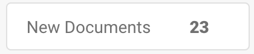

# Página de informes



### 1. Cómo activar la página de informes

Vaya a **Settings** → **Document Processing** → **Module** → **Document Type** → **Show Report** y active el interruptor para habilitar esta configuración.

<figure><figcaption></figcaption></figure>

### 2. **Cómo acceder a la página de informes**

Siga estos pasos para acceder a la **página de informes** en DocBits:

1. **Inicie sesión en DocBits**
   * Abra DocBits e inicie sesión con sus credenciales.
2. **Haga clic en el icono Report**
   * En la barra lateral izquierda, busque y haga clic en el icono **Report** (representado como un gráfico o diagrama).

<figure><figcaption></figcaption></figure>

### **3. Uso del filtro de unidad de tiempo**

*   En la parte superior de la página puede ajustar el filtro **Time Unit** para seleccionar el intervalo de tiempo del informe:

    * **Last 30 Days** (últimos 30 días)
    * **Last 7 Days** (últimos 7 días)
    * **Custom Time Frame** (intervalo de fechas personalizado)

    <figure><figcaption></figcaption></figure>

### **4. Visualización de documentos nuevos**

* Junto al filtro **Time Unit** hay un indicador denominado **New Documents**. Muestra el número de documentos nuevos importados durante el período seleccionado.

<figure><figcaption></figcaption></figure>

### **5. Visualización del tiempo medio del sistema**

* A continuación de **New Documents** se encuentra el indicador **Average System Time**. Muestra el tiempo medio, en segundos, que el sistema tardó en procesar un documento nuevo durante el período seleccionado.

<figure><figcaption></figcaption></figure>

### **6. Sección Changed Fields**

* Debajo de la información relacionada con el tiempo se encuentra la sección **Changed Fields**. Esta sección muestra un diagrama con la frecuencia con la que los usuarios modificaron manualmente cada campo del documento durante el período seleccionado.
* Cada campo se muestra con el número de cambios correspondiente, representado como barras en el diagrama.

<figure><figcaption></figcaption></figure>

* **Opciones de descarga del diagrama**
  * En el lado derecho del diagrama **Changed Fields** hay un pequeño menú que permite descargar el diagrama en varios formatos. Puede descargarlo como:
    * **SVG**
    * **PNG**
    * **CSV**
  * Para descargar el diagrama, haga clic en el menú y seleccione el formato de archivo que prefiera.

### **7. Secciones adicionales del informe**

Debajo de la sección **Changed Fields** encontrará cuatro botones adicionales que ofrecen información más detallada al hacer clic en ellos. Cada botón se expande al hacer clic para mostrar más información.

1.  **Total Documents per Type**

    * Este botón muestra el número total de documentos de cada tipo de documento (por ejemplo, Invoice, Purchase Order, etc.) durante el período seleccionado.
    * Al hacer clic en el botón, se expande y muestra una lista de tipos de documento con el recuento de los documentos de cada tipo procesados en el período seleccionado.

    <figure><figcaption></figcaption></figure>
2.  **Daily Average per Doctype**

    * Este botón muestra el promedio diario de documentos procesados, clasificados por tipo de documento.
    * Al hacer clic en el botón, se expande y muestra los tipos de documento con su promedio diario correspondiente.

    <figure><figcaption></figcaption></figure>
3.  **Status Statistic**

    * Este botón muestra la distribución de estados de cada tipo de documento (por ejemplo, Invoice, Purchase Order, etc.). Al hacer clic, se expande para mostrar el estado de los documentos dentro de cada tipo de documento, indicando cuántos documentos hay en cada categoría de estado.

    <figure><figcaption></figcaption></figure>
4.  **Export Statistic**

    * Este botón permite consultar las estadísticas de exportación de sus documentos. Al hacer clic, se expande para ofrecer datos relacionados con las exportaciones de documentos, como el número de exportaciones, las tasas de éxito y de error, y otra información relevante.

    <figure><figcaption></figcaption></figure>
