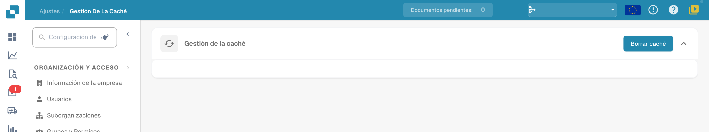

# Gestión de la caché

Abra **Ajustes → Gestión de la caché** para acceder a la acción de mantenimiento disponible.

<figure><figcaption>
Gestión actual de la caché con Borrar caché. Esta vista no contiene una tabla de objetos ni valores TTL editables. No se borró la caché.
</figcaption></figure>

## Borrar caché

Utilice **Borrar caché** cuando necesite restablecer los datos almacenados en caché. Después puede ser necesario cargar los datos de nuevo. Compruebe la vista afectada y el resultado esperado.

La versión mostrada ofrece esta acción global. No muestra una tabla de objetos de caché, interruptores por objeto ni valores TTL editables. Para la imagen no se borró la caché.
