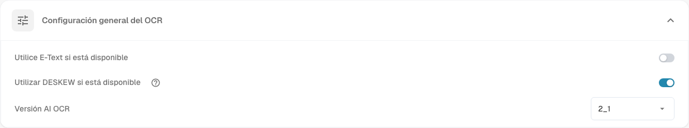

# Procesamiento de documentos

Los ajustes de **Procesamiento de documentos** determinan cómo DocBits lee, enriquece y exporta documentos. Abra **Ajustes** y elija el área que necesite en **Procesamiento de documentos**.

* [Configuración de OCR](ocr-settings.md): cómo se lee el texto de los documentos.
* [Búsqueda de datos maestros](master-data-lookup.md): cómo se comparan los valores extraídos con sus datos maestros.
* [Cálculo de fecha de vencimiento](due-date-calculation.md): cómo se calculan las fechas de vencimiento.
* [Exportar](export.md): adónde y cómo se exportan los documentos procesados.

Por ejemplo, abra **Configuración de OCR** para revisar **Configuración general del OCR**. El ajuste **Utilice E-Text si está disponible** utiliza el texto electrónico incrustado. El ajuste **Utilizar DESKEW si está disponible** endereza las páginas escaneadas. El ajuste **Versión AI OCR** selecciona la versión del motor de reconocimiento. Consulte [Configuración de OCR](ocr-settings.md) para conocer los controles en detalle.

<figure><figcaption>
Los ajustes generales de OCR son un área del procesamiento de documentos. Los valores seleccionados dependen de su organización.
</figcaption></figure>

Otras áreas de esta sección son [Importar](import/README.md), [Clasificación y extracción](classification-and-extraction/README.md), [Gestión de reglas](rule-manager/README.md), [Listas de valores](list-of-values.md) y [Módulo](module/README.md).

Si un ajuste no se comporta como se espera, compruébelo primero con un documento de prueba. Un cambio puede afectar a todos los documentos nuevos de la organización.
