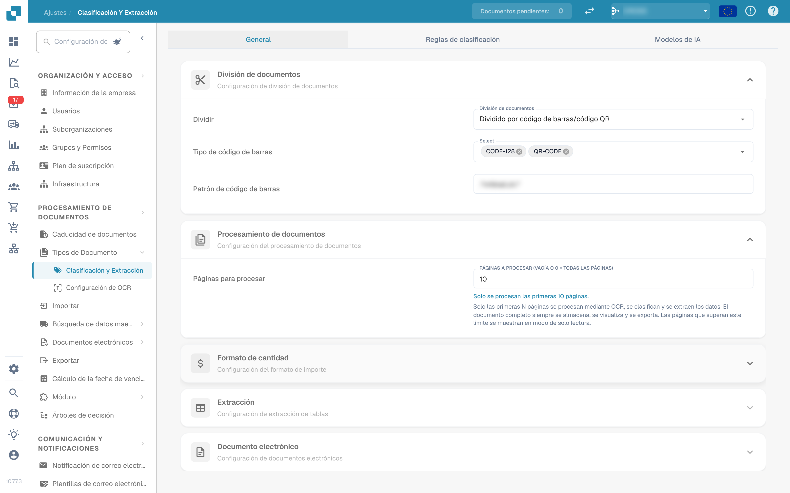
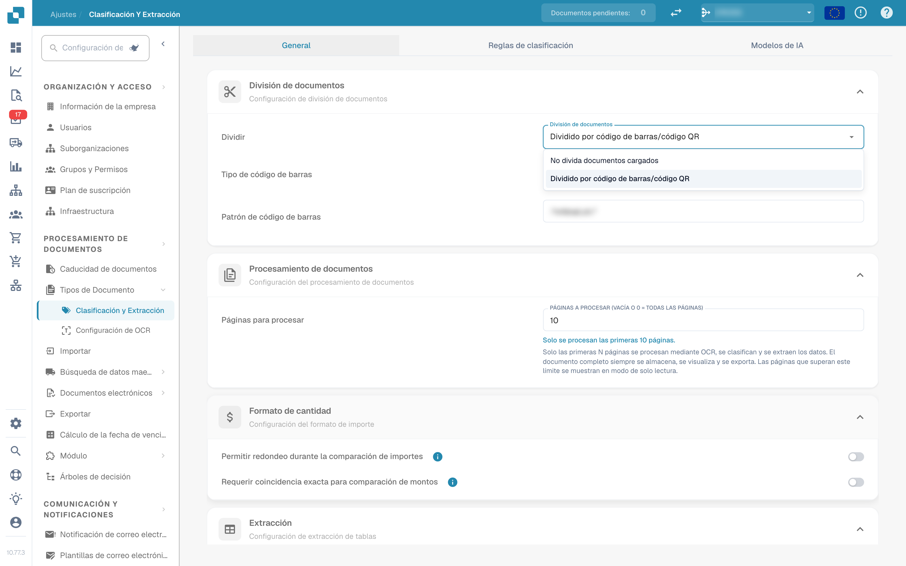
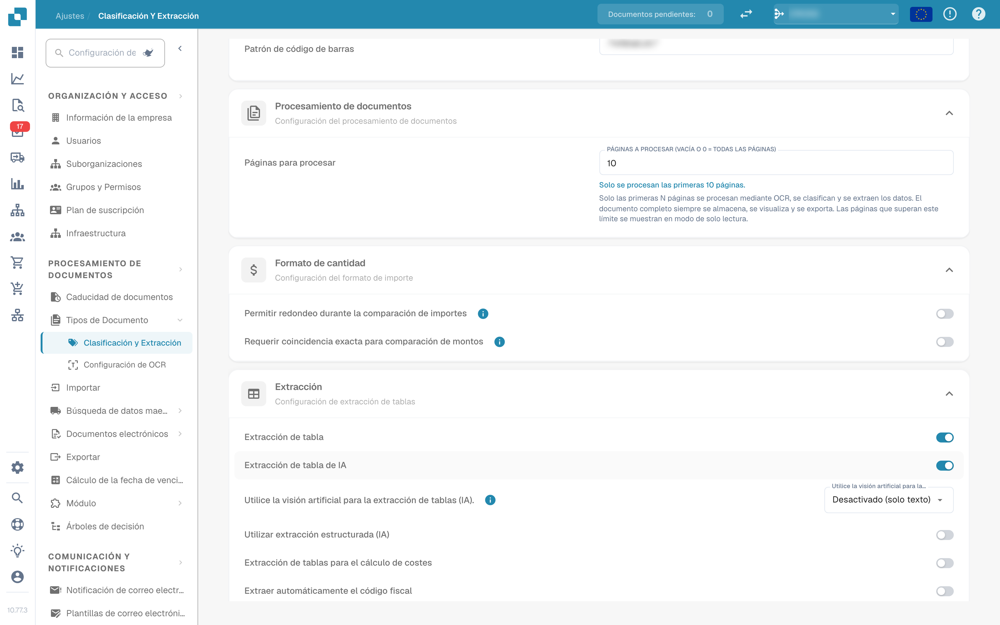
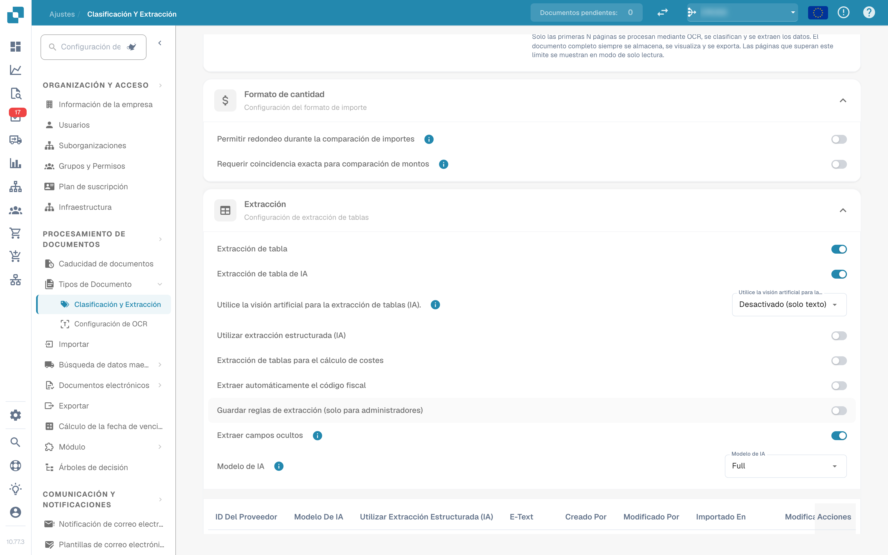
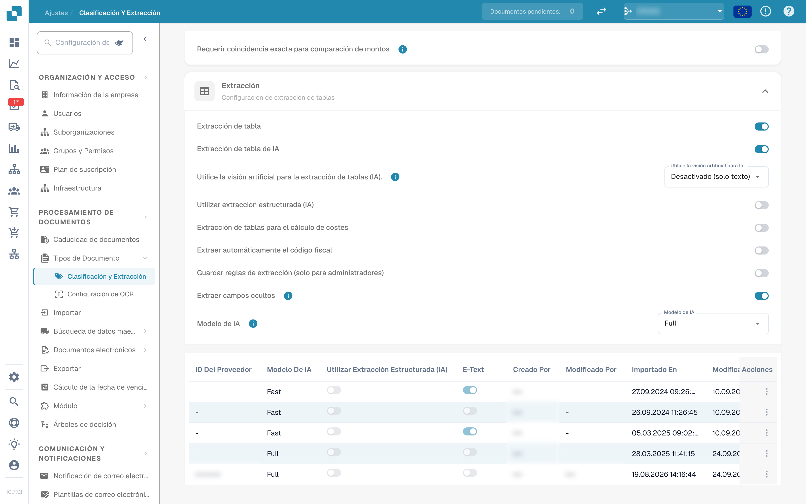
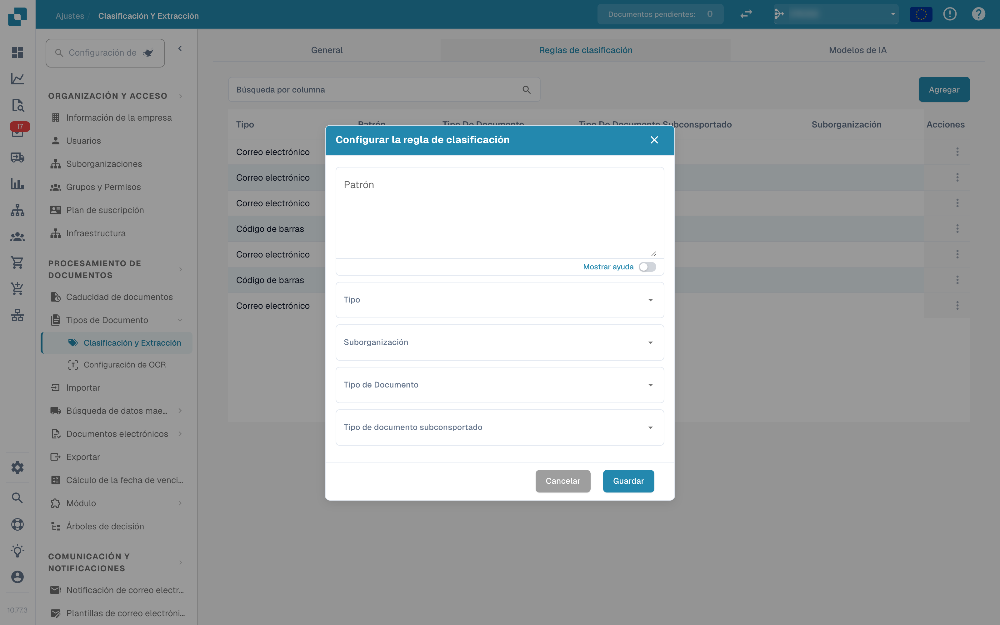
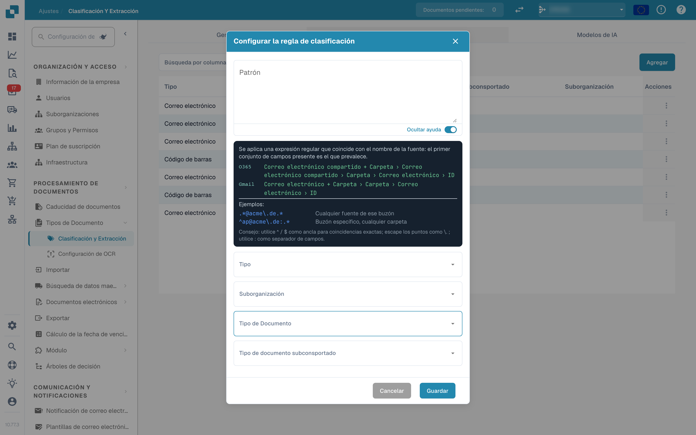
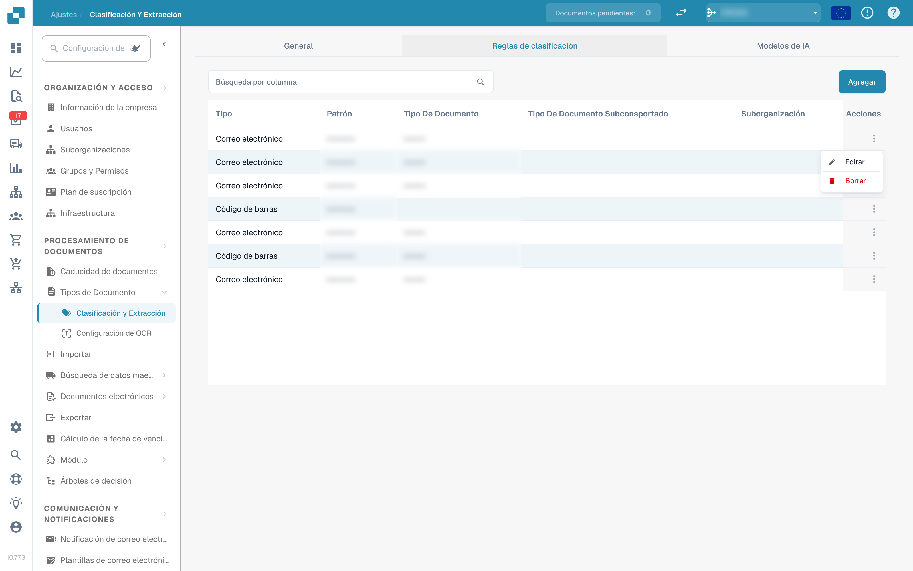
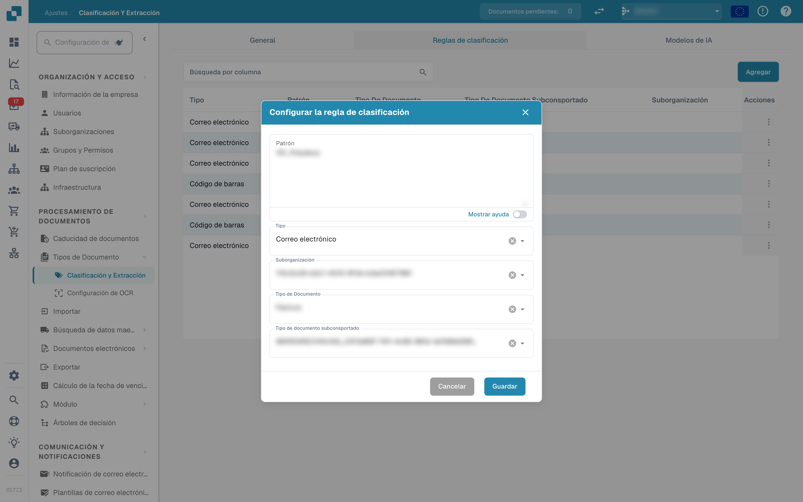
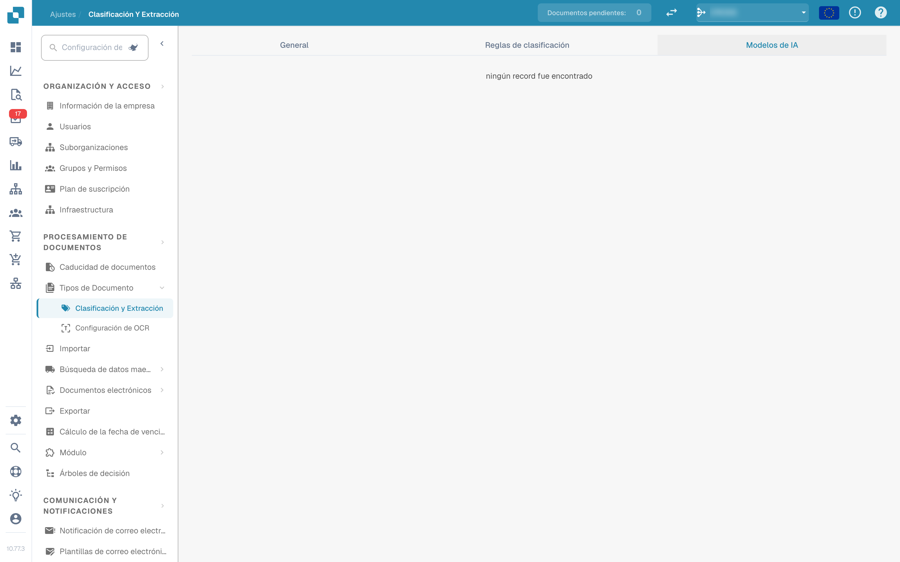

# Clasificación y extracción

<figure><figcaption>
Ajustes de clasificación y extracción
</figcaption></figure>

## Descripción general

En los ajustes de **Clasificación y extracción** puede:

* controlar cómo se **dividen** los documentos cargados y cuántas páginas se procesan
* configurar el **formato de cantidad** para la comparación de importes
* configurar la **extracción de tablas**, incluido el modelo de IA usado por proveedor
* activar o desactivar el procesamiento de archivos **ZUGFeRD** no admitidos
* definir **reglas de clasificación** que asignan un tipo de documento automáticamente
* revisar los **modelos de IA** y sus etiquetas entrenadas

La página tiene tres pestañas: **General**, **Reglas de clasificación** y **Modelos de IA**. La pestaña *Modelos de IA* solo se muestra cuando el módulo de modelos y etiquetas está habilitado para su organización.

| Pestaña | Contenido |
|---|---|
| General | División de documentos, Procesamiento de documentos, Formato de cantidad, Extracción, Documento electrónico |
| Reglas de clasificación | Reglas regex que clasifican documentos por el nombre de origen |
| Modelos de IA | Modelos entrenados a medida con sus etiquetas, tipos de documento y prioridad |

## Acceso a los ajustes de clasificación y extracción

Vaya a **Ajustes → Tipos de Documento → Clasificación y Extracción**.

## General

La pestaña **General** agrupa los ajustes en secciones desplegables. Todos los cambios se guardan inmediatamente al modificar un valor; no hay un botón de guardado aparte.

### División de documentos

**Dividir** decide si un documento cargado se divide en varios documentos cuando aparece un código de barras en alguna de sus páginas. El desplegable ofrece:

* **No divida documentos cargados** – el valor predeterminado; el documento se procesa como un solo archivo.
* **Dividido por código de barras/código QR** – el documento se divide en cada código de barras detectado.

<figure><figcaption>
Opciones de división en la sección «División de documentos»
</figcaption></figure>

Cuando se selecciona **Dividido por código de barras/código QR**, aparecen dos campos más:

* **Tipo de código de barras** – uno o más tipos de código de barras a detectar, por ejemplo *CODE-128* o *QR-CODE*.
* **Patrón de código de barras** – una expresión regular que el valor del código de barras debe cumplir antes de que se active la división. Déjelo vacío para dividir con cualquier código de barras de los tipos seleccionados. El patrón se valida antes de guardarse; una expresión no válida se informa de inmediato.

Tras una división correcta, el documento principal se elimina y las páginas continúan como documentos separados que comparten el mismo lote.

### Procesamiento de documentos

**Páginas para procesar** limita cuántas páginas se digitalizan por OCR, se clasifican y se extraen por documento.

<figure><figcaption>
Páginas para procesar en la sección «Procesamiento de documentos»
</figcaption></figure>

* Vacío o **0** significa que se procesan todas las páginas.
* Un número *N* limita el OCR, la clasificación y la extracción a las primeras *N* páginas. El documento completo se sigue almacenando, mostrando y exportando; las páginas que superan el límite se muestran en modo de solo lectura.

### Formato de cantidad

Dos interruptores controlan cómo se comparan los importes con los datos maestros y los pedidos de compra.

<figure><figcaption>
Sección «Formato de cantidad»
</figcaption></figure>

* **Permitir redondeo durante la comparación de importes** – cuando está habilitado, se permite una tolerancia de ±0,5. Cuando está deshabilitado, se aplica ±0,05.
* **Requerir coincidencia exacta para comparación de montos** – cuando está habilitado, los importes deben coincidir exactamente, sin tolerancia. Cuando está deshabilitado, se aplica ±0,05.

Solo uno de los dos interruptores puede estar activo a la vez; al activar uno se desactiva el otro.

### Extracción


**Requisitos para que funcione la extracción de tablas**

* El tipo de documento tiene **columnas de tabla** (Ajustes → Ajustes globales → Tipos de Documento → [Columnas de tabla](../../global-settings/document-types/table-columns/README.md)). Sin columnas no hay nada a lo que extraer.
* **Extracción de tabla** o **Extracción de tabla de IA** está activada abajo, para toda la organización.
* El documento contiene texto legible: se ejecutó el OCR, o se usa el E-Text en PDF digitales ([Configuración de OCR](../ocr-settings.md)).
* El entrenamiento y los modelos de IA son **por proveedor**. Una tabla entrenada se aplica solo a los documentos del proveedor con el que se entrenó.


Puede extraer tablas de documentos activando **Extracción de tabla** o **Extracción de tabla de IA**. Una tabla entrenada (ya sea basada en IA o manual) siempre está vinculada a un proveedor concreto.

<figure><figcaption>
Interruptores de la extracción de tablas
</figcaption></figure>

**Extracción de tabla:** Activa la extracción de tablas basada en reglas. Las tablas se entrenan por proveedor en la pantalla de validación (*Go to table extraction view*).\
Obtenga más información sobre el entrenamiento [aquí](../../../setup/document-training/training-line-fields-table-training/defining-tables-and-columns.md).

**Extracción de tabla de IA:** Usa IA para extraer la tabla de cualquier proveedor sin entrenamiento. Si los resultados para un proveedor no son lo bastante precisos, entrene la tabla de ese proveedor; las reglas guardadas tienen entonces prioridad sobre la IA para ese proveedor.

**Utilice la visión artificial para la extracción de tablas (IA).:** La IA lee la imagen de la página en lugar de la capa de texto. Ayuda con documentos escaneados y tablas sin estructura de texto clara; es más lenta. El desplegable junto al interruptor elige con qué intensidad se usa la imagen de la página:

* **Desactivado (solo texto)** – Solo se usa la capa de texto. Este es el valor predeterminado.
* **Solo imágenes** – Solo se lee la imagen de la página.
* **Híbrido (texto e imágenes)** – La capa de texto y la imagen de la página se combinan en la misma solicitud.
* **Automático (decidido por documento)** – DocBits decide por documento si la capa de texto es suficiente.

**Utilizar extracción estructurada (IA):** La IA devuelve la tabla en una estructura fija que se asigna directamente a las columnas de tabla configuradas. Recomendado cuando los encabezados de columna varían mucho entre documentos. Al hacer clic en el ajuste se abre una vista previa de qué campos y columnas pedirá exactamente la IA: los campos de encabezado y las columnas de línea se listan con su origen (campos estándar solicitados o desactivados), y el modo de salida esperado (por ejemplo *strict* – sin columnas adicionales). Los campos configurados para el tipo de documento pero desactivados no se solicitan a la IA.

**Extracción de tablas para el cálculo de costes:** Cuando está habilitado, DocBits puede extraer elementos de coste de tablas a nivel de línea y clasificarlos en consecuencia.\
Encontrará una explicación detallada [aquí](table-extraction-for-costing-element.md).

**Extraer automáticamente el código fiscal:** Cuando está habilitado, el sistema rellena automáticamente el campo **Código fiscal** en la pantalla de validación, siempre que se haya configurado un campo de código fiscal.\
Más información sobre este ajuste [aquí](auto-extract-tax-code.md).

**Guardar reglas de extracción (solo para administradores):** Solo los administradores pueden hacer clic en *Save Rules* durante el entrenamiento de tablas. Actívelo cuando los usuarios guarden repetidamente reglas que rompen la extracción de un proveedor.

**Extraer campos ocultos:** También se extraen los campos marcados como ocultos en la configuración de campos. Útil cuando un valor se necesita para una regla o una exportación, pero no debe mostrarse en la pantalla de validación.

**Modelo de IA:** Selecciona el nivel de IA usado para la extracción de tablas. Hay seis opciones: **Full** (máxima precisión, la más lenta, 2 tokens por documento), **Fast** (predeterminado; 1 token por documento), **Nexus** y **Nexus Flash** (familia de modelos alternativa, opcional), además de **Auto** y **Auto Nexus**, en los que DocBits decide por documento qué modelo tan potente se necesita. La tabla bajo el selector muestra:

* qué **proveedores** usan qué modelo de IA
* si usan extracción estructurada (IA) y E-Text
* opciones para eliminar una entrada y devolver así el proveedor al valor predeterminado

Este ajuste se explica en detalle [aquí](ai-model.md).

#### ¿Por qué la tabla se ve distinta por proveedor?

Todo lo que DocBits aprende sobre una tabla se guarda **por proveedor**:

* **Reglas guardadas** (entrenamiento de tablas): posición de la tabla y asignación de sus columnas en el diseño de ese proveedor.
* **Etiquetas de tabla de IA y reglas de formato**: indicaciones que el usuario guardó para la tabla de IA de ese proveedor.
* **Modelo de IA específico del proveedor**: el nivel elegido para ese proveedor en *More settings* de la pantalla de validación.

Así, el proveedor A con reglas guardadas muestra una tabla determinista en la pestaña *Extracted table* de la pantalla de validación, mientras que el proveedor B sin reglas recibe la *AI Extracted table*. Para que el proveedor B se comporte como A, entrene una vez la tabla de B. Para restablecer un proveedor, elimine sus reglas en la pantalla de validación o restablezca sus datos de entrenamiento en la tabla Modelo de IA.

#### Claves de preferencia

Cada interruptor de esta sección se guarda como preferencia de la organización. Utilice la clave cuando ajuste el valor mediante la API (`/preferences/set_preference`), un script o el MCP de DocBits (`get_preference` / `set_preference`).

| Ajuste (etiqueta de la UI) | Clave de preferencia | Valores |
|---|---|---|
| Dividir | `SPLIT_DOCUMENT_ON_BARCODE` | `true` / `false` |
| Tipo de código de barras | `SPLIT_DOCUMENT_BARCODE_TYPE` | lista de nombres de tipo de código de barras |
| Patrón de código de barras | `SPLIT_DOCUMENT_BARCODE_PATTERN` | cadena regex |
| Páginas para procesar | `RESTRICT_TO_PAGES` | número; vacío o `0` = todas las páginas |
| Permitir redondeo durante la comparación de importes | `AMOUNTS_ROUNDING` | `true` / `false` |
| Requerir coincidencia exacta para comparación de montos | `AMOUNTS_NO_ROUNDING` | `true` / `false` |
| Extracción de tabla | `TABLE_EXTRACTION_SETTING` | `true` / `false` |
| Extracción de tabla de IA | `USE_AI_TABLE_EXTRACTION` | `true` / `false` |
| Utilice la visión artificial para la extracción de tablas (IA) | `TABLE_EXTRACTION_VISION_MODE` | `off` (predeterminado), `vision`, `hybrid`, `auto` |
| Utilice la visión artificial para la extracción de tablas (IA) – interruptor antiguo | `TABLE_EXTRACTION_USE_VISION` | `true` / `false`; equivale a `vision` |
| Utilizar extracción estructurada (IA) | `USE_STRUCTURED_EXTRACTION` | `true` / `false` |
| Extracción de tablas para el cálculo de costes | `CHARGES_TABLE_EXTRACTION` | `true` / `false` |
| Extraer automáticamente el código fiscal | `AUTO_EXTRACT_TAX_CODE` | `true` / `false` |
| Guardar reglas de extracción (solo para administradores) | `ONLY_ADMIN_CAN_SAVE_RULES` | `true` / `false` |
| Extraer campos ocultos | `EXTRACT_HIDDEN_FIELDS` | `true` / `false` |
| Modelo de IA | `AI_MODEL` | `gpt-6-sol` (Full), `gpt-6-luna` (Fast), `qwen3.8-max` (Nexus), `glm-5.3-flash` (Nexus Flash), `auto` (Auto), `auto-nexus` (Auto Nexus) |
| Versión de la extracción de tablas (diálogo de confirmación) | `TBL_EXT_VERSION` | cadena de versión |
| Configuración de OCR → Utilizar datos de IA para tablas si están disponibles | `USE_AI_DATA_FOR_TABLE` | `true` / `false` |
| Configuración de OCR → Utilizar E-Text si está disponible | `USE_ETEXT_IF_AVAILABLE` | `true` / `false` |

Notas:

* Las preferencias booleanas se guardan como las cadenas `true` / `false`; una clave que nunca se ajustó cuenta como `false`. Si envía `1` o `0`, DocBits guarda `true` / `false`.
* Un `AI_MODEL` sin ajustar significa **Fast**.
* Un `TABLE_EXTRACTION_VISION_MODE` sin ajustar se resuelve a partir del interruptor antiguo `TABLE_EXTRACTION_USE_VISION`: `true` da `vision`, cualquier otro valor da `off`.
* Cambiar una clave surte efecto en los documentos procesados después. Reinicie un documento para volver a extraerlo con el nuevo ajuste.
* Las opciones por proveedor (E-Text, modelo de IA, reglas guardadas) no son preferencias de la organización; se ajustan en la pantalla de validación, en *More settings*, para un documento de ese proveedor.

### Documento electrónico

**Procesar ZUGFeRD PDF no admitido:** Si está habilitado, las versiones de **ZUGFeRD** no admitidas se procesan como PDF estándar y el XML incrustado se ignora.

La lista de versiones de **ZUGFeRD** admitidas se encuentra [aquí](../../global-settings/document-types/edi/zugferd/README.md).

## Reglas de clasificación

La pestaña **Reglas de clasificación** enumera las reglas que asignan automáticamente un tipo de documento durante el procesamiento. Cada regla compara un **patrón regex** con el nombre de origen del documento y, si coincide, asigna el tipo de documento y opcionalmente un tipo de documento subconsportado.

Cambie a la pestaña haciendo clic en **Reglas de clasificación** en la parte superior de la página.

<figure><figcaption>
Pestaña «Reglas de clasificación» con la tabla de reglas
</figcaption></figure>

La tabla tiene una fila por regla con estas columnas:

* **Tipo** – dónde se aplica el patrón. Existen dos tipos: **Código de barras** y **Correo electrónico**.
* **Patrón** – la expresión regular guardada para la regla.
* **Tipo de Documento** – el tipo de documento asignado cuando coincide el patrón.
* **Tipo de documento subconsportado** – el tipo de documento subconsportado asignado cuando coincide el patrón.
* **Suborganización** – la suborganización a la que se limita la regla. Vacío significa que la regla se aplica a todas las suborganizaciones.
* **Acciones** – el menú de fila con *Editar* y *Borrar*.

El campo de búsqueda sobre la tabla filtra todas las columnas, incluidos los textos mostrados de las columnas desplegables.

### Añadir una regla de clasificación

1.  Haga clic en **Agregar** sobre la tabla.

    <figure><figcaption>
Diálogo «Configurar la regla de clasificación»
</figcaption></figure>
2. Rellene los campos:
   * **Patrón** (obligatorio) – la expresión regular que busca la regla.
   * **Tipo** (obligatorio) – **Código de barras** o **Correo electrónico**. Esto decide contra qué nombre de origen se compara el patrón.
   * **Suborganización** *(opcional)* – limita la regla a una suborganización.
   * **Tipo de Documento** – el tipo de documento asignado cuando coincide el patrón.
   * **Tipo de documento subconsportado** *(opcional)* – un tipo más específico; la lista depende del tipo de documento seleccionado. Cambiar el tipo de documento borra el tipo de documento subconsportado.
3.  Haga clic en **Guardar**.

El diálogo valida el patrón antes de guardar. Un patrón que ya usa otra regla se rechaza con *El patrón ya existe*; un patrón vacío se rechaza con el mensaje de campo obligatorio.

#### Ayuda del patrón

El interruptor **Mostrar ayuda** bajo el campo de patrón abre una referencia en línea con los formatos de nombre de origen contra los que se compara el patrón:

* **O365** – `Correo electrónico compartido + Carpeta › Correo electrónico compartido › Carpeta › Correo electrónico › ID`
* **Gmail** – `Correo electrónico + Carpeta › Carpeta › Correo electrónico › ID`

<figure><figcaption>
Panel de ayuda del patrón dentro del diálogo de la regla
</figcaption></figure>

Ejemplos del panel:

* `.*@acme\.de.*` – cualquier fuente de ese buzón
* `^ap@acme\.de:.*` – un buzón concreto, cualquier carpeta

Consejo: utilice `^` / `$` como ancla para coincidencias exactas, escape los puntos como `\.` y use `:` como separador de campos. Gana el primer conjunto de campos presente en el nombre de origen.

Si usa el tipo **Correo electrónico**, el patrón se compara con los nombres de buzón y carpeta del correo importado, no con el contenido del documento.

### Editar una regla de clasificación

1.  Haga clic en los tres puntos de la columna **Acciones** de la regla que desea cambiar.

    <figure><figcaption>
Menú de fila con Editar y Borrar
</figcaption></figure>
2.  Seleccione **Editar**. El diálogo se abre con los valores actuales de la regla.

    <figure><figcaption>
Edición de una regla de clasificación existente
</figcaption></figure>
3. Modifique el patrón, el tipo, la suborganización, el tipo de documento o el tipo de documento subconsportado.
4.  Haga clic en **Guardar**.

Se aplica la misma validación que al añadir: el patrón no puede estar vacío ni duplicar el de otra regla.

### Eliminar una regla de clasificación

1. Haga clic en los tres puntos de la columna **Acciones**.
2. Seleccione **Borrar**.

La regla se elimina de la lista de inmediato. Eliminar una regla no modifica los documentos que ya se clasificaron con ella.

## Modelos de IA

La pestaña **Modelos de IA** muestra los modelos entrenados a medida disponibles para la clasificación de documentos y sus etiquetas. Solo aparece cuando el módulo de modelos y etiquetas está habilitado para su organización.

<figure><figcaption>
Pestaña «Modelos de IA»
</figcaption></figure>

Si no hay ningún modelo propio disponible para la organización, la pestaña muestra *¡ningún record fue encontrado!*.

### Modelos

Cada modelo es una entrada desplegable con:

* el **nombre del modelo** y la insignia **Defecto** en el modelo que se usa cuando no se aplica nada más.
* el número de **etiquetas** entrenadas para ese modelo.
* por modelo, una vez desplegado: **Tipo**, **Primera página solamente** y **Versión**.

Debajo de esa información se enumeran las etiquetas del modelo.

### Etiquetas

Las etiquetas son lo que aprende el modelo. Cada etiqueta asigna un patrón que el modelo reconoce a un tipo de documento.

* **Nombre** – el nombre de la etiqueta.
* **Siguiente modelo** – un modelo que continúa procesando la salida de esta etiqueta.
* **Tipo de documento** – el tipo de documento que asigna la etiqueta.
* **Tipo de documento subconsportado** – un tipo más específico para la etiqueta.
* **Prioridad** – el orden en que se evalúan las etiquetas; primero los números más bajos.

El campo de búsqueda sobre la tabla de etiquetas filtra las etiquetas del modelo seleccionado.

### Editar una etiqueta

Haga clic en el icono de lápiz de una fila de etiqueta para abrir el diálogo de edición. Ofrece **Siguiente modelo** y **Tipo de documento**; ajuste uno de los dos, ya que el diálogo exige un siguiente modelo o un tipo de documento. Haga clic en **Guardar** para aplicar el cambio.

## Páginas relacionadas

* [Modelo de IA](ai-model.md) – los seis niveles de extracción y cómo obtiene un proveedor su propio modelo
* [Extraer automáticamente el código fiscal](auto-extract-tax-code.md)
* [Extracción de tablas para el cálculo de costes](table-extraction-for-costing-element.md)
* [Configuración de OCR](../ocr-settings.md)
