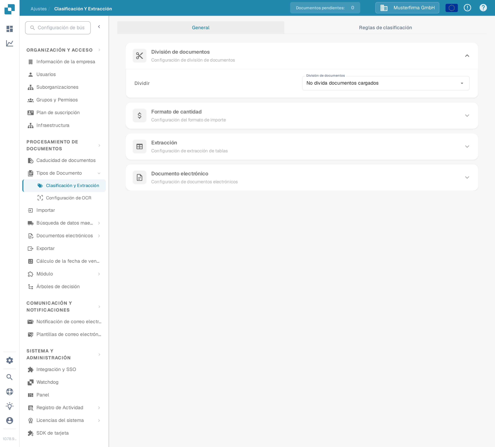
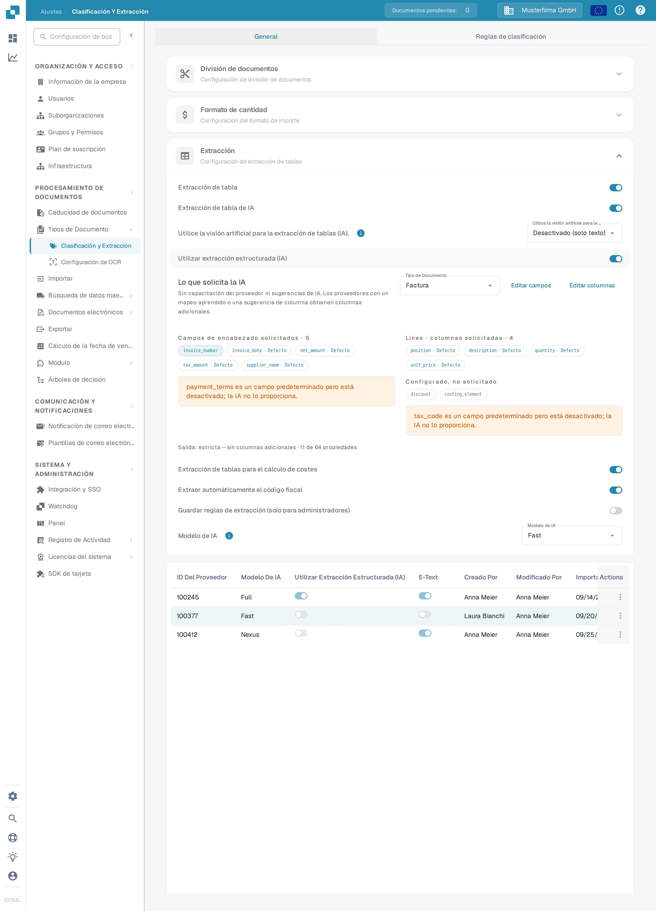
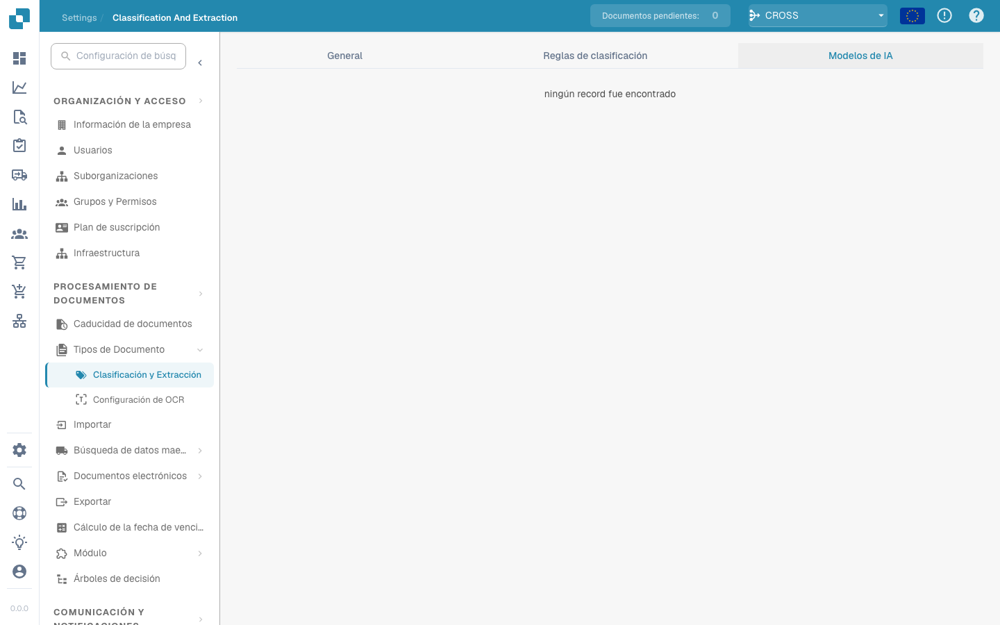

# Clasificación y extracción

## Descripción general

En la configuración de **Clasificación y extracción** puedes:

* Activar la **división de documentos** basada en códigos QR
* Configurar el **formato de importes**
* Configurar la **extracción de tablas**
* Activar o desactivar el procesamiento de archivos **ZUGFeRD** no compatibles
* Definir reglas de clasificación especiales
* Supervisar los **modelos de IA** entrenados a medida que se usan en el proceso de clasificación

Esta página explica en detalle todos los ajustes disponibles.

## **Acceder a la configuración de Clasificación y extracción**

Para acceder a la configuración de **Clasificación y extracción**, ve a:\
**Configuración → Procesamiento de documentos → Clasificación y extracción**

<figure><figcaption>
Abre <strong>Ajustes → Procesamiento de documentos → Clasificación y extracción</strong>.
</figcaption></figure>

## División de documentos

En la sección **División de documentos** puedes configurar si un documento cargado debe dividirse en varios documentos cada vez que aparezca un **código de barras** en una de sus páginas.

Para activar esta función:

1. Ve a la sección **División de documentos**.
2.  Abre el menú desplegable.

    <figure><figcaption></figcaption></figure>
3.  Selecciona **Dividir por código de barras/código QR**.

    <figure><figcaption></figcaption></figure>

A continuación tendrás la opción de:

* Seleccionar uno o varios tipos de código de barras que se deben detectar.
*   Indicar un patrón regex que el código de barras debe cumplir para que se active la división del documento.

    <figure><figcaption></figcaption></figure>

## Formato de importes

En la sección **Formato de importes** tienes dos opciones:

* **Permitir redondeo al comparar importes:**\
  Si está activada, se admite una tolerancia de ±0,5 al comparar importes.\
  Si está desactivada, se aplica la tolerancia predeterminada de ±0,05.
* **Exigir coincidencia exacta al comparar importes:**\
  Si está activada, los importes deben coincidir exactamente, sin tolerancia.\
  Si está desactivada, se admite una tolerancia de ±0,05.

<mark style="color:red;">**Nota**</mark>: Solo una de estas dos opciones puede estar activa a la vez.

## Extracción de tablas


**Requisitos para que la extracción de tablas funcione**

* El tipo de documento tiene **columnas de tabla** (Configuración → Configuración global → Tipos de documentos → [Columnas de tabla](../../global-settings/document-types/table-columns.md)). Sin columnas no hay dónde extraer.
* **Extracción de tablas** o **Extracción de tablas por IA** está activada más abajo, para toda la organización.
* El documento tiene texto legible: se ejecutó el OCR, o se usa E-Text en los PDF generados digitalmente ([Configuración de OCR](../ocr-settings.md)).
* El entrenamiento y los modelos de IA son **por proveedor**. Una tabla entrenada solo se aplica a los documentos del proveedor con el que se entrenó.


Puedes extraer tablas de los documentos activando **Extracción de tablas** o **Extracción de tablas por IA**. Una tabla entrenada (ya sea con IA o manualmente) siempre está vinculada a un proveedor concreto.

**Extracción de tablas (Table Extraction):** Activa la extracción de tablas basada en reglas. Las tablas se entrenan por proveedor en la pantalla de validación (*Ir a la vista de extracción de tablas*).\
Más información sobre el entrenamiento [aquí](../../../setup/document-training/training-line-fields-table-training/defining-tables-and-columns.md).

**Extracción de tablas por IA (AI Table Extraction):** Usa IA para extraer la tabla de cualquier proveedor sin entrenamiento. Si los resultados de un proveedor no son lo bastante precisos, entrena la tabla de ese proveedor; las reglas guardadas tienen prioridad sobre la IA para ese proveedor.

**Utilice la visión artificial para la extracción de tablas (IA):** La IA lee la imagen de la página en lugar de la capa de texto. Ayuda con documentos escaneados y tablas sin una estructura de texto clara; es más lento. El desplegable junto al interruptor define cuánto se usa la imagen de la página:

* **Desactivado (solo texto)** – Solo se usa la capa de texto. Es el valor predeterminado.
* **Solo imágenes** – Solo se lee la imagen de la página.
* **Híbrida (texto e imágenes)** – La capa de texto y la imagen de la página se combinan en la misma solicitud.
* **Auto (decidido por documento)** – DocBits decide por documento si la capa de texto es suficiente.

El modo se guarda bajo la clave de preferencia `TABLE_EXTRACTION_VISION_MODE`; el interruptor anterior `TABLE_EXTRACTION_USE_VISION` se mantiene y equivale en la práctica a *Solo imágenes*. La interfaz de la aplicación etiqueta este ajuste como *Utilice la visión artificial para la extracción de tablas (IA).*; la opción predeterminada que muestra el desplegable es *Desactivado (solo texto)*. Los demás nombres de modo aún no se han podido leer literalmente de la interfaz en español (el desplegable estaba cerrado en la captura), por lo que aquí se traducen del inglés.

**Utilizar extracción estructurada (IA):** La IA devuelve la tabla en una estructura fija que se asigna directamente a las columnas de tabla configuradas. Recomendado cuando los encabezados de columna varían mucho entre documentos. Al hacer clic en el ajuste se abre la vista previa *Lo que solicita la IA* con los campos y columnas exactos que se solicitan a la IA: *Campos de encabezado solicitados* y *columnas de línea solicitadas* se muestran con su origen (por ejemplo, *Defecto*), junto con los campos *Configurado, no solicitado* y el modo de salida esperado (por ejemplo, *Salida: estricta – sin columnas adicionales*). Los campos configurados para el tipo de documento pero desactivados no se solicitan a la IA.

<figure><figcaption>
La vista previa <em>Lo que solicita la IA</em> muestra los campos de encabezado y las columnas de línea solicitados, con el modo de salida esperado (<em>Salida: estricta</em>).
</figcaption></figure>

**Extracción de tablas para el elemento de costos:** Si está activada, DocBits puede extraer elementos de costos de las tablas a nivel de línea y clasificarlos en consecuencia.\
Explicación detallada [aquí](table-extraction-for-costing-element.md).

**Auto extraer código de impuestos:** Si está activada, el sistema rellena automáticamente el campo **Código de impuestos** en la pantalla de validación, siempre que haya un campo de código de impuestos configurado.\
Más información sobre este ajuste [aquí](auto-extract-tax-code.md).

**Guardar reglas de extracción (solo administradores):** Solo los administradores pueden hacer clic en *Guardar reglas* en el entrenamiento de tablas. Actívalo cuando los usuarios guarden una y otra vez reglas que rompen la extracción de un proveedor.

**Modelo de IA:** Selecciona el nivel de IA que se usa para la extracción de tablas. Hay seis opciones disponibles: **Full** (máxima precisión, la más lenta, 2 tokens por documento), **Fast** (predeterminado; 1 token por documento), **Nexus** y **Nexus Flash** (familia de modelos alternativa, opcional), además de **Auto** y **Auto Nexus**, en los que DocBits decide por documento cuánta potencia de modelo hace falta. La tabla debajo del selector muestra:

* Qué **proveedores** usan qué modelo de IA
* Si usan extracción estructurada (IA) y E-Text
* Opciones para eliminar una entrada y con ello restablecer al proveedor al valor predeterminado

Este ajuste se explica en detalle [aquí](ai-model.md).

### ¿Por qué la tabla se ve distinta según el proveedor?

Todo lo que DocBits aprende sobre una tabla se guarda **por proveedor**:

* **Reglas guardadas** (entrenamiento de tablas): posición de la tabla y asignación de sus columnas en el diseño de ese proveedor.
* **Etiquetas de la tabla AI y reglas de formato**: indicaciones que el usuario guardó para la tabla AI de ese proveedor.
* **Modelo de IA específico del proveedor**: el nivel elegido para ese proveedor en *Más ajustes* de la pantalla de validación.

Así, el proveedor A con reglas guardadas muestra una tabla determinista en la pestaña *Tabla extraída* de la pantalla de validación, mientras que el proveedor B sin reglas recibe la *Tabla extraída por IA*. Para que el proveedor B se comporte como A, entrena la tabla de B una vez. Para restablecer un proveedor, elimina sus reglas en la pantalla de validación o restablece sus datos de entrenamiento en la tabla del Modelo de IA.

### Claves de preferencias

Cada interruptor de esta sección se guarda como una preferencia de la organización. Usa la clave cuando establezcas el valor a través de la API (`/preferences/set_preference`), un script o el DocBits MCP (`get_preference` / `set_preference`).

| Ajuste (etiqueta en la interfaz) | Clave de preferencia | Valores |
|---|---|---|
| Extracción de tabla | `TABLE_EXTRACTION_SETTING` | `true` / `false` |
| Extracción de tabla de IA | `USE_AI_TABLE_EXTRACTION` | `true` / `false` |
| Utilice la visión artificial para la extracción de tablas (IA) | `TABLE_EXTRACTION_VISION_MODE` | `off` (predeterminado), `vision`, `hybrid`, `auto` |
| Utilice la visión artificial para la extracción de tablas (IA) – interruptor anterior | `TABLE_EXTRACTION_USE_VISION` | `true` / `false`; equivale en la práctica a `vision` |
| Utilizar extracción estructurada (IA) | `USE_STRUCTURED_EXTRACTION` | `true` / `false` |
| Extracción de tablas para el cálculo de costes | `CHARGES_TABLE_EXTRACTION` | `true` / `false` |
| Extraer automáticamente el código fiscal | `AUTO_EXTRACT_TAX_CODE` | `true` / `false` |
| Guardar reglas de extracción (solo para administradores) | `ONLY_ADMIN_CAN_SAVE_RULES` | `true` / `false` |
| Modelo de IA | `AI_MODEL` | `gpt-6-sol` (Full), `gpt-6-luna` (Fast), `qwen3.8-max` (Nexus), `glm-5.3-flash` (Nexus Flash), `auto` (Auto), `auto-nexus` (Auto Nexus) |
| Versión de extracción de tablas (cuadro de confirmación) | `TBL_EXT_VERSION` | cadena de versión |
| Configuración de OCR → Usar datos de IA para tablas si están disponibles | `USE_AI_DATA_FOR_TABLE` | `true` / `false` |
| Configuración de OCR → Utilice E-Text si está disponible | `USE_ETEXT_IF_AVAILABLE` | `true` / `false` |

Notas:

* Las preferencias booleanas se guardan como las cadenas `true` / `false`; una clave que nunca se ha establecido cuenta como `false`. Si envías `1` o `0`, DocBits guarda `true` / `false`.
* `AI_MODEL` sin establecer equivale a **Fast**.
* Un `TABLE_EXTRACTION_VISION_MODE` sin definir se deduce del interruptor anterior `TABLE_EXTRACTION_USE_VISION`: `true` equivale a `vision`, cualquier otro valor a `off`.
* Cambiar una clave surte efecto en los documentos procesados a partir de ese momento. Reinicia un documento para volver a extraerlo con el nuevo ajuste.
* Las elecciones por proveedor (E-Text, modelo de IA, reglas guardadas) no son preferencias de la organización; se establecen en la pantalla de validación, en *Más ajustes*, sobre un documento de ese proveedor.

## Documento electrónico

**Procesar PDF ZUGFeRD no compatibles:** Si está activada, las versiones de **ZUGFeRD** no compatibles se procesan como PDF estándar y el XML incrustado se ignora.

La lista de versiones de **ZUGFeRD** compatibles está disponible [aquí](../../global-settings/document-types/edi/zugferd/README.md).

## **Reglas de clasificación**

En la sección **Reglas de clasificación** puedes definir patrones **regex** y criterios específicos para ayudar al sistema a clasificar automáticamente los documentos durante el procesamiento.

Para acceder a esta sección, haz clic en la pestaña **Reglas de clasificación** en la parte superior de la página.

<figure><figcaption></figcaption></figure>

### **Añadir una nueva regla de clasificación**

Para crear una nueva regla:

1.  Haz clic en **Añadir** en la esquina superior derecha.

    <figure><figcaption></figcaption></figure>
2. Rellena los siguientes campos:
   * **Patrón**: El patrón regex que el sistema debe buscar para activar la clasificación.
   * **Tipo**: Dónde se debe buscar el patrón (por ejemplo, **Código de barras**).
   * **Suborganización** _(opcional)_: Indica a qué suborganización se aplica la regla.
   * **Tipo de documento**: Define el tipo de documento que se asigna cuando el patrón coincide.
   *   **Subtipo de documento** _(opcional)_: Indica un subtipo para una clasificación más detallada.

       <figure><figcaption></figcaption></figure>
3.  Haz clic en **Guardar** para guardar la regla de clasificación.

    <figure><figcaption></figcaption></figure>

### **Editar una regla de clasificación**

Para editar una regla existente:

1.  Haz clic en los tres puntos de la columna **Acciones**.

    <figure><figcaption></figcaption></figure>
2.  Selecciona **Editar**.

    <figure><figcaption></figcaption></figure>
3. Realiza los cambios que desees.
4.  Haz clic en **Guardar** para aplicar los cambios.

    <figure><figcaption></figcaption></figure>

### **Eliminar una regla de clasificación**

Para eliminar una regla:

1.  Haz clic en los tres puntos de la columna **Acciones**.

    <figure><figcaption></figcaption></figure>
2.  Selecciona **Eliminar**.

    <figure><figcaption></figcaption></figure>

## Modelos de IA

La sección **Modelos de IA** muestra todos los modelos entrenados a medida que se han ajustado específicamente para tus necesidades.

### Acceder a la sección Modelos de IA

Para abrir esta sección, haz clic en la pestaña **Modelos de IA** situada en la parte superior de la página.

<figure><figcaption></figcaption></figure>

### Categorías de modelos

Los modelos están organizados en categorías. Debajo del nombre de cada categoría se muestra el número de modelos que contiene.\
Haz clic en una categoría para ver sus detalles.

<figure><figcaption></figcaption></figure>

En la parte superior de la página de la categoría seleccionada verás la información clave de cada modelo:

* **Tipo**: El tipo de modelo.
* **Solo primera página**: Indica si el modelo procesa únicamente la primera página de un documento.
* **Versión**: El número de versión del modelo.

### Tabla de modelos

Todos los modelos de una categoría se listan en una tabla con la siguiente información:

* **Nombre**: El nombre del modelo.
* **Siguiente modelo**: El modelo que seguirá procesando la salida del modelo actual.
* **Tipo de documento**: El tipo de documento principal que el modelo asigna durante la clasificación.
* **Subtipos de documento**: Los subtipos en los que se sigue clasificando el documento.
* **Prioridad**: El nivel de prioridad que determina la posición del modelo en la cola de clasificación.

<figure><figcaption></figcaption></figure>

### Editar un modelo

Para editar un modelo:

1.  Haz clic en el icono del lápiz de la columna **Acciones** junto al modelo que quieras editar.

    <figure><figcaption></figcaption></figure>
2. Actualiza los campos disponibles:
   * **Siguiente modelo**: Selecciona el modelo que debe procesar la salida del modelo actual.
   * **Tipo de documento**: Elige el tipo de documento con el que el modelo debe clasificar la entrada.
3.  Haz clic en **Guardar** para aplicar los cambios.

    <figure><figcaption></figcaption></figure>
