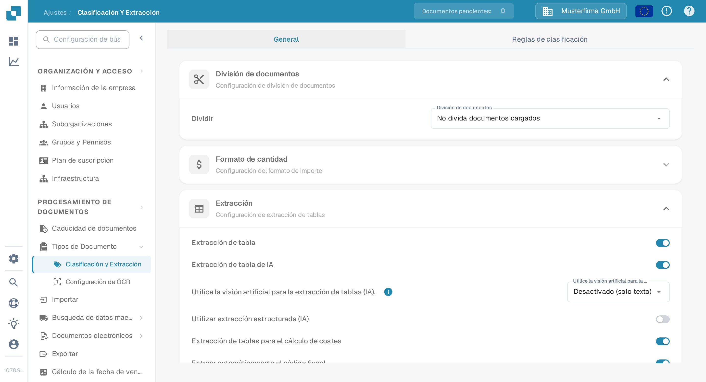
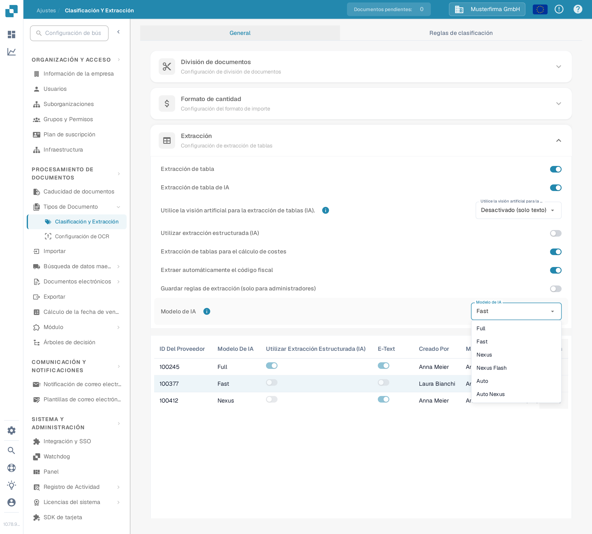
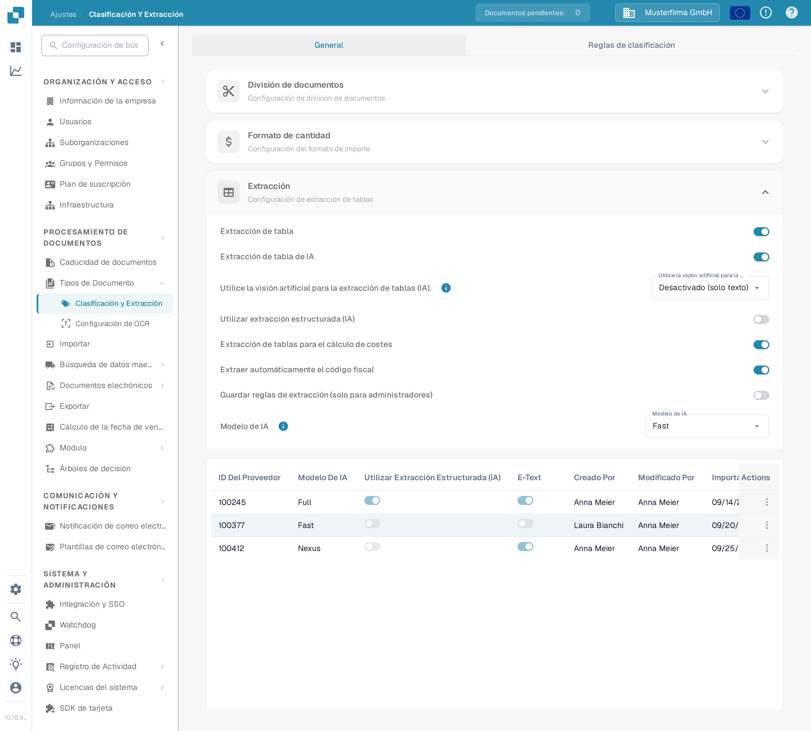
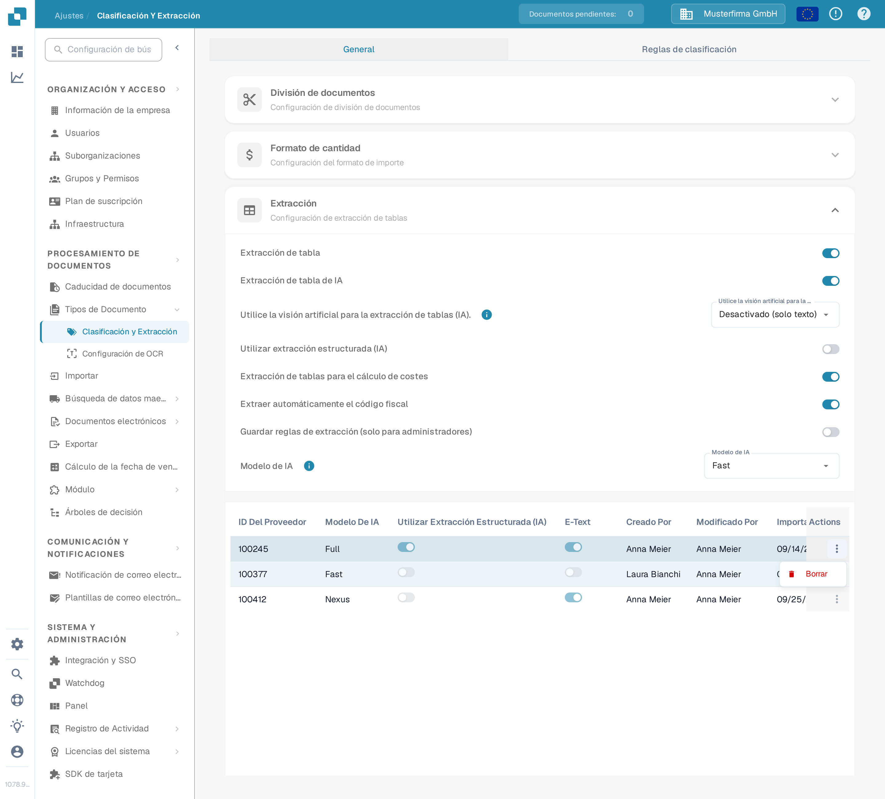
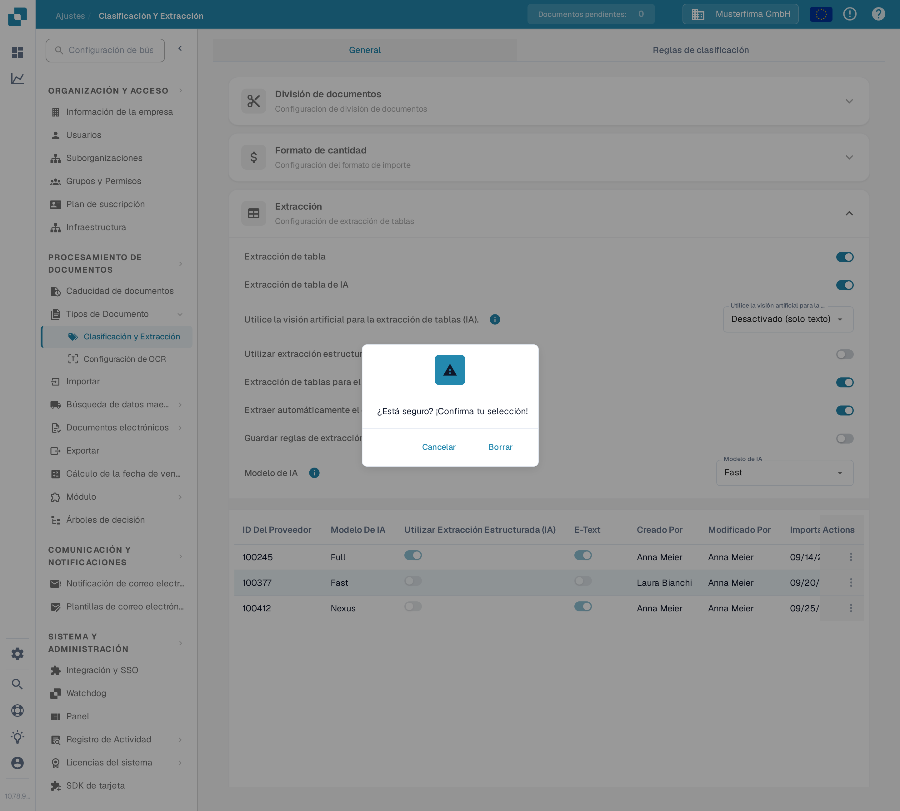

# Modelo de IA

## Descripción general

La configuración del **Modelo de IA** te permite definir qué modelo de IA se utiliza de forma predeterminada para la extracción de campos y la **Extracción de tabla** durante el procesamiento de documentos.\
En esta sección, puedes revisar el costo de tokens para cada modelo y ver qué modelo está actualmente asignado a cada proveedor.

## Cómo acceder

1.  Navega a **Ajustes** → **Procesamiento de documentos** → **Clasificación y extracción**

    <figure><figcaption>
Abre <strong>Ajustes → Procesamiento de documentos → Clasificación y extracción</strong>.
</figcaption></figure>
2.  Desplázate hacia abajo hasta la sección **Extracción**

    <figure><figcaption>
En la sección <strong>Extracción</strong> encontrarás el ajuste <strong>Modelo de IA</strong> y la tabla de asignación por proveedor.
</figcaption></figure>

## Opciones del Modelo de IA

DocBits ofrece seis opciones de modelo de IA para la extracción de campos y tablas. Se diferencian en el equilibrio entre **precisión de extracción**, **velocidad de procesamiento** y **costo de tokens por documento** — así puedes ajustar la opción al tipo de documentos que procesas. Pasa el cursor sobre el icono de información junto al ajuste para ver el costo de tokens de la opción seleccionada actualmente. Si no hay ningún modelo definido para un proveedor, eso significa que se usa Fast.

* **Full** – La opción más exhaustiva, con la mayor precisión de extracción. Ideal para diseños complejos, escaneos de baja calidad o documentos en los que la precisión es lo más importante. Al ser la opción más potente, también es la más lenta, con **2 tokens por documento**.
* **Fast** – Una opción equilibrada que combina alta precisión con un procesamiento más rápido y un costo menor. Es el nivel predeterminado: los proveedores sin modelo de IA propio usan Fast, con **1 token por documento**.
* **Nexus** – Una opción de activación opcional que se ejecuta sobre otra familia de modelos (Qwen 3.8 Max). Útil cuando quieres una segunda opinión para proveedores en los que Fast y Full discrepan, o cuando el modelo alternativo lee mejor un diseño concreto, con **1 token por documento**.
* **Nexus Flash** – Un nivel más rápido de la familia Nexus (GLM-5.3 Flash). Procesa documentos más deprisa que Nexus con el mismo costo en tokens, con **1 token por documento**.
* **Auto** – No es un modelo propio: DocBits decide por documento si Fast es suficiente o si hace falta Full, de modo que los documentos complejos reciben automáticamente el modelo más potente, con **1 token por documento**.
* **Auto Nexus** – Como Auto, pero limitado a la familia de modelos Nexus (Nexus Flash y Nexus). Los documentos quedan por completo fuera de la familia de modelos estándar, con **1 token por documento**.

| Opción | Ideal para | Precisión | Velocidad | Costo de tokens |
|--------|-----------|-----------|-----------|-----------------|
| **Full** | Diseños complejos, escaneos deficientes, alta precisión | Máxima | La más lenta | 2 / documento |
| **Fast** | Documentos habituales (predeterminado si no se define nada) | Alta | Rápida | 1 / documento |
| **Nexus** | Proveedores en los que la familia de modelos alternativa rinde mejor (opcional) | Alta | Rápida | 1 / documento |
| **Nexus Flash** | Calidad Nexus con un procesamiento más rápido | Alta | Más rápida | 1 / documento |
| **Auto** | Calidad de documentos mixta sin ajustes manuales | Por documento | Por documento | 1 / documento |
| **Auto Nexus** | Decisiones automáticas limitadas a la familia Nexus | Por documento | Por documento | 1 / documento |

<figure><figcaption>
El desplegable <strong>Modelo de IA</strong> con las seis opciones disponibles.
</figcaption></figure>

## Tabla de Asignación del Modelo de IA

También puedes configurar **modelos de IA** específicos por proveedor directamente en la pantalla de **Validación**, lo que te permite ajustar la precisión de extracción para proveedores individuales.\
\
Para más información, consulta la documentación correspondiente [aquí](../../../../end-user-and-partner-section/end-user-section/validation-screen/supplier-specific-ai-model-for-field-and-table-extraction.md).

La tabla de asignación muestra la configuración del modelo de IA para cada proveedor e incluye los siguientes detalles:

* **ID Del Proveedor** – El identificador único del proveedor
* **Modelo De IA** – El nivel de IA actualmente asignado al proveedor
* **Utilizar Extracción Estructurada (IA)** – Si la extracción estructurada está activada para ese proveedor
* **E-Text** – Indica si la función E-Text está habilitada
* **Creado Por / Modificado Por / Importado En / Modificado** – Quién definió la entrada y cuándo
* **Actions** – Contiene la opción para eliminar la entrada

<figure><figcaption>
La tabla de asignación muestra el nombre del nivel por proveedor, nunca el identificador interno del modelo.
</figcaption></figure>

### Eliminar entrada – Restablecer configuración específica del proveedor

Para restablecer la configuración del modelo de IA de un proveedor al valor predeterminado:

1.  Haz clic en los tres puntos de la columna **Actions** junto a la entrada del proveedor y selecciona **Borrar**.

    <figure><figcaption>
Abre el menú de acciones de la fila y elige <strong>Borrar</strong>.
</figcaption></figure>
2.  Aparecerá un cuadro de diálogo de confirmación—confirma que deseas eliminar la entrada.

    <figure><figcaption>
Confirma la eliminación en el cuadro de diálogo.
</figcaption></figure>

Una vez eliminada, el proveedor volverá a utilizar el **modelo de IA** predeterminado para la extracción de campos y la **Extracción de tabla**.
